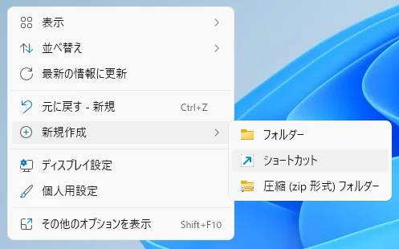
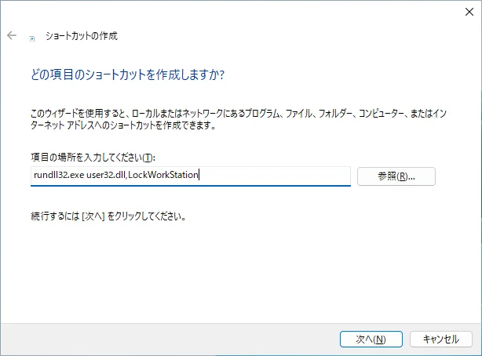
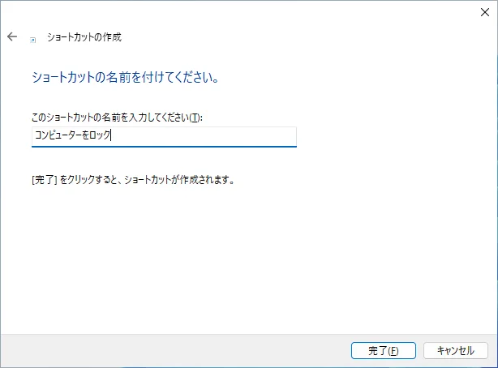
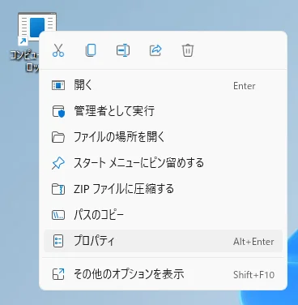
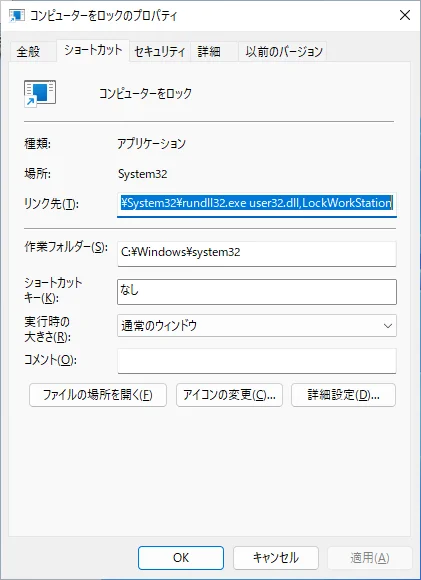
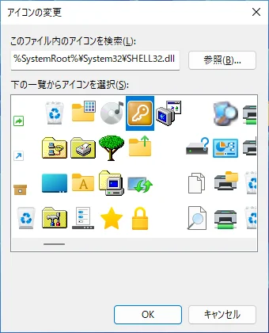
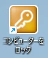

إليك كيفية إنشاء اختصار لقفل الكمبيوتر.

يعد ذلك مفيدًا لأنه يمكنك قفل الكمبيوتر عن طريق النقر المزدوج فوق الاختصار الذي تم إنشاؤه على سطح المكتب.

## طريقة الإنشاء

#### 1. انقر بزر الماوس الأيمن على سطح المكتب وحدد `جديد` > `اختصار`

#### 2. ستظهر شاشة إنشاء الاختصار، أدخل `rundll32.exe user32.dll,LockWorkStation` وانقر على `التالي`

#### 3. أدخل اسم الاختصار `قفل الكمبيوتر` وانقر على `إنهاء`

#### 4. تغيير أيقونة الاختصار الذي تم إنشاؤه

انقر بزر الماوس الأيمن على الاختصار الذي تم إنشاؤه وحدد `خصائص`

انقر على `تغيير الأيقونة`

حدد الأيقونة المربعة الصفراء وانقر على `موافق` ، ثم انقر على `موافق` مرة أخرى لإغلاق الخصائص

هذا كل شيء.

النقر المزدوج على الاختصار الذي تم إنشاؤه سيؤدي إلى قفل الكمبيوتر.

يمكنك أيضًا قفل الكمبيوتر بالضغط على `مفتاح Win` + `مفتاح L`.

※ ملاحظة: لن يتم عرض مربع حوار تأكيد قفل الكمبيوتر.

عند قفل Windows تظل التطبيقات مفتوحة، ويلزم تسجيل الدخول مجددًا للمتابعة. تعرض لقطات الشاشة واجهة Windows اليابانية، لذلك قد تختلف التسميات والتخطيط باختلاف الإصدار ولغة العرض.

## References

- [Microsoft Support: Lock your Windows device](https://support.microsoft.com/en-us/accounts-billing/security/user-account-access-in-windows)
- [Microsoft Learn: LockWorkStation function](https://learn.microsoft.com/en-us/windows/win32/api/winuser/nf-winuser-lockworkstation)
- [Microsoft Learn: Changing computer state with PowerShell](https://learn.microsoft.com/en-us/powershell/scripting/samples/changing-computer-state)
- [Microsoft Learn: rundll32 command](https://learn.microsoft.com/en-us/windows-server/administration/windows-commands/rundll32)
