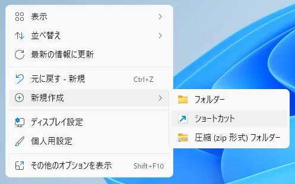
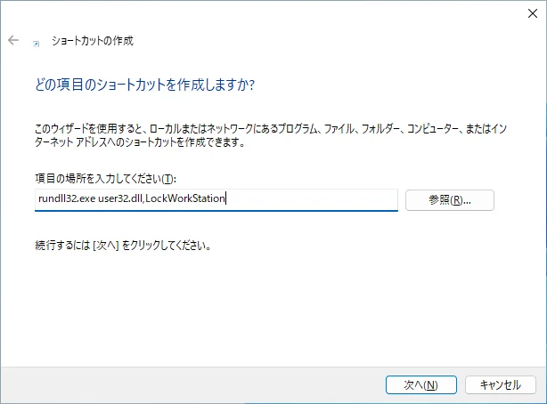
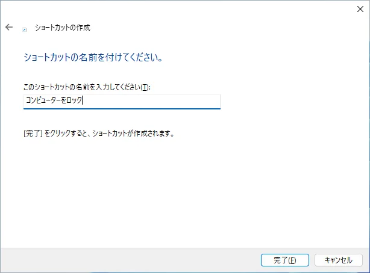
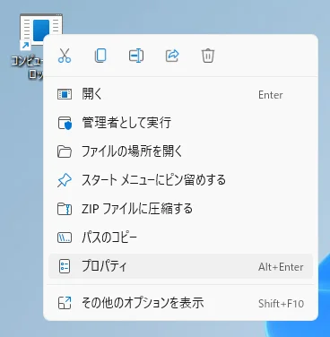
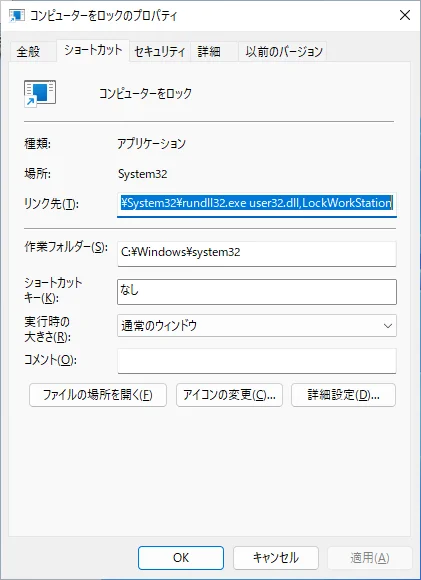
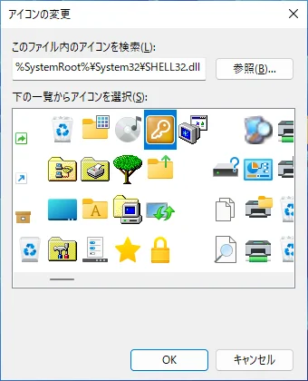
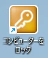

---

title: '¡Bloquea tu PC Windows en 1 segundo! Cómo crear y usar un acceso directo práctico'
slug: "Bloquear computadoraするAtajoを作成する方法"
tags: ["Windows", "Bloquear la computadora", "Acceso directo"]
draft: false
image: "img.webp"
categories: ["pc-gadgets"]
description: 'Explicamos con imágenes cómo crear un acceso directo que te permite bloquear tu PC con Windows con un solo clic. También presentamos el método conveniente usando las teclas Win+L para bloquear la pantalla al instante, como medida de seguridad cuando te alejas de tu asiento.'
date: "2024-04-01T01:37:49+09:00"
lastmod: "2026-11-25T00:00:00+09:00"
---

Aquí te mostramos cómo crear un acceso directo para bloquear la computadora.

Es conveniente porque puedes bloquear la computadora haciendo doble clic en el acceso directo creado en el escritorio u otros lugares.

## Cómo crear

#### 1. Haz clic derecho en el escritorio y selecciona `Nuevo` > `Acceso directo`

#### 2. Aparecerá la pantalla de creación del acceso directo, ingresa `rundll32.exe user32.dll,LockWorkStation` y haz clic en `Siguiente`

#### 3. Ingresa el nombre del acceso directo `Bloquear la computadora` y haz clic en `Finalizar`

#### 4. Cambiar el icono del acceso directo creado

Haz clic derecho en el acceso directo creado y selecciona `Propiedades`

Haz clic en `Cambiar icono`

Selecciona el icono del cuadrado amarillo y haz clic en `Aceptar`, luego haz clic en `Aceptar` nuevamente para cerrar las propiedades

Eso es todo.

Al hacer doble clic en el acceso directo creado, la computadora se bloqueará.

También puedes bloquear la computadora presionando la `tecla Win` + `tecla L`.

※Nota: No se mostrará un cuadro de diálogo de confirmación para bloquear la computadora.

Al bloquear Windows, las aplicaciones siguen abiertas; para continuar, tendrá que volver a iniciar sesión. Las capturas muestran la interfaz japonesa de Windows, por lo que los nombres y la disposición pueden variar según la versión y el idioma.

## References

- [Microsoft Support: Lock your Windows device](https://support.microsoft.com/en-us/accounts-billing/security/user-account-access-in-windows)
- [Microsoft Learn: LockWorkStation function](https://learn.microsoft.com/en-us/windows/win32/api/winuser/nf-winuser-lockworkstation)
- [Microsoft Learn: Changing computer state with PowerShell](https://learn.microsoft.com/en-us/powershell/scripting/samples/changing-computer-state)
- [Microsoft Learn: rundll32 command](https://learn.microsoft.com/en-us/windows-server/administration/windows-commands/rundll32)
