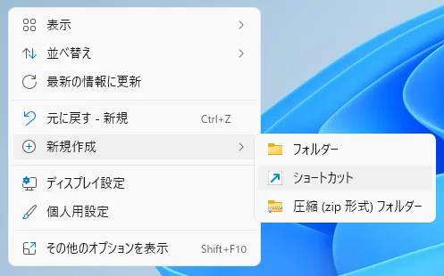
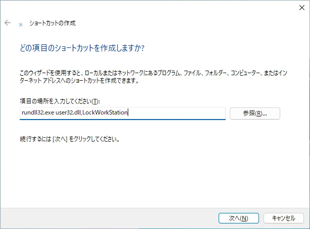
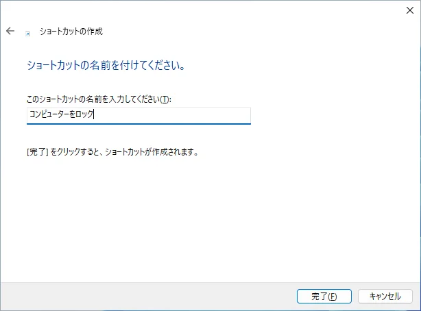
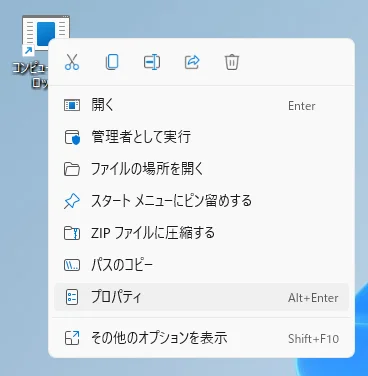
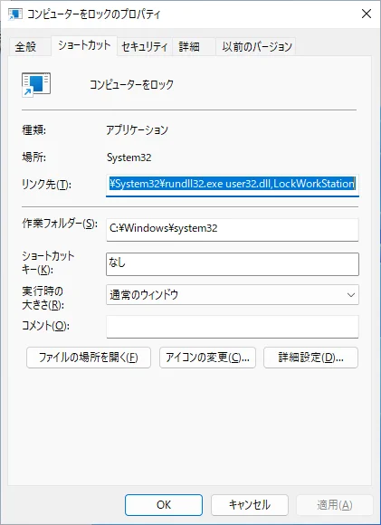
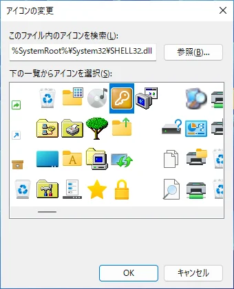
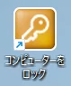

Voici comment créer un raccourci pour verrouiller votre ordinateur.

C'est pratique car vous pouvez verrouiller votre ordinateur en double-cliquant simplement sur le raccourci créé sur votre bureau.

## Comment créer

#### 1. Faites un clic droit sur le bureau, sélectionnez `Nouveau` > `Raccourci`

#### 2. L'écran de création de raccourci apparaîtra, entrez `rundll32.exe user32.dll,LockWorkStation` et cliquez sur `Suivant`

#### 3. Entrez le nom du raccourci `Verrouiller l'ordinateur` et cliquez sur `Terminer`

#### 4. Modifier l'icône du raccourci créé

Faites un clic droit sur le raccourci créé et sélectionnez `Propriétés`

Cliquez sur `Changer d'icône`

Sélectionnez l'icône de cadenas jaune et cliquez sur `OK`, puis cliquez à nouveau sur `OK` pour fermer les propriétés

C'est tout.

Double-cliquer sur le raccourci créé verrouillera l'ordinateur.

Vous pouvez également appuyer sur `Touche Win` + `L` pour verrouiller l'ordinateur de la même manière.

※ Remarque : Aucune boîte de dialogue de confirmation ne s'affichera lors du verrouillage de l'ordinateur.

Le verrouillage de Windows laisse les applications ouvertes ; vous devrez vous reconnecter pour reprendre. Les captures montrent l’interface japonaise de Windows : les libellés et la disposition peuvent varier selon la version et la langue.

## References

- [Microsoft Support: Lock your Windows device](https://support.microsoft.com/en-us/accounts-billing/security/user-account-access-in-windows)
- [Microsoft Learn: LockWorkStation function](https://learn.microsoft.com/en-us/windows/win32/api/winuser/nf-winuser-lockworkstation)
- [Microsoft Learn: Changing computer state with PowerShell](https://learn.microsoft.com/en-us/powershell/scripting/samples/changing-computer-state)
- [Microsoft Learn: rundll32 command](https://learn.microsoft.com/en-us/windows-server/administration/windows-commands/rundll32)
