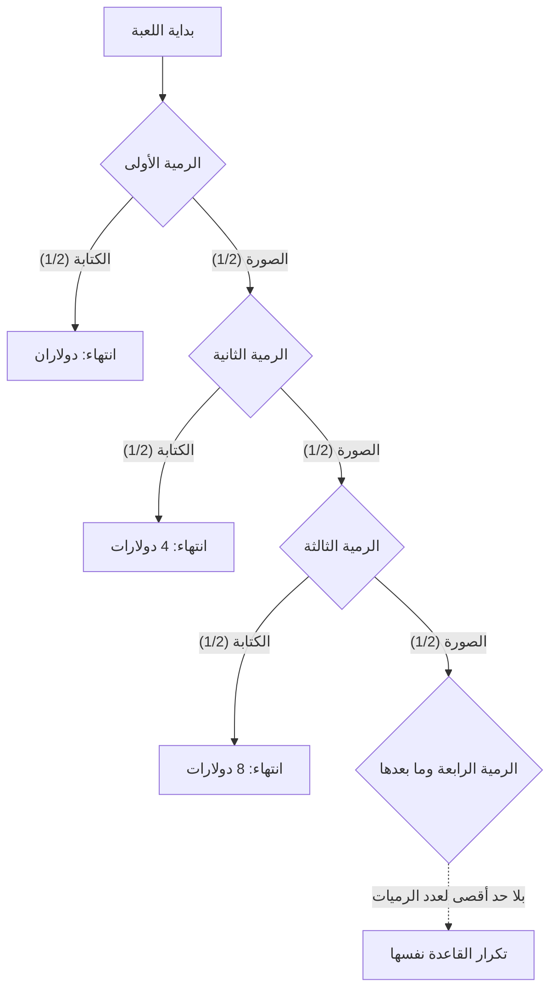

## 1. الرمي حتى ظهور الكتابة لأول مرة

كيف نقيّم لعبة عملة تبلغ رسوم المشاركة فيها 10 000 دولار أمريكي إذا اعتمدنا على القيمة المتوقعة للجائزة وحدها؟ نبدأ **بنموذج مثالي: رميات مستقلة لعملة عادلة، بلا سقف للجائزة وبلا قيود على قدرة المنظّم على الدفع**. المبالغ قيم عددية بوحدة الدولار الأمريكي.

لنسَمِّ أحد وجهَي العملة «الصورة» والآخر «الكتابة».

1. ادفع رسم المشاركة.
2. ارمِ العملة. إذا ظهرت الصورة، ضاعف الجائزة المحتملة وتابع الرمي.
3. عند ظهور الكتابة لأول مرة، تنتهي اللعبة وتحصل على الجائزة عندئذ.

الجائزة الابتدائية 2. إذا ظهرت الكتابة في الرمية الأولى فالجائزة 2؛ وإذا ظهرت الصورة ثم الكتابة فالجائزة 4؛ وإذا ظهرت الصورة مرتين ثم الكتابة فالجائزة 8. نرمز برمز N إلى رقم الرمية التي تظهر فيها الكتابة لأول مرة، وبرمز X إلى الجائزة قبل خصم رسم المشاركة.

$$
X=2^N,\qquad \Pr(N=n)=2^{-n}\quad(n=1,2,\ldots)
$$

يتناقص احتمال الحاجة إلى أكثر من m رمية نحو الصفر مع زيادة m:

$$
\Pr(N>m)=2^{-m}\longrightarrow0,\qquad \Pr(N=\infty)=0,\qquad\Pr(X<\infty)=1
$$

إذن الجائزة **منتهية باحتمال 1**، لكن مجموعة قيمها الممكنة غير محدودة من الأعلى. غياب السقف لا يعني استلام مبلغ لانهائي فعليًا.

## 2. ماذا تعني القيمة المتوقعة اللانهائية؟

القيمة المتوقعة لجائزة متقطعة غير سالبة هي مجموع كل جائزة مضروبة في احتمالها.

| رقم الرمية عند أول ظهور للكتابة | الجائزة | الاحتمال | المساهمة في القيمة المتوقعة غير المشروطة |
| --- | ---: | ---: | ---: |
| 1 | 2 | 1/2 | 1 |
| 2 | 4 | 1/4 | 1 |
| 3 | 8 | 1/8 | 1 |

يسهم كل موعد ممكن لانتهاء اللعبة بمقدار 1، ولذلك

$$
\mathbb E[X]=\sum_{n=1}^{\infty}2^n2^{-n}=\sum_{n=1}^{\infty}1=\infty
$$

عند العلم بأن اللعبة انتهت في الرمية n، تكون الجائزة 2 مرفوعة إلى الأس n، وليست 1. العدد 1 هو **مساهمة ذلك الحدث في القيمة المتوقعة غير المشروطة**.

إذا جمعنا أول K حد فقط نحصل على

$$
\sum_{n=1}^{K}2^n2^{-n}=K
$$

وتزداد المجاميع الجزئية دون حد عند زيادة K. بهذا المعنى تكون القيمة المتوقعة موجب ما لا نهاية. لا يضمن ذلك تحقق جائزة لانهائية أو ربح معيّن خلال عدد منتهٍ من الملاحظات. يناقش [قانون الأعداد الكبيرة](https://kenji.blog/ar/p/law-of-large-numbers/) شروط العلاقة بين متوسط منتهٍ ومتوسط العينة.

حتى بعد طرح رسم مشاركة ثابت ومنتهٍ c، تبقى القيمة المتوقعة لصافي العائد بالمعنى الممتد

$$
\mathbb E[X-c]=\infty\qquad(0\le c<\infty)
$$

لكن القيمة المتوقعة وحدها لا تقيّم احتمال الخسارة الكبيرة، أو القدرة على توفير الرسم، أو قدرة المنظّم الفعلية على الدفع. لا نستنتج من التوقع اللانهائي وجوب الاقتراض للمشاركة.

## 3. التاريخ ومعيار التقييم

تصف [الترجمة الإنجليزية لورقة دانيال برنولي لعام 1738](https://faculty.econ.ucsb.edu/~tedb/Courses/GraduateTheoryUCSB/Bernoulli.pdf) كيف أرسل ابن عمه نيكولاوس برنولي مسائل إلى مونتمور (Montmort). وتشير رسالة كرامر المؤرخة عام 1728 والمقتبسة فيها إلى مسألة في رسالة بتاريخ 9 سبتمبر 1713. يرتبط اسم المفارقة بنشر ورقة دانيال في أعمال أكاديمية العلوم في سانت بطرسبرغ.

تبدأ اللعبة الكلاسيكية المقتبسة في الورقة بجائزة قدرها دوكات واحد. أما نسختنا فتبدأ بدولارين أمريكيين، فلا يجوز نقل قيم المكافئ اليقيني وغيرها بين النسختين دون مراعاة اختلاف المقياس.

تدفعنا المسألة إلى الفصل بين القيمة المتوقعة للمال وكيفية تقييم النتائج المحفوفة بالمخاطر. اقترح دانيال التقييم بالمنفعة وعرض أيضًا أفكارًا مشابهة سابقة لكرامر. هذه تفسيرات تعتمد على نماذج، وليست براهين رياضية عامة على نفسية كل فرد.

## 4. نمذجة تناقص المنفعة الحدية

بعد شرب ماء كافٍ، قد تقل قيمة كوب إضافي. وبالنسبة إلى الثروة، يمكن أيضًا افتراض نموذج تتغير فيه قيمة زيادة مالية ثابتة بحسب مستوى الثروة الأولي.

مثلًا، نفترض منفعة لوغاريتمية للمبالغ الموجبة:

$$
u(x)=\log_2x,\qquad x>0
$$

وتحقق هذه الدالة

$$
u'(x)=\frac{1}{x\ln2}>0,\qquad u''(x)=-\frac{1}{x^2\ln2}<0
$$

تزيد المنفعة بزيادة الثروة، لكن الوحدة الإضافية عند مستوى أعلى من الثروة تعطي زيادة أصغر في المنفعة. هذا هو تناقص المنفعة الحدية في النموذج. وتظل المنفعة اللوغاريتمية نفسها غير محدودة من الأعلى. فتناقص الزيادات ووجود سقف منتهٍ للمنفعة خاصيتان مختلفتان.

دوال المنفعة هذه افتراضات لتمثيل التفضيلات. ليست هناك نتيجة تجريبية تثبت أن رضا جميع الأفراد يتبع الصيغة اللوغاريتمية نفسها.

## 5. المنفعة المتوقعة 2، والمكافئ اليقيني 4، ورسوم المشاركة

نبدأ بمقارنة مبسطة نطبّق فيها المنفعة مباشرة على الجائزة المستلمة. إذا انتهت اللعبة في الرمية n، فالمنفعة

$$
\log_2(2^n)=n
$$

وتكون المنفعة المتوقعة

$$
\mathbb E[u(X)]=\sum_{n=1}^{\infty}n2^{-n}=2
$$

يمكن التحقق من ذلك باستخدام المجاميع الجزئية:

$$
\sum_{n=1}^{K}n2^{-n}=2-\frac{K+2}{2^K}\longrightarrow2
$$

تتقارب متسلسلة المنافع الموزونة بالاحتمالات. لذا يمكن أن تكون المنفعة المتوقعة منتهية حتى لو لم يكن لدالة المنفعة سقف منتهٍ.

المبلغ المؤكد الاستلام الذي يعطي المنفعة نفسها في هذه المقارنة، أي **المكافئ النقدي اليقيني (certainty equivalent, CE)**، هو

$$
\mathrm{CE}=u^{-1}\!\left(\mathbb E[u(X)]\right)=2^2=4
$$

نقارن هنا استلام الجائزة العشوائية X باستلام مبلغ مؤكد قدره 4. **هذا لا يعني أن 4 هو الحد الأعلى لرسوم المشاركة لدى الجميع.**

لاتخاذ قرار دفع الرسم، نضيف الثروة الابتدائية w ورسم المشاركة c. في نموذج بسيط لا يسمح بالاقتراض، نفترض

$$
w>0,\qquad0\le c\le w,\qquad W_{\mathrm{final}}=w-c+X
$$

مع المنفعة اللوغاريتمية نفسها، يكون الفرق بين المنفعة المتوقعة للمشاركة ومنفعة عدم المشاركة

$$
G_w(c)=\sum_{n=1}^{\infty}2^{-n}\log_2(w-c+2^n)-\log_2w
$$

إذا كان الفرق موجبًا، تُفضَّل المشاركة في هذا النموذج؛ وإذا كان صفرًا، لا يُفضَّل أحد الخيارين على الآخر؛ وإذا كان سالبًا، يُفضَّل عدم المشاركة. عندما تكون w أكبر من 4، يكون الفرق متصلًا ومتناقصًا تمامًا مع c، ويأخذ قيمة موجبة عندما يكون الرسم صفرًا، وقيمة سالبة عندما يساوي الرسم الثروة w. لذلك يوجد رسم مشاركة وحيد تتساوى عنده المنفعتان:

$$
G_w(c^\ast)=0,\qquad0<c^\ast<w\quad(w>4)
$$

بحل المتسلسلة عدديًا نحصل مثلًا على القيم التقريبية التالية:

| الثروة الابتدائية w | رسم c* تقريبي لتساوي المنفعتين |
| ---: | ---: |
| 10 | 4.97 |
| 100 | 7.79 |
| 1 000 | 10.95 |

إدراج الثروة يغيّر التقييم حتى مع دالة المنفعة نفسها. ويختلف أيضًا مقدار الزيادة المؤكدة في الثروة المكافئة ليانصيب نملكه بالفعل عن سعر شرائه الذي تتساوى عنده منفعتا الشراء وعدم الشراء. يميّز برنولي نفسه في الفقرة 19 بين سعر الشراء وقيمة الفرصة المملوكة بالفعل.

## 6. وضع سقف للجائزة

تراعي النماذج الواقعية سقف الجائزة في العقد والقدرة على الدفع. مثلًا، نحدد السقف عند 2 مرفوعة إلى الأس K: عند أول ظهور للكتابة، يُدفع الأصغر من الجائزة X وفق القواعد الأصلية والسقف المحدد.

$$
X_K=\min(X,2^K),\qquad K\in\{1,2,\ldots\}
$$

احتمال أن تكون N أكبر من أو مساوية لـK هو مقلوب 2 مرفوعة إلى الأس K−1، ولذلك

$$
\mathbb E[X_K]=\sum_{n=1}^{K-1}2^n2^{-n}+2^K\Pr(N\ge K)=(K-1)+2=K+1
$$

عندما يكون السقف 1 024، أي K تساوي 10، تكون القيمة المتوقعة للجائزة 11. مجموع أول K حد من التوقع الأصلي يساوي K، أما توقع العقد المحدود بهذه القاعدة فيساوي K+1. وإذا غيّرنا قاعدة الدفع عند الإيقاف المبكر، نحصل على لعبة مختلفة.

## 7. منظور اقتصادي يوضح الافتراضات

تطبّق ورقة برنولي نماذج الثروة والمنفعة على التأمين وتوزيع الشحنات على السفن أيضًا. المنفعة المتوقعة أحد أطر التفكير في الاختيارات المحفوفة بالمخاطر. وتؤثر الأسعار والاعتماد بين الخسائر وقيود التمويل أيضًا في تقييم التأمين والتنويع؛ فلا يفسّر مبدأ نفسي واحد جميع القرارات.

**تقعّر المنفعة بوصفها دالة في مستوى الثروة، والنفور من الخسارة بوصفه عدم تناظر في تقييم المكاسب والخسائر بالنسبة إلى نقطة مرجعية، مفهومان مختلفان.** تناقش [ورقة تفيرسكي وكانيمان لعام 1981](https://www.stanford.edu/class/psych205/papers/Tversky-Kahneman-1981.pdf) النقاط المرجعية وقيمة المكاسب والخسائر وأوزان القرار، وتذكر أن هذه الخصائص ليست عامة لدى جميع الأفراد.

تميّز مفارقة سانت بطرسبرغ بين النموذج الاحتمالي والقيمة المتوقعة للمال والتفضيلات والقيود. ويساعد توضيح الافتراضات والمعلومات التي تُحسب الاحتمالات في ضوئها على فهم [مفارقة المظروفين](https://kenji.blog/ar/p/two-envelopes-paradox/) و[نظرية بايز](https://kenji.blog/ar/p/bayes-theorem/) أيضًا.
