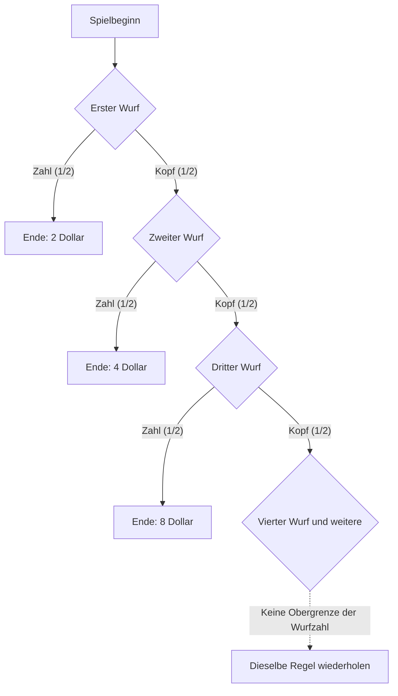

## 1. Spielen, bis zum ersten Mal Zahl fällt

Wie beurteilen wir ein Münzwurfspiel mit einer Teilnahmegebühr von 10 000 US-Dollar allein anhand der erwarteten Auszahlung? Zunächst betrachten wir ein **ideales Modell: unabhängige Würfe mit einer fairen Münze, ohne Obergrenze für die Auszahlung und ohne Beschränkung der Zahlungsfähigkeit des Veranstalters**. Geldbeträge sind Zahlenwerte in US-Dollar.

1. Die Teilnahmegebühr wird bezahlt.
2. Die Münze wird geworfen. Bei Kopf verdoppelt sich die mögliche Auszahlung, und das Spiel geht weiter.
3. Sobald erstmals Zahl fällt, endet das Spiel; der erreichte Betrag wird ausgezahlt.

Der Anfangsbetrag ist 2. Bei Zahl im ersten Wurf beträgt die Auszahlung 2; bei Kopf und anschließend Zahl 4; bei Kopf, Kopf und anschließend Zahl 8. N bezeichnet die Nummer des Wurfs, bei dem erstmals Zahl fällt, und X die Auszahlung vor Abzug der Teilnahmegebühr.

$$
X=2^N,\qquad \Pr(N=n)=2^{-n}\quad(n=1,2,\ldots)
$$

Die Wahrscheinlichkeit, mehr als m Würfe zu benötigen, geht mit wachsendem m gegen null:

$$
\Pr(N>m)=2^{-m}\longrightarrow0,\qquad \Pr(N=\infty)=0,\qquad\Pr(X<\infty)=1
$$

Die Auszahlung ist also **mit Wahrscheinlichkeit 1 endlich**, ihre möglichen Werte haben jedoch keine endliche obere Schranke. Eine nach oben unbeschränkte Verteilung bedeutet nicht, dass tatsächlich eine unendliche Summe ausgezahlt wird.

## 2. Was ein unendlicher Erwartungswert bedeutet

Der Erwartungswert einer nichtnegativen diskreten Auszahlung ist die Summe aller Beträge, jeweils multipliziert mit ihrer Wahrscheinlichkeit.

| Zum ersten Mal Zahl bei Wurf | Auszahlung | Wahrscheinlichkeit | Beitrag zum unbedingten Erwartungswert |
| --- | ---: | ---: | ---: |
| 1 | 2 | 1/2 | 1 |
| 2 | 4 | 1/4 | 1 |
| 3 | 8 | 1/8 | 1 |

Jeder mögliche Endzeitpunkt trägt 1 bei. Deshalb gilt

$$
\mathbb E[X]=\sum_{n=1}^{\infty}2^n2^{-n}=\sum_{n=1}^{\infty}1=\infty
$$

Unter der Bedingung, dass das Spiel bei Wurf n endet, beträgt die Auszahlung 2 hoch n, nicht 1. Die 1 ist der **Beitrag dieses Ereignisses zum unbedingten Erwartungswert**.

Die ersten K Summanden ergeben

$$
\sum_{n=1}^{K}2^n2^{-n}=K
$$

und diese Partialsummen wachsen mit K über jede Grenze. In diesem Sinn ist der Erwartungswert unendlich groß. Das garantiert weder eine unendliche Auszahlung noch einen bestimmten Gewinn bei endlich vielen Beobachtungen. Das [Gesetz der großen Zahlen](https://kenji.blog/de/p/law-of-large-numbers/) behandelt die Voraussetzungen für den Zusammenhang zwischen endlichen Erwartungswerten und Stichprobenmitteln.

Auch nach Abzug einer festen, endlichen Teilnahmegebühr c bleibt der Erwartungswert des Nettogewinns im erweiterten Sinn

$$
\mathbb E[X-c]=\infty\qquad(0\le c<\infty)
$$

Dieser Erwartungswert allein bewertet aber weder die Möglichkeit eines hohen Verlusts noch die Finanzierbarkeit der Gebühr oder die Zahlungsfähigkeit des Veranstalters. Aus einem unendlichen Erwartungswert folgt nicht, dass man sich für die Teilnahme verschulden sollte.

## 3. Geschichte und Bewertungsmaßstab

Die [englische Übersetzung von Daniel Bernoullis Aufsatz aus dem Jahr 1738](https://faculty.econ.ucsb.edu/~tedb/Courses/GraduateTheoryUCSB/Bernoulli.pdf) beschreibt, wie sein Cousin Nicolaus Bernoulli Montmort Probleme zusandte. Ein darin zitierter Brief Cramers von 1728 verweist auf das Problem aus dem Brief vom 9. September 1713. Der Name des Paradoxons hängt mit der Veröffentlichung von Daniels Aufsatz in den Abhandlungen der Akademie der Wissenschaften in Sankt Petersburg zusammen.

Das dort zitierte klassische Spiel beginnt mit einer Auszahlung von einem Dukaten. Hier verwenden wir einen Anfangsbetrag von 2 Dollar. Sicherheitsäquivalente und andere Geldbeträge dürfen daher nicht ohne Anpassung der Skala übernommen werden.

Das Problem regt dazu an, den erwarteten Geldbetrag von der Bewertung riskanter Ergebnisse zu unterscheiden. Daniel schlug eine Bewertung anhand des Nutzens vor und stellte auch ähnliche frühere Ideen Cramers vor. Solche Erklärungen beruhen auf Modellen; sie sind keine universellen mathematischen Beweise für die Psychologie jedes Menschen.

## 4. Abnehmenden Grenznutzen modellieren

Wer bereits genug Wasser getrunken hat, bewertet ein weiteres Glas möglicherweise geringer. Auch beim Vermögen lässt sich modellieren, dass der Wert eines festen Geldzuwachses vom Ausgangsniveau abhängt.

Beispielsweise setzen wir für positive Beträge einen logarithmischen Nutzen an:

$$
u(x)=\log_2x,\qquad x>0
$$

Diese Funktion erfüllt

$$
u'(x)=\frac{1}{x\ln2}>0,\qquad u''(x)=-\frac{1}{x^2\ln2}<0
$$

Mit dem Vermögen steigt auch der Nutzen, doch eine zusätzliche Einheit bewirkt bei höherem Vermögen einen kleineren Nutzenzuwachs. Das ist der abnehmende Grenznutzen in diesem Modell. Der logarithmische Nutzen selbst wächst weiterhin ohne obere Schranke. Abnehmende Zuwächse und eine endliche obere Nutzengrenze sind unterschiedliche Eigenschaften.

Solche Nutzenfunktionen sind Annahmen zur Darstellung von Präferenzen, keine empirische Feststellung, dass die Zufriedenheit aller Menschen derselben logarithmischen Formel folgt.

## 5. Erwarteter Nutzen 2, Sicherheitsäquivalent 4 und Teilnahmegebühr

Zunächst vergleichen wir vereinfacht, indem wir den Nutzen direkt auf die erhaltene Auszahlung anwenden. Endet das Spiel bei Wurf n, beträgt der Nutzen

$$
\log_2(2^n)=n
$$

und der erwartete Nutzen ist

$$
\mathbb E[u(X)]=\sum_{n=1}^{\infty}n2^{-n}=2
$$

Die Partialsummen bestätigen dies:

$$
\sum_{n=1}^{K}n2^{-n}=2-\frac{K+2}{2^K}\longrightarrow2
$$

Die mit Wahrscheinlichkeiten gewichtete Nutzenreihe konvergiert. Somit kann der erwartete Nutzen endlich sein, obwohl die Nutzenfunktion nach oben unbeschränkt ist.

Der sichere Auszahlungsbetrag mit demselben Nutzen in diesem Vergleich, das **Sicherheitsäquivalent (CE)**, ist

$$
\mathrm{CE}=u^{-1}\!\left(\mathbb E[u(X)]\right)=2^2=4
$$

Verglichen werden die zufällige Auszahlung X und eine sichere Auszahlung von 4. **Das bedeutet keine allgemeingültige Obergrenze von 4 für die Teilnahmegebühr.**

Für die Entscheidung, ob man die Gebühr bezahlt, müssen Anfangsvermögen w und Gebühr c einbezogen werden. Ein einfaches Modell ohne Kreditaufnahme verwendet folgende Größen und Bedingungen:

$$
w>0,\qquad0\le c\le w,\qquad W_{\mathrm{final}}=w-c+X
$$

Bei demselben logarithmischen Nutzen ist die Differenz zwischen erwartetem Nutzen bei Teilnahme und Nutzen bei Nichtteilnahme

$$
G_w(c)=\sum_{n=1}^{\infty}2^{-n}\log_2(w-c+2^n)-\log_2w
$$

Eine positive Differenz spricht in diesem Modell für die Teilnahme, null bedeutet Indifferenz, eine negative Differenz spricht für die Nichtteilnahme. Für w größer als 4 ist die Differenz stetig und streng fallend in c, positiv bei c gleich 0 und negativ bei c gleich w. Es gibt daher genau eine Teilnahmegebühr, bei der der Spieler zwischen beiden Entscheidungen indifferent ist:

$$
G_w(c^\ast)=0,\qquad0<c^\ast<w\quad(w>4)
$$

Die numerische Lösung der Reihe liefert diese Beispiele:

| Anfangsvermögen w | Ungefährer Indifferenzpreis c* |
| ---: | ---: |
| 10 | 4,97 |
| 100 | 7,79 |
| 1 000 | 10,95 |

Selbst bei derselben Nutzenfunktion ändert die Berücksichtigung des Vermögens die Bewertung. Der sichere Vermögenszuwachs, der einer bereits gehaltenen Lotterie entspricht, unterscheidet sich zudem vom Indifferenzpreis für ihren Kauf. Bernoulli selbst unterscheidet in Abschnitt 19 zwischen Kaufpreis und Wert einer bereits vorhandenen Gewinnmöglichkeit.

## 6. Die Auszahlung begrenzen

Ein praktisches Modell muss auch Vertragsgrenzen und Zahlungsfähigkeit berücksichtigen. Legen wir etwa eine Obergrenze von 2 hoch K fest: Sobald erstmals Zahl fällt, wird der kleinere Wert aus ursprünglichem Betrag und Obergrenze ausgezahlt.

$$
X_K=\min(X,2^K),\qquad K\in\{1,2,\ldots\}
$$

Die Wahrscheinlichkeit, dass N mindestens K ist, beträgt den Kehrwert von 2 hoch K−1. Daher gilt

$$
\mathbb E[X_K]=\sum_{n=1}^{K-1}2^n2^{-n}+2^K\Pr(N\ge K)=(K-1)+2=K+1
$$

Bei einer Obergrenze von 1 024, also K gleich 10, ist die erwartete Auszahlung 11. Die ersten K Summanden des ursprünglichen Erwartungswerts ergeben K; der begrenzte Vertrag hat dagegen den Erwartungswert K+1. Eine andere Zahlungsregel bei vorzeitigem Abbruch definiert ein anderes Spiel.

## 7. Eine ökonomische Perspektive mit ausdrücklichen Annahmen

Bernoulli wendet Vermögens- und Nutzenmodelle auch auf Versicherungen und die Verteilung von Waren auf mehrere Schiffe an. Erwarteter Nutzen ist ein Rahmen für Überlegungen zu riskanten Entscheidungen. Preise, Abhängigkeiten zwischen Verlusten und Finanzierungsbeschränkungen sind für Versicherung und Diversifikation ebenfalls wichtig; ein einzelnes psychologisches Prinzip erklärt nicht jede Entscheidung.

**Die Konkavität des Nutzens über dem Vermögen und Verlustaversion als Asymmetrie von Gewinnen und Verlusten relativ zu einem Referenzpunkt sind unterschiedliche Begriffe.** [Tversky und Kahneman behandeln in ihrem Aufsatz von 1981](https://www.stanford.edu/class/psych205/papers/Tversky-Kahneman-1981.pdf) Referenzpunkte, den Wert von Gewinnen und Verlusten sowie Entscheidungsgewichte und weisen darauf hin, dass diese Eigenschaften nicht für alle Menschen universell gelten.

Das Sankt-Petersburg-Paradoxon unterscheidet Wahrscheinlichkeitsmodell, erwarteten Geldbetrag, Präferenzen und Beschränkungen. Auch das [Zwei-Umschläge-Paradoxon](https://kenji.blog/de/p/two-envelopes-paradox/) und der [Satz von Bayes](https://kenji.blog/de/p/bayes-theorem/) werden verständlicher, wenn Annahmen und bedingende Informationen ausdrücklich genannt werden.
