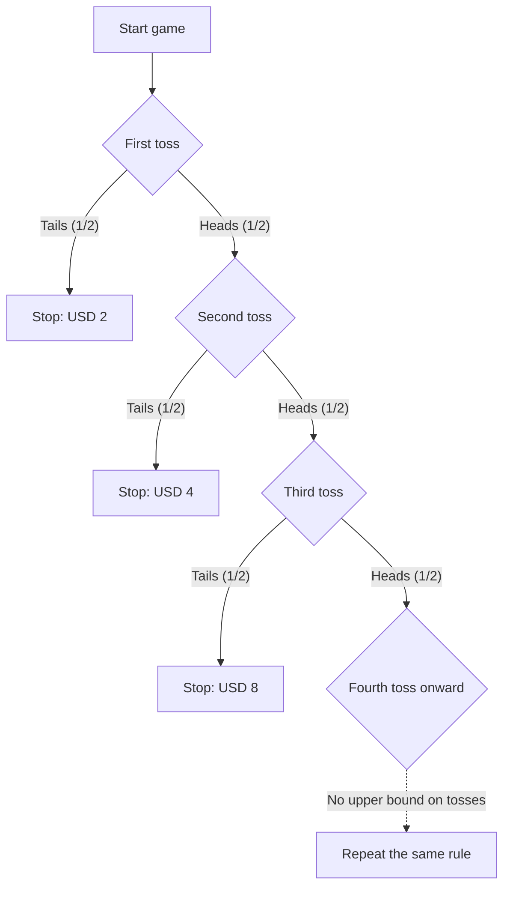

## 1. Play until the first tails

How should we assess a coin-toss game with an entry fee of USD 10 000 using expected prize money? Start with an **ideal model: independent tosses of a fair coin, no prize cap, and no limit on the organizer's ability to pay**. Monetary amounts are numerical values in US dollars.

1. Pay an entry fee.
2. Toss the coin. On heads, double the potential prize and continue.
3. Stop at the first tails and receive the prize reached at that point.

The initial prize is 2. Tails on the first toss pays 2, heads then tails pays 4, and heads, heads, tails pays 8. Let N be the first toss that lands tails and X the gross prize before the entry fee.

$$
X=2^N,\qquad \Pr(N=n)=2^{-n}\quad(n=1,2,\ldots)
$$

The probability that the game outlasts a finite number of tosses tends to zero as that number grows:

$$
\Pr(N>m)=2^{-m}\longrightarrow0,\qquad \Pr(N=\infty)=0,\qquad\Pr(X<\infty)=1
$$

Thus the prize is **finite with probability 1**, while its possible values have no finite upper bound. An unbounded prize distribution does not mean that the player actually receives an infinite prize.

## 2. What infinite expectation means

The expectation of a nonnegative discrete prize is the sum of each prize multiplied by its probability.

| First tails on toss | Prize | Probability | Contribution to unconditional expectation |
| --- | ---: | ---: | ---: |
| 1 | 2 | 1/2 | 1 |
| 2 | 4 | 1/4 | 1 |
| 3 | 8 | 1/8 | 1 |

Each possible stopping time contributes 1, giving

$$
\mathbb E[X]=\sum_{n=1}^{\infty}2^n2^{-n}=\sum_{n=1}^{\infty}1=\infty
$$

Conditional on ending at toss n, the prize is 2 to the power n, not 1. The number 1 is that event's **contribution to the unconditional expectation**.

The first K terms alone give

$$
\sum_{n=1}^{K}2^n2^{-n}=K
$$

and these partial sums grow without bound as K increases. This is the meaning of positive infinite expectation. It does not imply an infinite prize or a guaranteed profit in a finite set of observations. The [law of large numbers](https://kenji.blog/en/p/law-of-large-numbers/) discusses the assumptions connecting ordinary finite means and sample averages.

Subtracting a finite, fixed entry fee c still gives the extended expected net payoff

$$
\mathbb E[X-c]=\infty\qquad(0\le c<\infty)
$$

But expected net payoff alone does not assess the possibility of a large loss, whether the player can fund the fee, or whether the organizer can pay. Infinite expectation does not imply that the player should borrow to participate.

## 3. History and the criterion of evaluation

The [English translation of Daniel Bernoulli's 1738 paper](https://faculty.econ.ucsb.edu/~tedb/Courses/GraduateTheoryUCSB/Bernoulli.pdf) describes his cousin Nicolaus Bernoulli's submission of problems to Montmort. A 1728 letter from Cramer, quoted in the paper, refers to a problem in the letter dated 9 September 1713. The paradox's name is associated with the publication of Daniel's paper in the proceedings of the academy of sciences in St. Petersburg.

The classical game quoted in that paper starts with a prize of one ducat. This article uses an initial prize of USD 2, so numerical certainty equivalents and other monetary results should not be carried over unchanged.

The problem invites us to distinguish expected money from the evaluation of risky outcomes. Daniel proposed a utility-based approach and also reported Cramer's similar earlier ideas. Such explanations depend on models; they are not universal mathematical proofs of every individual's psychology.

## 4. Modeling diminishing marginal utility

After enough water, an additional glass may become less valuable. For wealth, too, we can model the value of a fixed monetary increment as depending on the starting level.

For example, use logarithmic utility for positive amounts:

$$
u(x)=\log_2x,\qquad x>0
$$

This function satisfies

$$
u'(x)=\frac{1}{x\ln2}>0,\qquad u''(x)=-\frac{1}{x^2\ln2}<0
$$

Utility increases with wealth, but an extra unit produces a smaller utility increment at higher wealth. This is diminishing marginal utility in this model. Logarithmic utility itself remains unbounded above. Diminishing increments and a finite upper bound on utility are different properties.

Utility functions of this kind are assumptions representing preferences, not an empirical finding that every person's satisfaction follows the same logarithmic formula.

## 5. Expected utility 2, certainty equivalent 4, and the entry fee

First make a simplified comparison by applying the utility function directly to the prize received. Ending at toss n gives utility

$$
\log_2(2^n)=n
$$

so expected utility is

$$
\mathbb E[u(X)]=\sum_{n=1}^{\infty}n2^{-n}=2
$$

The partial sums verify this:

$$
\sum_{n=1}^{K}n2^{-n}=2-\frac{K+2}{2^K}\longrightarrow2
$$

The probability-weighted utility series converges, so expected utility can be finite even though the utility function is unbounded.

The certain receipt giving the same utility in this comparison, the **certainty equivalent**, is

$$
\mathrm{CE}=u^{-1}\!\left(\mathbb E[u(X)]\right)=2^2=4
$$

This compares receiving the lottery prize X with receiving 4 for certain. **It is not a universal entry-fee ceiling of 4.**

To decide whether to pay a fee, include initial wealth w and fee c. A simple model without borrowing uses

$$
w>0,\qquad0\le c\le w,\qquad W_{\mathrm{final}}=w-c+X
$$

Under the same logarithmic utility, the difference between expected utility from playing and utility from not playing is

$$
G_w(c)=\sum_{n=1}^{\infty}2^{-n}\log_2(w-c+2^n)-\log_2w
$$

A positive difference favors participation in this model, zero means indifference, and a negative difference favors not playing. If w exceeds 4, the difference is continuous and strictly decreasing in c, positive at c equal to 0 and negative at c equal to w. There is therefore a unique indifference fee:

$$
G_w(c^\ast)=0,\qquad0<c^\ast<w\quad(w>4)
$$

Solving the series numerically gives these examples:

| Initial wealth w | Approximate indifference fee c* |
| ---: | ---: |
| 10 | 4.97 |
| 100 | 7.79 |
| 1 000 | 10.95 |

Including wealth changes the evaluation even with the same utility function. The certainty-equivalent increment for an already-owned lottery also differs from the indifference price for buying it. Bernoulli himself discusses purchase price versus the value of an opportunity already held in section 19.

## 6. Capping the prize

A practical model should include the contract's prize limits and payment capacity. For example, specify a cap of 2 to the power K: at the first tails, pay the smaller of the original prize and the cap.

$$
X_K=\min(X,2^K),\qquad K\in\{1,2,\ldots\}
$$

The probability that N is at least K is the reciprocal of 2 to the power K−1, so

$$
\mathbb E[X_K]=\sum_{n=1}^{K-1}2^n2^{-n}+2^K\Pr(N\ge K)=(K-1)+2=K+1
$$

A cap of 1 024, or K equal to 10, gives an expected prize of 11. The first K terms of the original expectation sum to K; the capped contract has expectation K+1. Changing what is paid when a game is stopped early defines a different game.

## 7. An economic perspective that makes assumptions explicit

Bernoulli also applied wealth and utility models to insurance and dividing cargo across shipments. Expected utility is one framework for considering risky choices. Prices, dependence between losses, and funding constraints also affect insurance and diversification; a single psychological principle does not explain every decision.

**Concavity of utility over wealth and loss aversion as an asymmetry between gains and losses relative to a reference point are distinct concepts.** [Tversky and Kahneman's 1981 paper](https://www.stanford.edu/class/psych205/papers/Tversky-Kahneman-1981.pdf) discusses reference points, values of gains and losses, and decision weights, while noting that these properties are not universal across individuals.

The St. Petersburg paradox separates the probability model, expected money, preferences, and constraints. The [two-envelope paradox](https://kenji.blog/en/p/two-envelopes-paradox/) and [Bayes' theorem](https://kenji.blog/en/p/bayes-theorem/) likewise become easier to interpret when the assumptions and conditioning information are explicit.
