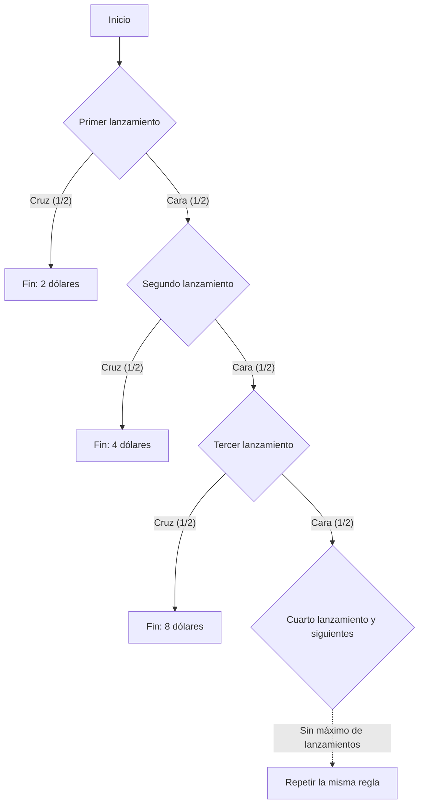

## 1. Jugar hasta la primera cruz

¿Cómo evaluaríamos, usando solo el premio esperado, un juego de moneda cuya entrada cuesta 10 000 dólares estadounidenses? Partamos de un **modelo ideal: lanzamientos independientes de una moneda equilibrada, sin límite al premio ni a la capacidad de pago del organizador**. Los importes son valores numéricos expresados en dólares estadounidenses.

1. Se paga una cuota de entrada.
2. Se lanza la moneda. Si sale cara, se duplica el premio potencial y se continúa.
3. El juego termina con la primera cruz y se recibe el premio alcanzado.

El premio inicial es 2. Si sale cruz en el primer lanzamiento, se reciben 2; si sale cara y después cruz, 4; con dos caras seguidas de cruz, 8. Sea N el número del lanzamiento en que aparece la primera cruz y X el premio bruto, antes de descontar la entrada.

$$
X=2^N,\qquad \Pr(N=n)=2^{-n}\quad(n=1,2,\ldots)
$$

La probabilidad de que el juego dure más que un número finito de lanzamientos tiende a cero cuando ese número aumenta:

$$
\Pr(N>m)=2^{-m}\longrightarrow0,\qquad \Pr(N=\infty)=0,\qquad\Pr(X<\infty)=1
$$

Por tanto, el premio es **finito con probabilidad 1**, aunque sus posibles valores no tienen una cota superior finita. Que los premios no estén acotados no significa que el jugador reciba realmente un premio infinito.

## 2. Qué significa un valor esperado infinito

El valor esperado de un premio discreto no negativo es la suma de cada premio multiplicado por su probabilidad.

| Primera cruz en el lanzamiento | Premio | Probabilidad | Contribución al valor esperado incondicional |
| --- | ---: | ---: | ---: |
| 1 | 2 | 1/2 | 1 |
| 2 | 4 | 1/4 | 1 |
| 3 | 8 | 1/8 | 1 |

Cada posible momento de finalización aporta 1, de modo que

$$
\mathbb E[X]=\sum_{n=1}^{\infty}2^n2^{-n}=\sum_{n=1}^{\infty}1=\infty
$$

Si sabemos que el juego termina en el lanzamiento n, el premio es 2 elevado a n, no 1. Ese 1 es la **contribución del suceso al valor esperado incondicional**.

Los primeros K términos dan

$$
\sum_{n=1}^{K}2^n2^{-n}=K
$$

y estas sumas parciales crecen sin cota al aumentar K. En este sentido el valor esperado es infinito positivo. No implica un premio infinito ni un beneficio garantizado en un conjunto finito de observaciones. La [ley de los grandes números](https://kenji.blog/es/p/law-of-large-numbers/) explica las hipótesis que relacionan las medias finitas habituales y las medias muestrales.

Restar una cuota fija y finita c sigue dando el valor esperado neto, en sentido extendido,

$$
\mathbb E[X-c]=\infty\qquad(0\le c<\infty)
$$

Pero ese valor por sí solo no evalúa la posibilidad de una pérdida importante, si el jugador puede financiar la entrada o si el organizador puede pagar. Un valor esperado infinito no implica que haya que endeudarse para participar.

## 3. Historia y criterio de evaluación

La [traducción al inglés del artículo de Daniel Bernoulli de 1738](https://faculty.econ.ucsb.edu/~tedb/Courses/GraduateTheoryUCSB/Bernoulli.pdf) relata cómo su primo Nicolaus Bernoulli envió problemas a Montmort. Una carta de Cramer de 1728, citada en el artículo, remite al problema de la carta del 9 de septiembre de 1713. El nombre de la paradoja está relacionado con la publicación del artículo de Daniel en las actas de la Academia de Ciencias de San Petersburgo.

El juego clásico citado en ese artículo empieza con un premio de un ducado. Aquí usamos un premio inicial de 2 dólares, por lo que sus equivalentes ciertos y otros resultados monetarios no deben trasladarse sin cambiar la escala.

El problema invita a distinguir el valor esperado monetario de la evaluación de resultados arriesgados. Daniel propuso una evaluación basada en la utilidad y también presentó ideas anteriores similares de Cramer. Estas explicaciones dependen de modelos; no son pruebas matemáticas universales de la psicología de cada persona.

## 4. Modelar la utilidad marginal decreciente

Tras beber suficiente agua, un vaso adicional puede resultar menos valioso. Para la riqueza también podemos modelar el valor de un incremento monetario fijo como dependiente del nivel inicial.

Por ejemplo, usemos una utilidad logarítmica para importes positivos:

$$
u(x)=\log_2x,\qquad x>0
$$

Esta función cumple

$$
u'(x)=\frac{1}{x\ln2}>0,\qquad u''(x)=-\frac{1}{x^2\ln2}<0
$$

La utilidad aumenta con la riqueza, pero cada unidad adicional produce un incremento de utilidad menor a niveles de riqueza mayores. Es la utilidad marginal decreciente de este modelo. La propia utilidad logarítmica sigue sin estar acotada superiormente: incrementos decrecientes y una cota superior finita son propiedades distintas.

Estas funciones de utilidad son hipótesis para representar preferencias, no una constatación empírica de que la satisfacción de todo el mundo siga la misma fórmula logarítmica.

## 5. Utilidad esperada 2, equivalente cierto 4 y cuota de entrada

Primero hagamos una comparación simplificada aplicando la utilidad directamente al premio recibido. Si el juego termina en el lanzamiento n, la utilidad es

$$
\log_2(2^n)=n
$$

por lo que la utilidad esperada resulta

$$
\mathbb E[u(X)]=\sum_{n=1}^{\infty}n2^{-n}=2
$$

Las sumas parciales lo verifican:

$$
\sum_{n=1}^{K}n2^{-n}=2-\frac{K+2}{2^K}\longrightarrow2
$$

La serie de utilidades ponderadas por sus probabilidades converge. Así, la utilidad esperada puede ser finita aunque la función de utilidad no esté acotada.

El importe cierto que da la misma utilidad en esta comparación, el **equivalente cierto (CE)**, es

$$
\mathrm{CE}=u^{-1}\!\left(\mathbb E[u(X)]\right)=2^2=4
$$

Esto compara recibir el premio aleatorio X con recibir 4 con certeza. **No es un límite universal de 4 para la cuota de entrada.**

Para decidir si pagar, hay que incluir la riqueza inicial w y la cuota c. Un modelo sencillo sin endeudamiento utiliza

$$
w>0,\qquad0\le c\le w,\qquad W_{\mathrm{final}}=w-c+X
$$

Con la misma utilidad logarítmica, la diferencia entre la utilidad esperada de jugar y la utilidad de no hacerlo es

$$
G_w(c)=\sum_{n=1}^{\infty}2^{-n}\log_2(w-c+2^n)-\log_2w
$$

Una diferencia positiva favorece participar en este modelo; cero indica indiferencia y una negativa favorece no participar. Si w supera 4, la diferencia es continua y estrictamente decreciente en c, positiva cuando c es 0 y negativa cuando c es w. Por tanto, existe una única cuota que produce indiferencia:

$$
G_w(c^\ast)=0,\qquad0<c^\ast<w\quad(w>4)
$$

La solución numérica de la serie da estos ejemplos:

| Riqueza inicial w | Cuota de indiferencia aproximada c* |
| ---: | ---: |
| 10 | 4,97 |
| 100 | 7,79 |
| 1 000 | 10,95 |

Incluir la riqueza cambia la evaluación incluso con la misma función de utilidad. El incremento cierto de riqueza equivalente a una lotería que ya se posee también difiere del precio de indiferencia para comprarla. El propio Bernoulli distingue entre precio de compra y valor de una oportunidad ya poseída en la sección 19.

## 6. Limitar el premio

Un modelo práctico también debe considerar los límites del contrato y la capacidad de pago. Por ejemplo, fijemos un máximo de 2 elevado a K: al aparecer la primera cruz, se paga el menor entre el premio original y ese máximo.

$$
X_K=\min(X,2^K),\qquad K\in\{1,2,\ldots\}
$$

La probabilidad de que N sea al menos K es el inverso de 2 elevado a K−1, de modo que

$$
\mathbb E[X_K]=\sum_{n=1}^{K-1}2^n2^{-n}+2^K\Pr(N\ge K)=(K-1)+2=K+1
$$

Un máximo de 1 024, es decir, K igual a 10, da un premio esperado de 11. Los primeros K términos del valor esperado original suman K, mientras que este contrato con límite tiene valor esperado K+1. Cambiar lo que se paga al detener anticipadamente el juego define otro juego.

## 7. Una perspectiva económica que explicita las hipótesis

Bernoulli también aplicó modelos de riqueza y utilidad a los seguros y a repartir mercancías entre varios envíos. La utilidad esperada es un marco para pensar las elecciones arriesgadas. Los precios, la dependencia entre pérdidas y las restricciones de financiación también afectan a los seguros y a la diversificación; un único principio psicológico no explica todas las decisiones.

**La concavidad de la utilidad sobre la riqueza y la aversión a las pérdidas como asimetría entre ganancias y pérdidas respecto a un punto de referencia son conceptos distintos.** [Tversky y Kahneman, en su artículo de 1981](https://www.stanford.edu/class/psych205/papers/Tversky-Kahneman-1981.pdf), tratan los puntos de referencia, el valor de ganancias y pérdidas y los pesos de decisión, y señalan que estas propiedades no son universales entre individuos.

La paradoja de San Petersburgo separa el modelo probabilístico, el valor esperado monetario, las preferencias y las restricciones. La [paradoja de los dos sobres](https://kenji.blog/es/p/two-envelopes-paradox/) y el [teorema de Bayes](https://kenji.blog/es/p/bayes-theorem/) también se interpretan mejor al explicitar las hipótesis y la información condicionante.
