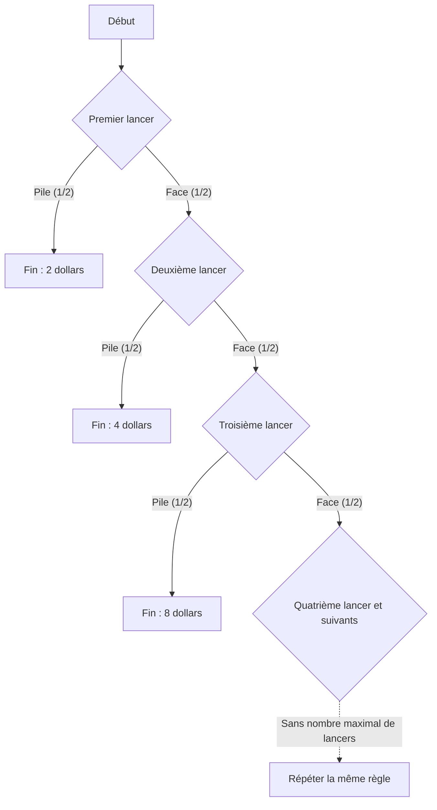

## 1. Jouer jusqu’au premier résultat pile

Comment évaluer, à partir de la seule espérance de versement, un jeu de pile ou face dont l’entrée coûte 10 000 dollars américains ? Partons d’un **modèle idéal : lancers indépendants d’une pièce équilibrée, sans plafond de versement ni limite à la capacité de paiement de l’organisateur**. Les montants sont des valeurs numériques en dollars américains.

1. Payer l’entrée.
2. Lancer la pièce. Si elle donne face, doubler le montant à recevoir et continuer.
3. S’arrêter au premier résultat pile et recevoir le montant atteint.

Le montant initial est 2. Pile au premier lancer donne un versement de 2 ; face puis pile, de 4 ; face, face puis pile, de 8. N désigne le numéro du lancer où pile apparaît pour la première fois, et X le montant versé avant déduction de l’entrée.

$$
X=2^N,\qquad \Pr(N=n)=2^{-n}\quad(n=1,2,\ldots)
$$

La probabilité que le jeu dépasse un nombre fini de lancers tend vers zéro lorsque ce nombre augmente :

$$
\Pr(N>m)=2^{-m}\longrightarrow0,\qquad \Pr(N=\infty)=0,\qquad\Pr(X<\infty)=1
$$

Le versement est donc **fini avec probabilité 1**, alors que ses valeurs possibles n’ont pas de borne supérieure finie. Une distribution non bornée ne signifie pas que le joueur reçoit effectivement une somme infinie.

## 2. Ce que signifie une espérance infinie

L’espérance d’un versement discret non négatif est la somme de chaque montant multiplié par sa probabilité.

| Premier pile au lancer | Versement | Probabilité | Contribution à l’espérance non conditionnelle |
| --- | ---: | ---: | ---: |
| 1 | 2 | 1/2 | 1 |
| 2 | 4 | 1/4 | 1 |
| 3 | 8 | 1/8 | 1 |

Chaque instant de fin possible contribue pour 1, d’où

$$
\mathbb E[X]=\sum_{n=1}^{\infty}2^n2^{-n}=\sum_{n=1}^{\infty}1=\infty
$$

Si l’on sait que le jeu se termine au lancer n, le montant reçu est 2 à la puissance n, et non 1. Le nombre 1 est la **contribution de cet événement à l’espérance non conditionnelle**.

Les K premiers termes donnent

$$
\sum_{n=1}^{K}2^n2^{-n}=K
$$

et ces sommes partielles croissent sans borne avec K. C’est en ce sens que l’espérance vaut plus l’infini. Cela ne garantit ni versement infini ni bénéfice donné sur un nombre fini d’observations. La [loi des grands nombres](https://kenji.blog/fr/p/law-of-large-numbers/) présente les hypothèses reliant les espérances finies aux moyennes empiriques.

Soustraire un prix d’entrée c fixe et fini laisse une espérance étendue du gain net égale à

$$
\mathbb E[X-c]=\infty\qquad(0\le c<\infty)
$$

Mais cette espérance seule n’évalue pas le risque d’une forte perte, la possibilité de financer l’entrée ou la capacité de paiement de l’organisateur. Une espérance infinie ne permet pas de conclure qu’il faut s’endetter pour participer.

## 3. Histoire et critère d’évaluation

La [traduction anglaise de l’article de Daniel Bernoulli de 1738](https://faculty.econ.ucsb.edu/~tedb/Courses/GraduateTheoryUCSB/Bernoulli.pdf) relate comment son cousin Nicolas Bernoulli a envoyé des problèmes à Montmort. Une lettre de Cramer de 1728, citée dans l’article, renvoie au problème de la lettre du 9 septembre 1713. Le nom du paradoxe est lié à la publication de l’article de Daniel dans les mémoires de l’Académie des sciences de Saint-Pétersbourg.

Le jeu classique cité dans cet article commence par un versement d’un ducat. Ici, le premier versement est de 2 dollars : les équivalents certains et autres résultats monétaires ne se transposent donc pas sans tenir compte de l’échelle.

Le problème invite à distinguer l’espérance monétaire de l’évaluation des résultats risqués. Daniel a proposé une évaluation par l’utilité et a aussi présenté des idées antérieures similaires de Cramer. Ces explications reposent sur des modèles ; elles ne sont pas des preuves mathématiques universelles de la psychologie de chaque personne.

## 4. Modéliser l’utilité marginale décroissante

Après avoir bu suffisamment, un verre d’eau supplémentaire peut avoir moins de valeur. Pour la richesse aussi, on peut modéliser la valeur d’un accroissement monétaire fixe comme dépendant du niveau initial.

Prenons par exemple une utilité logarithmique pour les montants positifs :

$$
u(x)=\log_2x,\qquad x>0
$$

Cette fonction vérifie

$$
u'(x)=\frac{1}{x\ln2}>0,\qquad u''(x)=-\frac{1}{x^2\ln2}<0
$$

L’utilité augmente avec la richesse, mais une unité supplémentaire procure un accroissement d’utilité plus faible à un niveau de richesse plus élevé. C’est l’utilité marginale décroissante de ce modèle. L’utilité logarithmique elle-même reste non bornée supérieurement. Des accroissements décroissants et une borne supérieure finie sont deux propriétés différentes.

Ces fonctions d’utilité sont des hypothèses représentant des préférences, pas un résultat empirique établissant que la satisfaction de tous suit la même formule logarithmique.

## 5. Utilité espérée 2, équivalent certain 4 et prix d’entrée

Commençons par une comparaison simplifiée appliquant l’utilité directement au montant reçu. Une fin au lancer n donne l’utilité

$$
\log_2(2^n)=n
$$

donc l’utilité espérée

$$
\mathbb E[u(X)]=\sum_{n=1}^{\infty}n2^{-n}=2
$$

Les sommes partielles le confirment :

$$
\sum_{n=1}^{K}n2^{-n}=2-\frac{K+2}{2^K}\longrightarrow2
$$

La série des utilités pondérées par leurs probabilités converge. L’utilité espérée peut ainsi être finie même si la fonction d’utilité n’a pas de borne supérieure.

Le montant certain donnant la même utilité dans cette comparaison, l’**équivalent certain (CE)**, est

$$
\mathrm{CE}=u^{-1}\!\left(\mathbb E[u(X)]\right)=2^2=4
$$

Il s’agit de comparer le versement aléatoire X à un versement certain de 4. **Ce n’est pas un plafond universel de 4 pour le prix d’entrée.**

Pour décider de payer l’entrée, il faut inclure la richesse initiale w et le prix c. Un modèle simple sans emprunt pose

$$
w>0,\qquad0\le c\le w,\qquad W_{\mathrm{final}}=w-c+X
$$

Avec la même utilité logarithmique, la différence entre l’utilité espérée de participer et l’utilité de ne pas participer est

$$
G_w(c)=\sum_{n=1}^{\infty}2^{-n}\log_2(w-c+2^n)-\log_2w
$$

Une différence positive favorise la participation dans ce modèle ; zéro exprime l’indifférence ; une différence négative favorise la non-participation. Si w dépasse 4, la différence est continue et strictement décroissante en c, positive pour c égal à 0 et négative pour c égal à w. Il existe donc un unique prix d’entrée rendant le joueur indifférent entre participer et ne pas participer :

$$
G_w(c^\ast)=0,\qquad0<c^\ast<w\quad(w>4)
$$

La résolution numérique de la série donne ces exemples :

| Richesse initiale w | Prix d’indifférence c* approximatif |
| ---: | ---: |
| 10 | 4,97 |
| 100 | 7,79 |
| 1 000 | 10,95 |

Inclure la richesse change l’évaluation, même avec la même fonction d’utilité. L’accroissement certain de richesse équivalent à une loterie déjà détenue diffère aussi du prix d’indifférence pour l’acheter. Bernoulli lui-même distingue le prix d’achat de la valeur d’une possibilité déjà détenue dans la section 19.

## 6. Plafonner le versement

Un modèle pratique doit aussi prendre en compte les limites du contrat et la capacité de paiement. Fixons par exemple un plafond égal à 2 à la puissance K : au premier résultat pile, on verse le montant initialement prévu, sans dépasser ce plafond.

$$
X_K=\min(X,2^K),\qquad K\in\{1,2,\ldots\}
$$

La probabilité que N soit au moins K est l’inverse de 2 à la puissance K−1, donc

$$
\mathbb E[X_K]=\sum_{n=1}^{K-1}2^n2^{-n}+2^K\Pr(N\ge K)=(K-1)+2=K+1
$$

Un plafond de 1 024, soit K égal à 10, donne une espérance de versement de 11. Les K premiers termes de l’espérance initiale totalisent K, alors que ce contrat plafonné a pour espérance K+1. Modifier le versement lors d’un arrêt anticipé définit un autre jeu.

## 7. Une perspective économique qui explicite les hypothèses

Bernoulli applique aussi des modèles de richesse et d’utilité à l’assurance et à la répartition de marchandises entre plusieurs navires. L’utilité espérée est un cadre pour penser les choix risqués. Les prix, la dépendance entre pertes et les contraintes de financement interviennent aussi dans l’assurance et la diversification ; un seul principe psychologique n’explique pas toutes les décisions.

**La concavité de l’utilité sur la richesse et l’aversion aux pertes comme asymétrie entre gains et pertes par rapport à un point de référence sont deux concepts distincts.** [Tversky et Kahneman, dans leur article de 1981](https://www.stanford.edu/class/psych205/papers/Tversky-Kahneman-1981.pdf), traitent des points de référence, de la valeur des gains et pertes et des pondérations de décision, tout en précisant que ces propriétés ne sont pas universelles.

Le paradoxe de Saint-Pétersbourg distingue modèle probabiliste, espérance monétaire, préférences et contraintes. Le [paradoxe des deux enveloppes](https://kenji.blog/fr/p/two-envelopes-paradox/) et le [théorème de Bayes](https://kenji.blog/fr/p/bayes-theorem/) se comprennent aussi mieux quand les hypothèses et les informations de conditionnement sont explicites.
