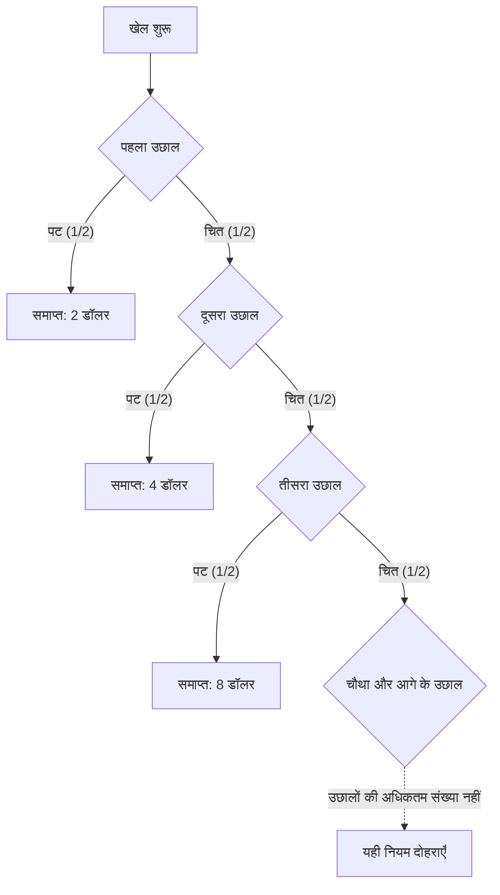

## 1. पहली बार पट आने तक खेलना

यदि सिक्का उछालने के खेल में भाग लेने का शुल्क 10 000 अमेरिकी डॉलर हो, तो केवल पुरस्कार के अपेक्षित मान से उसका मूल्यांकन कैसे करें? पहले **आदर्श मॉडल** लें: **हर उछाल स्वतंत्र है, चित और पट की प्रायिकताएँ समान हैं, पुरस्कार की कोई ऊपरी सीमा नहीं है और आयोजक की भुगतान क्षमता भी असीमित मानी गई है।** सभी रकम अमेरिकी डॉलर की इकाइयों में संख्यात्मक मान हैं।

1. भाग लेने का शुल्क चुकाएँ।
2. सिक्का उछालें। चित आने पर मिलने वाली पुरस्कार राशि दोगुनी करें और खेल जारी रखें।
3. पहली बार पट आने पर खेल रोकें और उस समय की पुरस्कार राशि लें।

शुरुआती पुरस्कार 2 है। पहले उछाल पर पट आने पर 2, चित फिर पट आने पर 4, और चित, चित, फिर पट आने पर 8 मिलते हैं। N उस उछाल की क्रम संख्या है जिस पर पहली बार पट आता है; X शुल्क घटाने से पहले की पुरस्कार राशि है।

$$
X=2^N,\qquad \Pr(N=n)=2^{-n}\quad(n=1,2,\ldots)
$$

खेल के m उछालों से अधिक चलने की प्रायिकता, m के बढ़ने पर शून्य की ओर जाती है:

$$
\Pr(N>m)=2^{-m}\longrightarrow0,\qquad \Pr(N=\infty)=0,\qquad\Pr(X<\infty)=1
$$

इसलिए पुरस्कार राशि **प्रायिकता 1 के साथ परिमित (finite)** है, लेकिन उसके संभव मानों की कोई परिमित ऊपरी सीमा नहीं है। ऊपरी सीमा का न होना वास्तव में अनंत पुरस्कार मिलना नहीं है।

## 2. अनंत अपेक्षित मान का अर्थ

किसी गैरऋणात्मक असतत पुरस्कार राशि का अपेक्षित मान, प्रत्येक राशि और उसकी प्रायिकता के गुणनफलों का योग है।

| पहली बार पट आने वाला उछाल | पुरस्कार | प्रायिकता | बिना शर्त अपेक्षित मान में योगदान |
| --- | ---: | ---: | ---: |
| 1 | 2 | 1/2 | 1 |
| 2 | 4 | 1/4 | 1 |
| 3 | 8 | 1/8 | 1 |

समाप्ति के हर संभव समय का योगदान 1 है, इसलिए

$$
\mathbb E[X]=\sum_{n=1}^{\infty}2^n2^{-n}=\sum_{n=1}^{\infty}1=\infty
$$

यदि यह ज्ञात है कि खेल nवें उछाल पर समाप्त होता है, तो मिलने वाली राशि 1 नहीं, बल्कि 2 की घात n है। यहाँ 1 उस घटना का **बिना शर्त अपेक्षित मान में योगदान** है।

केवल पहले K पद जोड़ने पर

$$
\sum_{n=1}^{K}2^n2^{-n}=K
$$

मिलता है। K बढ़ाने पर ये आंशिक योग किसी भी सीमा से बड़े हो जाते हैं। इसी अर्थ में अपेक्षित मान धनात्मक अनंत है। इसका मतलब यह नहीं कि परिमित प्रेक्षणों में अनंत पुरस्कार या कोई निश्चित लाभ मिलना सुनिश्चित है। सामान्य परिमित अपेक्षित मान और नमूना औसत को जोड़ने वाली धारणाओं पर [बड़ी संख्याओं का नियम](https://kenji.blog/hi/p/law-of-large-numbers/) चर्चा करता है।

स्थिर और परिमित शुल्क c घटाने पर भी विस्तारित अर्थ में शुद्ध लाभ का अपेक्षित मान

$$
\mathbb E[X-c]=\infty\qquad(0\le c<\infty)
$$

रहता है। लेकिन अकेला यह मान बड़े नुकसान की संभावना, शुल्क जुटाने की क्षमता या आयोजक की भुगतान क्षमता का मूल्यांकन नहीं करता। अनंत अपेक्षित मान से यह निष्कर्ष नहीं निकलता कि भाग लेने के लिए कर्ज लेना चाहिए।

## 3. इतिहास और मूल्यांकन का मापदंड

[डैनियल बर्नौली के 1738 के लेख का अंग्रेज़ी अनुवाद](https://faculty.econ.ucsb.edu/~tedb/Courses/GraduateTheoryUCSB/Bernoulli.pdf) बताता है कि उनके चचेरे भाई निकोलस बर्नौली ने मोंमोर (Montmort) को समस्याएँ भेजी थीं। लेख में उद्धृत क्रेमर (Cramer) का 1728 का पत्र, 9 सितंबर 1713 के पत्र की समस्या का उल्लेख करता है। इस विरोधाभास का नाम डैनियल का लेख सेंट पीटर्सबर्ग की विज्ञान अकादमी की पत्रिका में प्रकाशित होने से जुड़ा है।

उस लेख में उद्धृत पारंपरिक खेल का पहला पुरस्कार एक डुकाट है। यहाँ पहला पुरस्कार 2 अमेरिकी डॉलर है। इसलिए निश्चित समतुल्य राशि जैसे मौद्रिक परिणामों को पैमाने का अंतर देखे बिना लागू नहीं करना चाहिए।

समस्या धन के अपेक्षित मान और जोखिम वाले परिणामों के मूल्यांकन को अलग करने के लिए प्रेरित करती है। डैनियल ने उपयोगिता पर आधारित मूल्यांकन प्रस्तावित किया और क्रेमर के पहले के समान विचार भी बताए। ऐसी व्याख्याएँ मॉडल पर निर्भर प्रस्ताव हैं, प्रत्येक व्यक्ति के मनोविज्ञान के सार्वभौमिक गणितीय प्रमाण नहीं।

## 4. घटती सीमांत उपयोगिता का मॉडल

पर्याप्त पानी पी लेने के बाद एक अतिरिक्त गिलास का मूल्य कम हो सकता है। संपत्ति के लिए भी ऐसा मॉडल बनाया जा सकता है जिसमें एक निश्चित अतिरिक्त रकम का मूल्य शुरुआती संपत्ति पर निर्भर हो।

उदाहरण के लिए, धनात्मक रकम पर लघुगणकीय उपयोगिता लें:

$$
u(x)=\log_2x,\qquad x>0
$$

यह फलन निम्न शर्तें पूरी करता है:

$$
u'(x)=\frac{1}{x\ln2}>0,\qquad u''(x)=-\frac{1}{x^2\ln2}<0
$$

संपत्ति बढ़ने पर उपयोगिता बढ़ती है, लेकिन संपत्ति के ऊँचे स्तर पर एक अतिरिक्त इकाई से उपयोगिता में कम बढ़ोतरी होती है। इस मॉडल में यही घटती सीमांत उपयोगिता है। लघुगणकीय उपयोगिता स्वयं ऊपर की ओर असीमित रहती है। बढ़ोतरी का घटना और उपयोगिता की परिमित ऊपरी सीमा होना अलग गुण हैं।

ऐसे उपयोगिता फलन पसंद के क्रम को व्यक्त करने वाली धारणाएँ हैं। यह अनुभवजन्य प्रमाण नहीं है कि सभी की संतुष्टि एक ही लघुगणकीय सूत्र का अनुसरण करती है।

## 5. अपेक्षित उपयोगिता 2, निश्चित समतुल्य राशि 4 और भागीदारी शुल्क

पहले एक सरल तुलना में उपयोगिता फलन को मिलने वाली पुरस्कार राशि पर सीधे लागू करें। nवें उछाल पर समाप्ति की उपयोगिता है

$$
\log_2(2^n)=n
$$

इसलिए अपेक्षित उपयोगिता है

$$
\mathbb E[u(X)]=\sum_{n=1}^{\infty}n2^{-n}=2
$$

आंशिक योग इसकी पुष्टि करते हैं:

$$
\sum_{n=1}^{K}n2^{-n}=2-\frac{K+2}{2^K}\longrightarrow2
$$

प्रायिकताओं से भारित उपयोगिताओं की श्रेणी अभिसरित होती है। इसलिए उपयोगिता फलन की ऊपरी सीमा न होने पर भी अपेक्षित उपयोगिता परिमित हो सकती है।

इस तुलना में समान उपयोगिता देने वाली निश्चित प्राप्ति, अर्थात **निश्चित समतुल्य राशि (certainty equivalent, CE)**, है

$$
\mathrm{CE}=u^{-1}\!\left(\mathbb E[u(X)]\right)=2^2=4
$$

यह यादृच्छिक पुरस्कार X पाने और निश्चित रूप से 4 पाने की तुलना है। **यह सभी के लिए भागीदारी शुल्क की सार्वभौमिक सीमा 4 नहीं है।**

शुल्क देना है या नहीं, यह तय करते समय प्रारंभिक संपत्ति w और शुल्क c भी शामिल करें। बिना कर्ज वाले एक सरल मॉडल में

$$
w>0,\qquad0\le c\le w,\qquad W_{\mathrm{final}}=w-c+X
$$

रखते हैं। उसी लघुगणकीय उपयोगिता में, भाग लेने की अपेक्षित उपयोगिता और भाग न लेने की उपयोगिता का अंतर है

$$
G_w(c)=\sum_{n=1}^{\infty}2^{-n}\log_2(w-c+2^n)-\log_2w
$$

अंतर धनात्मक होने पर इस मॉडल में भाग लेना पसंद होगा; शून्य पर दोनों विकल्प समान हैं; ऋणात्मक होने पर भाग न लेना पसंद होगा। यदि w, 4 से बड़ा है, तो यह अंतर c में सतत और सख्ती से घटता है। c के 0 होने पर अंतर धनात्मक, और c के w होने पर ऋणात्मक है। इसलिए दोनों विकल्पों को समान उपयोगिता देने वाला शुल्क एक ही है:

$$
G_w(c^\ast)=0,\qquad0<c^\ast<w\quad(w>4)
$$

श्रेणी को संख्यात्मक रूप से हल करने पर निम्न सन्निकट मान मिलते हैं:

| प्रारंभिक संपत्ति w | समान उपयोगिता देने वाले शुल्क c* का सन्निकट मान |
| ---: | ---: |
| 10 | 4.97 |
| 100 | 7.79 |
| 1000 | 10.95 |

एक ही उपयोगिता फलन में भी संपत्ति शामिल करने से मूल्यांकन बदलता है। पहले से स्वामित्व में मौजूद लॉटरी के समतुल्य निश्चित संपत्ति-वृद्धि और उसे नया खरीदने की उदासीनता कीमत भी अलग हैं। बर्नौली स्वयं लेख के अनुच्छेद 19 में खरीद मूल्य और पहले से मौजूद अवसर के मूल्य का अंतर बताते हैं।

## 6. पुरस्कार की ऊपरी सीमा तय करना

व्यावहारिक मॉडल में अनुबंध की पुरस्कार सीमा और भुगतान क्षमता भी देखनी चाहिए। उदाहरण के लिए, ऊपरी सीमा 2 की घात K रखें: पहली बार पट आने पर मूल पुरस्कार और इस सीमा में से छोटी रकम दी जाए।

$$
X_K=\min(X,2^K),\qquad K\in\{1,2,\ldots\}
$$

N के कम से कम K होने की प्रायिकता, 2 की घात K−1 का व्युत्क्रम है। इसलिए

$$
\mathbb E[X_K]=\sum_{n=1}^{K-1}2^n2^{-n}+2^K\Pr(N\ge K)=(K-1)+2=K+1
$$

यदि सीमा 1024 है, यानी K का मान 10 है, तो अपेक्षित पुरस्कार 11 है। मूल अपेक्षित मान के पहले K पदों का योग K है, जबकि इस सीमित अनुबंध का अपेक्षित मान K+1 है। बीच में खेल रोकने पर भुगतान का नियम बदल दें, तो वह अलग खेल हो जाता है।

## 7. धारणाएँ स्पष्ट करने वाला आर्थिक दृष्टिकोण

बर्नौली का लेख संपत्ति और उपयोगिता के मॉडल को बीमा तथा माल को अलग-अलग जहाजों में बाँटकर भेजने पर भी लागू करता है। अपेक्षित उपयोगिता जोखिम वाले चुनावों पर विचार करने का एक ढाँचा है। बीमा और विविधीकरण के मूल्यांकन में कीमतें, हानियों के बीच निर्भरता और धन की बाधाएँ भी जुड़ती हैं। एक ही मनोवैज्ञानिक सिद्धांत सभी निर्णयों की व्याख्या नहीं करता।

**संपत्ति के सापेक्ष उपयोगिता फलन की अवतलता (concavity) और संदर्भ बिंदु के सापेक्ष लाभ व हानि को असममित ढंग से मूल्य देने वाली हानि-विमुखता (loss aversion), अलग अवधारणाएँ हैं।** [Tversky और Kahneman का 1981 का लेख](https://www.stanford.edu/class/psych205/papers/Tversky-Kahneman-1981.pdf) संदर्भ बिंदु, लाभ-हानि के मूल्य और निर्णय भारों पर चर्चा करता है। वह यह भी स्पष्ट करता है कि ये गुण हर व्यक्ति के लिए सार्वभौमिक नहीं हैं।

सेंट पीटर्सबर्ग विरोधाभास प्रायिकता मॉडल, धन के अपेक्षित मान, पसंद और बाधाओं को अलग करके देखता है। [दो लिफाफों का विरोधाभास](https://kenji.blog/hi/p/two-envelopes-paradox/) और [बेज़ का प्रमेय](https://kenji.blog/hi/p/bayes-theorem/) भी अधिक स्पष्ट होते हैं जब धारणाएँ और शर्त के रूप में इस्तेमाल की गई जानकारी बताई जाए।
