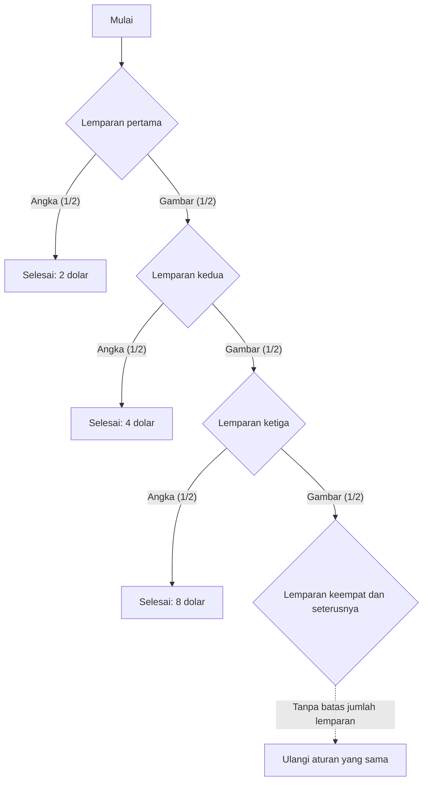

## 1. Bermain sampai angka muncul pertama kali

Bagaimana menilai permainan koin dengan biaya partisipasi 10 000 dolar AS hanya dari nilai harapan hadiahnya? Mulailah dengan **model ideal: lemparan saling independen, sisi gambar dan sisi angka pada koin memiliki peluang sama, hadiah tidak dibatasi, dan kemampuan penyelenggara membayar juga tidak dibatasi**. Semua jumlah uang dinyatakan sebagai nilai numerik dalam dolar AS.

1. Bayar biaya partisipasi.
2. Lempar koin. Jika muncul gambar, gandakan hadiah yang akan dibayarkan dan lanjutkan.
3. Saat angka muncul pertama kali, permainan berakhir dan hadiah pada saat itu dibayarkan.

Hadiah awal adalah 2. Pemain menerima 2 jika angka muncul pada lemparan pertama, 4 untuk urutan gambar–angka, dan 8 untuk gambar–gambar–angka. N adalah nomor lemparan ketika angka muncul pertama kali, sedangkan X adalah hadiah sebelum biaya partisipasi dikurangkan.

$$
X=2^N,\qquad \Pr(N=n)=2^{-n}\quad(n=1,2,\ldots)
$$

Peluang permainan berlangsung lebih dari sejumlah lemparan berhingga mendekati nol ketika jumlah itu meningkat:

$$
\Pr(N>m)=2^{-m}\longrightarrow0,\qquad \Pr(N=\infty)=0,\qquad\Pr(X<\infty)=1
$$

Jadi, hadiah **berhingga dengan peluang 1**, walaupun nilai yang mungkin diperoleh tidak memiliki batas atas berhingga. Tidak adanya batas atas bukan berarti pemain benar-benar menerima hadiah tak hingga.

## 2. Arti nilai harapan tak hingga

Nilai harapan hadiah diskret nonnegatif adalah jumlah setiap hadiah dikalikan peluangnya.

| Kemunculan pertama sisi angka pada lemparan | Hadiah | Peluang | Kontribusi pada nilai harapan tak bersyarat |
| --- | ---: | ---: | ---: |
| 1 | 2 | 1/2 | 1 |
| 2 | 4 | 1/4 | 1 |
| 3 | 8 | 1/8 | 1 |

Setiap kemungkinan waktu berakhir menyumbang 1, sehingga

$$
\mathbb E[X]=\sum_{n=1}^{\infty}2^n2^{-n}=\sum_{n=1}^{\infty}1=\infty
$$

Jika diketahui permainan berakhir pada lemparan n, hadiah yang diterima adalah 2 pangkat n, bukan 1. Nilai 1 di sini adalah **kontribusi kejadian tersebut pada nilai harapan tak bersyarat**.

Menjumlahkan K suku pertama menghasilkan

$$
\sum_{n=1}^{K}2^n2^{-n}=K
$$

dan jumlah parsial ini tumbuh tanpa batas ketika K bertambah. Dalam pengertian itulah nilai harapannya positif tak hingga. Ini tidak menjamin hadiah tak hingga atau keuntungan tertentu dalam sejumlah pengamatan berhingga. [Hukum bilangan besar](https://kenji.blog/id/p/law-of-large-numbers/) membahas asumsi yang menghubungkan nilai harapan berhingga dan rata-rata sampel.

Setelah dikurangi biaya c yang tetap dan berhingga, nilai harapan keuntungan bersih dalam pengertian diperluas tetap

$$
\mathbb E[X-c]=\infty\qquad(0\le c<\infty)
$$

Namun, nilai harapan itu saja tidak menilai kemungkinan rugi besar, kemampuan membayar biaya, atau kemampuan penyelenggara menepati pembayaran. Nilai harapan tak hingga tidak berarti seseorang harus berutang untuk ikut bermain.

## 3. Sejarah dan kriteria penilaian

[Terjemahan Inggris makalah Daniel Bernoulli tahun 1738](https://faculty.econ.ucsb.edu/~tedb/Courses/GraduateTheoryUCSB/Bernoulli.pdf) menceritakan bagaimana sepupunya, Nicolaus Bernoulli, mengirimkan masalah kepada Montmort. Surat Cramer tahun 1728 yang dikutip di sana merujuk masalah dalam surat bertanggal 9 September 1713. Nama paradoks ini berkaitan dengan penerbitan makalah Daniel dalam jurnal Akademi Ilmu Pengetahuan St. Petersburg.

Permainan klasik yang dikutip dalam makalah itu dimulai dengan hadiah satu dukat. Artikel ini memakai hadiah awal 2 dolar, sehingga nilai ekuivalen pasti dan hasil moneter lainnya tidak boleh dipindahkan begitu saja tanpa memperhatikan skalanya.

Masalah ini mengajak kita membedakan nilai harapan uang dan penilaian atas hasil berisiko. Daniel mengusulkan penilaian berdasarkan utilitas dan juga memperkenalkan gagasan serupa Cramer yang lebih awal. Penjelasan tersebut bergantung pada model, bukan bukti matematis universal atas psikologi setiap orang.

## 4. Memodelkan utilitas marjinal yang menurun

Setelah cukup minum, tambahan segelas air mungkin kurang bernilai. Untuk kekayaan pun, kita dapat memodelkan nilai tambahan uang yang tetap sebagai sesuatu yang bergantung pada tingkat awal.

Sebagai contoh, gunakan utilitas logaritmik untuk jumlah positif:

$$
u(x)=\log_2x,\qquad x>0
$$

Fungsi ini memenuhi

$$
u'(x)=\frac{1}{x\ln2}>0,\qquad u''(x)=-\frac{1}{x^2\ln2}<0
$$

Utilitas meningkat bersama kekayaan, tetapi tambahan satu unit memberikan peningkatan utilitas yang lebih kecil pada tingkat kekayaan yang lebih tinggi. Itulah utilitas marjinal yang menurun dalam model ini. Utilitas logaritmik sendiri tetap tidak memiliki batas atas. Tambahan yang mengecil dan adanya batas atas berhingga adalah dua sifat berbeda.

Fungsi utilitas semacam ini merupakan asumsi untuk menyatakan preferensi, bukan temuan empiris bahwa kepuasan semua orang mengikuti rumus logaritmik yang sama.

## 5. Utilitas harapan 2, ekuivalen pasti 4, dan biaya partisipasi

Pertama, lakukan perbandingan sederhana dengan menerapkan fungsi utilitas langsung pada hadiah yang diterima. Berakhir pada lemparan n memberikan utilitas

$$
\log_2(2^n)=n
$$

sehingga utilitas harapannya adalah

$$
\mathbb E[u(X)]=\sum_{n=1}^{\infty}n2^{-n}=2
$$

Jumlah parsial mengonfirmasikannya:

$$
\sum_{n=1}^{K}n2^{-n}=2-\frac{K+2}{2^K}\longrightarrow2
$$

Deret utilitas yang dibobot dengan peluangnya konvergen. Karena itu, utilitas harapan bisa berhingga meskipun fungsi utilitas tidak memiliki batas atas.

Jumlah pasti yang memberikan utilitas sama dalam perbandingan ini, yaitu **nilai ekuivalen pasti (certainty equivalent, CE)**, adalah

$$
\mathrm{CE}=u^{-1}\!\left(\mathbb E[u(X)]\right)=2^2=4
$$

Ini membandingkan penerimaan hadiah acak X dengan penerimaan pasti sebesar 4. **Angka 4 bukan batas biaya partisipasi yang berlaku bagi semua orang.**

Untuk memutuskan apakah akan membayar, sertakan kekayaan awal w dan biaya c. Model sederhana tanpa berutang menggunakan

$$
w>0,\qquad0\le c\le w,\qquad W_{\mathrm{final}}=w-c+X
$$

Dengan utilitas logaritmik yang sama, selisih antara utilitas harapan jika ikut dan utilitas jika tidak ikut adalah

$$
G_w(c)=\sum_{n=1}^{\infty}2^{-n}\log_2(w-c+2^n)-\log_2w
$$

Dalam model ini, pemain lebih memilih ikut jika selisih positif, menilai kedua pilihan setara jika nol, dan lebih memilih tidak ikut jika negatif. Jika w lebih besar dari 4, selisih itu kontinu dan menurun secara ketat terhadap c, positif saat c sama dengan 0 dan negatif saat c sama dengan w. Maka ada tepat satu biaya yang membuat utilitas kedua pilihan sama:

$$
G_w(c^\ast)=0,\qquad0<c^\ast<w\quad(w>4)
$$

Penyelesaian numerik deret memberikan contoh berikut:

| Kekayaan awal w | Perkiraan biaya c* yang membuat kedua pilihan setara |
| ---: | ---: |
| 10 | 4,97 |
| 100 | 7,79 |
| 1 000 | 10,95 |

Memasukkan kekayaan mengubah penilaian meskipun fungsi utilitas sama. Tambahan kekayaan pasti yang ekuivalen dengan lotere yang sudah dimiliki juga berbeda dari harga indiferensi untuk membelinya. Bernoulli sendiri membedakan harga pembelian dan nilai kesempatan yang sudah dimiliki pada bagian 19.

## 6. Membatasi hadiah

Model praktis juga harus mempertimbangkan batas kontrak dan kemampuan membayar. Misalnya, tetapkan batas hadiah 2 pangkat K: ketika angka muncul pertama kali, bayar nilai yang lebih kecil antara hadiah semula dan batas tersebut.

$$
X_K=\min(X,2^K),\qquad K\in\{1,2,\ldots\}
$$

Peluang N bernilai setidaknya K adalah kebalikan dari 2 pangkat K−1, sehingga

$$
\mathbb E[X_K]=\sum_{n=1}^{K-1}2^n2^{-n}+2^K\Pr(N\ge K)=(K-1)+2=K+1
$$

Batas 1 024, atau K sama dengan 10, menghasilkan nilai harapan hadiah 11. K suku pertama dari nilai harapan semula berjumlah K, sedangkan kontrak dengan batas ini memiliki nilai harapan K+1. Mengubah aturan pembayaran saat permainan dihentikan lebih awal mendefinisikan permainan berbeda.

## 7. Perspektif ekonomi yang menyatakan asumsi secara jelas

Bernoulli juga menerapkan model kekayaan dan utilitas pada asuransi serta pembagian barang ke beberapa kapal. Utilitas harapan adalah salah satu kerangka untuk memikirkan pilihan berisiko. Harga, ketergantungan antarkerugian, dan kendala dana juga berperan dalam asuransi serta diversifikasi; satu prinsip psikologis tidak menjelaskan semua keputusan.

**Kecekungan fungsi utilitas terhadap kekayaan dan aversi terhadap kerugian sebagai ketidaksimetrian untung dan rugi relatif terhadap titik acuan adalah konsep berbeda.** [Tversky dan Kahneman dalam makalah tahun 1981](https://www.stanford.edu/class/psych205/papers/Tversky-Kahneman-1981.pdf) membahas titik acuan, nilai keuntungan dan kerugian, serta bobot keputusan, sambil menyatakan bahwa sifat-sifat ini tidak universal pada semua individu.

Paradoks St. Petersburg memisahkan model probabilitas, nilai harapan uang, preferensi, dan kendala. [Paradoks dua amplop](https://kenji.blog/id/p/two-envelopes-paradox/) dan [teorema Bayes](https://kenji.blog/id/p/bayes-theorem/) juga lebih mudah dipahami jika asumsi serta informasi yang menjadi kondisi dinyatakan secara jelas.
