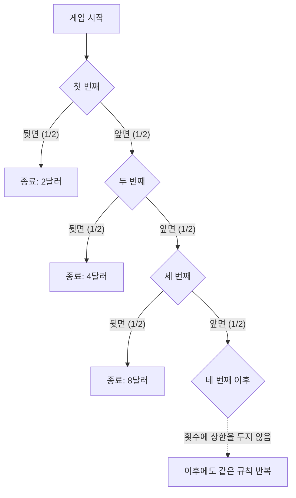

## 1. 처음 뒷면이 나올 때까지 하는 게임

참가비가 1만 미국 달러인 동전 던지기 게임을 상금의 기댓값만으로 평가하면 어떻게 될까요? 먼저 **공정한 동전을 독립적으로 던지고, 상금의 상한과 주최자의 지급 능력에 제한을 두지 않는 이상적인 모형**을 생각합니다. 금액은 미국 달러 단위의 수치로 나타냅니다.

1. 참가비를 냅니다.
2. 동전을 던져 앞면이면 상금을 두 배로 늘리고 계속합니다.
3. 처음 뒷면이 나오면 종료하고 그때의 상금을 받습니다.

시작 상금은 2입니다. 첫 번째에 뒷면이면 2, 앞면·뒷면이면 4, 앞면·앞면·뒷면이면 8을 받습니다. 뒷면이 처음 나올 때까지 동전을 던진 횟수를 N, 참가비를 빼기 전 상금을 X라고 하겠습니다.

$$
X=2^N,\qquad \Pr(N=n)=2^{-n}\quad(n=1,2,\ldots)
$$

게임이 어떤 유한한 횟수를 넘겨 계속될 확률은 그 횟수가 커질수록 0에 가까워집니다.

$$
\Pr(N>m)=2^{-m}\longrightarrow0,\qquad \Pr(N=\infty)=0,\qquad\Pr(X<\infty)=1
$$

따라서 상금은 **확률 1로 유한**합니다. 다만 가능한 상금에는 유한한 상한이 없습니다. 상한이 없다는 것과 실제로 무한한 상금을 받는 것은 다릅니다.

## 2. 기댓값이 무한하다는 뜻

음이 아닌 이산 상금의 기댓값은 각 상금에 그 확률을 곱해 더한 값입니다.

| 첫 뒷면이 나올 때까지 던진 횟수 | 상금 | 확률 | 전체 기댓값에 대한 기여 |
| --- | ---: | ---: | ---: |
| 1 | 2 | 1/2 | 1 |
| 2 | 4 | 1/4 | 1 |
| 3 | 8 | 1/8 | 1 |

각 종료 시점의 기여가 1이므로

$$
\mathbb E[X]=\sum_{n=1}^{\infty}2^n2^{-n}=\sum_{n=1}^{\infty}1=\infty
$$

입니다. n번째에 끝났다는 조건에서 받는 상금은 1이 아니라 2의 n제곱입니다. 1은 그 사건이 **조건을 걸지 않은 전체 기댓값에 기여하는 양**입니다.

앞의 K개 항만 더하면

$$
\sum_{n=1}^{K}2^n2^{-n}=K
$$

이고 K를 늘릴수록 부분합은 한없이 커집니다. 이것이 기댓값이 양의 무한대라는 뜻입니다. 유한한 횟수의 관측에서 무한한 상금이나 일정한 이익을 얻는다는 보장은 아닙니다. 일반적인 유한 평균과 표본평균의 관계 및 전제는 [큰 수의 법칙](https://kenji.blog/ko/p/law-of-large-numbers/)에서 다룹니다.

유한하고 고정된 참가비 c를 빼도, 확장된 의미의 순수익 기댓값은

$$
\mathbb E[X-c]=\infty\qquad(0\le c<\infty)
$$

입니다. 하지만 순수익 기댓값만으로는 큰 손실의 가능성, 참가비를 마련할 수 있는지, 주최자가 실제로 지급할 수 있는지를 평가할 수 없습니다. 무한 기댓값에서 빚을 내서라도 참가해야 한다는 결론이 나오지는 않습니다.

## 3. 역사와 평가 기준

[다니엘 베르누이의 1738년 논문 영어 번역](https://faculty.econ.ucsb.edu/~tedb/Courses/GraduateTheoryUCSB/Bernoulli.pdf)에는 사촌 니콜라우스 베르누이가 몽모르(Montmort)에게 문제를 보낸 경위가 나옵니다. 논문에 인용된 크라메르(Cramer)의 1728년 편지는 1713년 9월 9일 편지의 문제를 언급합니다. 역설의 명칭은 다니엘의 논문이 상트페테르부르크 과학 아카데미의 회보에 실린 것과 관련됩니다.

그 논문에 인용된 고전적인 게임은 첫 상금이 1두카트입니다. 이 글은 첫 상금이 2미국 달러인 변형이므로, 확실성등가액 등 금액 결과를 그대로 옮기면 안 됩니다.

이 문제는 돈의 기댓값과 위험한 결과의 평가를 구분하게 합니다. 다니엘은 효용에 따른 평가를 제안했고 크라메르의 앞선 유사한 생각도 소개했습니다. 이런 설명은 모형에 의존하는 제안이며, 모든 개인의 심리를 보편적으로 증명한 수학 정리는 아닙니다.

## 4. 한계효용 체감을 모형으로 표현하기

물을 충분히 마신 뒤에는 추가로 한 잔을 마시는 가치가 작아질 수 있습니다. 재산에 대해서도 같은 금액의 증가가 주는 가치가 시작 재산에 따라 달라지는 모형을 생각할 수 있습니다.

예를 들어 양의 금액에 로그 효용을 적용합니다.

$$
u(x)=\log_2x,\qquad x>0
$$

이 함수는 다음 조건을 만족합니다.

$$
u'(x)=\frac{1}{x\ln2}>0,\qquad u''(x)=-\frac{1}{x^2\ln2}<0
$$

재산이 늘면 효용도 증가하지만, 재산이 많아질수록 추가 한 단위가 주는 효용 증가는 작아집니다. 이 모형에서의 한계효용 체감입니다. 로그 효용 자체는 상한 없이 증가합니다. 증가분의 체감과 효용의 유한한 상한은 다른 성질입니다.

이런 효용함수는 선호를 나타내는 가정입니다. 모든 사람의 만족도가 같은 로그 식을 따른다고 실측으로 확인된 것은 아닙니다.

## 5. 기대효용 2, 확실성등가액 4, 참가비의 차이

먼저 받는 상금 자체에 효용함수를 적용하는 단순한 비교를 합니다. n번째에 끝날 때 효용은

$$
\log_2(2^n)=n
$$

이므로 기대효용은

$$
\mathbb E[u(X)]=\sum_{n=1}^{\infty}n2^{-n}=2
$$

입니다. 부분합으로 확인하면

$$
\sum_{n=1}^{K}n2^{-n}=2-\frac{K+2}{2^K}\longrightarrow2
$$

입니다. 확률로 가중한 효용급수가 수렴하므로, 효용함수가 유계가 아니어도 기대효용은 유한할 수 있습니다.

이 비교에서 같은 효용을 주는 확정 수령액, 즉 **확실성등가액(CE)**은

$$
\mathrm{CE}=u^{-1}\!\left(\mathbb E[u(X)]\right)=2^2=4
$$

입니다. 이는 무작위 상금 X를 받는 것과 확정적으로 4를 받는 것의 비교입니다. **모든 사람에게 공통인 참가비 상한 4를 뜻하지 않습니다.**

참가비를 낼지는 초기 재산 w와 참가비 c를 포함해 판단해야 합니다. 빚을 내지 않는 단순한 모형에서는 다음과 같이 둡니다.

$$
w>0,\qquad0\le c\le w,\qquad W_{\mathrm{final}}=w-c+X
$$

같은 로그 효용에서 참가의 기대효용과 불참의 효용 차이는

$$
G_w(c)=\sum_{n=1}^{\infty}2^{-n}\log_2(w-c+2^n)-\log_2w
$$

입니다. 차이가 양수이면 이 모형에서는 참가를 선호하고, 0이면 무차별하며, 음수이면 불참을 선호합니다. w가 4보다 크면 이 차이는 c에 대해 연속이고 엄격히 감소합니다. c가 0이면 양수, c가 w이면 음수이므로, 두 선택이 무차별해지는 참가비가 하나 존재합니다.

$$
G_w(c^\ast)=0,\qquad0<c^\ast<w\quad(w>4)
$$

급수를 수치적으로 풀면 다음과 같은 근삿값을 얻습니다.

| 초기 재산 w | 두 선택이 무차별해지는 참가비 c*의 근삿값 |
| ---: | ---: |
| 10 | 4.97 |
| 100 | 7.79 |
| 1 000 | 10.95 |

같은 효용함수라도 재산을 포함하면 평가는 달라집니다. 이미 가진 복권의 확실성등가 재산 증가분과 새로 살 때의 무차별 가격도 구분해야 합니다. 베르누이 자신도 논문 19절에서 구매 가격과 이미 가진 기회의 가치 사이 차이를 언급합니다.

## 6. 상금에 상한을 둘 때

실제 모형에는 계약의 상금 한도와 지급 능력도 포함해야 합니다. 예를 들어 한도를 2의 K제곱으로 두고, 첫 뒷면이 나올 때 원래 상금과 한도 중 작은 금액을 지급한다고 명시합니다.

$$
X_K=\min(X,2^K),\qquad K\in\{1,2,\ldots\}
$$

N이 K 이상일 확률은 2의 K−1제곱의 역수이므로

$$
\mathbb E[X_K]=\sum_{n=1}^{K-1}2^n2^{-n}+2^K\Pr(N\ge K)=(K-1)+2=K+1
$$

입니다. 상한이 1 024, 즉 K가 10이면 상금 기댓값은 11입니다. 원래 기댓값의 앞 K개 항의 합 K와 이 상한 계약의 기댓값 K+1은 다릅니다. 중간에 중단할 때의 지급 규칙을 바꾸면 다른 게임이 됩니다.

## 7. 경제학으로 이어지는, 가정을 명시하는 관점

베르누이의 논문은 재산과 효용 모형을 보험과 화물 분산 운송에도 적용합니다. 기대효용은 위험한 선택을 생각하는 한 가지 틀입니다. 보험이나 분산의 평가에는 가격, 손실 사이의 의존 관계, 자금 제약도 관련되므로 하나의 심리 원리만으로 모든 행동을 설명할 수는 없습니다.

**재산에 대한 효용의 오목성(concavity)과, 준거점을 기준으로 이익과 손실을 비대칭적으로 평가하는 손실회피는 다른 개념입니다.** [Tversky와 Kahneman의 1981년 논문](https://www.stanford.edu/class/psych205/papers/Tversky-Kahneman-1981.pdf)은 준거점, 이익과 손실의 가치, 의사결정 가중치를 다루며, 이런 성질이 모든 개인에게 보편적인 것은 아니라고도 설명합니다.

상트페테르부르크의 역설은 확률모형, 돈의 기댓값, 선호와 제약을 구분하는 예입니다. [두 봉투의 역설](https://kenji.blog/ko/p/two-envelopes-paradox/)과 [베이즈 정리](https://kenji.blog/ko/p/bayes-theorem/)도 무엇을 가정하고 무엇을 조건으로 하는지 명시하면 식의 의미를 이해하기 쉬워집니다.
