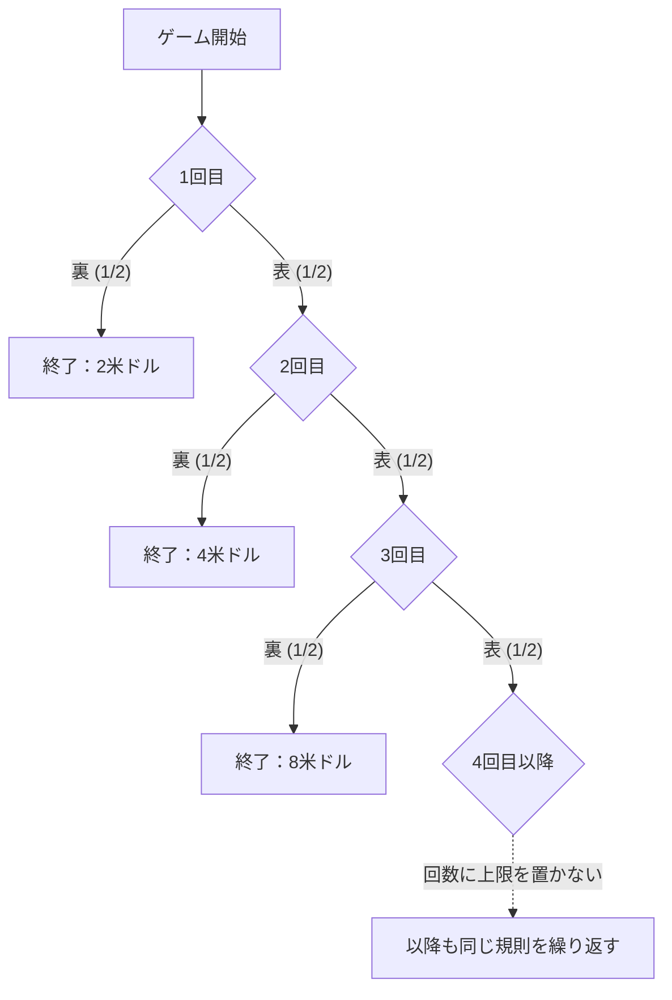

## 1. 初めて裏が出るまで続けるゲーム

参加費が1万米ドルのコイン投げゲームを、賞金の期待値だけで評価するとどうなるでしょうか。まず、**公平なコインを独立に投げ、賞金の上限や支払い能力の制約を置かない理想モデル**を考えます。金額は米ドル単位の数値で表します。

1. 参加費を払う。
2. コインを投げ、表なら賞金候補を倍にして続ける。
3. 初めて裏が出たときに終了し、その時点の賞金を受け取る。

初回の賞金は2です。1回目に裏なら2、表・裏なら4、表・表・裏なら8。最初に裏が出る回をN、参加費を引く前の賞金をXとします。

$$
X=2^N,\qquad \Pr(N=n)=2^{-n}\quad(n=1,2,\ldots)
$$

裏が出るまでに有限の回数を超える確率は、回数とともにゼロへ近づきます。

$$
\Pr(N>m)=2^{-m}\longrightarrow0,\qquad \Pr(N=\infty)=0,\qquad\Pr(X<\infty)=1
$$

したがって賞金は**確率1で有限**です。ただし、取り得る賞金には有限の上限がありません。「上限がない」と「実際に無限の賞金を受け取る」は違います。

## 2. 無限の期待値が意味すること

非負の離散賞金の期待値は、各賞金にその確率を掛けた和です。

| 初めて裏が出る回 | 賞金 | 確率 | 無条件期待値への寄与 |
| --- | ---: | ---: | ---: |
| 1 | 2 | 1/2 | 1 |
| 2 | 4 | 1/4 | 1 |
| 3 | 8 | 1/8 | 1 |

各終了時点の寄与が1なので、

$$
\mathbb E[X]=\sum_{n=1}^{\infty}2^n2^{-n}=\sum_{n=1}^{\infty}1=\infty
$$

となります。n回目で終わったという条件のもとで受け取る額は、1ではなく2のn乗です。1はその事象の**無条件期待値への寄与**です。

最初のK項だけなら

$$
\sum_{n=1}^{K}2^n2^{-n}=K
$$

となり、Kを増やすと部分和はいくらでも大きくなります。この意味で期待値は正の無限大です。有限回の観測で無限の賞金や一定の利益が実現することを意味しません。通常の有限な平均と標本平均の関係については、[大数の法則](https://kenji.blog/p/law-of-large-numbers/)で前提も含めて扱っています。

有限の固定参加費cを引いても、拡張された期待純収益は

$$
\mathbb E[X-c]=\infty\qquad(0\le c<\infty)
$$

です。しかし、期待純収益だけでは、大損する可能性、参加費を用意できるか、胴元が本当に支払えるかを評価できません。無限期待値から、借金して参加すべきという結論は出ません。

## 3. 歴史と、評価の基準をめぐる問題

[ダニエル・ベルヌーイの1738年論文の英訳](https://faculty.econ.ucsb.edu/~tedb/Courses/GraduateTheoryUCSB/Bernoulli.pdf)は、いとこのニコラウス・ベルヌーイがモンモールに問題を送った経緯を記しています。論文に引用されたクレメールの1728年書簡は、1713年9月9日の書簡中の問題を参照しています。名称は、ダニエルの論文がサンクトペテルブルクの科学アカデミーの紀要に掲載されたことと結び付いています。

同論文の古典的なゲームの引用は初回1ドゥカートです。本稿は初回2米ドルの版なので、確実同等額などの数値をそのまま混同しないようにします。

この問題は、貨幣の期待値と、危険を伴う結果をどう評価するかを分けて考えるきっかけになります。ダニエルは効用による評価を提案し、先行するクレメールの類似した考えも紹介しています。効用による説明はモデルに基づく提案で、すべての個人の心理に対する普遍的な数学的証明ではありません。

## 4. 限界効用逓減をモデルにする

水を既に十分飲んだ後では、追加の1杯のありがたさが小さくなる、という直感があります。資産についても、同額の増加の価値が資産水準によって変わるモデルを考えられます。

たとえば正の金額に対する対数効用を置きます。

$$
u(x)=\log_2x,\qquad x>0
$$

この関数は

$$
u'(x)=\frac{1}{x\ln2}>0,\qquad u''(x)=-\frac{1}{x^2\ln2}<0
$$

を満たします。資産が増えると効用も増えますが、追加の1単位がもたらす効用の増分は小さくなります。これがこのモデルでの限界効用逓減です。対数効用そのものは上限なく増え続けます。「増分が逓減する」ことと「効用が有限の上限を持つ」ことも区別します。

こうした効用関数は選好を表す仮定です。すべての個人の満足度が同じ対数式に従うと実測で確定したわけではありません。

## 5. 期待効用2、確実同等額4、参加費の違い

まず、受け取る賞金そのものに上の効用を適用する単純な比較をします。n回目で終わるときの効用は

$$
\log_2(2^n)=n
$$

なので、期待効用は

$$
\mathbb E[u(X)]=\sum_{n=1}^{\infty}n2^{-n}=2
$$

です。部分和を使うと

$$
\sum_{n=1}^{K}n2^{-n}=2-\frac{K+2}{2^K}\longrightarrow2
$$

と確かめられます。確率で重み付けした効用の級数が収束するため、効用関数が上限を持たなくても期待効用は有限です。

この比較で同じ効用になる確定受取額、すなわち**確実同等額**は

$$
\mathrm{CE}=u^{-1}\!\left(\mathbb E[u(X)]\right)=2^2=4
$$

です。これは「賞金Xを受け取ること」と「確定で4を受け取ること」の比較です。**全員に共通する参加費の上限4を意味しません。**

実際に参加費を払う判断には、初期資産wと参加費cを含めます。借入をしない単純モデルでは

$$
w>0,\qquad0\le c\le w,\qquad W_{\mathrm{final}}=w-c+X
$$

とします。同じ対数効用のもとで、参加する場合と参加しない場合の期待効用の差は

$$
G_w(c)=\sum_{n=1}^{\infty}2^{-n}\log_2(w-c+2^n)-\log_2w
$$

です。差が正ならこのモデルでは参加を選好し、ゼロなら無差別、負なら不参加を選好します。wが4より大きければ、差はcとともに連続かつ厳密に減少し、cが0のとき正、cがwのとき負なので、一意な無差別参加費があります。

$$
G_w(c^\ast)=0,\qquad0<c^\ast<w\quad(w>4)
$$

上の級数を数値的に解くと、たとえば次の近似値になります。

| 初期資産w | 無差別参加費c*の近似 |
| ---: | ---: |
| 10 | 4.97 |
| 100 | 7.79 |
| 1 000 | 10.95 |

同じ効用関数でも資産を含めると評価は変わります。既に保有しているくじの確実同等の増分と、新たに買うときの無差別価格も区別が必要です。ベルヌーイ自身も論文§19で、この購入価格と保有価値の違いに言及しています。

## 6. 賞金に上限を設けるとき

現実のモデルでは、契約の賞金上限や支払い能力も考慮します。たとえば賞金の上限を2のK乗とし、初めて裏が出たら元の賞金と上限の小さい方を払う、と明記します。

$$
X_K=\min(X,2^K),\qquad K\in\{1,2,\ldots\}
$$

このとき、NがK以上となる確率は2のK−1乗の逆数なので、

$$
\mathbb E[X_K]=\sum_{n=1}^{K-1}2^n2^{-n}+2^K\Pr(N\ge K)=(K-1)+2=K+1
$$

となります。上限が1 024、すなわちKが10なら期待賞金は11です。元の期待値の最初のK項を足した値Kと、上限付き契約の期待値K+1は異なります。途中で打ち切る場合の支払い規則を変えれば、別のゲームになります。

## 7. 経済学につながる、仮定を明示する視点

ベルヌーイの論文は、資産と効用のモデルを保険や貨物の分割にも適用しています。期待効用は、リスクを伴う選択を考える枠組みの一つです。保険や分散の評価には価格、損失の依存関係、資金制約なども関わり、すべての行動を一つの心理原理だけで説明できるわけではありません。

**資産水準に対する効用の凹性と、参照点を基準とする利得・損失の非対称性としての損失回避は、区別する概念です。** [TverskyとKahnemanの1981年論文](https://www.stanford.edu/class/psych205/papers/Tversky-Kahneman-1981.pdf)は、参照点、利得・損失の価値、意思決定の重みを扱い、それらの性質が全員に普遍的ではないことも述べています。

サンクトペテルブルクのパラドックスは、確率モデル、貨幣の期待値、選好と制約を分ける例です。[二つの封筒のパラドックス](https://kenji.blog/p/two-envelopes-paradox/)や[ベイズの定理](https://kenji.blog/p/bayes-theorem/)も、何を仮定して何を条件にするかを明示すると、式の意味を捉えやすくなります。
