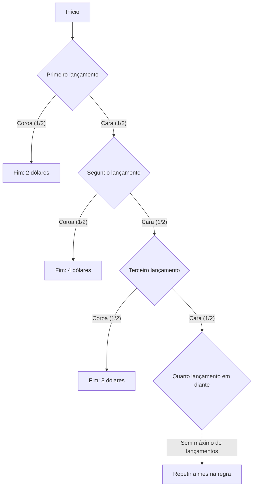

## 1. Jogar até a primeira coroa

Como avaliar, apenas pelo prêmio esperado, um jogo de moeda com entrada de 10 000 dólares americanos? Comecemos com um **modelo ideal: lançamentos independentes de uma moeda equilibrada, sem teto para o prêmio nem limite à capacidade de pagamento do organizador**. Os valores monetários são números expressos em dólares americanos.

1. Paga-se a entrada.
2. Lança-se a moeda. Se sair cara, o prêmio potencial dobra e o jogo continua.
3. Na primeira coroa, o jogo termina e você recebe o prêmio atingido.

O prêmio inicial é 2. Se sair coroa no primeiro lançamento, você recebe 2; com cara e coroa, 4; com cara, cara e coroa, 8. Seja N o número do lançamento em que aparece a primeira coroa, e X o prêmio bruto, antes de descontar a entrada.

$$
X=2^N,\qquad \Pr(N=n)=2^{-n}\quad(n=1,2,\ldots)
$$

A probabilidade de o jogo ultrapassar um número finito de lançamentos tende a zero quando esse número cresce:

$$
\Pr(N>m)=2^{-m}\longrightarrow0,\qquad \Pr(N=\infty)=0,\qquad\Pr(X<\infty)=1
$$

Portanto, o prêmio é **finito com probabilidade 1**, embora os valores possíveis não tenham limite superior finito. Não ter um teto não significa receber de fato um prêmio infinito.

## 2. O significado de um valor esperado infinito

O valor esperado de um prêmio discreto não negativo é a soma de cada prêmio multiplicado por sua probabilidade.

| Primeira coroa no lançamento | Prêmio | Probabilidade | Contribuição ao valor esperado incondicional |
| --- | ---: | ---: | ---: |
| 1 | 2 | 1/2 | 1 |
| 2 | 4 | 1/4 | 1 |
| 3 | 8 | 1/8 | 1 |

Cada possível instante de término contribui com 1, de modo que

$$
\mathbb E[X]=\sum_{n=1}^{\infty}2^n2^{-n}=\sum_{n=1}^{\infty}1=\infty
$$

Se sabemos que o jogo termina no lançamento n, o prêmio é 2 elevado a n, não 1. Esse 1 é a **contribuição do evento ao valor esperado incondicional**.

Somando apenas os primeiros K termos,

$$
\sum_{n=1}^{K}2^n2^{-n}=K
$$

as somas parciais crescem sem limite quando K aumenta. Nesse sentido, o valor esperado é infinito positivo. Isso não implica um prêmio infinito nem lucro garantido em um conjunto finito de observações. A [lei dos grandes números](https://kenji.blog/pt/p/law-of-large-numbers/) discute as hipóteses que relacionam médias finitas usuais e médias amostrais.

Mesmo descontando um preço de entrada c fixo e finito, o valor esperado do resultado líquido, no sentido estendido, é

$$
\mathbb E[X-c]=\infty\qquad(0\le c<\infty)
$$

Mas esse valor, sozinho, não avalia a possibilidade de uma grande perda, se a pessoa consegue pagar a entrada ou se o organizador consegue honrar os prêmios. Valor esperado infinito não implica que seja necessário ou recomendável se endividar para jogar.

## 3. História e critério de avaliação

A [tradução inglesa do artigo de Daniel Bernoulli de 1738](https://faculty.econ.ucsb.edu/~tedb/Courses/GraduateTheoryUCSB/Bernoulli.pdf) relata como seu primo Nicolaus Bernoulli enviou problemas a Montmort. Uma carta de Cramer de 1728, citada no artigo, faz referência ao problema da carta de 9 de setembro de 1713. O nome do paradoxo se relaciona à publicação do artigo de Daniel nos anais da Academia de Ciências de São Petersburgo.

O jogo clássico citado nesse artigo começa com um prêmio de um ducado. Aqui, usamos um prêmio inicial de 2 dólares, de modo que equivalentes certos e outros resultados monetários não devem ser transportados diretamente entre as duas escalas.

O problema convida a distinguir o valor monetário esperado da avaliação de resultados arriscados. Daniel propôs uma avaliação baseada na utilidade e também apresentou ideias semelhantes anteriores de Cramer. São explicações que dependem de modelos, não provas matemáticas universais da psicologia de cada pessoa.

## 4. Modelar a utilidade marginal decrescente

Depois de beber água suficiente, um copo adicional pode ter menos valor. Para a riqueza, também podemos modelar o valor de um acréscimo monetário fixo como dependente do nível inicial.

Por exemplo, adotemos utilidade logarítmica para valores positivos:

$$
u(x)=\log_2x,\qquad x>0
$$

Essa função satisfaz

$$
u'(x)=\frac{1}{x\ln2}>0,\qquad u''(x)=-\frac{1}{x^2\ln2}<0
$$

A utilidade aumenta com a riqueza, mas uma unidade adicional gera um acréscimo de utilidade menor em níveis de riqueza maiores. Essa é a utilidade marginal decrescente neste modelo. A própria utilidade logarítmica continua sem limite superior. Acréscimos decrescentes e um limite superior finito são propriedades distintas.

Funções de utilidade desse tipo são hipóteses para representar preferências, não uma constatação empírica de que a satisfação de todas as pessoas segue a mesma fórmula logarítmica.

## 5. Utilidade esperada 2, equivalente certo 4 e preço de entrada

Primeiro, façamos uma comparação simplificada aplicando a utilidade diretamente ao prêmio recebido. Terminar no lançamento n dá utilidade

$$
\log_2(2^n)=n
$$

e, portanto, utilidade esperada

$$
\mathbb E[u(X)]=\sum_{n=1}^{\infty}n2^{-n}=2
$$

As somas parciais confirmam:

$$
\sum_{n=1}^{K}n2^{-n}=2-\frac{K+2}{2^K}\longrightarrow2
$$

A série de utilidades ponderadas por suas probabilidades converge. Assim, a utilidade esperada pode ser finita mesmo quando a função de utilidade não tem limite superior.

O recebimento certo que produz a mesma utilidade nesta comparação, o **equivalente certo (CE)**, é

$$
\mathrm{CE}=u^{-1}\!\left(\mathbb E[u(X)]\right)=2^2=4
$$

Isso compara receber o prêmio aleatório X com receber 4 com certeza. **Não é um teto universal de 4 para o preço de entrada.**

Para decidir se vale pagar, é preciso incluir a riqueza inicial w e o preço c. Um modelo simples sem endividamento usa

$$
w>0,\qquad0\le c\le w,\qquad W_{\mathrm{final}}=w-c+X
$$

Com a mesma utilidade logarítmica, a diferença entre a utilidade esperada de participar e a utilidade de não participar é

$$
G_w(c)=\sum_{n=1}^{\infty}2^{-n}\log_2(w-c+2^n)-\log_2w
$$

Uma diferença positiva favorece participar neste modelo; zero indica indiferença; uma diferença negativa favorece não participar. Se w supera 4, a diferença é contínua e estritamente decrescente em c, positiva quando c é 0 e negativa quando c é w. Assim, existe um único preço de entrada que produz indiferença:

$$
G_w(c^\ast)=0,\qquad0<c^\ast<w\quad(w>4)
$$

A solução numérica da série fornece estes exemplos:

| Riqueza inicial w | Preço de indiferença c* aproximado |
| ---: | ---: |
| 10 | 4,97 |
| 100 | 7,79 |
| 1 000 | 10,95 |

Incluir a riqueza muda a avaliação mesmo com a mesma função de utilidade. O acréscimo certo de riqueza equivalente a uma loteria já possuída também difere do preço de indiferença para comprá-la. O próprio Bernoulli distingue preço de compra e valor de uma oportunidade já possuída na seção 19.

## 6. Impor um teto ao prêmio

Um modelo prático também deve considerar os limites do contrato e a capacidade de pagamento. Por exemplo, fixe um teto de 2 elevado a K: na primeira coroa, paga-se o menor entre o prêmio original e o teto.

$$
X_K=\min(X,2^K),\qquad K\in\{1,2,\ldots\}
$$

A probabilidade de N ser pelo menos K é o inverso de 2 elevado a K−1. Logo,

$$
\mathbb E[X_K]=\sum_{n=1}^{K-1}2^n2^{-n}+2^K\Pr(N\ge K)=(K-1)+2=K+1
$$

Um teto de 1 024, isto é, K igual a 10, dá prêmio esperado de 11. Os primeiros K termos da expectativa original somam K, enquanto o contrato com esse teto tem valor esperado K+1. Mudar a regra de pagamento quando o jogo é interrompido antes de terminar define outro jogo.

## 7. Uma perspectiva econômica que explicita as hipóteses

Bernoulli também aplicou modelos de riqueza e utilidade a seguros e à divisão de cargas entre embarcações. A utilidade esperada é uma estrutura para pensar escolhas arriscadas. Preços, dependência entre perdas e restrições financeiras também importam para seguros e diversificação; um único princípio psicológico não explica todas as decisões.

**A concavidade da utilidade sobre a riqueza e a aversão a perdas como assimetria entre ganhos e perdas em relação a um ponto de referência são conceitos distintos.** [Tversky e Kahneman, no artigo de 1981](https://www.stanford.edu/class/psych205/papers/Tversky-Kahneman-1981.pdf), discutem pontos de referência, valores de ganhos e perdas e pesos de decisão, observando que essas propriedades não são universais entre indivíduos.

O paradoxo de São Petersburgo separa modelo probabilístico, valor monetário esperado, preferências e restrições. O [paradoxo dos dois envelopes](https://kenji.blog/pt/p/two-envelopes-paradox/) e o [teorema de Bayes](https://kenji.blog/pt/p/bayes-theorem/) também ficam mais claros quando as hipóteses e as informações condicionantes são explícitas.
