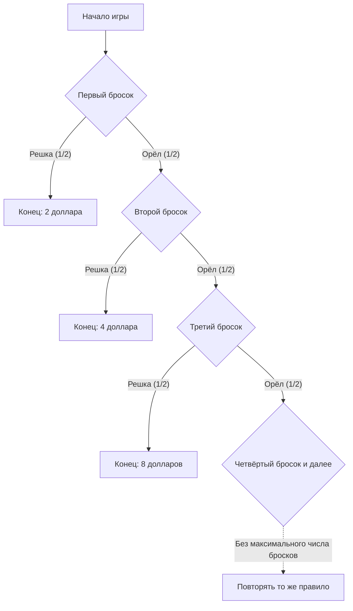

## 1. Играть до первой решки

Как оценить игру с монетой и платой за участие 10 000 долларов США только по ожидаемой выплате? Начнём с **идеальной модели: независимые броски честной монеты, без верхней границы выплаты и без ограничений платёжеспособности организатора**. Денежные величины — числовые значения в долларах США.

1. Уплатить взнос за участие.
2. Бросить монету. Если выпал орёл, удвоить возможную выплату и продолжить.
3. Остановиться при первой решке и получить достигнутую сумму.

Начальная сумма — 2. Решка при первом броске даёт выплату 2; орёл, затем решка — 4; орёл, орёл, затем решка — 8. N — номер броска, при котором впервые выпала решка, X — выплата до вычета платы за участие.

$$
X=2^N,\qquad \Pr(N=n)=2^{-n}\quad(n=1,2,\ldots)
$$

Вероятность того, что потребуется больше m бросков, стремится к нулю при увеличении m:

$$
\Pr(N>m)=2^{-m}\longrightarrow0,\qquad \Pr(N=\infty)=0,\qquad\Pr(X<\infty)=1
$$

Значит, выплата **конечна с вероятностью 1**, хотя множество её возможных значений не ограничено сверху. Отсутствие верхней границы не означает фактического получения бесконечной суммы.

## 2. Что означает бесконечное математическое ожидание

Математическое ожидание неотрицательной дискретной выплаты — сумма каждой выплаты, умноженной на её вероятность.

| Первая решка при броске | Выплата | Вероятность | Вклад в безусловное математическое ожидание |
| --- | ---: | ---: | ---: |
| 1 | 2 | 1/2 | 1 |
| 2 | 4 | 1/4 | 1 |
| 3 | 8 | 1/8 | 1 |

Каждый возможный момент завершения даёт вклад 1, поэтому

$$
\mathbb E[X]=\sum_{n=1}^{\infty}2^n2^{-n}=\sum_{n=1}^{\infty}1=\infty
$$

Если известно, что игра заканчивается при броске n, выплата равна 2 в степени n, а не 1. Число 1 — **вклад этого события в безусловное ожидание**.

Сумма первых K слагаемых равна

$$
\sum_{n=1}^{K}2^n2^{-n}=K
$$

и эти частичные суммы неограниченно растут с K. В этом смысле ожидание равно плюс бесконечности. Это не гарантирует бесконечной выплаты или определённой прибыли за конечное число наблюдений. [Закон больших чисел](https://kenji.blog/ru/p/law-of-large-numbers/) рассматривает предпосылки связи конечного математического ожидания с выборочными средними.

Вычитание фиксированной конечной платы c оставляет ожидание чистого результата в расширенном смысле равным

$$
\mathbb E[X-c]=\infty\qquad(0\le c<\infty)
$$

Однако одно это ожидание не оценивает возможность крупной потери, доступность денег на взнос или способность организатора платить. Из бесконечного ожидания не следует, что нужно занимать деньги для участия.

## 3. История и критерий оценки

[Английский перевод статьи Даниила Бернулли 1738 года](https://faculty.econ.ucsb.edu/~tedb/Courses/GraduateTheoryUCSB/Bernoulli.pdf) описывает, как его двоюродный брат Николай Бернулли послал задачи Монмору. В приведённом там письме Крамера 1728 года есть ссылка на задачу из письма от 9 сентября 1713 года. Название парадокса связано с публикацией статьи Даниила в трудах Петербургской академии наук.

Классическая игра, процитированная в статье, начинается с выплаты одного дуката. Здесь мы используем начальную выплату 2 доллара. Поэтому денежные эквиваленты и другие суммы нельзя переносить между вариантами без учёта масштаба.

Проблема побуждает различать ожидаемую сумму денег и оценку рискованных исходов. Даниил предложил оценку через полезность и также изложил похожие более ранние идеи Крамера. Такие объяснения зависят от моделей и не являются универсальными математическими доказательствами психологии каждого человека.

## 4. Модель убывающей предельной полезности

После достаточного количества воды ещё один стакан может иметь меньшую ценность. Для богатства тоже можно моделировать ценность фиксированного денежного прибавления как зависящую от исходного уровня.

Например, зададим логарифмическую полезность для положительных сумм:

$$
u(x)=\log_2x,\qquad x>0
$$

Эта функция удовлетворяет условиям

$$
u'(x)=\frac{1}{x\ln2}>0,\qquad u''(x)=-\frac{1}{x^2\ln2}<0
$$

Полезность увеличивается с богатством, но дополнительная единица при большем богатстве даёт меньшую прибавку полезности. Это убывающая предельная полезность данной модели. Сама логарифмическая полезность остаётся неограниченной сверху. Убывание прибавок и конечная верхняя граница полезности — разные свойства.

Такие функции полезности — предположения о предпочтениях, а не эмпирически установленная одинаковая логарифмическая формула удовлетворения всех людей.

## 5. Ожидаемая полезность 2, безрисковый эквивалент 4 и плата за участие

Сначала сделаем упрощённое сравнение, применив полезность непосредственно к полученной выплате. Завершение при броске n даёт полезность

$$
\log_2(2^n)=n
$$

и ожидаемую полезность

$$
\mathbb E[u(X)]=\sum_{n=1}^{\infty}n2^{-n}=2
$$

Это подтверждается частичными суммами:

$$
\sum_{n=1}^{K}n2^{-n}=2-\frac{K+2}{2^K}\longrightarrow2
$$

Ряд полезностей, взвешенных по вероятностям, сходится. Поэтому ожидаемая полезность может быть конечной даже при неограниченной сверху функции полезности.

Гарантированная сумма с такой же полезностью в этом сравнении, **безрисковый денежный эквивалент (certainty equivalent, CE)**, равна

$$
\mathrm{CE}=u^{-1}\!\left(\mathbb E[u(X)]\right)=2^2=4
$$

Здесь сравниваются случайная выплата X и гарантированная выплата 4. **Это не универсальная верхняя граница платы за участие, равная 4.**

Чтобы решить, платить ли за участие, нужно включить начальное богатство w и плату c. В простой модели без заимствований используются

$$
w>0,\qquad0\le c\le w,\qquad W_{\mathrm{final}}=w-c+X
$$

При той же логарифмической полезности разность между ожидаемой полезностью участия и полезностью отказа равна

$$
G_w(c)=\sum_{n=1}^{\infty}2^{-n}\log_2(w-c+2^n)-\log_2w
$$

Положительная разность в этой модели означает предпочтение участия, нулевая — безразличие, отрицательная — предпочтение отказа. При w больше 4 разность непрерывна и строго убывает по c, положительна при c равном 0 и отрицательна при c равном w. Поэтому существует единственная плата, уравнивающая полезности двух решений:

$$
G_w(c^\ast)=0,\qquad0<c^\ast<w\quad(w>4)
$$

Численное решение ряда даёт следующие примеры:

| Начальное богатство w | Приближённая плата c*, уравнивающая полезности |
| ---: | ---: |
| 10 | 4,97 |
| 100 | 7,79 |
| 1 000 | 10,95 |

Учёт богатства меняет оценку даже при одной функции полезности. Гарантированная прибавка богатства, эквивалентная уже имеющейся лотерее, также отличается от цены безразличия при её покупке. Сам Бернулли в параграфе 19 различает покупную цену и ценность уже имеющейся возможности.

## 6. Ограничение выплаты

Практическая модель должна учитывать ограничения договора и платёжеспособность. Например, установим верхнюю границу 2 в степени K: при первой решке выплачивается меньшая из суммы X по исходным правилам и установленной верхней границы.

$$
X_K=\min(X,2^K),\qquad K\in\{1,2,\ldots\}
$$

Вероятность того, что N не меньше K, равна обратной величине 2 в степени K−1. Поэтому

$$
\mathbb E[X_K]=\sum_{n=1}^{K-1}2^n2^{-n}+2^K\Pr(N\ge K)=(K-1)+2=K+1
$$

При верхней границе 1 024, то есть K равном 10, ожидаемая выплата равна 11. Первые K слагаемых исходного ожидания дают K, а ограниченный таким образом договор имеет ожидание K+1. Изменение правила выплаты при досрочном прекращении определяет другую игру.

## 7. Экономический взгляд с явными предположениями

Бернулли также применяет модели богатства и полезности к страхованию и распределению грузов между кораблями. Ожидаемая полезность — одна из основ рассмотрения рискованных решений. Цены, зависимость потерь и ограничения финансирования тоже влияют на оценку страхования и диверсификации; один психологический принцип не объясняет все решения.

**Вогнутость функции полезности по богатству и неприятие потерь как асимметрия оценки выигрышей и потерь относительно точки отсчёта — разные понятия.** [Тверски и Канеман в статье 1981 года](https://www.stanford.edu/class/psych205/papers/Tversky-Kahneman-1981.pdf) рассматривают точки отсчёта, ценность выигрышей и потерь, веса решений и отмечают, что эти свойства не универсальны для всех людей.

Санкт-Петербургский парадокс разделяет вероятностную модель, ожидаемые деньги, предпочтения и ограничения. [Парадокс двух конвертов](https://kenji.blog/ru/p/two-envelopes-paradox/) и [теорема Байеса](https://kenji.blog/ru/p/bayes-theorem/) тоже понятнее, когда явно названы предположения и доступная информация, с учётом которой вычисляются вероятности.
