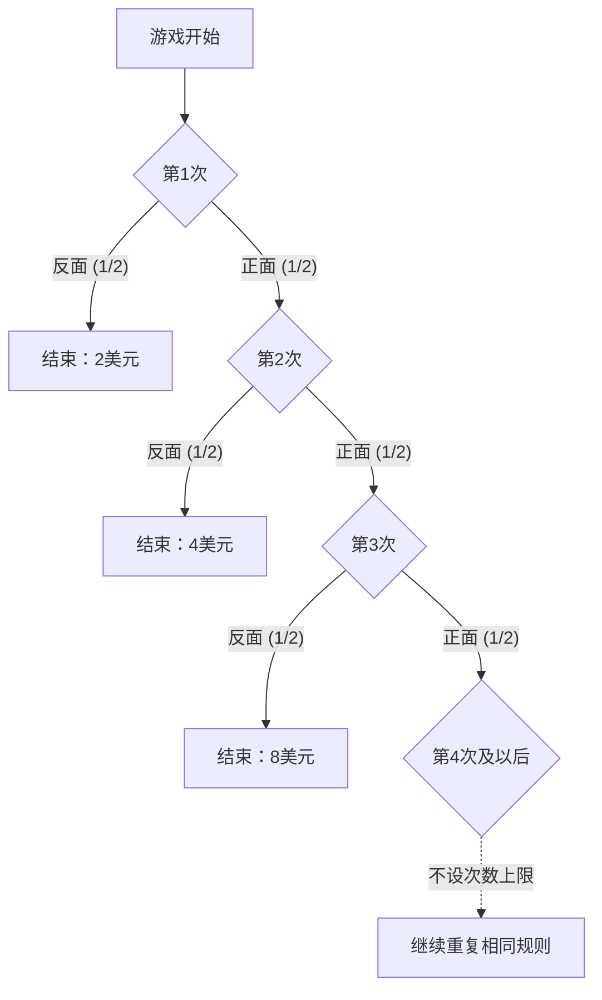

## 1. 一直抛到第一次出现反面的游戏

一场参与费为1万美元的抛硬币游戏，若只看奖金的期望值，该怎样评价？先考虑一个**理想模型：独立抛掷公平硬币，不设奖金上限，也不限制主办方的支付能力**。金额均按美元为单位的数值计算。

1. 支付参与费。
2. 抛硬币；若为正面，将奖金翻倍并继续抛掷。
3. 第一次出现反面时结束，领取当时的奖金。

初始奖金为2。第一次就出现反面得到2；正面、反面得到4；正面、正面、反面得到8。记首次出现反面时的抛掷次数为N，扣除参与费前的奖金为X。

$$
X=2^N,\qquad \Pr(N=n)=2^{-n}\quad(n=1,2,\ldots)
$$

游戏持续超过某个有限次数的概率，随着次数增加趋于零：

$$
\Pr(N>m)=2^{-m}\longrightarrow0,\qquad \Pr(N=\infty)=0,\qquad\Pr(X<\infty)=1
$$

因此，奖金**以概率1为有限值**，但可能取到的金额没有有限上界。“没有上界”不等于“实际领到无限奖金”。

## 2. 无限期望值是什么意思

非负离散奖金的期望，是每个奖金与其概率的乘积之和。

| 第几次首次出现反面 | 奖金 | 概率 | 对无条件期望的贡献 |
| --- | ---: | ---: | ---: |
| 1 | 2 | 1/2 | 1 |
| 2 | 4 | 1/4 | 1 |
| 3 | 8 | 1/8 | 1 |

每个可能的结束时点贡献1，因此

$$
\mathbb E[X]=\sum_{n=1}^{\infty}2^n2^{-n}=\sum_{n=1}^{\infty}1=\infty
$$

在已知第n次结束的条件下，领取的奖金是2的n次方，而不是1。这里的1是该事件**对无条件期望的贡献**。

只加前K项，得到

$$
\sum_{n=1}^{K}2^n2^{-n}=K
$$

随着K增加，部分和可以任意大。这就是期望为正无穷大的含义，并不表示有限次观测能实现无限奖金或保证某个利润。[大数定律](https://kenji.blog/zh-cn/p/law-of-large-numbers/)讨论了通常的有限均值与样本平均之间的关系及其前提。

即使减去有限、固定的参与费c，扩展意义下的期望净收益仍为

$$
\mathbb E[X-c]=\infty\qquad(0\le c<\infty)
$$

但仅凭期望净收益，无法评价严重亏损的可能性、能否筹措参与费，以及主办方是否真的能兑现奖金。无限期望值不能推出“应当借债参与”。

## 3. 历史与评价标准

[丹尼尔·伯努利1738年论文的英译本](https://faculty.econ.ucsb.edu/~tedb/Courses/GraduateTheoryUCSB/Bernoulli.pdf)记述了他的堂兄尼古拉斯·伯努利向蒙莫尔（Montmort）寄送问题的经过。论文引用的克拉默（Cramer）1728年书信，提到了1713年9月9日书信中的问题。悖论的名称与丹尼尔的论文刊载于圣彼得堡科学院纪要有关。

论文引用的经典游戏首次奖励1杜卡特。本篇采用首次奖励2美元的版本，不能直接照搬其中的确定性等价金额等数值。

这个问题促使我们区分货币期望值与风险结果的评价。丹尼尔提出用效用评价，也介绍了克拉默更早的类似思路。这些解释依赖模型，并非对所有人的心理给出普遍的数学证明。

## 4. 用模型表示边际效用递减

喝足水以后，额外一杯水的价值可能变小。对于财富，也可以建立模型，使同额财富增量的价值取决于起始财富水平。

例如，对正的金额采用对数效用：

$$
u(x)=\log_2x,\qquad x>0
$$

这个函数满足

$$
u'(x)=\frac{1}{x\ln2}>0,\qquad u''(x)=-\frac{1}{x^2\ln2}<0
$$

财富增加时效用也增加，但财富越多，额外一单位带来的效用增量越小。这就是该模型中的边际效用递减。对数效用本身仍然没有上界。“增量递减”与“效用存在有限上界”是两回事。

这样的效用函数是表达偏好的假设，并不是实测证实了所有人的满足感都遵循同一条对数公式。

## 5. 期望效用2、确定性等价金额4与参与费

先做一个简化比较，直接把上述效用函数用于收到的奖金。第n次结束时，效用为

$$
\log_2(2^n)=n
$$

所以期望效用为

$$
\mathbb E[u(X)]=\sum_{n=1}^{\infty}n2^{-n}=2
$$

其部分和给出

$$
\sum_{n=1}^{K}n2^{-n}=2-\frac{K+2}{2^K}\longrightarrow2
$$

概率加权的效用级数收敛，因此，即使效用函数没有上界，期望效用也可以有限。

在这个比较中，具有相同效用的确定领取金额，即**确定性等价金额（CE）**，为

$$
\mathrm{CE}=u^{-1}\!\left(\mathbb E[u(X)]\right)=2^2=4
$$

这比较的是“领取随机奖金X”和“确定领取4”。**它不是适用于所有人的参与费上限4。**

决定是否付费参与时，需要计入初始财富w和参与费c。在不借债的简单模型中，

$$
w>0,\qquad0\le c\le w,\qquad W_{\mathrm{final}}=w-c+X
$$

在同一对数效用下，参与后的期望效用与不参与时的效用之差为

$$
G_w(c)=\sum_{n=1}^{\infty}2^{-n}\log_2(w-c+2^n)-\log_2w
$$

差为正时，该模型偏好参与；为零时无差异；为负时偏好不参与。当w大于4时，这个差关于c连续且严格递减，在c为0时为正，在c为w时为负，因此存在唯一的无差异参与费：

$$
G_w(c^\ast)=0,\qquad0<c^\ast<w\quad(w>4)
$$

数值求解上述级数，可得到以下近似例子：

| 初始财富w | 无差异参与费c*的近似值 |
| ---: | ---: |
| 10 | 4.97 |
| 100 | 7.79 |
| 1000 | 10.95 |

即使使用同一效用函数，计入财富也会改变评价。对于已经持有的彩票，其确定性等价财富增量，与新购入时的无差异价格也需要区分。伯努利本人在论文第19节讨论了购买价格与已经持有的机会之价值的区别。

## 6. 设置奖金上限

实际模型还要考虑合同中的奖金上限和支付能力。例如，明确约定上限为2的K次方：首次出现反面时，支付原奖金与上限中的较小者。

$$
X_K=\min(X,2^K),\qquad K\in\{1,2,\ldots\}
$$

N至少为K的概率是2的K−1次方的倒数，因此

$$
\mathbb E[X_K]=\sum_{n=1}^{K-1}2^n2^{-n}+2^K\Pr(N\ge K)=(K-1)+2=K+1
$$

上限为1024，即K为10时，期望奖金是11。原期望的前K项之和为K，而这个有上限合同的期望是K+1。若改变提前终止时的支付规则，就变成另一种游戏。

## 7. 通向经济学的视角：明确假设

伯努利的论文还把财富与效用模型用于保险和货物分批运输。期望效用是思考风险选择的一种框架。保险和分散化的评价还涉及价格、损失之间的依赖关系、资金约束等，并不能用单一心理原理解释所有行为。

**财富效用的凹性，与以参照点为基准的收益、损失非对称性所体现的损失厌恶，是不同概念。** [Tversky与Kahneman的1981年论文](https://www.stanford.edu/class/psych205/papers/Tversky-Kahneman-1981.pdf)讨论了参照点、收益与损失的价值、决策权重，也指出这些性质并不适用于所有人。

圣彼得堡悖论帮助我们分开看待概率模型、货币期望、偏好和约束。[双信封悖论](https://kenji.blog/zh-cn/p/two-envelopes-paradox/)与[贝叶斯定理](https://kenji.blog/zh-cn/p/bayes-theorem/)也说明，明确假设和条件信息，有助于理解公式的意义。
