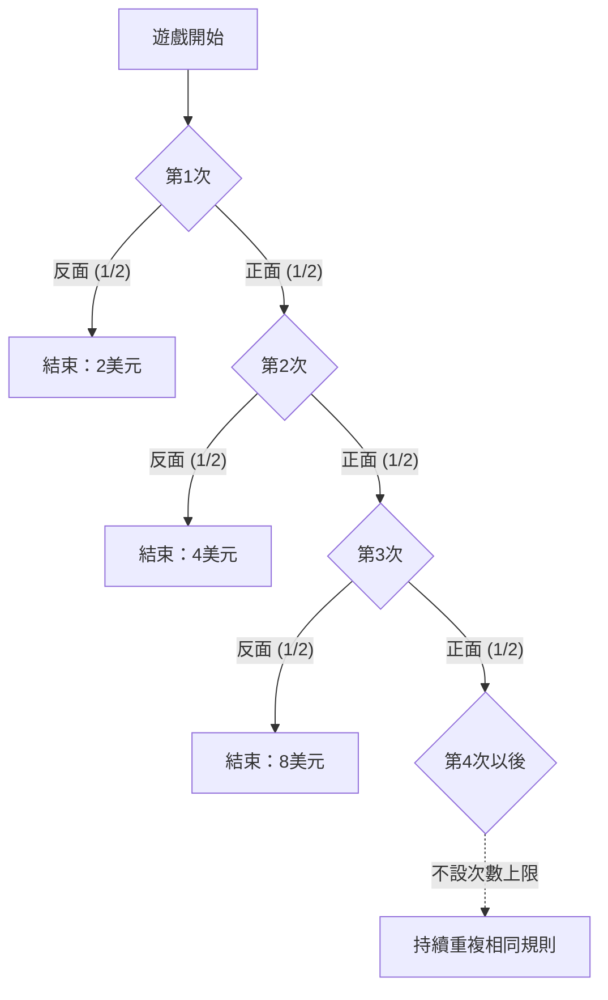

## 1. 擲到第一次出現反面為止

參加費為1萬美元的擲硬幣遊戲，若只用期望獎金來評價，會得到什麼結果？先採用**理想模型：公平硬幣的各次投擲互相獨立，不設獎金上限，也不限制莊家的支付能力**。金額以美元為單位的數值表示。

1. 支付參加費。
2. 擲硬幣；正面時，將獎金加倍並繼續擲。
3. 第一次出現反面時結束，領取當時的獎金。

起始獎金為2。第一次就是反面可得2；正面、反面可得4；正面、正面、反面可得8。令N為首次出現反面時的投擲次數，X為尚未扣除參加費的獎金。

$$
X=2^N,\qquad \Pr(N=n)=2^{-n}\quad(n=1,2,\ldots)
$$

遊戲持續超過某個有限投擲次數的機率，會隨該次數增加而趨近零：

$$
\Pr(N>m)=2^{-m}\longrightarrow0,\qquad \Pr(N=\infty)=0,\qquad\Pr(X<\infty)=1
$$

所以獎金**以機率1為有限值**，但可能金額沒有有限的上界。「沒有上界」與「實際領到無限獎金」是兩回事。

## 2. 無限期望值的意義

非負離散獎金的期望值，是將每項獎金乘上對應機率後加總。

| 首次反面出現於第幾次 | 獎金 | 機率 | 對無條件期望值的貢獻 |
| --- | ---: | ---: | ---: |
| 1 | 2 | 1/2 | 1 |
| 2 | 4 | 1/4 | 1 |
| 3 | 8 | 1/8 | 1 |

每個可能的結束時點都貢獻1，因此

$$
\mathbb E[X]=\sum_{n=1}^{\infty}2^n2^{-n}=\sum_{n=1}^{\infty}1=\infty
$$

若已知遊戲在第n次結束，獎金是2的n次方，而非1。這裡的1是該事件**對無條件期望值的貢獻**。

只取前K項，則

$$
\sum_{n=1}^{K}2^n2^{-n}=K
$$

K增加時，部分和可以任意大，這就是期望值為正無窮大的意思。有限次觀察並不保證無限獎金或某個利潤。[大數法則](https://kenji.blog/zh-tw/p/law-of-large-numbers/)也討論了一般有限期望值與樣本平均的關係及其前提。

即使扣除有限、固定的參加費c，擴充意義下的期望淨收益仍為

$$
\mathbb E[X-c]=\infty\qquad(0\le c<\infty)
$$

但期望淨收益本身，無法評估大幅虧損的可能性、是否付得起費用，以及莊家能否兌現獎金。無限期望值推不出「應該借款參加」。

## 3. 歷史與評價準則

[丹尼爾·伯努利1738年論文的英譯](https://faculty.econ.ucsb.edu/~tedb/Courses/GraduateTheoryUCSB/Bernoulli.pdf)，記述了他的堂兄尼古拉斯·伯努利向蒙莫爾（Montmort）提出問題的經過。論文引述的克拉瑪（Cramer）1728年書信，提及1713年9月9日書信中的問題。悖論名稱與丹尼爾的論文刊登於聖彼得堡科學院紀要有關。

該論文引述的古典遊戲，第一次獎金為1杜卡特。本文採用第一次獎金為2美元的版本，不能直接沿用古典版本的確定等值金額等數值。

這個問題促使我們區分貨幣期望值與風險結果的評價。丹尼爾提出以效用評價，也介紹了克拉瑪更早的類似想法。這些說明以模型為基礎，並非對所有人心理的普遍數學證明。

## 4. 建立邊際效用遞減的模型

喝足水之後，多一杯水的價值可能變小。對財富也可建立模型，讓相同金額增量的價值，隨起始財富水準改變。

例如，對正金額採用對數效用：

$$
u(x)=\log_2x,\qquad x>0
$$

這個函數滿足

$$
u'(x)=\frac{1}{x\ln2}>0,\qquad u''(x)=-\frac{1}{x^2\ln2}<0
$$

財富增加，效用也增加；但財富越多，額外一單位帶來的效用增量越小。這是此模型中的邊際效用遞減。對數效用本身仍無上界。「增量遞減」與「效用具有有限上界」必須分開看。

這類效用函數是用來表示偏好的假設，並非實測已證實每個人的滿足感都服從同一個對數公式。

## 5. 期望效用2、確定等值金額4與參加費

先做簡化比較，將效用函數直接套用於收到的獎金。第n次結束時的效用為

$$
\log_2(2^n)=n
$$

因此期望效用是

$$
\mathbb E[u(X)]=\sum_{n=1}^{\infty}n2^{-n}=2
$$

由部分和可確認

$$
\sum_{n=1}^{K}n2^{-n}=2-\frac{K+2}{2^K}\longrightarrow2
$$

因為以機率加權的效用級數收斂，效用函數即使沒有上界，期望效用仍可有限。

在這個比較裡，能帶來相同效用的確定領取金額，也就是**確定等值金額（CE）**，為

$$
\mathrm{CE}=u^{-1}\!\left(\mathbb E[u(X)]\right)=2^2=4
$$

這比較的是「領取隨機獎金X」與「確定領取4」。**它不是所有人共通的參加費上限4。**

決定是否付費參加時，還要納入初始財富w與參加費c。簡單的不借款模型設定為

$$
w>0,\qquad0\le c\le w,\qquad W_{\mathrm{final}}=w-c+X
$$

在相同對數效用下，參加後的期望效用與不參加時的效用之差為

$$
G_w(c)=\sum_{n=1}^{\infty}2^{-n}\log_2(w-c+2^n)-\log_2w
$$

差為正時，此模型偏好參加；為零時兩者無異；為負時偏好不參加。w大於4時，此差對c連續且嚴格遞減，在c等於0時為正，在c等於w時為負，因此有唯一使兩者無異的參加費：

$$
G_w(c^\ast)=0,\qquad0<c^\ast<w\quad(w>4)
$$

數值求解上述級數，可得到以下近似例子：

| 初始財富w | 使兩者無異的參加費c*（近似） |
| ---: | ---: |
| 10 | 4.97 |
| 100 | 7.79 |
| 1 000 | 10.95 |

即使用相同效用函數，納入財富仍會改變評價。已持有彩券的確定等值財富增量，與新購買時使兩者無異的價格，也應區分。伯努利本人在論文第19節，就談到購買價格與已持有機會的價值之差。

## 6. 設定獎金上限

實際模型也要考慮契約的獎金上限與支付能力。例如明訂上限為2的K次方：首次出現反面時，支付原獎金與上限中較小的金額。

$$
X_K=\min(X,2^K),\qquad K\in\{1,2,\ldots\}
$$

N至少為K的機率，是2的K−1次方的倒數，因此

$$
\mathbb E[X_K]=\sum_{n=1}^{K-1}2^n2^{-n}+2^K\Pr(N\ge K)=(K-1)+2=K+1
$$

上限為1 024，也就是K為10時，期望獎金為11。原期望值前K項的和是K，此上限契約的期望值則為K+1。若改變提前停止時的付款規則，便是另一個遊戲。

## 7. 通往經濟學的觀點：明列假設

伯努利的論文也把財富與效用模型用於保險和分批運送貨物。期望效用是思考風險選擇的一種架構。評價保險或分散風險，還涉及價格、損失間的相依關係與資金限制，不能用單一心理原理解釋所有行為。

**財富效用的凹性，與以參考點為基準、利得和損失不對稱的損失趨避（loss aversion），是不同概念。** [Tversky與Kahneman的1981年論文](https://www.stanford.edu/class/psych205/papers/Tversky-Kahneman-1981.pdf)討論參考點、利得與損失的價值，以及決策權重，也指出這些性質並非對所有人都普遍成立。

聖彼得堡悖論讓我們分開看待機率模型、貨幣期望、偏好與限制。[雙信封悖論](https://kenji.blog/zh-tw/p/two-envelopes-paradox/)和[貝氏定理](https://kenji.blog/zh-tw/p/bayes-theorem/)也說明，明列假設與條件資訊，有助於理解公式的意義。
