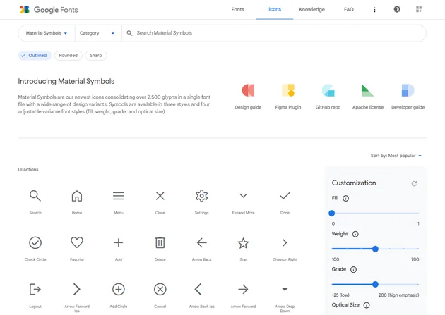
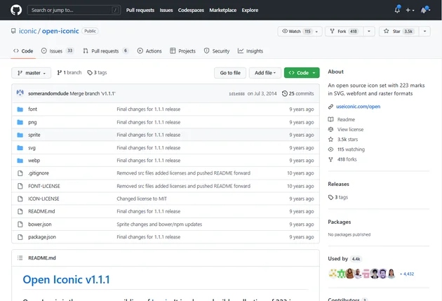

## Google Material Symbols and Icons

[https://fonts.google.com/icons](https://fonts.google.com/icons)

## GitHub Octicons

[https://primer.style/octicons/](https://primer.style/octicons/)

## Sargam Icons

[https://sargamicons.com/](https://sargamicons.com/)

## Icon-Icons
 
- [https://icon-icons.com/](https://icon-icons.com/)

## flaticon

[https://www.flaticon.com/](https://www.flaticon.com/)

## ICONFINDER

[https://www.iconfinder.com/](https://www.iconfinder.com/)

## iconfont

[https://www.iconfont.cn/](https://www.iconfont.cn/)

## open-iconic

- [https://github.com/iconic/open-iconic](https://github.com/iconic/open-iconic)

## Licensing notes

Links and license information were checked on November 24, 2026. Google Material Symbols use Apache License 2.0; GitHub Octicons and Sargam Icons use the MIT License. Open Iconic icons use the MIT License, while its fonts use the SIL Open Font License.

Icon-Icons’ free license requires creator attribution. Flaticon has free and paid plans, and terms can depend on the plan and format, so check the current notice when downloading. Iconfinder licenses can differ by icon, and a commercial-use label may still have conditions. Check the creator and license for each iconfont collection.

Before commercial use, read the license for the actual file, including attribution and redistribution restrictions. Company logos and trademarks may have separate rules beyond the icon asset license.

## Official license and usage references

- [Google Material Symbols licensing](https://developers.google.com/fonts/docs/material_symbols)
- [GitHub Octicons MIT license](https://github.com/primer/octicons/blob/main/LICENSE)
- [Sargam Icons MIT license](https://github.com/planetabhi/sargam-icons/blob/main/LICENSE.txt)
- [Icon-Icons free license](https://icon-icons.com/id/license)
- [Flaticon current plans and attribution](https://www.flaticon.com/pricing)
- [Iconfinder license API documentation](https://legacy-api-docs.iconfinder.com/)
- [Open Iconic license and formats](https://github.com/iconic/open-iconic)
