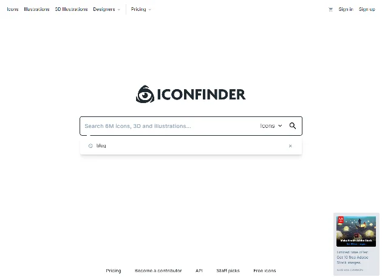

## Google Material Symbols and Icons

[https://fonts.google.com/icons](https://fonts.google.com/icons)

## GitHub Octicons

[https://primer.style/octicons/](https://primer.style/octicons/)

## Sargam Icons

[https://sargamicons.com/](https://sargamicons.com/)

## Icon-Icons
 
- [https://icon-icons.com/](https://icon-icons.com/)

## flaticon

[https://www.flaticon.com/](https://www.flaticon.com/)

## ICONFINDER

[https://www.iconfinder.com/](https://www.iconfinder.com/)

## iconfont

[https://www.iconfont.cn/](https://www.iconfont.cn/)

## open-iconic

- [https://github.com/iconic/open-iconic](https://github.com/iconic/open-iconic)

## लाइसेंस संबंधी नोट

लिंक और लाइसेंस जानकारी 24 नवंबर 2026 को जाँची गई। Google Material Symbols Apache License 2.0 के अंतर्गत हैं; GitHub Octicons और Sargam Icons MIT License के अंतर्गत हैं। Open Iconic के आइकन MIT License और उसके फ़ॉन्ट SIL Open Font License के अंतर्गत हैं।

Icon-Icons का मुफ्त लाइसेंस निर्माता को श्रेय देना आवश्यक करता है। Flaticon में मुफ्त और सशुल्क योजनाएँ हैं; शर्तें योजना और फ़ॉर्मैट के अनुसार बदल सकती हैं, इसलिए डाउनलोड के समय वर्तमान जानकारी देखें। Iconfinder में हर आइकन का लाइसेंस अलग हो सकता है और व्यावसायिक उपयोग का लेबल भी अतिरिक्त शर्तों के अधीन हो सकता है। iconfont पर हर संग्रह के निर्माता और लाइसेंस की जाँच करें।

व्यावसायिक उपयोग से पहले उसी फ़ाइल का लाइसेंस पढ़ें और श्रेय तथा पुनर्वितरण की पाबंदियाँ जाँचें। कंपनी के लोगो और ट्रेडमार्क पर आइकन लाइसेंस से अलग नियम लागू हो सकते हैं।

## आधिकारिक लाइसेंस और उपयोग शर्तें

- [Google Material Symbols licensing](https://developers.google.com/fonts/docs/material_symbols)
- [GitHub Octicons MIT license](https://github.com/primer/octicons/blob/main/LICENSE)
- [Sargam Icons MIT license](https://github.com/planetabhi/sargam-icons/blob/main/LICENSE.txt)
- [Icon-Icons free license](https://icon-icons.com/id/license)
- [Flaticon current plans and attribution](https://www.flaticon.com/pricing)
- [Iconfinder license API documentation](https://legacy-api-docs.iconfinder.com/)
- [Open Iconic license and formats](https://github.com/iconic/open-iconic)
