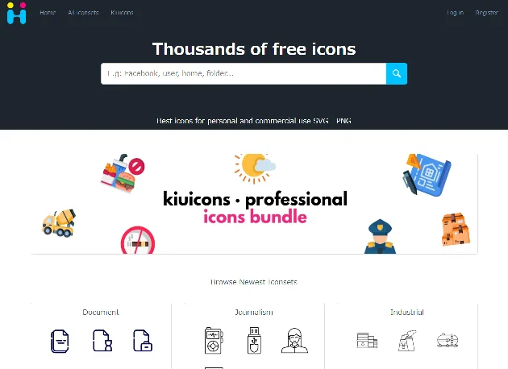
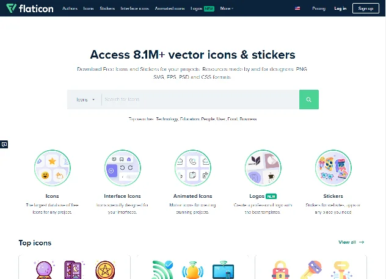

## Google Material Symbols and Icons

[https://fonts.google.com/icons](https://fonts.google.com/icons)

## GitHub Octicons

[https://primer.style/octicons/](https://primer.style/octicons/)

## Sargam Icons

[https://sargamicons.com/](https://sargamicons.com/)

## Icon-Icons
 
- [https://icon-icons.com/](https://icon-icons.com/)

## flaticon

[https://www.flaticon.com/](https://www.flaticon.com/)

## ICONFINDER

[https://www.iconfinder.com/](https://www.iconfinder.com/)

## iconfont

[https://www.iconfont.cn/](https://www.iconfont.cn/)

## open-iconic

- [https://github.com/iconic/open-iconic](https://github.com/iconic/open-iconic)

## 라이선스 안내

링크와 라이선스 정보는 2026년 11월 24일 확인했습니다. Google Material Symbols는 Apache License 2.0, GitHub Octicons와 Sargam Icons는 MIT License를 사용합니다. Open Iconic은 아이콘이 MIT License, 폰트가 SIL Open Font License를 사용합니다.

Icon-Icons의 무료 라이선스는 제작자 표기를 요구합니다. Flaticon은 무료·유료 플랜이 있으며 플랜과 형식에 따라 조건이 달라질 수 있으므로 다운로드할 때 최신 안내를 확인하세요. Iconfinder는 아이콘마다 라이선스가 다르고 상업적 이용 표시에도 추가 조건이 있을 수 있습니다. iconfont에서는 각 컬렉션의 제작자와 라이선스를 확인하세요.

상업적으로 이용하기 전에 실제 파일의 라이선스와 출처 표기 및 재배포 제한을 확인하세요. 회사 로고나 상표에는 아이콘 파일 라이선스와 별도의 규정이 적용될 수 있습니다.

## 공식 라이선스 및 이용 안내

- [Google Material Symbols licensing](https://developers.google.com/fonts/docs/material_symbols)
- [GitHub Octicons MIT license](https://github.com/primer/octicons/blob/main/LICENSE)
- [Sargam Icons MIT license](https://github.com/planetabhi/sargam-icons/blob/main/LICENSE.txt)
- [Icon-Icons free license](https://icon-icons.com/id/license)
- [Flaticon current plans and attribution](https://www.flaticon.com/pricing)
- [Iconfinder license API documentation](https://legacy-api-docs.iconfinder.com/)
- [Open Iconic license and formats](https://github.com/iconic/open-iconic)
