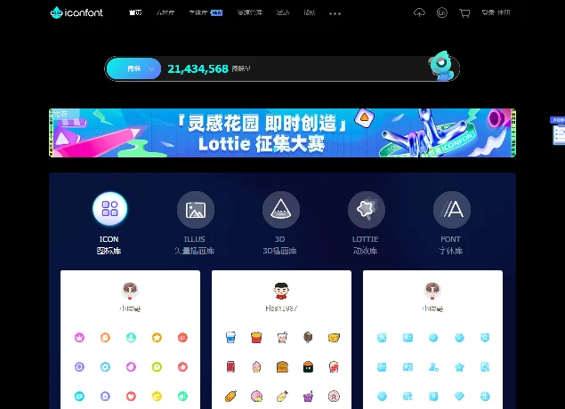

## Google Material Symbols and Icons

[https://fonts.google.com/icons](https://fonts.google.com/icons)

## GitHub Octicons

[https://primer.style/octicons/](https://primer.style/octicons/)

## Sargam Icons

[https://sargamicons.com/](https://sargamicons.com/)

## Milhares de ícones gratuitos
 
- [https://icon-icons.com/](https://icon-icons.com/)

## flaticon

[https://www.flaticon.com/](https://www.flaticon.com/)

## ICONFINDER

[https://www.iconfinder.com/](https://www.iconfinder.com/)

## iconfont

[https://www.iconfont.cn/](https://www.iconfont.cn/)

## open-iconic

- [https://github.com/iconic/open-iconic](https://github.com/iconic/open-iconic)

## Notas sobre licenças

Os links e as informações de licença foram verificados em 24 de novembro de 2026. Google Material Symbols usa Apache License 2.0; GitHub Octicons e Sargam Icons usam MIT License. Os ícones do Open Iconic usam MIT License, e as fontes, SIL Open Font License.

A licença gratuita do Icon-Icons exige crédito ao autor. O Flaticon oferece planos gratuitos e pagos, e as condições podem depender do plano e do formato; confira as informações atuais ao baixar. As licenças do Iconfinder variam por ícone, e a indicação de uso comercial pode ter condições adicionais. No iconfont, verifique o autor e a licença de cada coleção.

Antes de usar um arquivo comercialmente, leia sua licença, incluindo exigências de atribuição e restrições de redistribuição. Logotipos e marcas podem ter regras próprias, além da licença do recurso.

## Licenças e condições oficiais

- [Google Material Symbols licensing](https://developers.google.com/fonts/docs/material_symbols)
- [GitHub Octicons MIT license](https://github.com/primer/octicons/blob/main/LICENSE)
- [Sargam Icons MIT license](https://github.com/planetabhi/sargam-icons/blob/main/LICENSE.txt)
- [Icon-Icons free license](https://icon-icons.com/id/license)
- [Flaticon current plans and attribution](https://www.flaticon.com/pricing)
- [Iconfinder license API documentation](https://legacy-api-docs.iconfinder.com/)
- [Open Iconic license and formats](https://github.com/iconic/open-iconic)
