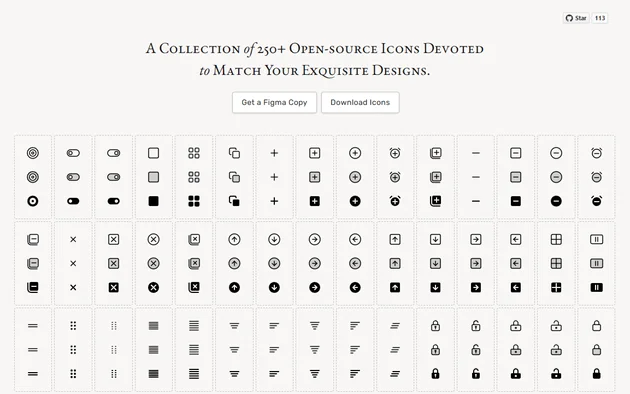

## Google Material Symbols and Icons

[https://fonts.google.com/icons](https://fonts.google.com/icons)

## GitHub Octicons

[https://primer.style/octicons/](https://primer.style/octicons/)

## Sargam Icons

[https://sargamicons.com/](https://sargamicons.com/)

## Icon-Icons
 
- [https://icon-icons.com/](https://icon-icons.com/)

## flaticon

[https://www.flaticon.com/](https://www.flaticon.com/)

## ICONFINDER

[https://www.iconfinder.com/](https://www.iconfinder.com/)

## iconfont

[https://www.iconfont.cn/](https://www.iconfont.cn/)

## open-iconic

- [https://github.com/iconic/open-iconic](https://github.com/iconic/open-iconic)

## Сведения о лицензиях

Ссылки и сведения о лицензиях проверены 24 ноября 2026 года. Google Material Symbols распространяются по Apache License 2.0; GitHub Octicons и Sargam Icons — по MIT License. Иконки Open Iconic распространяются по MIT License, а шрифты — по SIL Open Font License.

Бесплатная лицензия Icon-Icons требует указать автора. У Flaticon есть бесплатный и платный планы, а условия могут зависеть от плана и формата; при загрузке проверьте актуальную информацию. Лицензии Iconfinder различаются для отдельных иконок, а отметка о коммерческом использовании может содержать дополнительные условия. В iconfont проверяйте автора и лицензию каждой коллекции.

Перед коммерческим использованием прочитайте лицензию конкретного файла, включая требования к указанию автора и ограничения на распространение. Для логотипов и товарных знаков компаний могут действовать отдельные правила.

## Официальные лицензии и условия использования

- [Google Material Symbols licensing](https://developers.google.com/fonts/docs/material_symbols)
- [GitHub Octicons MIT license](https://github.com/primer/octicons/blob/main/LICENSE)
- [Sargam Icons MIT license](https://github.com/planetabhi/sargam-icons/blob/main/LICENSE.txt)
- [Icon-Icons free license](https://icon-icons.com/id/license)
- [Flaticon current plans and attribution](https://www.flaticon.com/pricing)
- [Iconfinder license API documentation](https://legacy-api-docs.iconfinder.com/)
- [Open Iconic license and formats](https://github.com/iconic/open-iconic)
