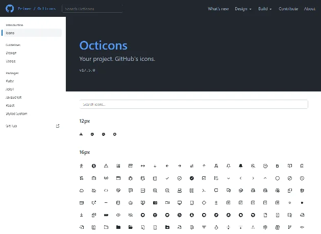

## Google Material Symbols and Icons

[https://fonts.google.com/icons](https://fonts.google.com/icons)

## GitHub Octicons

[https://primer.style/octicons/](https://primer.style/octicons/)

## Sargam Icons

[https://sargamicons.com/](https://sargamicons.com/)

## Icon-Icons
 
- [https://icon-icons.com/](https://icon-icons.com/)

## flaticon

[https://www.flaticon.com/](https://www.flaticon.com/)

## ICONFINDER

[https://www.iconfinder.com/](https://www.iconfinder.com/)

## iconfont

[https://www.iconfont.cn/](https://www.iconfont.cn/)

## open-iconic

- [https://github.com/iconic/open-iconic](https://github.com/iconic/open-iconic)

## 许可须知

我们于2026年11月24日核对了链接和许可信息。Google Material Symbols 使用 Apache License 2.0；GitHub Octicons 和 Sargam Icons 使用 MIT License。Open Iconic 的图标使用 MIT License，字体使用 SIL Open Font License。

Icon-Icons 的免费许可要求注明作者。Flaticon 提供免费和付费方案，条件可能因方案和格式而异，下载时请查看最新说明。Iconfinder 的许可因图标而异，标注可商用也可能附带条件。使用 iconfont 时，请确认各图标集的作者和许可。

商用前，请阅读实际文件的许可，包括署名和再分发限制。公司标志和商标可能另有规则，不由图标素材许可决定。

## 官方许可与使用说明

- [Google Material Symbols licensing](https://developers.google.com/fonts/docs/material_symbols)
- [GitHub Octicons MIT license](https://github.com/primer/octicons/blob/main/LICENSE)
- [Sargam Icons MIT license](https://github.com/planetabhi/sargam-icons/blob/main/LICENSE.txt)
- [Icon-Icons free license](https://icon-icons.com/id/license)
- [Flaticon current plans and attribution](https://www.flaticon.com/pricing)
- [Iconfinder license API documentation](https://legacy-api-docs.iconfinder.com/)
- [Open Iconic license and formats](https://github.com/iconic/open-iconic)
