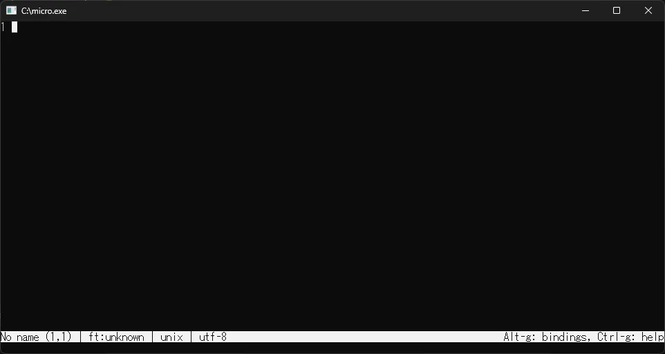

## 下載 micro
https://github.com/micro-editor/micro/releases/latest
在最新版本的 Assets 中，下載適用於 Windows x64 的壓縮檔（例如 `micro-<version>-win64.zip`），並解壓縮至任意資料夾。

若使用 Windows ARM，請改選對應的 ARM64 壓縮檔。

## 設定環境變數
為了從命令提示字元使用 `micro.exe`，您需要設定環境變數。

1. 按下 `Win` + `R`，輸入 `sysdm.cpl`，再按 `Enter`。
2. 開啟「進階」索引標籤，點選「環境變數」。
3. 在「使用者變數」中選取自己帳戶的 `Path`，再點選「編輯」。若清單中沒有 `Path`，請先新增。
4. 點選「新增」，加入包含 `micro.exe` 的資料夾路徑。
5. 點選「確定」關閉對話方塊。
6. 重新開啟命令提示字元並執行 `micro`，確認程式可以啟動。

## micro 的使用方法

在命令提示字元中輸入 `micro` 並執行後，將顯示以下畫面。

主要的操作方法與快捷鍵如下：

| 快捷鍵 | 操作 | 
|--------|-----| 
| Ctrl+Q | 關閉目前檔案（若這是最後一個檔案，micro 會結束） |
| Ctrl+S | 儲存檔案 | 
| Ctrl+O | 開啟檔案 | 
| Ctrl+A | 全選 | 
| Ctrl+X | 剪下選取範圍 | 
| Ctrl+C | 複製選取範圍 | 
| Ctrl+V | 貼上 | 
| Ctrl+Z | 復原 | 
| Ctrl+Y | 重做 | 
| Ctrl+E | 執行編輯器指令 | 

## 參考
- [micro](https://micro-editor.github.io/)
- [Default key bindings](https://github.com/micro-editor/micro/blob/master/runtime/help/defaultkeys.md)
