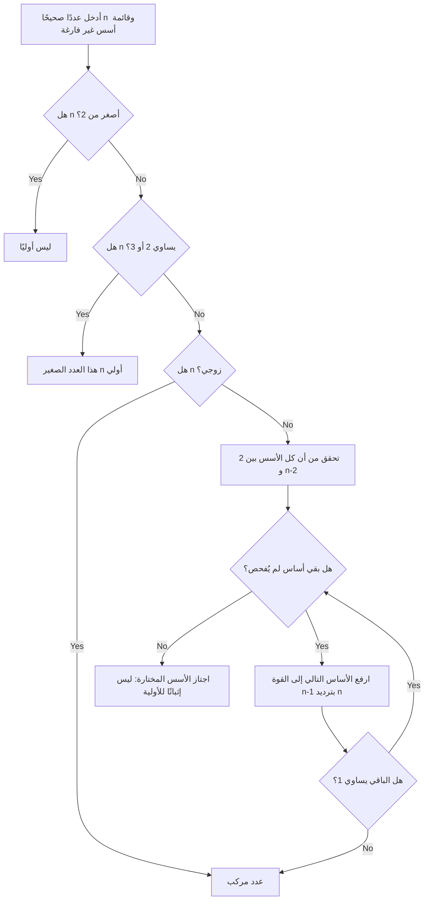
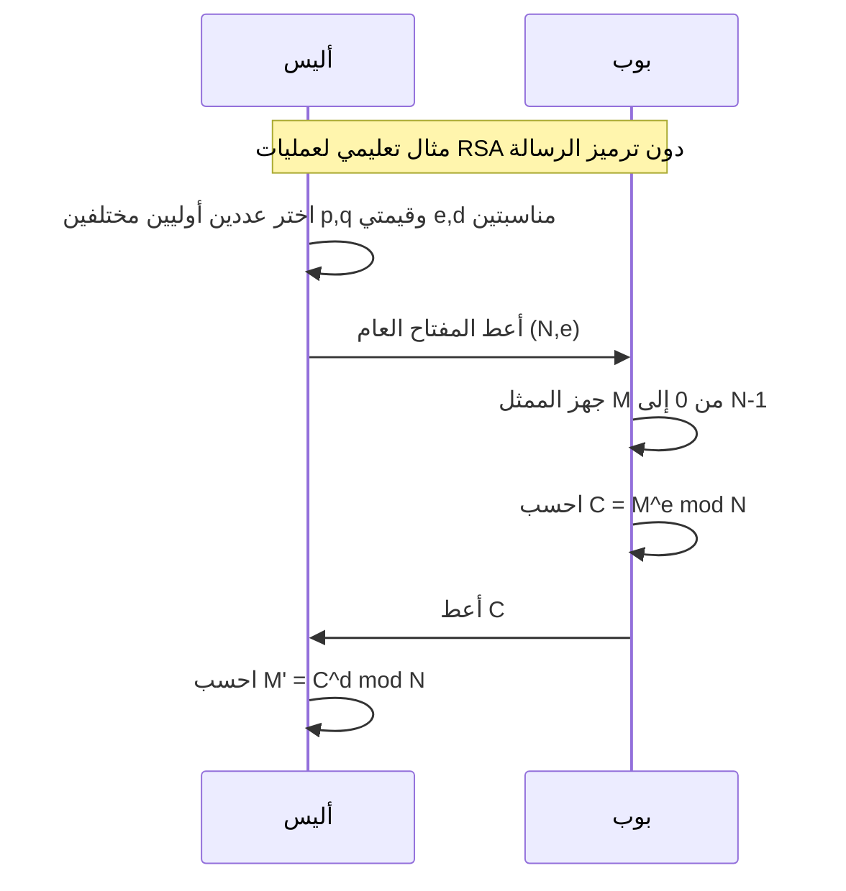

## 1. ما الذي تضمنه المبرهنة

تصف مبرهنة فيرما الصغرى خصائص رفع الأعداد إلى قوى بترديد عدد أولي. وهي تساعد على فهم شرط لازم للأولية وصحة فك التشفير في RSA. لكن صحة فك التشفير وأمان مخطط التشفير خاصيتان مختلفتان؛ فالمبرهنة وحدها لا تضمن سرية الاتصالات.

يشرح هذا المقال التطابق، ومبرهنتي فيرما وأويلر، وحدود اختبار فيرما، ورياضيات RSA. الشيفرة مادة تعليمية تتضمن التحقق من الحالات الحدّية، وليست تنفيذًا لتوليد المفاتيح أو للتشفير في الأنظمة الفعلية. انظر أيضًا [الفرق بين رياضيات RSA ومخطط التشفير](https://kenji.blog/ar/p/rsa-encryption-math-explained-for-beginners/).

## 2. التطابق والمعكوس الضربي

لعدد صحيح موجب $n$، تعني الكتابة التالية أن الفرق بين العددين الصحيحين $a,b$ من مضاعفات $n$:

$$ a \equiv b \pmod n. $$

مثلًا، $17\equiv12\equiv2\pmod5$. يُحفظ التطابق عند الجمع والطرح والضرب ورفع الأعداد إلى أسس صحيحة غير سالبة. لكن اختزال عامل مشترك يتطلب شرطًا:

$$ ac\equiv bc\pmod n,\quad \gcd(c,n)=1
\quad\Longrightarrow\quad a\equiv b\pmod n. $$

من دون شرط الأولية النسبية، لدينا مثلًا $2\cdot1\equiv2\cdot4\pmod6$، مع أن $1\not\equiv4\pmod6$. عندما يكون $n>1$، يوجد المعكوس $c^{-1}$ إذا وفقط إذا كان $\gcd(c,n)=1$. تجد خوارزمية إقليدس الممتدة حلًا للمعادلة $cx+ny=1$؛ وبأخذ باقي $x$ بترديد $n$ نحصل على المعكوس.

## 3. مبرهنة فيرما الصغرى وإثباتها

إذا كان $p$ أوليًا و $p\nmid a$، فإن:

$$ a^{p-1}\equiv1\pmod p. $$

عند $p=5$، تعطي الأعداد $2^4=16$ و $3^4=81$ و $4^4=256$ باقيًا يساوي 1 عند القسمة على 5. والصيغة الصالحة لكل عدد صحيح $a$ هي:

$$ a^p\equiv a\pmod p. $$

إذا كان $p\nmid a$ نضرب الصيغة الأولى في $a$. وإذا كان $p\mid a$، فكلا طرفي الصيغة الثانية متطابق مع الصفر.

لإثبات الصيغة الأولى، نضرب البواقي غير الصفرية $1,2,\ldots,p-1$ في $a$. لا يظهر باقي صفر. وإذا كان $ia\equiv ja\pmod p$ أمكن اختزال العامل $a$، فنحصل على $i=j$. إذن البواقي الناتجة إعادة ترتيب للبواقي غير الصفرية الأصلية. وبأخذ حاصل الضرب:

$$ a^{p-1}(p-1)!\equiv(p-1)!\pmod p. $$

بما أن $(p-1)!$ و $p$ أوليان فيما بينهما، يمكن اختزال العامل المشترك، فتثبت المبرهنة.

## 4. مبرهنة أويلر

تحصي دالة أويلر $\varphi(n)$ الأعداد الصحيحة من 1 إلى $n$ التي تكون أولية نسبيًا مع $n$. للعدد الأولي $p$ لدينا $\varphi(p)=p-1$؛ ولعددين أوليين مختلفين $p,q$:

$$ \varphi(pq)=(p-1)(q-1). $$

عندما يكون $n>1$ و $\gcd(a,n)=1$، تنص [مبرهنة أويلر](https://dlmf.nist.gov/27.2#E8) على أن:

$$ a^{\varphi(n)}\equiv1\pmod n. $$

يعتمد الإثبات على إعادة ترتيب البواقي الأولية نسبيًا مع المقياس واختزال حاصل الضرب، كما في القسم السابق. وحالة المقياس الأولي هي مبرهنة فيرما الصغرى. لا يجوز تطبيق مبرهنة أويلر دون شرط على مدخل ليس أوليًا نسبيًا مع المقياس.

## 5. ما الذي يكشفه اختبار فيرما

لعدد صحيح فردي $n>3$، نختار الأساس $a$ من المجال $2\le a\le n-2$. إذا تحقق عدم التطابق التالي، فإن $n$ مركب قطعًا:

$$ a^{n-1}\not\equiv1\pmod n. $$

العكس غير صحيح. اجتياز الاختبار يعني فقط أن الأسس المختارة لم تكشف مخالفة لهذا الشرط اللازم. وتكرار الفحص بأسس عشوائية لا يضمن حدًا صغيرًا موحدًا لاحتمال الخطأ لجميع المدخلات المركبة.



تثير الشيفرة استثناءً للقائمة الفارغة أو للأساس خارج المجال. وترفض نسخة Python أيضًا القيم التي ليست من النوع المدمج `int`. لا يُفحص مجال الأسس إلا للأعداد الفردية $n\ge5$، بعد معالجة الأعداد الصحيحة الصغيرة والأعداد الزوجية.

عدد كارمايكل عدد مركب يحقق تطابق فيرما **لكل أساس أولي نسبيًا مع $n$**. أصغر مثال هو $561=3\cdot11\cdot17$؛ يجتاز الأساس 2 لكنه يفشل عند الأساس 3. والعدد المركب $1105=5\cdot13\cdot17$ يجتاز الأساسين 2 و3. لا يجوز اعتبار ذلك إثباتًا للأولية عند توليد الأعداد الأولية.

يوضح قسما فيرما وميلر–رابين في [الفصل 4 من Handbook of Applied Cryptography](https://cacr.uwaterloo.ca/hac/about/chap4.pdf) هذا الفرق. لعدد مركب فردي ثابت، لا يتجاوز احتمال اجتياز $k$ اختبارات ميلر–رابين خطأً، باستخدام أسس عشوائية مستقلة وموزعة بانتظام، القيمة $4^{-k}$. وهذا ليس احتمال كون العدد مركبًا بعد اجتياز الاختبار، ولا ينطبق الحد تلقائيًا على أسس ثابتة اعتباطية. وتصف [وثائق OpenSSL](https://docs.openssl.org/master/man3/BN_generate_prime/) الأعداد الأولية المحتملة والاختبارات المتكررة. انظر أيضًا [مقال اختبار الأولية](https://kenji.blog/ar/p/cpp-fast-prime-testing-miller-rabin/).

## 6. فحص الشرط اللازم باستخدام C++ وPython

هذه أمثلة تعليمية تفحص أسسًا محددة دون اختيار عشوائي. تعني `passes` في اسم الدالة اجتياز الفحص، لا شهادة أولية. في التنفيذ القديم، كان عدد التكرارات الصفري أو السالب يؤدي إلى تخطي الفحص؛ أما هذا الإصدار فيرفض قائمة الأسس الفارغة.

### C++17

يتطلب المثال تنفيذًا يوفر `std::uint64_t`، ولا يعالج المدخلات السالبة. يُبنى الضرب المعياري من عمليات جمع تحافظ على البواقي ضمن مجال المقياس، دون الاعتماد على امتداد `__int128`. تفترض الدالة الداخلية المساعدة `add_mod` أن كلا العددين المجموعين أصغر من المقياس. إذا كان `a >= m-b`، يُستعاض عن الجمع بالطرح؛ وإلا فالمجموع أصغر من المقياس ويتسع في 64 بت. ترفض دالتا الضرب ورفع القوة المقياس صفرًا، وتعيدان الباقي صفرًا للمقياس واحد.

```cpp
#include <cstdint>
#include <iostream>
#include <stdexcept>
#include <vector>

using u64 = std::uint64_t;

// Internal helper: m > 0 and a, b < m.
u64 add_mod(u64 a, u64 b, u64 m) {
    return a >= m - b ? a - (m - b) : a + b;
}

u64 mul_mod(u64 a, u64 b, u64 m) {
    if (m == 0) throw std::invalid_argument("Modulus must be positive");
    a %= m;
    u64 result = 0;
    while (b != 0) {
        if (b & 1) result = add_mod(result, a, m);
        b >>= 1;
        if (b != 0) a = add_mod(a, a, m);
    }
    return result;
}

u64 power_mod(u64 a, u64 exponent, u64 m) {
    if (m == 0) throw std::invalid_argument("Modulus must be positive");
    u64 result = 1 % m;
    a %= m;
    while (exponent != 0) {
        if (exponent & 1) result = mul_mod(result, a, m);
        exponent >>= 1;
        if (exponent != 0) a = mul_mod(a, a, m);
    }
    return result;
}

bool fermat_passes(u64 n, const std::vector<u64>& bases) {
    if (bases.empty()) throw std::invalid_argument("Choose at least one base");
    if (n < 2) return false;
    if (n <= 3) return true;
    if (n % 2 == 0) return false;
    for (u64 a : bases) {
        if (a < 2 || a > n - 2) throw std::invalid_argument("Base outside range");
    }
    for (u64 a : bases) {
        if (power_mod(a, n - 1, n) != 1) return false;
    }
    return true;
}

int main() {
    std::cout << "1000000007 passes bases 2,3: " << fermat_passes(1000000007, {2, 3}) << '\n';
    std::cout << "1105 passes bases 2,3: " << fermat_passes(1105, {2, 3}) << '\n';
    std::cout << "1105 passes base 5: " << fermat_passes(1105, {5}) << '\n';
}
```

يمكن الترجمة مثلًا بالأمر `g++ -std=c++17 fermat.cpp -o fermat`. فُحصت الشيفرة باستخدام GCC 13.3 في WSL. النتائج المنطقية بالترتيب هي `1, 1, 0`. واجتياز العدد المركب 1105 لأساسين يوضح حدود الاختبار.

### Python

تستخدم النسخة الأعداد الصحيحة في Python 3 والدالة `pow` ذات الوسائط الثلاث. لا تقبل إلا النوع المدمج `int`، وترفض `bool` والأنواع الأخرى. يجب ألا تكون قائمة الأسس فارغة. وتفحص المرشحين والأسس نفسها في مثال C++.

```python
def fermat_passes(n, bases):
    if type(n) is not int:
        raise TypeError("n must be an integer")
    bases = tuple(bases)
    if not bases:
        raise ValueError("Choose at least one base")
    if any(type(a) is not int for a in bases):
        raise TypeError("Bases must be integers")
    if n < 2:
        return False
    if n <= 3:
        return True
    if n % 2 == 0:
        return False
    if any(a < 2 or a > n - 2 for a in bases):
        raise ValueError("Base outside range")
    return all(pow(a, n - 1, n) == 1 for a in bases)


if __name__ == "__main__":
    print("1000000007 passes bases 2,3:", fermat_passes(1000000007, [2, 3]))
    print("1105 passes bases 2,3:", fermat_passes(1105, [2, 3]))
    print("1105 passes base 5:", fermat_passes(1105, [5]))
```

فُحصت الشيفرة باستخدام Python 3.12. النتائج بالترتيب هي `True, True, False`. ويظل العدد 104729 من المثال السابق مجتازًا للاختبار بصفته عددًا أوليًا. تمنع الأعداد الصحيحة ذات الدقة الاعتباطية في Python تجاوز سعة الأعداد ثابتة العرض، لكن الوقت والذاكرة ليسا غير محدودين.

تجري طريقة التربيع المتكرر $O(\log b)$ عمليات ضرب معياري للأس $b>0$، أي عددًا يتناسب مع طوله بالبتات. هذا عدد عمليات، وليس التعقيد بالبتات أو زمنًا مقاسًا. وكل ضرب معياري في مثال C++ يستخدم عددًا من عمليات الجمع المعياري يتناسب مع طول المضروب فيه بالبتات. ولا نفترض أن الخوارزمية الداخلية الدقيقة للدالة `pow` واحدة في جميع إصدارات Python.

## 7. لماذا يكون فك تشفير RSA صحيحًا

نختار عددين أوليين مختلفين $p,q$ ونضع $N=pq$. في هذا البناء التعليمي، يحقق الأس العام $1<e<\varphi(N)$ و $\gcd(e,\varphi(N))=1$. ومعكوسه هو الأس الخاص $d$:

$$ ed\equiv1\pmod{\varphi(N)},\qquad
\varphi(N)=(p-1)(q-1). $$

المفتاح العام هو $(N,e)$، والتمثيل المبسط للمفتاح الخاص هو $(N,d)$. قد يتضمن المفتاح الخاص الفعلي عوامل للحساب باستخدام مبرهنة الباقي الصينية، ويجب إبقاؤها سرية أيضًا. تحليل المقياس إلى عوامله يتيح حساب الأس الخاص، لكن لم يُثبت التكافؤ العام بين عكس عملية RSA وتحليل العدد إلى عوامله.

لممثل رسالة على هيئة عدد صحيح $0\le M<N$:

$$ C=M^e\bmod N,\qquad M'=C^d\bmod N. $$

يعرض المخطط فقط **عمليات RSA دون ترميز الرسالة** على الممثلين من الأعداد الصحيحة. إنه مخطط رياضي يحذف ترميز الرسالة والتحقق من الأصالة في التطبيق الفعلي.



أولًا، إذا كان $\gcd(M,N)=1$، نكتب $ed=1+t\varphi(N)$ لعدد صحيح غير سالب $t$. من مبرهنة أويلر:

$$ M^{ed}=M(M^{\varphi(N)})^t\equiv M\pmod N. $$

ولا نستبعد الممثلين غير الأوليين نسبيًا مع المقياس. بترديد $p$، إذا كان $p\mid M$ فإن $M^{ed}$ و $M$ كلاهما صفر بهذا الترديد. وإلا، تعطي مبرهنة فيرما الصغرى والعلاقة $p-1\mid ed-1$ التطابق المطلوب. وينطبق الاستدلال نفسه بترديد $q$. ولأن $p,q$ أوليان فيما بينهما، تعطينا مبرهنة الباقي الصينية:

$$ M^{ed}\equiv M\pmod p,\quad
M^{ed}\equiv M\pmod q
\quad\Longrightarrow\quad M^{ed}\equiv M\pmod N. $$

إذن يُستعاد كل ممثل، بما في ذلك الصفر ومضاعفات $p,q$. هذا إثبات للصحة، وليس للسرية.

## 8. مثال قابل لإعادة الإنتاج للعملية الأساسية في RSA

نستخدم العددين الأوليين المعروفين الثابتين 61 و53 والأس 17. ويُحسب المعكوس بخوارزمية إقليدس الممتدة. لا يولد المثال أعدادًا أولية عشوائية ولا يحول السلسلة حرفًا بحرف. كان «مولد الأعداد الأولية» القديم، الذي يفحص الأساسين 2 و3 فقط، يقبل 1105 وقد ينتج مفاتيح يفشل بها فك التشفير. ولا يمكن إغفال الأس واحد أو الممثلين خارج المجال عند تحديد متطلبات التشفير الفعلي.

تتحقق `rsa_primitive` فقط من المجالات الحسابية لمدخلات الأس والمقياس والممثل. لا تحلل مقياسًا اعتباطيًا إلى عوامله ولا تفحص صلاحية مفتاح RSA اعتباطي. أما المفتاح التعليمي الثابت فيحقق شروط المفتاح على نحو منفصل. ويميز [القسمان 5 و7 من RFC 8017](https://www.rfc-editor.org/rfc/rfc8017.html) أيضًا بين العمليات الأساسية ومخططات التشفير.

```python
def extended_gcd(a, b):
    old_r, r = a, b
    old_s, s = 1, 0
    old_t, t = 0, 1
    while r:
        q = old_r // r
        old_r, r = r, old_r - q * r
        old_s, s = s, old_s - q * s
        old_t, t = t, old_t - q * t
    return old_r, old_s, old_t


def mod_inverse(a, modulus):
    if type(a) is not int or type(modulus) is not int:
        raise TypeError("Arguments must be integers")
    if modulus <= 1:
        raise ValueError("Modulus must exceed one")
    g, x, _ = extended_gcd(a % modulus, modulus)
    if g != 1:
        raise ValueError("Inverse does not exist")
    return x % modulus


def rsa_primitive(value, exponent, modulus):
    if any(type(x) is not int for x in (value, exponent, modulus)):
        raise TypeError("Arguments must be integers")
    if exponent <= 0 or modulus <= 1 or not 0 <= value < modulus:
        raise ValueError("Invalid exponent, modulus or representative")
    return pow(value, exponent, modulus)


def rsa_primitive_demo():
    p, q, e = 61, 53, 17  # Fixed public teaching constants, not secret keys.
    n = p * q
    phi = (p - 1) * (q - 1)
    d = mod_inverse(e, phi)
    print("Public key (n, e):", (n, e))
    print("Private key (n, d):", (n, d))
    m = 65
    c = rsa_primitive(m, e, n)
    recovered = rsa_primitive(c, d, n)
    print(f"{m} -> {c} -> {recovered}")
    for representative in range(n):
        cipher = rsa_primitive(representative, e, n)
        if rsa_primitive(cipher, d, n) != representative:
            raise ArithmeticError("Round-trip failed")
    print("All 3233 representatives round-trip.")


if __name__ == "__main__":
    rsa_primitive_demo()
```

يعرض التنفيذ $(N,e)=(3233,17)$ و $(N,d)=(3233,2753)$ و `65 -> 2790 -> 65`، ثم يفحص استعادة جميع الممثلين البالغ عددهم 3233 بعد التشفير وفكه. والمفتاح الخاص المعروض ثابت تعليمي معلن. لا تضمن هذه الاختبارات أمان مفاتيح RSA عمومًا.

## 9. حدود الاستخدام والمراجع

RSA دون ترميز الرسالة حتمي، ولا يكفي لتشفير آمن. مثلًا، يتيح المفتاح العام حساب نصوص مشفرة للأحرف المحتملة ومطابقتها بقاموس. يتطلب الاستخدام الفعلي مكتبة مدققة، ومخططًا مناسبًا مثل RSAES-OAEP، ومعلمات صحيحة، وعشوائية آمنة تشفيريًا. لا يجوز استخدام مولد الأعداد شبه العشوائية في [random في Python](https://docs.python.org/3/library/random.html) لتوليد مفاتيح التشفير. وRSASSA-PSS مخطط توقيع، مختلف عن التشفير.

ينبغي التمييز بين المراحل: تثبت المبرهنة تطابقًا؛ ويفحص اختبار الأولية شروطًا؛ وتستعيد عمليات RSA ذات المفتاح الصحيح الممثل؛ ويضيف المخطط الفعلي الترميز ومتطلبات أمان أخرى. لا يصح الادعاء بأن خدمة اتصالات معينة أو التشفير الحديث كله يعتمد على مبرهنة فيرما الصغرى وحدها.

المصادر الأولية المشار إليها هي [مبرهنة أويلر في DLMF](https://dlmf.nist.gov/27.2#E8)، و[الفصل 4 من HAC](https://cacr.uwaterloo.ca/hac/about/chap4.pdf)، و[مواصفة RSA في RFC 8017](https://www.rfc-editor.org/rfc/rfc8017.html)، و[شرح الأعداد الصحيحة ذات 128 بت في GCC](https://gcc.gnu.org/onlinedocs/gcc/_005f_005fint128.html). يوضح المصدر الأخير قيود نوع الامتداد المستخدم في التنفيذ السابق.
