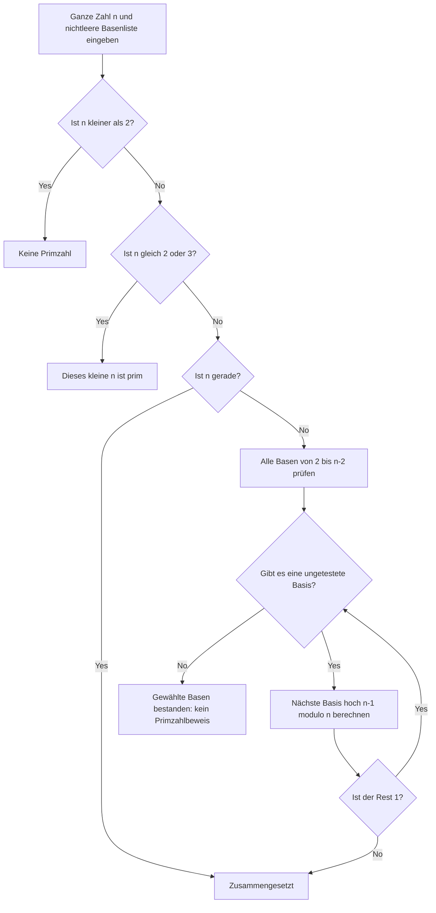
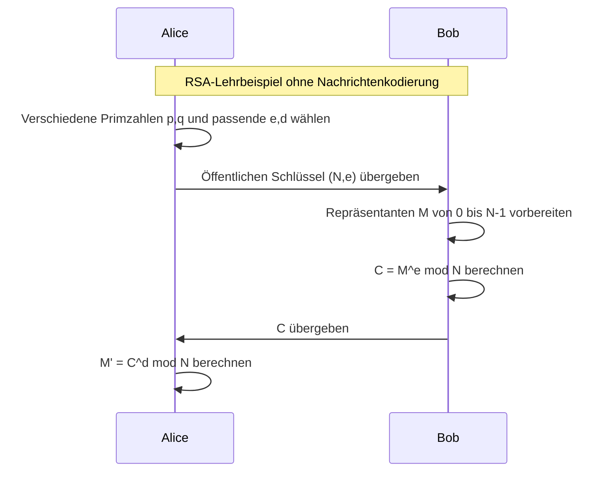

## 1. Was der Satz garantiert

Der kleine Satz von Fermat beschreibt Potenzen modulo einer Primzahl. Er hilft, eine notwendige Bedingung für Primzahlen und die Korrektheit der RSA-Entschlüsselung zu verstehen. Korrekte Entschlüsselung und ein sicheres Verschlüsselungsverfahren sind verschiedene Eigenschaften: Der Satz allein garantiert keine vertrauliche Kommunikation.

Dieser Artikel behandelt Kongruenzen, die Sätze von Fermat und Euler, die Grenzen des Fermat-Tests und die RSA-Mathematik. Der Code ist Lehrmaterial mit Grenzprüfungen, keine Implementierung für produktive Schlüsselgenerierung oder Verschlüsselung. Siehe auch [RSA-Mathematik und Verschlüsselungsverfahren](https://kenji.blog/de/p/rsa-encryption-math-explained-for-beginners/).

## 2. Kongruenzen und Inverse

Für eine positive ganze Zahl $n$ bedeutet die folgende Schreibweise, dass die Differenz der ganzen Zahlen $a,b$ ein Vielfaches von $n$ ist.

$$ a \equiv b \pmod n. $$

Beispielsweise gilt $17\equiv12\equiv2\pmod5$. Kongruenzen sind mit Addition, Subtraktion, Multiplikation und nichtnegativen ganzzahligen Potenzen verträglich. Das Kürzen eines Faktors verlangt jedoch eine Bedingung.

$$ ac\equiv bc\pmod n,\quad \gcd(c,n)=1
\quad\Longrightarrow\quad a\equiv b\pmod n. $$

Ohne Teilerfremdheit gilt zwar $2\cdot1\equiv2\cdot4\pmod6$, aber $1\not\equiv4\pmod6$. Für $n>1$ existiert das Inverse $c^{-1}$ genau dann, wenn $\gcd(c,n)=1$. Der erweiterte euklidische Algorithmus findet $cx+ny=1$; die Reduktion von $x$ modulo $n$ liefert das Inverse.

## 3. Kleiner Satz von Fermat und Beweis

Ist $p$ eine Primzahl und gilt $p\nmid a$, dann:

$$ a^{p-1}\equiv1\pmod p. $$

Für $p=5$ haben $2^4=16$, $3^4=81$ und $4^4=256$ jeweils den Rest 1 bei Division durch 5. Eine für jede ganze Zahl $a$ gültige Form ist:

$$ a^p\equiv a\pmod p. $$

Für $p\nmid a$ multipliziert man die erste Form mit $a$. Für $p\mid a$ sind beide Seiten der zweiten Form kongruent zu null.

Zum Beweis der ersten Form multipliziert man die von null verschiedenen Reste $1,2,\ldots,p-1$ mit $a$. Keiner der neuen Reste ist null. Aus $ia\equiv ja\pmod p$ folgt durch Kürzen von $a$ die Gleichheit $i=j$. Die Produkte permutieren also die ursprünglichen von null verschiedenen Reste. Durch Produktbildung erhält man:

$$ a^{p-1}(p-1)!\equiv(p-1)!\pmod p. $$

Da $(p-1)!$ und $p$ teilerfremd sind, kann man diesen Faktor kürzen. Damit ist der Satz bewiesen.

## 4. Satz von Euler

Die eulersche Phi-Funktion $\varphi(n)$ zählt die zu $n$ teilerfremden ganzen Zahlen von 1 bis $n$. Für eine Primzahl $p$ gilt $\varphi(p)=p-1$; für verschiedene Primzahlen $p,q$ gilt:

$$ \varphi(pq)=(p-1)(q-1). $$

Für $n>1$ und $\gcd(a,n)=1$ besagt der [Satz von Euler](https://dlmf.nist.gov/27.2#E8):

$$ a^{\varphi(n)}\equiv1\pmod n. $$

Eine Permutation der zum Modulus teilerfremden Reste und anschließendes Kürzen des Produkts beweisen dies wie im vorigen Abschnitt. Der kleine Satz von Fermat ist der Fall eines Primzahlmodulus. Auf eine nicht teilerfremde Eingabe darf man den Satz von Euler nicht ohne Weiteres anwenden.

## 5. Was der Fermat-Test aussagt

Für eine ungerade ganze Zahl $n>3$ wählt man eine Basis $a$ mit $2\le a\le n-2$. Bei folgender Nichtkongruenz ist $n$ sicher zusammengesetzt.

$$ a^{n-1}\not\equiv1\pmod n. $$

Die Umkehrung gilt nicht. Das Bestehen bedeutet lediglich, dass die gewählten Basen diese notwendige Bedingung nicht verletzt haben. Wiederholungen mit mehreren zufälligen Basen liefern keine einheitlich kleine Fehlerschranke für alle zusammengesetzten Eingaben.



Bei leerer Liste oder einer Basis außerhalb des Bereichs löst der Code eine Ausnahme aus. Die Python-Version lehnt auch nichtganzzahlige Typen ab. Der Basenbereich wird nur für ungerade $n\ge5$ geprüft, nachdem kleine ganze Zahlen und gerade Zahlen behandelt wurden.

Eine Carmichael-Zahl ist eine zusammengesetzte Zahl, die die Fermat-Kongruenz für **jede zu $n$ teilerfremde Basis** erfüllt. Das kleinste Beispiel $561=3\cdot11\cdot17$ besteht den Test zur Basis 2, aber nicht zur Basis 3. Die zusammengesetzte Zahl $1105=5\cdot13\cdot17$ besteht ihn zu den Basen 2 und 3. Solche Ergebnisse dürfen bei der Primzahlgenerierung nicht als Beweis gelten.

Die Abschnitte zu Fermat und Miller–Rabin im [Handbook of Applied Cryptography, Kapitel 4](https://cacr.uwaterloo.ca/hac/about/chap4.pdf) erläutern den Unterschied. Für eine feste ungerade zusammengesetzte Zahl begrenzen $k$ Miller–Rabin-Tests mit unabhängigen, gleichverteilten Zufallsbasen die Wahrscheinlichkeit eines fälschlichen Bestehens auf $4^{-k}$. Das ist eine andere Größe als die Wahrscheinlichkeit, dass eine Zahl nach bestandenen Tests zusammengesetzt ist. Die Schranke gilt auch nicht automatisch für beliebige feste Basen. Die [OpenSSL-Dokumentation](https://docs.openssl.org/master/man3/BN_generate_prime/) beschreibt ebenfalls wahrscheinliche Primzahlen und wiederholte Tests. Näheres steht im [Artikel über Primzahltests](https://kenji.blog/de/p/cpp-fast-prime-testing-miller-rabin/).

## 6. Notwendige Bedingung mit C++ und Python testen

Diese Lehrbeispiele prüfen vorgegebene Basen ohne Zufallsauswahl. Der Name `passes` bezeichnet ein Bestehen, keinen Primzahlbeweis. Die ursprüngliche Implementierung übersprang die Prüfungen bei null oder negativen Wiederholungszahlen; diese Versionen weisen eine leere Basenliste zurück.

### C++17

Das Beispiel setzt eine Implementierung mit `std::uint64_t` voraus und behandelt keine negativen Eingaben. Die modulare Multiplikation verwendet Additionen, deren Reste im Bereich des Modulus bleiben, ohne die Erweiterung `__int128`. Die interne Hilfsfunktion `add_mod` setzt voraus, dass beide Summanden kleiner als der Modulus sind. Bei `a >= m-b` ersetzt eine Subtraktion die Addition; andernfalls ist die Summe kleiner als der Modulus und passt in 64 Bit. Multiplikations- und Potenzfunktionen lehnen den Modulus null ab und liefern für Modulus eins den Rest null.

```cpp
#include <cstdint>
#include <iostream>
#include <stdexcept>
#include <vector>

using u64 = std::uint64_t;

// Internal helper: m > 0 and a, b < m.
u64 add_mod(u64 a, u64 b, u64 m) {
    return a >= m - b ? a - (m - b) : a + b;
}

u64 mul_mod(u64 a, u64 b, u64 m) {
    if (m == 0) throw std::invalid_argument("Modulus must be positive");
    a %= m;
    u64 result = 0;
    while (b != 0) {
        if (b & 1) result = add_mod(result, a, m);
        b >>= 1;
        if (b != 0) a = add_mod(a, a, m);
    }
    return result;
}

u64 power_mod(u64 a, u64 exponent, u64 m) {
    if (m == 0) throw std::invalid_argument("Modulus must be positive");
    u64 result = 1 % m;
    a %= m;
    while (exponent != 0) {
        if (exponent & 1) result = mul_mod(result, a, m);
        exponent >>= 1;
        if (exponent != 0) a = mul_mod(a, a, m);
    }
    return result;
}

bool fermat_passes(u64 n, const std::vector<u64>& bases) {
    if (bases.empty()) throw std::invalid_argument("Choose at least one base");
    if (n < 2) return false;
    if (n <= 3) return true;
    if (n % 2 == 0) return false;
    for (u64 a : bases) {
        if (a < 2 || a > n - 2) throw std::invalid_argument("Base outside range");
    }
    for (u64 a : bases) {
        if (power_mod(a, n - 1, n) != 1) return false;
    }
    return true;
}

int main() {
    std::cout << "1000000007 passes bases 2,3: " << fermat_passes(1000000007, {2, 3}) << '\n';
    std::cout << "1105 passes bases 2,3: " << fermat_passes(1105, {2, 3}) << '\n';
    std::cout << "1105 passes base 5: " << fermat_passes(1105, {5}) << '\n';
}
```

Zum Beispiel kompiliert man mit `g++ -std=c++17 fermat.cpp -o fermat`. Der Code wurde mit GCC 13.3 unter WSL geprüft. Die booleschen Ausgaben lauten der Reihe nach `1, 1, 0`. Dass die zusammengesetzte Zahl 1105 die Tests zu zwei Basen besteht, zeigt bereits die Grenze des Tests.

### Python

Diese Version nutzt Python-3-Ganzzahlen und `pow` mit drei Argumenten. Sie verlangt den eingebauten Typ `int` und lehnt `bool` ab. Die Basenliste darf nicht leer sein. Kandidaten und Basen entsprechen dem C++-Beispiel.

```python
def fermat_passes(n, bases):
    if type(n) is not int:
        raise TypeError("n must be an integer")
    bases = tuple(bases)
    if not bases:
        raise ValueError("Choose at least one base")
    if any(type(a) is not int for a in bases):
        raise TypeError("Bases must be integers")
    if n < 2:
        return False
    if n <= 3:
        return True
    if n % 2 == 0:
        return False
    if any(a < 2 or a > n - 2 for a in bases):
        raise ValueError("Base outside range")
    return all(pow(a, n - 1, n) == 1 for a in bases)


if __name__ == "__main__":
    print("1000000007 passes bases 2,3:", fermat_passes(1000000007, [2, 3]))
    print("1105 passes bases 2,3:", fermat_passes(1105, [2, 3]))
    print("1105 passes base 5:", fermat_passes(1105, [5]))
```

Der Code wurde mit Python 3.12 geprüft. Die Ergebnisse lauten `True, True, False`. Das ursprüngliche Beispiel 104729 besteht weiterhin als Primzahl. Python-Ganzzahlen vermeiden Überläufe fester Breite, aber Zeit und Speicher sind nicht unbegrenzt.

Binäre Exponentiation benötigt für einen Exponenten $b>0$ insgesamt $O(\log b)$ modulare Multiplikationen, proportional zu seiner Bitlänge. Dies ist weder Bitkomplexität noch gemessene Laufzeit. Jede modulare Multiplikation im C++-Beispiel verwendet eine zur Bitlänge des Multiplikators proportionale Anzahl modularer Additionen. Der genaue interne Algorithmus von Python-`pow` wird nicht für alle Versionen als identisch vorausgesetzt.

## 7. Warum RSA-Entschlüsselung funktioniert

Man wählt verschiedene Primzahlen $p,q$ und setzt $N=pq$. Für diese Lehrkonstruktion erfüllt der öffentliche Exponent $1<e<\varphi(N)$ und $\gcd(e,\varphi(N))=1$; sein Inverses ist der private Exponent $d$.

$$ ed\equiv1\pmod{\varphi(N)},\qquad
\varphi(N)=(p-1)(q-1). $$

Der öffentliche Schlüssel ist $(N,e)$, eine vereinfachte Darstellung des privaten Schlüssels ist $(N,d)$. Reale private Schlüssel können auch Faktoren für CRT-Berechnungen enthalten, die ebenfalls geheim sind. Durch Faktorisierung des Modulus lässt sich der private Exponent berechnen. Eine allgemeine Äquivalenz zwischen RSA-Inversion und Faktorisierung ist damit jedoch nicht bewiesen.

Für einen Repräsentanten $0\le M<N$ gilt:

$$ C=M^e\bmod N,\qquad M'=C^d\bmod N. $$

Das Diagramm zeigt ausschließlich **RSA-Operationen ohne Nachrichtenkodierung** für ganzzahlige Repräsentanten. Es ist ein mathematisches Diagramm, das die Nachrichtenkodierung und Authentisierung einer realen Anwendung auslässt.



Zunächst kann man für $\gcd(M,N)=1$ die Gleichung $ed=1+t\varphi(N)$ mit einer nichtnegativen ganzen Zahl $t$ schreiben. Der Satz von Euler liefert:

$$ M^{ed}=M(M^{\varphi(N)})^t\equiv M\pmod N. $$

Nicht teilerfremde Repräsentanten werden nicht ausgeschlossen. Modulo $p$ sind bei $p\mid M$ sowohl $M^{ed}$ als auch $M$ null. Andernfalls liefern der kleine Satz von Fermat und $p-1\mid ed-1$ die Kongruenz. Dasselbe Argument gilt modulo $q$. Da $p,q$ teilerfremd sind, liefert der chinesische Restsatz:

$$ M^{ed}\equiv M\pmod p,\quad
M^{ed}\equiv M\pmod q
\quad\Longrightarrow\quad M^{ed}\equiv M\pmod N. $$

Damit werden alle Repräsentanten wiederhergestellt, einschließlich null und der Vielfachen von $p,q$. Dies ist ein Korrektheitsbeweis, kein Vertraulichkeitsbeweis.

## 8. Reproduzierbares Beispiel der RSA-Grundoperation

Verwendet werden die bekannten festen Primzahlen 61 und 53 sowie der Exponent 17. Das Inverse wird mit dem erweiterten euklidischen Algorithmus berechnet. Es werden keine zufälligen Primzahlen erzeugt und keine Zeichenketten zeichenweise umgewandelt. Der ursprüngliche „Primzahlgenerator“, der nur die Basen 2 und 3 prüfte, akzeptiert 1105 und kann Schlüssel erzeugen, die eine korrekte Entschlüsselung verhindern. Auch Exponent eins und Repräsentanten außerhalb des Bereichs dürfen bei Anforderungen an reale Verschlüsselung nicht übergangen werden.

Die Funktion `rsa_primitive` prüft nur die arithmetischen Eingabebereiche von Exponent, Modulus und Repräsentant. Sie faktorisiert keinen beliebigen Modulus und validiert keinen beliebigen RSA-Schlüssel. Der feste Lehrschlüssel erfüllt die Schlüsselbedingungen gesondert. Die [RFC 8017](https://www.rfc-editor.org/rfc/rfc8017.html) unterscheidet in den Abschnitten 5 und 7 ebenfalls zwischen Grundoperationen und Verschlüsselungsverfahren.

```python
def extended_gcd(a, b):
    old_r, r = a, b
    old_s, s = 1, 0
    old_t, t = 0, 1
    while r:
        q = old_r // r
        old_r, r = r, old_r - q * r
        old_s, s = s, old_s - q * s
        old_t, t = t, old_t - q * t
    return old_r, old_s, old_t


def mod_inverse(a, modulus):
    if type(a) is not int or type(modulus) is not int:
        raise TypeError("Arguments must be integers")
    if modulus <= 1:
        raise ValueError("Modulus must exceed one")
    g, x, _ = extended_gcd(a % modulus, modulus)
    if g != 1:
        raise ValueError("Inverse does not exist")
    return x % modulus


def rsa_primitive(value, exponent, modulus):
    if any(type(x) is not int for x in (value, exponent, modulus)):
        raise TypeError("Arguments must be integers")
    if exponent <= 0 or modulus <= 1 or not 0 <= value < modulus:
        raise ValueError("Invalid exponent, modulus or representative")
    return pow(value, exponent, modulus)


def rsa_primitive_demo():
    p, q, e = 61, 53, 17  # Fixed public teaching constants, not secret keys.
    n = p * q
    phi = (p - 1) * (q - 1)
    d = mod_inverse(e, phi)
    print("Public key (n, e):", (n, e))
    print("Private key (n, d):", (n, d))
    m = 65
    c = rsa_primitive(m, e, n)
    recovered = rsa_primitive(c, d, n)
    print(f"{m} -> {c} -> {recovered}")
    for representative in range(n):
        cipher = rsa_primitive(representative, e, n)
        if rsa_primitive(cipher, d, n) != representative:
            raise ArithmeticError("Round-trip failed")
    print("All 3233 representatives round-trip.")


if __name__ == "__main__":
    rsa_primitive_demo()
```

Die Ausführung zeigt $(N,e)=(3233,17)$, $(N,d)=(3233,2753)$ und `65 -> 2790 -> 65` und prüft die Hin- und Rückumwandlung aller 3233 Repräsentanten. Auch der ausgegebene private Schlüssel ist eine feste, öffentliche Lehrkonstante. Der Test garantiert keine Sicherheit beliebiger RSA-Schlüssel.

## 9. Praktische Grenzen und Quellen

RSA ohne Nachrichtenkodierung ist deterministisch und reicht für sichere Verschlüsselung nicht aus. Beispielsweise erlaubt der öffentliche Schlüssel einen Wörterbuchabgleich zeichenweise verschlüsselter Texte. In der Praxis braucht man geprüfte Bibliotheken, ein geeignetes Verfahren wie RSAES-OAEP, passende Parameter und sicheren Zufall. Der Pseudozufallsgenerator in [Python-random](https://docs.python.org/3/library/random.html) darf nicht zur Erzeugung kryptographischer Schlüssel verwendet werden. RSASSA-PSS ist ein Signaturverfahren und von Verschlüsselung zu unterscheiden.

Die Schritte müssen auseinandergehalten werden: Der Satz begründet Kongruenzen, Primzahltests prüfen Bedingungen, RSA-Operationen mit gültigen Schlüsseln stellen Repräsentanten wieder her, und reale Verfahren ergänzen Kodierung und weitere Sicherheitsanforderungen. Weder einzelne Kommunikationsdienste noch die gesamte moderne Kryptographie lassen sich als ausschließlich vom kleinen Satz von Fermat abhängig beschreiben.

Primärquellen sind [DLMF zum Satz von Euler](https://dlmf.nist.gov/27.2#E8), [HAC, Kapitel 4](https://cacr.uwaterloo.ca/hac/about/chap4.pdf), [die RSA-Spezifikation RFC 8017](https://www.rfc-editor.org/rfc/rfc8017.html) und [die GCC-Beschreibung von 128-Bit-Ganzzahlen](https://gcc.gnu.org/onlinedocs/gcc/_005f_005fint128.html). Die letzte Quelle erläutert die Grenzen des Erweiterungstyps aus der ursprünglichen Implementierung.
