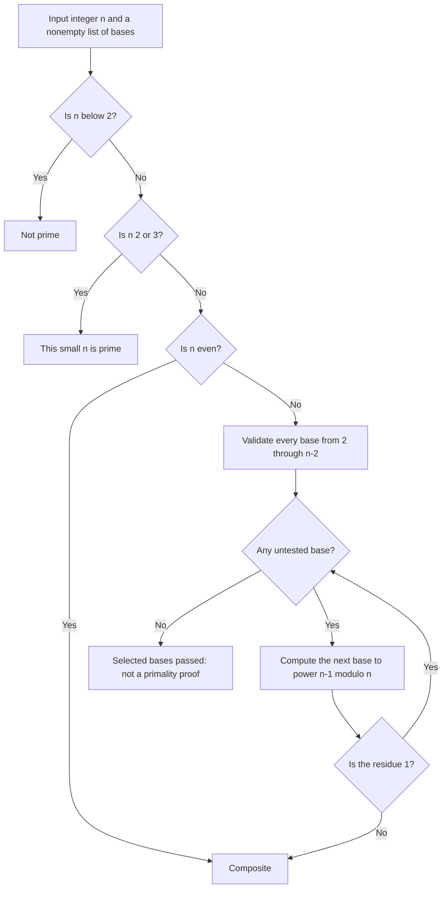
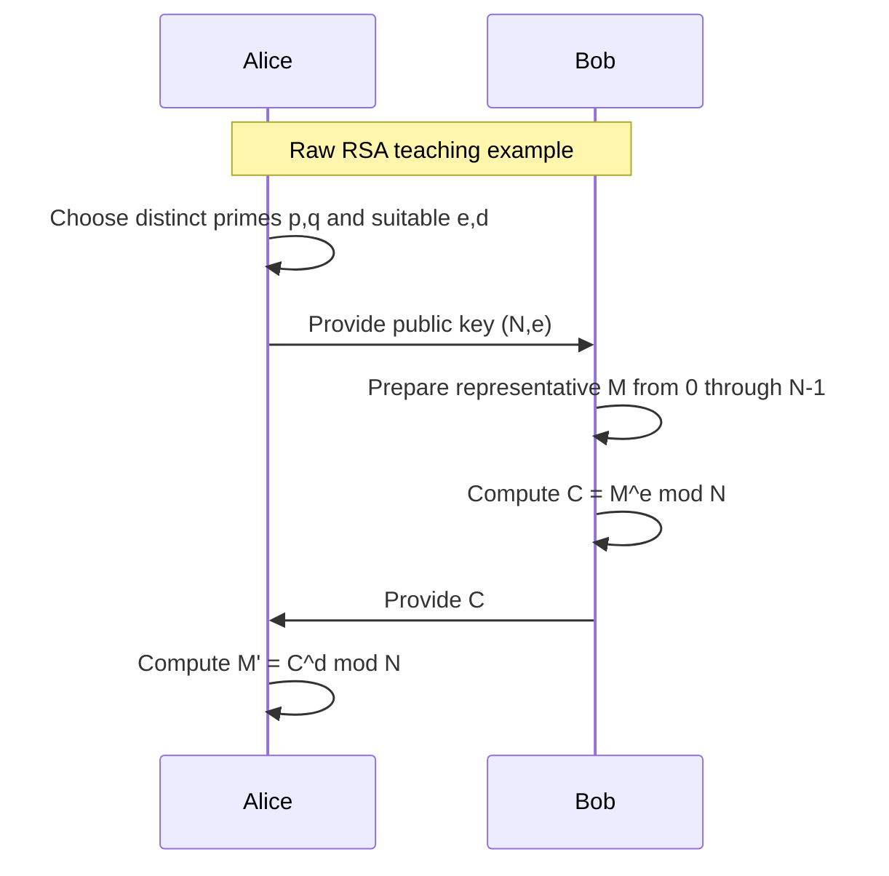

## 1. What the theorem guarantees

Fermat's little theorem describes powers modulo a prime. It helps explain a necessary condition for primality and why RSA decryption works. Correct decryption and a secure encryption scheme are separate properties: the theorem alone does not guarantee confidential communication.

This article covers congruences, Fermat's and Euler's theorems, the limitations of the Fermat test, and RSA mathematics. The code is teaching material with explicit boundary checks, rather than an implementation for production key generation or encryption. See also [RSA mathematics and encryption schemes](https://kenji.blog/en/p/rsa-encryption-math-explained-for-beginners/).

## 2. Congruences and inverses

For a positive integer $n$, the following says that the difference between integers $a,b$ is a multiple of $n$.

$$ a \equiv b \pmod n. $$

For example, $17\equiv12\equiv2\pmod5$. Congruences respect addition, subtraction, multiplication, and nonnegative integer powers. Cancellation, however, needs a condition.

$$ ac\equiv bc\pmod n,\quad \gcd(c,n)=1
\quad\Longrightarrow\quad a\equiv b\pmod n. $$

Without coprimality, $2\cdot1\equiv2\cdot4\pmod6$ holds while $1\not\equiv4\pmod6$. For $n>1$, an inverse $c^{-1}$ exists precisely when $\gcd(c,n)=1$. The extended Euclidean algorithm finds $cx+ny=1$; reducing $x$ modulo $n$ gives the inverse.

## 3. Fermat's little theorem and its proof

If $p$ is prime and $p\nmid a$, then

$$ a^{p-1}\equiv1\pmod p. $$

For $p=5$, the values $2^4=16$, $3^4=81$, and $4^4=256$ all leave remainder 1 on division by 5. A form valid for every integer $a$ is

$$ a^p\equiv a\pmod p. $$

When $p\nmid a$, multiply the first form by $a$. When $p\mid a$, both sides of the second form are congruent to zero.

For the first form, multiply the nonzero residues $1,2,\ldots,p-1$ by $a$. None becomes zero. If $ia\equiv ja\pmod p$, cancel $a$ to obtain $i=j$, so these products permute the original nonzero residues. Taking products gives

$$ a^{p-1}(p-1)!\equiv(p-1)!\pmod p. $$

Since $(p-1)!$ is coprime to $p$, cancellation proves the theorem.

## 4. Euler's theorem

The totient $\varphi(n)$ counts integers from 1 through $n$ that are coprime to $n$. For a prime $p$, $\varphi(p)=p-1$; for distinct primes $p,q$,

$$ \varphi(pq)=(p-1)(q-1). $$

For $n>1$ and $\gcd(a,n)=1$, [Euler's theorem](https://dlmf.nist.gov/27.2#E8) states

$$ a^{\varphi(n)}\equiv1\pmod n. $$

A permutation and product-cancellation argument on the coprime residues proves this, as in the previous section. Fermat's little theorem is the prime-modulus case. Euler's theorem cannot be applied unconditionally to a noncoprime input.

## 5. What the Fermat test tells us

For an odd integer $n>3$, choose a base $a$ with $2\le a\le n-2$. If the following mismatch occurs, $n$ is definitely composite.

$$ a^{n-1}\not\equiv1\pmod n. $$

The converse fails. Passing means only that the selected bases did not violate this necessary condition. Repeating with several random bases does not give a uniformly small false-positive bound for every composite input.



The code raises exceptions for an empty list or an invalid base range. The Python version also rejects noninteger types. Base-range validation applies only to odd $n\ge5$, after handling small integers and even numbers.

A Carmichael number is a composite that satisfies the Fermat congruence for **every base coprime to $n$**. The smallest example, $561=3\cdot11\cdot17$, passes base 2 but fails base 3. The composite $1105=5\cdot13\cdot17$ passes bases 2 and 3. Such passing results must not be used as proof when generating primes.

The Fermat and Miller–Rabin sections of the [Handbook of Applied Cryptography, Chapter 4](https://cacr.uwaterloo.ca/hac/about/chap4.pdf) explain the distinction. For a fixed odd composite, $k$ Miller–Rabin tests with independently and uniformly random bases bound the false-positive probability by $4^{-k}$. This is a different quantity from the probability of compositeness after passing, and it does not automatically apply to arbitrary fixed bases. [OpenSSL's documentation](https://docs.openssl.org/master/man3/BN_generate_prime/) also distinguishes probable primes and repeated testing. See the [primality-testing article](https://kenji.blog/en/p/cpp-fast-prime-testing-miller-rabin/) for more detail.

## 6. Trying the necessary condition in C++ and Python

These teaching examples test specified bases without randomness. The name `passes` describes passing a test, rather than certifying primality. The original iteration-count implementation skipped testing with zero or negative counts; these versions reject an empty list of bases.

### C++17

The example requires an implementation providing `std::uint64_t` and does not accept negative inputs. Modular multiplication uses additions that preserve the residue, without the `__int128` extension. The internal helper `add_mod` requires both addends to be below the modulus. When `a >= m-b`, subtraction replaces addition; otherwise the sum is below the modulus and fits in 64 bits. The multiplication and exponentiation functions reject modulus zero and return residue zero for modulus one.

```cpp
#include <cstdint>
#include <iostream>
#include <stdexcept>
#include <vector>

using u64 = std::uint64_t;

// Internal helper: m > 0 and a, b < m.
u64 add_mod(u64 a, u64 b, u64 m) {
    return a >= m - b ? a - (m - b) : a + b;
}

u64 mul_mod(u64 a, u64 b, u64 m) {
    if (m == 0) throw std::invalid_argument("Modulus must be positive");
    a %= m;
    u64 result = 0;
    while (b != 0) {
        if (b & 1) result = add_mod(result, a, m);
        b >>= 1;
        if (b != 0) a = add_mod(a, a, m);
    }
    return result;
}

u64 power_mod(u64 a, u64 exponent, u64 m) {
    if (m == 0) throw std::invalid_argument("Modulus must be positive");
    u64 result = 1 % m;
    a %= m;
    while (exponent != 0) {
        if (exponent & 1) result = mul_mod(result, a, m);
        exponent >>= 1;
        if (exponent != 0) a = mul_mod(a, a, m);
    }
    return result;
}

bool fermat_passes(u64 n, const std::vector<u64>& bases) {
    if (bases.empty()) throw std::invalid_argument("Choose at least one base");
    if (n < 2) return false;
    if (n <= 3) return true;
    if (n % 2 == 0) return false;
    for (u64 a : bases) {
        if (a < 2 || a > n - 2) throw std::invalid_argument("Base outside range");
    }
    for (u64 a : bases) {
        if (power_mod(a, n - 1, n) != 1) return false;
    }
    return true;
}

int main() {
    std::cout << "1000000007 passes bases 2,3: " << fermat_passes(1000000007, {2, 3}) << '\n';
    std::cout << "1105 passes bases 2,3: " << fermat_passes(1105, {2, 3}) << '\n';
    std::cout << "1105 passes base 5: " << fermat_passes(1105, {5}) << '\n';
}
```

For example, compile with `g++ -std=c++17 fermat.cpp -o fermat`. The code was checked with GCC 13.3 under WSL. Its Boolean outputs are `1, 1, 0`, in that order. The composite 1105 passing two bases demonstrates the limitation.

### Python

This version uses Python 3 integers and three-argument `pow`. It requires the built-in `int` type and rejects `bool`. The base list cannot be empty. It tests the same candidates and bases as the C++ example.

```python
def fermat_passes(n, bases):
    if type(n) is not int:
        raise TypeError("n must be an integer")
    bases = tuple(bases)
    if not bases:
        raise ValueError("Choose at least one base")
    if any(type(a) is not int for a in bases):
        raise TypeError("Bases must be integers")
    if n < 2:
        return False
    if n <= 3:
        return True
    if n % 2 == 0:
        return False
    if any(a < 2 or a > n - 2 for a in bases):
        raise ValueError("Base outside range")
    return all(pow(a, n - 1, n) == 1 for a in bases)


if __name__ == "__main__":
    print("1000000007 passes bases 2,3:", fermat_passes(1000000007, [2, 3]))
    print("1105 passes bases 2,3:", fermat_passes(1105, [2, 3]))
    print("1105 passes base 5:", fermat_passes(1105, [5]))
```

It was checked with Python 3.12. The results are `True, True, False`. The original example 104729 still passes as a prime. Python integers avoid fixed-width overflow, but execution time and memory remain finite.

Exponentiation by squaring performs $O(\log b)$ modular multiplications for exponent $b>0$, proportional to its bit length. This is not a bit-complexity bound or measured runtime. Each modular multiplication in the C++ example uses modular additions proportional to the multiplier's bit length. Python's precise internal `pow` algorithm is not assumed identical across all versions.

## 7. Why RSA decryption works

Choose distinct primes $p,q$ and set $N=pq$. For this teaching construction, choose a public exponent with $1<e<\varphi(N)$ and $\gcd(e,\varphi(N))=1$, and let the private exponent $d$ be its inverse.

$$ ed\equiv1\pmod{\varphi(N)},\qquad
\varphi(N)=(p-1)(q-1). $$

The public key is $(N,e)$; a simplified private-key representation is $(N,d)$. Production private keys can also contain factors for CRT computations, which are secret too. Factoring the modulus lets one compute the private exponent, but general equivalence between RSA inversion and factoring has not been proved.

For a representative $0\le M<N$,

$$ C=M^e\bmod N,\qquad M'=C^d\bmod N. $$

The following diagram shows only **raw RSA operations** on integer representatives. It is a mathematics diagram that omits production message encoding and authentication.



First, if $\gcd(M,N)=1$, write $ed=1+t\varphi(N)$ for a nonnegative integer $t$. Euler's theorem gives

$$ M^{ed}=M(M^{\varphi(N)})^t\equiv M\pmod N. $$

Noncoprime representatives are not excluded. Modulo $p$, if $p\mid M$, both $M^{ed}$ and $M$ are zero. Otherwise Fermat's little theorem and $p-1\mid ed-1$ give the congruence. The same argument holds modulo $q$. Since $p,q$ are coprime, the Chinese remainder theorem gives

$$ M^{ed}\equiv M\pmod p,\quad
M^{ed}\equiv M\pmod q
\quad\Longrightarrow\quad M^{ed}\equiv M\pmod N. $$

Thus every representative is recovered, including zero and multiples of $p,q$. This proves correctness, not confidentiality.

## 8. A reproducible RSA primitive demonstration

Use the fixed known primes 61 and 53 and exponent 17, obtaining the inverse with the extended Euclidean algorithm. The example does not generate random primes or convert strings character by character. The original base-2-and-3 "prime generator" accepts 1105 and can produce keys that break decryption. Exponent one and out-of-range representatives also cannot be overlooked when discussing production encryption requirements.

The function `rsa_primitive` checks only the arithmetic input ranges for the exponent, modulus, and representative. It does not factor an arbitrary modulus or validate an arbitrary RSA key. The fixed teaching key separately satisfies the key conditions. [RFC 8017, Sections 5 and 7](https://www.rfc-editor.org/rfc/rfc8017.html) also distinguishes primitives from encryption schemes.

```python
def extended_gcd(a, b):
    old_r, r = a, b
    old_s, s = 1, 0
    old_t, t = 0, 1
    while r:
        q = old_r // r
        old_r, r = r, old_r - q * r
        old_s, s = s, old_s - q * s
        old_t, t = t, old_t - q * t
    return old_r, old_s, old_t


def mod_inverse(a, modulus):
    if type(a) is not int or type(modulus) is not int:
        raise TypeError("Arguments must be integers")
    if modulus <= 1:
        raise ValueError("Modulus must exceed one")
    g, x, _ = extended_gcd(a % modulus, modulus)
    if g != 1:
        raise ValueError("Inverse does not exist")
    return x % modulus


def rsa_primitive(value, exponent, modulus):
    if any(type(x) is not int for x in (value, exponent, modulus)):
        raise TypeError("Arguments must be integers")
    if exponent <= 0 or modulus <= 1 or not 0 <= value < modulus:
        raise ValueError("Invalid exponent, modulus or representative")
    return pow(value, exponent, modulus)


def rsa_primitive_demo():
    p, q, e = 61, 53, 17  # Fixed public teaching constants, not secret keys.
    n = p * q
    phi = (p - 1) * (q - 1)
    d = mod_inverse(e, phi)
    print("Public key (n, e):", (n, e))
    print("Private key (n, d):", (n, d))
    m = 65
    c = rsa_primitive(m, e, n)
    recovered = rsa_primitive(c, d, n)
    print(f"{m} -> {c} -> {recovered}")
    for representative in range(n):
        cipher = rsa_primitive(representative, e, n)
        if rsa_primitive(cipher, d, n) != representative:
            raise ArithmeticError("Round-trip failed")
    print("All 3233 representatives round-trip.")


if __name__ == "__main__":
    rsa_primitive_demo()
```

Running it prints $(N,e)=(3233,17)$, $(N,d)=(3233,2753)$, and `65 -> 2790 -> 65`, then checks round trips for all 3233 representatives. The displayed private key is a fixed, public teaching constant. This test does not establish the security of RSA keys in general.

## 9. Production boundaries and references

Raw RSA is deterministic and lacks the properties needed for secure encryption. For example, a public key allows dictionary matching against character-wise ciphertext. Production use requires audited libraries, a suitable scheme such as RSAES-OAEP, appropriate parameters, and secure randomness. The pseudorandom generator in [Python's random module](https://docs.python.org/3/library/random.html) must not be treated as suitable for cryptographic key generation. RSASSA-PSS is a signature scheme, separate from encryption.

The stages matter: the theorem establishes congruences; primality tests check conditions; RSA operations with valid keys recover representatives; and production schemes add encoding and other security requirements. Specific communication services, and modern cryptography as a whole, cannot be described as depending solely on Fermat's little theorem.

Primary references are [DLMF on Euler's theorem](https://dlmf.nist.gov/27.2#E8), [HAC Chapter 4](https://cacr.uwaterloo.ca/hac/about/chap4.pdf), [RSA specification RFC 8017](https://www.rfc-editor.org/rfc/rfc8017.html), and [GCC's description of 128-bit integers](https://gcc.gnu.org/onlinedocs/gcc/_005f_005fint128.html). The last reference explains constraints on the extension type used in the original implementation.
