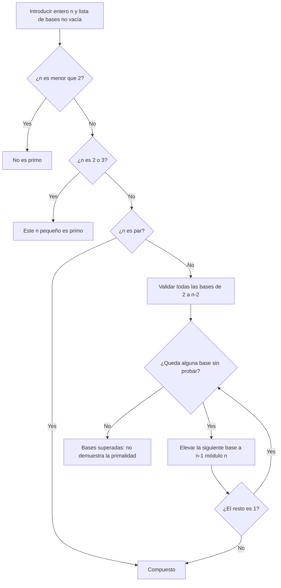
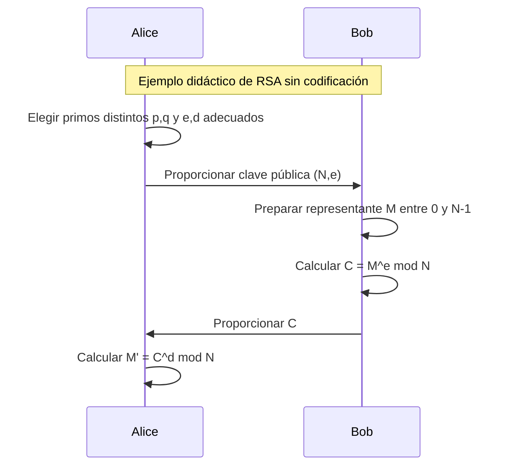

## 1. Qué garantiza el teorema

El pequeño teorema de Fermat describe las potencias módulo un primo. Ayuda a comprender una condición necesaria de primalidad y la corrección del descifrado RSA. Descifrar correctamente y disponer de un esquema de cifrado seguro son propiedades distintas: el teorema por sí solo no garantiza la confidencialidad de las comunicaciones.

Este artículo trata las congruencias, los teoremas de Fermat y Euler, las limitaciones de la prueba de Fermat y las matemáticas de RSA. El código es material didáctico con comprobaciones de los límites, no una implementación para generar claves o cifrar en producción. Véase también [la diferencia entre las matemáticas de RSA y los esquemas de cifrado](https://kenji.blog/es/p/rsa-encryption-math-explained-for-beginners/).

## 2. Congruencias e inversos

Para un entero positivo $n$, la siguiente expresión indica que la diferencia entre los enteros $a,b$ es múltiplo de $n$.

$$ a \equiv b \pmod n. $$

Por ejemplo, $17\equiv12\equiv2\pmod5$. Las congruencias son compatibles con la suma, la resta, la multiplicación y las potencias enteras no negativas. Sin embargo, cancelar un factor requiere una condición.

$$ ac\equiv bc\pmod n,\quad \gcd(c,n)=1
\quad\Longrightarrow\quad a\equiv b\pmod n. $$

Sin coprimalidad, se cumple $2\cdot1\equiv2\cdot4\pmod6$, pero $1\not\equiv4\pmod6$. Para $n>1$, el inverso $c^{-1}$ existe si y solo si $\gcd(c,n)=1$. El algoritmo de Euclides extendido encuentra $cx+ny=1$; reducir $x$ módulo $n$ proporciona el inverso.

## 3. Pequeño teorema de Fermat y demostración

Si $p$ es primo y $p\nmid a$, entonces:

$$ a^{p-1}\equiv1\pmod p. $$

Para $p=5$, los valores $2^4=16$, $3^4=81$ y $4^4=256$ dejan resto 1 al dividir entre 5. Una forma válida para cualquier entero $a$ es:

$$ a^p\equiv a\pmod p. $$

Cuando $p\nmid a$, multiplicamos la primera forma por $a$. Cuando $p\mid a$, ambos miembros de la segunda son congruentes con cero.

Para demostrar la primera forma, multiplicamos los residuos no nulos $1,2,\ldots,p-1$ por $a$. Ninguno se convierte en cero. Si $ia\equiv ja\pmod p$, cancelamos $a$ y obtenemos $i=j$; por tanto, esos productos permutan los residuos no nulos originales. Tomando productos:

$$ a^{p-1}(p-1)!\equiv(p-1)!\pmod p. $$

Como $(p-1)!$ es coprimo con $p$, podemos cancelarlo y queda demostrado el teorema.

## 4. Teorema de Euler

La función totiente $\varphi(n)$ cuenta los enteros de 1 a $n$ que son coprimos con $n$. Para un primo $p$, $\varphi(p)=p-1$; para primos distintos $p,q$:

$$ \varphi(pq)=(p-1)(q-1). $$

Para $n>1$ y $\gcd(a,n)=1$, el [teorema de Euler](https://dlmf.nist.gov/27.2#E8) establece:

$$ a^{\varphi(n)}\equiv1\pmod n. $$

Se demuestra mediante una permutación y la cancelación del producto de los residuos coprimos, como en la sección anterior. El pequeño teorema de Fermat es el caso de módulo primo. El teorema de Euler no puede aplicarse sin condiciones a una entrada que no sea coprima con el módulo.

## 5. Qué nos dice la prueba de Fermat

Para un entero impar $n>3$, elegimos una base $a$ con $2\le a\le n-2$. Si aparece la siguiente discrepancia, $n$ es definitivamente compuesto.

$$ a^{n-1}\not\equiv1\pmod n. $$

El recíproco no se cumple. Superar la prueba solo indica que las bases elegidas no han violado esta condición necesaria. Repetir con varias bases aleatorias no proporciona una cota uniformemente pequeña de falsos positivos para todo número compuesto.



El código lanza excepciones si la lista está vacía o una base está fuera del intervalo. La versión de Python también rechaza tipos no enteros. El intervalo de las bases se valida solo para impares $n\ge5$, después de tratar los enteros pequeños y los pares.

Un número de Carmichael es un compuesto que cumple la congruencia de Fermat para **toda base coprima con $n$**. El menor ejemplo, $561=3\cdot11\cdot17$, supera la base 2, pero no la base 3. El compuesto $1105=5\cdot13\cdot17$ supera las bases 2 y 3. Al generar primos, estos resultados no deben tomarse como una demostración.

Las secciones de Fermat y Miller–Rabin del [Handbook of Applied Cryptography, capítulo 4](https://cacr.uwaterloo.ca/hac/about/chap4.pdf) explican la diferencia. Para un compuesto impar fijo, $k$ pruebas de Miller–Rabin con bases aleatorias uniformes e independientes acotan la probabilidad de falso positivo por $4^{-k}$. No es la misma cantidad que la probabilidad de que el número sea compuesto después de superar las pruebas, ni se aplica automáticamente a bases fijas arbitrarias. La [documentación de OpenSSL](https://docs.openssl.org/master/man3/BN_generate_prime/) también describe los primos probables y las pruebas repetidas. Véase el [artículo sobre pruebas de primalidad](https://kenji.blog/es/p/cpp-fast-prime-testing-miller-rabin/).

## 6. Comprobar la condición necesaria en C++ y Python

Estos ejemplos didácticos comprueban bases especificadas, sin aleatoriedad. El nombre `passes` significa que se supera una prueba, no que se certifica la primalidad. La implementación original omitía las comprobaciones con cero o un número negativo de iteraciones; estas versiones rechazan una lista de bases vacía.

### C++17

El ejemplo requiere una implementación que ofrezca `std::uint64_t` y no admite entradas negativas. La multiplicación modular se construye con sumas que mantienen el residuo dentro del intervalo del módulo, sin la extensión `__int128`. La función interna `add_mod` exige que ambos sumandos sean menores que el módulo. Si `a >= m-b`, una resta sustituye la suma; en caso contrario, la suma es menor que el módulo y cabe en 64 bits. Las funciones de multiplicación y exponenciación rechazan el módulo cero y devuelven residuo cero para el módulo uno.

```cpp
#include <cstdint>
#include <iostream>
#include <stdexcept>
#include <vector>

using u64 = std::uint64_t;

// Internal helper: m > 0 and a, b < m.
u64 add_mod(u64 a, u64 b, u64 m) {
    return a >= m - b ? a - (m - b) : a + b;
}

u64 mul_mod(u64 a, u64 b, u64 m) {
    if (m == 0) throw std::invalid_argument("Modulus must be positive");
    a %= m;
    u64 result = 0;
    while (b != 0) {
        if (b & 1) result = add_mod(result, a, m);
        b >>= 1;
        if (b != 0) a = add_mod(a, a, m);
    }
    return result;
}

u64 power_mod(u64 a, u64 exponent, u64 m) {
    if (m == 0) throw std::invalid_argument("Modulus must be positive");
    u64 result = 1 % m;
    a %= m;
    while (exponent != 0) {
        if (exponent & 1) result = mul_mod(result, a, m);
        exponent >>= 1;
        if (exponent != 0) a = mul_mod(a, a, m);
    }
    return result;
}

bool fermat_passes(u64 n, const std::vector<u64>& bases) {
    if (bases.empty()) throw std::invalid_argument("Choose at least one base");
    if (n < 2) return false;
    if (n <= 3) return true;
    if (n % 2 == 0) return false;
    for (u64 a : bases) {
        if (a < 2 || a > n - 2) throw std::invalid_argument("Base outside range");
    }
    for (u64 a : bases) {
        if (power_mod(a, n - 1, n) != 1) return false;
    }
    return true;
}

int main() {
    std::cout << "1000000007 passes bases 2,3: " << fermat_passes(1000000007, {2, 3}) << '\n';
    std::cout << "1105 passes bases 2,3: " << fermat_passes(1105, {2, 3}) << '\n';
    std::cout << "1105 passes base 5: " << fermat_passes(1105, {5}) << '\n';
}
```

Por ejemplo, compila con `g++ -std=c++17 fermat.cpp -o fermat`. Se verificó con GCC 13.3 en WSL. Las salidas booleanas son `1, 1, 0`, en ese orden. Que el compuesto 1105 supere dos bases demuestra la limitación.

### Python

Esta versión utiliza enteros de Python 3 y `pow` con tres argumentos. Exige el tipo incorporado `int` y rechaza `bool`. La lista de bases no puede estar vacía. Los candidatos y las bases son los mismos que en C++.

```python
def fermat_passes(n, bases):
    if type(n) is not int:
        raise TypeError("n must be an integer")
    bases = tuple(bases)
    if not bases:
        raise ValueError("Choose at least one base")
    if any(type(a) is not int for a in bases):
        raise TypeError("Bases must be integers")
    if n < 2:
        return False
    if n <= 3:
        return True
    if n % 2 == 0:
        return False
    if any(a < 2 or a > n - 2 for a in bases):
        raise ValueError("Base outside range")
    return all(pow(a, n - 1, n) == 1 for a in bases)


if __name__ == "__main__":
    print("1000000007 passes bases 2,3:", fermat_passes(1000000007, [2, 3]))
    print("1105 passes bases 2,3:", fermat_passes(1105, [2, 3]))
    print("1105 passes base 5:", fermat_passes(1105, [5]))
```

Se verificó con Python 3.12. Los resultados son `True, True, False`. El ejemplo original 104729 sigue superando la prueba como primo. Los enteros de Python evitan el desbordamiento de ancho fijo, pero el tiempo y la memoria no son ilimitados.

La exponenciación por cuadrados realiza $O(\log b)$ multiplicaciones modulares para un exponente $b>0$, un número proporcional a su longitud en bits. Esto no es complejidad en bits ni tiempo medido. Cada multiplicación modular del ejemplo C++ emplea un número de sumas modulares proporcional a la longitud del multiplicador en bits. No se presupone que el algoritmo interno exacto de `pow` sea idéntico en todas las versiones de Python.

## 7. Por qué funciona el descifrado RSA

Elegimos primos distintos $p,q$ y establecemos $N=pq$. En esta construcción didáctica, escogemos un exponente público con $1<e<\varphi(N)$ y $\gcd(e,\varphi(N))=1$; el exponente privado $d$ es su inverso.

$$ ed\equiv1\pmod{\varphi(N)},\qquad
\varphi(N)=(p-1)(q-1). $$

La clave pública es $(N,e)$ y una representación simplificada de la clave privada es $(N,d)$. Las claves privadas reales también pueden contener factores para los cálculos CRT, que igualmente son secretos. Factorizar el módulo permite calcular el exponente privado, pero no se ha demostrado la equivalencia general entre invertir la función RSA y factorizar.

Para un representante $0\le M<N$:

$$ C=M^e\bmod N,\qquad M'=C^d\bmod N. $$

El diagrama muestra únicamente **operaciones RSA sin codificación** sobre representantes enteros. Es un esquema matemático que omite la codificación de mensajes y la autenticación de una aplicación real.



Primero, si $\gcd(M,N)=1$, escribimos $ed=1+t\varphi(N)$ para un entero no negativo $t$. El teorema de Euler da:

$$ M^{ed}=M(M^{\varphi(N)})^t\equiv M\pmod N. $$

No excluimos los representantes que no son coprimos. Módulo $p$, si $p\mid M$, tanto $M^{ed}$ como $M$ son cero. En caso contrario, el pequeño teorema de Fermat y $p-1\mid ed-1$ dan la congruencia. El mismo argumento sirve módulo $q$. Como $p,q$ son coprimos, el teorema chino del resto da:

$$ M^{ed}\equiv M\pmod p,\quad
M^{ed}\equiv M\pmod q
\quad\Longrightarrow\quad M^{ed}\equiv M\pmod N. $$

Así se recuperan todos los representantes, incluidos cero y los múltiplos de $p,q$. Es una demostración de corrección, no de confidencialidad.

## 8. Demostración reproducible de la primitiva RSA

Usamos los primos conocidos y fijos 61 y 53 y el exponente 17, calculando el inverso mediante el algoritmo de Euclides extendido. No generamos primos aleatorios ni convertimos cadenas carácter a carácter. El «generador de primos» original, basado solo en las bases 2 y 3, acepta 1105 y puede producir claves que impiden recuperar el mensaje. El exponente uno y los representantes fuera de rango tampoco pueden ignorarse al tratar los requisitos del cifrado real.

La función `rsa_primitive` solo verifica los intervalos aritméticos del exponente, el módulo y el representante. No factoriza un módulo arbitrario ni valida cualquier clave RSA. La clave didáctica fija satisface por separado las condiciones de la clave. [RFC 8017, secciones 5 y 7](https://www.rfc-editor.org/rfc/rfc8017.html) también distingue primitivas y esquemas de cifrado.

```python
def extended_gcd(a, b):
    old_r, r = a, b
    old_s, s = 1, 0
    old_t, t = 0, 1
    while r:
        q = old_r // r
        old_r, r = r, old_r - q * r
        old_s, s = s, old_s - q * s
        old_t, t = t, old_t - q * t
    return old_r, old_s, old_t


def mod_inverse(a, modulus):
    if type(a) is not int or type(modulus) is not int:
        raise TypeError("Arguments must be integers")
    if modulus <= 1:
        raise ValueError("Modulus must exceed one")
    g, x, _ = extended_gcd(a % modulus, modulus)
    if g != 1:
        raise ValueError("Inverse does not exist")
    return x % modulus


def rsa_primitive(value, exponent, modulus):
    if any(type(x) is not int for x in (value, exponent, modulus)):
        raise TypeError("Arguments must be integers")
    if exponent <= 0 or modulus <= 1 or not 0 <= value < modulus:
        raise ValueError("Invalid exponent, modulus or representative")
    return pow(value, exponent, modulus)


def rsa_primitive_demo():
    p, q, e = 61, 53, 17  # Fixed public teaching constants, not secret keys.
    n = p * q
    phi = (p - 1) * (q - 1)
    d = mod_inverse(e, phi)
    print("Public key (n, e):", (n, e))
    print("Private key (n, d):", (n, d))
    m = 65
    c = rsa_primitive(m, e, n)
    recovered = rsa_primitive(c, d, n)
    print(f"{m} -> {c} -> {recovered}")
    for representative in range(n):
        cipher = rsa_primitive(representative, e, n)
        if rsa_primitive(cipher, d, n) != representative:
            raise ArithmeticError("Round-trip failed")
    print("All 3233 representatives round-trip.")


if __name__ == "__main__":
    rsa_primitive_demo()
```

Al ejecutarlo se muestran $(N,e)=(3233,17)$, $(N,d)=(3233,2753)$ y `65 -> 2790 -> 65`, y se comprueba la ida y vuelta de los 3233 representantes. La clave privada mostrada es una constante didáctica fija y pública. La prueba no demuestra la seguridad de las claves RSA en general.

## 9. Límites de uso y referencias

RSA sin un esquema de codificación es determinista y no basta para un cifrado seguro. Por ejemplo, la clave pública permite comparar un diccionario con los cifrados carácter a carácter. En producción se necesitan bibliotecas auditadas, un esquema adecuado como RSAES-OAEP, parámetros apropiados y aleatoriedad segura. El generador seudoaleatorio de [random de Python](https://docs.python.org/3/library/random.html) no debe usarse para generar claves criptográficas. RSASSA-PSS es un esquema de firma, distinto del cifrado.

Hay que distinguir las etapas: el teorema establece congruencias; las pruebas de primalidad verifican condiciones; las operaciones RSA con claves válidas recuperan representantes; y los esquemas reales añaden codificación y otros requisitos de seguridad. No puede afirmarse que determinados servicios de comunicación, o toda la criptografía moderna, dependan exclusivamente del pequeño teorema de Fermat.

Las fuentes primarias son [DLMF sobre el teorema de Euler](https://dlmf.nist.gov/27.2#E8), [HAC, capítulo 4](https://cacr.uwaterloo.ca/hac/about/chap4.pdf), [la especificación RSA, RFC 8017](https://www.rfc-editor.org/rfc/rfc8017.html) y [la descripción de enteros de 128 bits de GCC](https://gcc.gnu.org/onlinedocs/gcc/_005f_005fint128.html). La última fuente explica las limitaciones del tipo de extensión usado en la implementación original.
