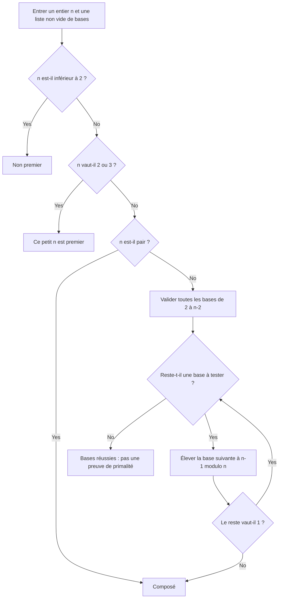
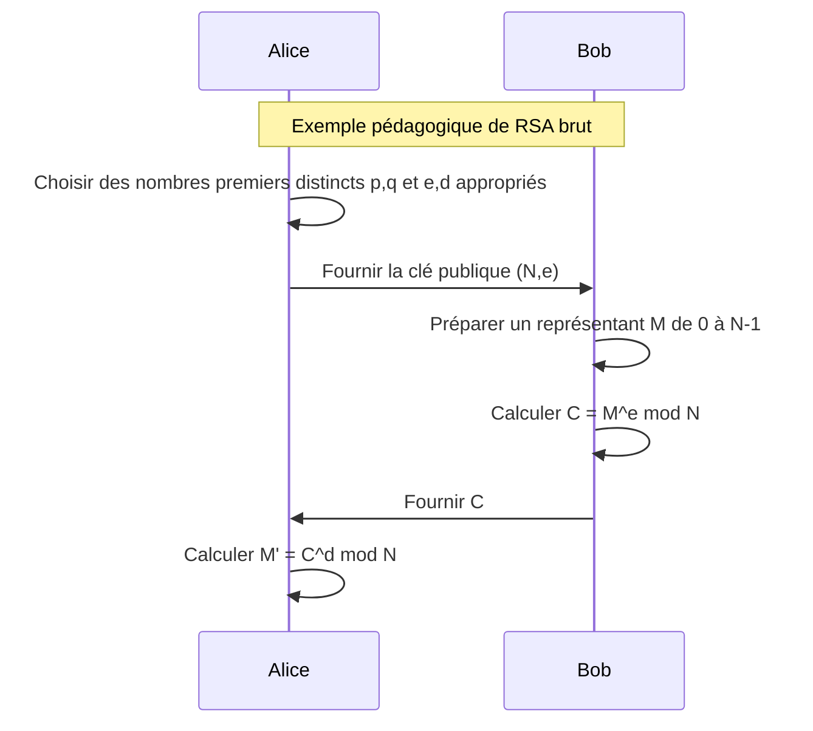

## 1. Ce que garantit le théorème

Le petit théorème de Fermat décrit les puissances modulo un nombre premier. Il aide à comprendre une condition nécessaire de primalité et pourquoi le déchiffrement RSA fonctionne. Déchiffrer correctement et disposer d’un schéma de chiffrement sûr sont deux propriétés distinctes : le théorème seul ne garantit pas la confidentialité des communications.

Cet article présente les congruences, les théorèmes de Fermat et d’Euler, les limites du test de Fermat et les mathématiques de RSA. Le code est un support pédagogique avec des contrôles des bornes, pas une implémentation de génération de clés ou de chiffrement en production. Voir aussi [les mathématiques de RSA et les schémas de chiffrement](https://kenji.blog/fr/p/rsa-encryption-math-explained-for-beginners/).

## 2. Congruences et inverses

Pour un entier positif $n$, la notation suivante signifie que la différence entre les entiers $a,b$ est un multiple de $n$.

$$ a \equiv b \pmod n. $$

Par exemple, $17\equiv12\equiv2\pmod5$. Les congruences sont compatibles avec l’addition, la soustraction, la multiplication et les puissances entières non négatives. En revanche, simplifier par un facteur exige une condition.

$$ ac\equiv bc\pmod n,\quad \gcd(c,n)=1
\quad\Longrightarrow\quad a\equiv b\pmod n. $$

Sans cette condition, $2\cdot1\equiv2\cdot4\pmod6$ est vrai, mais $1\not\equiv4\pmod6$. Pour $n>1$, l’inverse $c^{-1}$ existe si et seulement si $\gcd(c,n)=1$. L’algorithme d’Euclide étendu trouve $cx+ny=1$ ; réduire $x$ modulo $n$ donne l’inverse.

## 3. Petit théorème de Fermat et démonstration

Si $p$ est premier et $p\nmid a$, alors :

$$ a^{p-1}\equiv1\pmod p. $$

Pour $p=5$, les valeurs $2^4=16$, $3^4=81$ et $4^4=256$ ont toutes pour reste 1 dans la division par 5. Une forme valable pour tout entier $a$ est :

$$ a^p\equiv a\pmod p. $$

Lorsque $p\nmid a$, on multiplie la première forme par $a$. Lorsque $p\mid a$, les deux membres de la seconde sont congrus à zéro.

Pour démontrer la première forme, multiplions les résidus non nuls $1,2,\ldots,p-1$ par $a$. Aucun ne devient nul. Si $ia\equiv ja\pmod p$, on simplifie par $a$ pour obtenir $i=j$ : ces produits permutent donc les résidus non nuls initiaux. En prenant les produits :

$$ a^{p-1}(p-1)!\equiv(p-1)!\pmod p. $$

Comme $(p-1)!$ et $p$ sont premiers entre eux, on peut simplifier par ce facteur, ce qui démontre le théorème.

## 4. Théorème d’Euler

L’indicatrice d’Euler $\varphi(n)$ compte les entiers de 1 à $n$ qui sont premiers avec $n$. Pour un nombre premier $p$, $\varphi(p)=p-1$ ; pour des nombres premiers distincts $p,q$ :

$$ \varphi(pq)=(p-1)(q-1). $$

Pour $n>1$ et $\gcd(a,n)=1$, le [théorème d’Euler](https://dlmf.nist.gov/27.2#E8) affirme :

$$ a^{\varphi(n)}\equiv1\pmod n. $$

Une permutation des résidus premiers avec le module, suivie d’une simplification du produit, le démontre comme dans la section précédente. Le petit théorème de Fermat est le cas où le module est premier. On ne peut pas appliquer le théorème d’Euler sans condition à une entrée qui n’est pas première avec le module.

## 5. Ce qu’indique le test de Fermat

Pour un entier impair $n>3$, choisissons une base $a$ telle que $2\le a\le n-2$. Si la non-congruence suivante est vérifiée, $n$ est certainement composé.

$$ a^{n-1}\not\equiv1\pmod n. $$

La réciproque est fausse. Réussir le test signifie seulement que les bases choisies n’ont pas violé cette condition nécessaire. Répéter le test avec plusieurs bases aléatoires ne fournit pas une petite borne d’erreur uniforme pour tous les nombres composés.



Le code lève une exception si la liste est vide ou si une base est hors intervalle. La version Python refuse aussi les types non entiers. Les bornes des bases ne sont contrôlées que pour les impairs $n\ge5$, après le traitement des petits entiers et des nombres pairs.

Un nombre de Carmichael est un composé qui satisfait la congruence de Fermat pour **toute base première avec $n$**. Le plus petit exemple, $561=3\cdot11\cdot17$, réussit le test en base 2, mais échoue en base 3. Le composé $1105=5\cdot13\cdot17$ réussit en bases 2 et 3. Lors de la génération de nombres premiers, ces résultats ne doivent pas tenir lieu de preuve.

Les sections Fermat et Miller–Rabin du [Handbook of Applied Cryptography, chapitre 4](https://cacr.uwaterloo.ca/hac/about/chap4.pdf) expliquent cette distinction. Pour un composé impair fixé, $k$ tests de Miller–Rabin avec des bases aléatoires uniformes et indépendantes bornent la probabilité de faux positif par $4^{-k}$. Ce n’est pas la même quantité que la probabilité que le nombre soit composé après avoir réussi les tests, et cette borne ne s’applique pas automatiquement à des bases fixes arbitraires. La [documentation d’OpenSSL](https://docs.openssl.org/master/man3/BN_generate_prime/) explique également les nombres probablement premiers et les tests répétés. Voir l’[article sur les tests de primalité](https://kenji.blog/fr/p/cpp-fast-prime-testing-miller-rabin/).

## 6. Tester la condition nécessaire en C++ et Python

Ces exemples pédagogiques testent des bases spécifiées, sans tirage aléatoire. Le nom `passes` indique la réussite d’un test, pas une certification de primalité. L’implémentation initiale ne faisait aucun test avec zéro itération ou un nombre négatif d’itérations ; ces versions refusent une liste vide de bases.

### C++17

L’exemple exige une implémentation fournissant `std::uint64_t` et ne traite pas les entrées négatives. La multiplication modulaire utilise des additions qui maintiennent le résidu dans l’intervalle du module, sans extension `__int128`. La fonction interne `add_mod` suppose que les deux termes sont inférieurs au module. Si `a >= m-b`, une soustraction remplace l’addition ; sinon, la somme est inférieure au module et tient sur 64 bits. Les fonctions de multiplication et d’exponentiation refusent le module zéro et renvoient le résidu zéro pour le module un.

```cpp
#include <cstdint>
#include <iostream>
#include <stdexcept>
#include <vector>

using u64 = std::uint64_t;

// Internal helper: m > 0 and a, b < m.
u64 add_mod(u64 a, u64 b, u64 m) {
    return a >= m - b ? a - (m - b) : a + b;
}

u64 mul_mod(u64 a, u64 b, u64 m) {
    if (m == 0) throw std::invalid_argument("Modulus must be positive");
    a %= m;
    u64 result = 0;
    while (b != 0) {
        if (b & 1) result = add_mod(result, a, m);
        b >>= 1;
        if (b != 0) a = add_mod(a, a, m);
    }
    return result;
}

u64 power_mod(u64 a, u64 exponent, u64 m) {
    if (m == 0) throw std::invalid_argument("Modulus must be positive");
    u64 result = 1 % m;
    a %= m;
    while (exponent != 0) {
        if (exponent & 1) result = mul_mod(result, a, m);
        exponent >>= 1;
        if (exponent != 0) a = mul_mod(a, a, m);
    }
    return result;
}

bool fermat_passes(u64 n, const std::vector<u64>& bases) {
    if (bases.empty()) throw std::invalid_argument("Choose at least one base");
    if (n < 2) return false;
    if (n <= 3) return true;
    if (n % 2 == 0) return false;
    for (u64 a : bases) {
        if (a < 2 || a > n - 2) throw std::invalid_argument("Base outside range");
    }
    for (u64 a : bases) {
        if (power_mod(a, n - 1, n) != 1) return false;
    }
    return true;
}

int main() {
    std::cout << "1000000007 passes bases 2,3: " << fermat_passes(1000000007, {2, 3}) << '\n';
    std::cout << "1105 passes bases 2,3: " << fermat_passes(1105, {2, 3}) << '\n';
    std::cout << "1105 passes base 5: " << fermat_passes(1105, {5}) << '\n';
}
```

Par exemple, compilez avec `g++ -std=c++17 fermat.cpp -o fermat`. Le code a été vérifié avec GCC 13.3 sous WSL. Les sorties booléennes sont `1, 1, 0`, dans cet ordre. Le fait que le nombre composé 1105 réussisse le test pour deux bases illustre sa limite.

### Python

Cette version utilise les entiers de Python 3 et `pow` à trois arguments. Elle exige le type natif `int` et refuse `bool`. La liste de bases ne peut pas être vide. Les candidats et les bases sont les mêmes qu’en C++.

```python
def fermat_passes(n, bases):
    if type(n) is not int:
        raise TypeError("n must be an integer")
    bases = tuple(bases)
    if not bases:
        raise ValueError("Choose at least one base")
    if any(type(a) is not int for a in bases):
        raise TypeError("Bases must be integers")
    if n < 2:
        return False
    if n <= 3:
        return True
    if n % 2 == 0:
        return False
    if any(a < 2 or a > n - 2 for a in bases):
        raise ValueError("Base outside range")
    return all(pow(a, n - 1, n) == 1 for a in bases)


if __name__ == "__main__":
    print("1000000007 passes bases 2,3:", fermat_passes(1000000007, [2, 3]))
    print("1105 passes bases 2,3:", fermat_passes(1105, [2, 3]))
    print("1105 passes base 5:", fermat_passes(1105, [5]))
```

Le code a été vérifié avec Python 3.12. Les résultats sont `True, True, False`. L’exemple initial 104729 réussit toujours le test en tant que nombre premier. Les entiers Python évitent le débordement de largeur fixe, mais le temps et la mémoire restent limités.

L’exponentiation par carrés effectue $O(\log b)$ multiplications modulaires pour un exposant $b>0$, un nombre proportionnel à sa longueur en bits. Ce n’est ni une complexité en bits ni un temps mesuré. Chaque multiplication modulaire de l’exemple C++ utilise un nombre d’additions modulaires proportionnel à la longueur du multiplicateur en bits. On ne suppose pas que l’algorithme interne précis de `pow` soit identique dans toutes les versions de Python.

## 7. Pourquoi le déchiffrement RSA fonctionne

Choisissons des nombres premiers distincts $p,q$ et posons $N=pq$. Pour cette construction pédagogique, l’exposant public vérifie $1<e<\varphi(N)$ et $\gcd(e,\varphi(N))=1$ ; l’exposant privé $d$ est son inverse.

$$ ed\equiv1\pmod{\varphi(N)},\qquad
\varphi(N)=(p-1)(q-1). $$

La clé publique est $(N,e)$, et une représentation simplifiée de la clé privée est $(N,d)$. Les clés privées réelles peuvent aussi contenir des facteurs pour les calculs CRT, qui restent secrets. Factoriser le module permet de calculer l’exposant privé, mais l’équivalence générale entre l’inversion de RSA et la factorisation n’a pas été démontrée.

Pour un représentant $0\le M<N$ :

$$ C=M^e\bmod N,\qquad M'=C^d\bmod N. $$

Le diagramme représente uniquement les **opérations RSA brutes** sur des représentants entiers. C’est un diagramme mathématique qui omet l’encodage des messages et l’authentification d’une application réelle.



D’abord, si $\gcd(M,N)=1$, écrivons $ed=1+t\varphi(N)$ pour un entier non négatif $t$. Le théorème d’Euler donne :

$$ M^{ed}=M(M^{\varphi(N)})^t\equiv M\pmod N. $$

Les représentants non premiers avec le module ne sont pas exclus. Modulo $p$, si $p\mid M$, alors $M^{ed}$ et $M$ valent tous deux zéro. Sinon, le petit théorème de Fermat et $p-1\mid ed-1$ donnent la congruence. Le même argument vaut modulo $q$. Comme $p,q$ sont premiers entre eux, le théorème des restes chinois donne :

$$ M^{ed}\equiv M\pmod p,\quad
M^{ed}\equiv M\pmod q
\quad\Longrightarrow\quad M^{ed}\equiv M\pmod N. $$

Tous les représentants sont donc retrouvés, y compris zéro et les multiples de $p,q$. C’est une preuve de correction, pas de confidentialité.

## 8. Démonstration reproductible de la primitive RSA

Utilisons les nombres premiers connus et fixes 61 et 53, avec l’exposant 17, en calculant l’inverse par l’algorithme d’Euclide étendu. L’exemple ne génère pas de nombres premiers aléatoires et ne convertit pas les chaînes caractère par caractère. Le « générateur de nombres premiers » initial, limité aux bases 2 et 3, accepte 1105 et peut produire des clés qui empêchent de retrouver le message. L’exposant un et les représentants hors intervalle ne doivent pas non plus être ignorés dans les exigences du chiffrement réel.

La fonction `rsa_primitive` ne contrôle que les intervalles arithmétiques de l’exposant, du module et du représentant. Elle ne factorise pas un module arbitraire et ne valide pas n’importe quelle clé RSA. La clé pédagogique fixe satisfait séparément les conditions sur les clés. La [RFC 8017, sections 5 et 7](https://www.rfc-editor.org/rfc/rfc8017.html) distingue aussi les primitives des schémas de chiffrement.

```python
def extended_gcd(a, b):
    old_r, r = a, b
    old_s, s = 1, 0
    old_t, t = 0, 1
    while r:
        q = old_r // r
        old_r, r = r, old_r - q * r
        old_s, s = s, old_s - q * s
        old_t, t = t, old_t - q * t
    return old_r, old_s, old_t


def mod_inverse(a, modulus):
    if type(a) is not int or type(modulus) is not int:
        raise TypeError("Arguments must be integers")
    if modulus <= 1:
        raise ValueError("Modulus must exceed one")
    g, x, _ = extended_gcd(a % modulus, modulus)
    if g != 1:
        raise ValueError("Inverse does not exist")
    return x % modulus


def rsa_primitive(value, exponent, modulus):
    if any(type(x) is not int for x in (value, exponent, modulus)):
        raise TypeError("Arguments must be integers")
    if exponent <= 0 or modulus <= 1 or not 0 <= value < modulus:
        raise ValueError("Invalid exponent, modulus or representative")
    return pow(value, exponent, modulus)


def rsa_primitive_demo():
    p, q, e = 61, 53, 17  # Fixed public teaching constants, not secret keys.
    n = p * q
    phi = (p - 1) * (q - 1)
    d = mod_inverse(e, phi)
    print("Public key (n, e):", (n, e))
    print("Private key (n, d):", (n, d))
    m = 65
    c = rsa_primitive(m, e, n)
    recovered = rsa_primitive(c, d, n)
    print(f"{m} -> {c} -> {recovered}")
    for representative in range(n):
        cipher = rsa_primitive(representative, e, n)
        if rsa_primitive(cipher, d, n) != representative:
            raise ArithmeticError("Round-trip failed")
    print("All 3233 representatives round-trip.")


if __name__ == "__main__":
    rsa_primitive_demo()
```

L’exécution affiche $(N,e)=(3233,17)$, $(N,d)=(3233,2753)$ et `65 -> 2790 -> 65`, puis vérifie l’aller-retour des 3233 représentants. La clé privée affichée est une constante pédagogique fixe et publique. Ce test ne garantit pas la sécurité des clés RSA en général.

## 9. Limites pratiques et références

RSA brut est déterministe et ne suffit pas pour un chiffrement sûr. Par exemple, la clé publique permet une comparaison par dictionnaire avec les textes chiffrés caractère par caractère. En production, il faut des bibliothèques auditées, un schéma adapté tel que RSAES-OAEP, des paramètres appropriés et un aléa sûr. Le générateur pseudo-aléatoire de [random en Python](https://docs.python.org/3/library/random.html) ne doit pas servir à générer des clés cryptographiques. RSASSA-PSS est un schéma de signature, distinct du chiffrement.

Il faut distinguer les étapes : le théorème établit des congruences ; les tests de primalité vérifient des conditions ; les opérations RSA avec des clés valides retrouvent les représentants ; les schémas réels ajoutent un encodage et d’autres exigences de sécurité. On ne peut pas affirmer que certains services de communication, ou toute la cryptographie moderne, reposent exclusivement sur le petit théorème de Fermat.

Les sources primaires sont [DLMF sur le théorème d’Euler](https://dlmf.nist.gov/27.2#E8), [HAC, chapitre 4](https://cacr.uwaterloo.ca/hac/about/chap4.pdf), [la spécification RSA, RFC 8017](https://www.rfc-editor.org/rfc/rfc8017.html) et [la description des entiers de 128 bits de GCC](https://gcc.gnu.org/onlinedocs/gcc/_005f_005fint128.html). La dernière explique les limites du type d’extension utilisé dans l’implémentation initiale.
