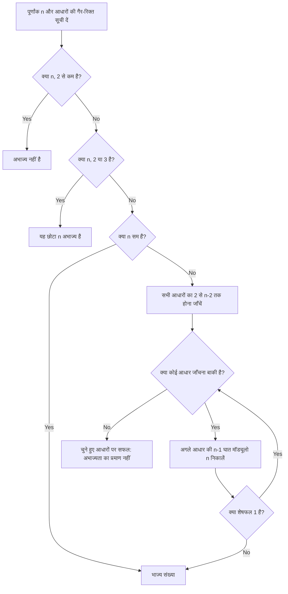
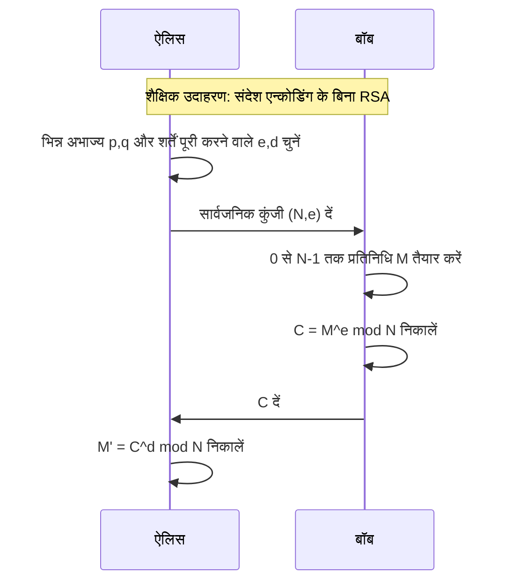

## 1. प्रमेय क्या सुनिश्चित करता है

फर्मेट का छोटा प्रमेय किसी अभाज्य संख्या के मॉड्यूलो घात लेने का गुण बताता है। इससे अभाज्यता की आवश्यक शर्त और RSA में डिक्रिप्शन की शुद्धता समझने में मदद मिलती है। सही डिक्रिप्शन होना और एन्क्रिप्शन योजना का सुरक्षित होना अलग गुण हैं। केवल यह प्रमेय संचार की गोपनीयता सुनिश्चित नहीं करता।

यह लेख सर्वांगसमता, फर्मेट और यूलर के प्रमेय, फर्मेट परीक्षण की सीमाएँ और RSA का गणित समझाता है। कोड सीमांत स्थितियों की जाँच वाला शैक्षिक उदाहरण है; इसे वास्तविक उपयोग के लिए कुंजी जनरेटर या एन्क्रिप्शन प्रणाली न समझें। [RSA के गणित और एन्क्रिप्शन योजना का अंतर](https://kenji.blog/hi/p/rsa-encryption-math-explained-for-beginners/) भी देखें।

## 2. सर्वांगसमता और मॉड्यूलर व्युत्क्रम

धनात्मक पूर्णांक $n$ के लिए, पूर्णांकों $a,b$ का अंतर $n$ का गुणज होने को इस तरह लिखते हैं:

$$ a \equiv b \pmod n. $$

उदाहरण के लिए, $17\equiv12\equiv2\pmod5$। सर्वांगसमता जोड़, घटाव, गुणा और गैर-ऋणात्मक पूर्णांक घातों के साथ बनी रहती है। लेकिन दोनों पक्षों से एक गुणक काटने की शर्त है:

$$ ac\equiv bc\pmod n,\quad \gcd(c,n)=1
\quad\Longrightarrow\quad a\equiv b\pmod n. $$

सह-अभाज्यता की शर्त के बिना, $2\cdot1\equiv2\cdot4\pmod6$ होने पर भी $1\not\equiv4\pmod6$ है। जब $n>1$ हो, व्युत्क्रम $c^{-1}$ तभी मौजूद है जब $\gcd(c,n)=1$ हो। विस्तारित यूक्लिडीय एल्गोरिदम से $cx+ny=1$ हल करने पर, $x$ को मॉड्यूलो $n$ में घटाने से व्युत्क्रम मिलता है।

## 3. फर्मेट का छोटा प्रमेय और प्रमाण

यदि $p$ अभाज्य है और $p\nmid a$ है, तो:

$$ a^{p-1}\equiv1\pmod p. $$

$p=5$ के लिए $2^4=16$, $3^4=81$ और $4^4=256$ को 5 से भाग देने पर शेषफल 1 है। प्रत्येक पूर्णांक $a$ के लिए मान्य रूप है:

$$ a^p\equiv a\pmod p. $$

यदि $p\nmid a$ है, तो पहले रूप को $a$ से गुणा करें। यदि $p\mid a$ है, तो दूसरे रूप के दोनों पक्ष शून्य के सर्वांगसम हैं।

पहले रूप के प्रमाण के लिए, अशून्य शेषफलों $1,2,\ldots,p-1$ को $a$ से गुणा करें। कोई नया शेषफल शून्य नहीं है। यदि $ia\equiv ja\pmod p$ है, तो गुणक $a$ काटने पर $i=j$ मिलता है। इसलिए प्राप्त शेषफल मूल अशून्य शेषफलों का क्रमचय हैं। इनका गुणनफल लेने पर:

$$ a^{p-1}(p-1)!\equiv(p-1)!\pmod p. $$

चूँकि $(p-1)!$ और $p$ सह-अभाज्य हैं, यह गुणक काटा जा सकता है और प्रमेय सिद्ध हो जाता है।

## 4. यूलर का प्रमेय

टोटिएंट फलन $\varphi(n)$ उन पूर्णांकों की संख्या गिनता है जो 1 से $n$ तक हैं और $n$ के साथ सह-अभाज्य हैं। अभाज्य $p$ के लिए $\varphi(p)=p-1$ है। भिन्न अभाज्य संख्याओं $p,q$ के लिए:

$$ \varphi(pq)=(p-1)(q-1). $$

$n>1$ और $\gcd(a,n)=1$ के लिए [यूलर का प्रमेय](https://dlmf.nist.gov/27.2#E8) कहता है:

$$ a^{\varphi(n)}\equiv1\pmod n. $$

इसका प्रमाण भी मॉड्यूलस के साथ सह-अभाज्य शेषफलों का क्रमचय बनाकर और गुणनफल का साझा गुणक काटकर दिया जाता है। अभाज्य मॉड्यूलस वाला विशेष मामला फर्मेट का छोटा प्रमेय है। मॉड्यूलस के साथ सह-अभाज्य न होने वाले इनपुट पर यूलर का प्रमेय बिना शर्त लागू नहीं होता।

## 5. फर्मेट परीक्षण से क्या पता चलता है

विषम पूर्णांक $n>3$ के लिए आधार $a$ को $2\le a\le n-2$ से चुनें। यदि निम्न असर्वांगसमता मिले, तो $n$ निश्चित रूप से भाज्य है:

$$ a^{n-1}\not\equiv1\pmod n. $$

इसका उलटा सही नहीं है। परीक्षण में सफल होने का अर्थ केवल यह है कि चुने गए आधारों पर इस आवश्यक शर्त का उल्लंघन नहीं मिला। कई यादृच्छिक आधारों से जाँच करने पर भी सभी भाज्य संख्याओं के लिए एक समान छोटी त्रुटि-सीमा की गारंटी नहीं मिलती।



रिक्त सूची या सीमा के बाहर आधार के लिए कोड अपवाद उत्पन्न करता है। Python संस्करण गैर-पूर्णांक प्रकारों को भी अस्वीकार करता है। छोटे पूर्णांकों और सम संख्याओं को सँभालने के बाद, केवल विषम $n\ge5$ के लिए आधारों की सीमा जाँची जाती है।

कारमाइकल संख्या ऐसी भाज्य संख्या है जो **$n$ के साथ सह-अभाज्य हर आधार** के लिए फर्मेट की सर्वांगसमता संतुष्ट करती है। सबसे छोटा उदाहरण $561=3\cdot11\cdot17$ आधार 2 पर सफल होता है, लेकिन आधार 3 पर विफल होता है। भाज्य संख्या $1105=5\cdot13\cdot17$ आधार 2 और 3 दोनों पर सफल होती है। अभाज्य संख्या उत्पन्न करते समय इसे अभाज्यता का प्रमाण नहीं मानना चाहिए।

[Handbook of Applied Cryptography के अध्याय 4](https://cacr.uwaterloo.ca/hac/about/chap4.pdf) के Fermat और Miller–Rabin वाले भाग यह अंतर समझाते हैं। एक निश्चित विषम भाज्य संख्या के लिए, स्वतंत्र और एकसमान यादृच्छिक आधारों वाले $k$ Miller–Rabin परीक्षणों में गलत तरीके से सफल होने की प्रायिकता अधिकतम $4^{-k}$ है। यह सफल परीक्षण के बाद संख्या के भाज्य होने की प्रायिकता के समान नहीं है, और मनमाने निश्चित आधारों पर यह सीमा स्वतः लागू नहीं होती। [OpenSSL का दस्तावेज़](https://docs.openssl.org/master/man3/BN_generate_prime/) भी संभावित अभाज्य संख्याओं और बार-बार जाँच का वर्णन करता है। [अभाज्यता परीक्षण वाला लेख](https://kenji.blog/hi/p/cpp-fast-prime-testing-miller-rabin/) भी देखें।

## 6. C++ और Python में आवश्यक शर्त की जाँच

ये शैक्षिक उदाहरण यादृच्छिक चयन के बिना दिए गए आधारों की जाँच करते हैं। नाम में `passes` का अर्थ परीक्षण में सफल होना है, अभाज्यता का प्रमाणपत्र नहीं। पुराने कार्यान्वयन में पुनरावृत्ति संख्या शून्य या ऋणात्मक होने पर जाँच होती ही नहीं थी; यह संस्करण आधारों की रिक्त सूची अस्वीकार करता है।

### C++17

इस उदाहरण के लिए `std::uint64_t` उपलब्ध कराने वाला कार्यान्वयन चाहिए; ऋणात्मक इनपुट नहीं सँभाले जाते। मॉड्यूलर गुणा शेषफल बनाए रखने वाले जोड़ से बनाया गया है और `__int128` विस्तार पर निर्भर नहीं है। आंतरिक सहायक `add_mod` में दोनों योज्य मॉड्यूलस से छोटे होने चाहिए। `a >= m-b` होने पर जोड़ की जगह घटाव होता है; अन्यथा योग मॉड्यूलस से छोटा है और 64 बिट में समा जाता है। गुणा और घात वाले फलन मॉड्यूलस शून्य को अस्वीकार करते हैं और मॉड्यूलस एक के लिए शेषफल शून्य लौटाते हैं।

```cpp
#include <cstdint>
#include <iostream>
#include <stdexcept>
#include <vector>

using u64 = std::uint64_t;

// Internal helper: m > 0 and a, b < m.
u64 add_mod(u64 a, u64 b, u64 m) {
    return a >= m - b ? a - (m - b) : a + b;
}

u64 mul_mod(u64 a, u64 b, u64 m) {
    if (m == 0) throw std::invalid_argument("Modulus must be positive");
    a %= m;
    u64 result = 0;
    while (b != 0) {
        if (b & 1) result = add_mod(result, a, m);
        b >>= 1;
        if (b != 0) a = add_mod(a, a, m);
    }
    return result;
}

u64 power_mod(u64 a, u64 exponent, u64 m) {
    if (m == 0) throw std::invalid_argument("Modulus must be positive");
    u64 result = 1 % m;
    a %= m;
    while (exponent != 0) {
        if (exponent & 1) result = mul_mod(result, a, m);
        exponent >>= 1;
        if (exponent != 0) a = mul_mod(a, a, m);
    }
    return result;
}

bool fermat_passes(u64 n, const std::vector<u64>& bases) {
    if (bases.empty()) throw std::invalid_argument("Choose at least one base");
    if (n < 2) return false;
    if (n <= 3) return true;
    if (n % 2 == 0) return false;
    for (u64 a : bases) {
        if (a < 2 || a > n - 2) throw std::invalid_argument("Base outside range");
    }
    for (u64 a : bases) {
        if (power_mod(a, n - 1, n) != 1) return false;
    }
    return true;
}

int main() {
    std::cout << "1000000007 passes bases 2,3: " << fermat_passes(1000000007, {2, 3}) << '\n';
    std::cout << "1105 passes bases 2,3: " << fermat_passes(1105, {2, 3}) << '\n';
    std::cout << "1105 passes base 5: " << fermat_passes(1105, {5}) << '\n';
}
```

उदाहरण के लिए `g++ -std=c++17 fermat.cpp -o fermat` से संकलित करें। कोड WSL में GCC 13.3 के साथ जाँचा गया है। बूलियन परिणाम क्रम से `1, 1, 0` हैं। भाज्य संख्या 1105 का दो आधारों पर सफल होना परीक्षण की सीमा दिखाता है।

### Python

यह संस्करण Python 3 के पूर्णांकों और तीन तर्कों वाले `pow` का उपयोग करता है। केवल अंतर्निहित `int` प्रकार स्वीकार होता है; `bool` जैसे प्रकार अस्वीकार होते हैं। आधारों की सूची रिक्त नहीं हो सकती। उदाहरण C++ वाले उम्मीदवार और आधार ही जाँचता है।

```python
def fermat_passes(n, bases):
    if type(n) is not int:
        raise TypeError("n must be an integer")
    bases = tuple(bases)
    if not bases:
        raise ValueError("Choose at least one base")
    if any(type(a) is not int for a in bases):
        raise TypeError("Bases must be integers")
    if n < 2:
        return False
    if n <= 3:
        return True
    if n % 2 == 0:
        return False
    if any(a < 2 or a > n - 2 for a in bases):
        raise ValueError("Base outside range")
    return all(pow(a, n - 1, n) == 1 for a in bases)


if __name__ == "__main__":
    print("1000000007 passes bases 2,3:", fermat_passes(1000000007, [2, 3]))
    print("1105 passes bases 2,3:", fermat_passes(1105, [2, 3]))
    print("1105 passes base 5:", fermat_passes(1105, [5]))
```

कोड Python 3.12 में जाँचा गया है। परिणाम क्रम से `True, True, False` हैं। पुराना उदाहरण 104729 भी अभाज्य संख्या के रूप में परीक्षण में सफल होता है। Python के मनमानी परिशुद्धता वाले पूर्णांक निश्चित चौड़ाई का ओवरफ़्लो टालते हैं, लेकिन समय और मेमोरी असीमित नहीं होते।

बार-बार वर्ग करने की विधि घातांक $b>0$ के लिए $O(\log b)$ मॉड्यूलर गुणा करती है, जो उसकी बिट-लंबाई के समानुपाती है। यह बिट-जटिलता या मापा हुआ समय नहीं है। C++ उदाहरण में हर मॉड्यूलर गुणा, गुणक की बिट-लंबाई के समानुपाती संख्या में मॉड्यूलर जोड़ करता है। Python के हर संस्करण में `pow` का सटीक आंतरिक एल्गोरिदम एक ही है, ऐसा नहीं माना गया है।

## 7. RSA में डिक्रिप्शन सही क्यों होता है

भिन्न अभाज्य संख्याएँ $p,q$ चुनकर $N=pq$ बनाएँ। इस शैक्षिक निर्माण में सार्वजनिक घातांक $1<e<\varphi(N)$ और $\gcd(e,\varphi(N))=1$ संतुष्ट करता है। उसका व्युत्क्रम निजी घातांक $d$ है:

$$ ed\equiv1\pmod{\varphi(N)},\qquad
\varphi(N)=(p-1)(q-1). $$

सार्वजनिक कुंजी $(N,e)$ और निजी कुंजी का सरल रूप $(N,d)$ है। वास्तविक निजी कुंजी में CRT गणना के गुणनखंड भी हो सकते हैं; वे भी गोपनीय हैं। मॉड्यूलस का गुणनखंडन होने पर निजी घातांक निकाला जा सकता है, लेकिन RSA का उलटा निकालने और गुणनखंडन करने की समस्याओं की सामान्य समतुल्यता सिद्ध नहीं है।

पूर्णांक संदेश प्रतिनिधि $0\le M<N$ के लिए:

$$ C=M^e\bmod N,\qquad M'=C^d\bmod N. $$

नीचे का चित्र पूर्णांक प्रतिनिधियों पर केवल **बिना संदेश एन्कोडिंग वाला RSA ऑपरेशन** दिखाता है। यह गणित का चित्र है, जिसमें वास्तविक अनुप्रयोगों की संदेश एन्कोडिंग और प्रमाणीकरण शामिल नहीं हैं।



पहले $\gcd(M,N)=1$ मानें। किसी गैर-ऋणात्मक पूर्णांक $t$ के लिए $ed=1+t\varphi(N)$ लिख सकते हैं। यूलर के प्रमेय से:

$$ M^{ed}=M(M^{\varphi(N)})^t\equiv M\pmod N. $$

सह-अभाज्य न होने वाले प्रतिनिधि भी बाहर नहीं किए जाते। मॉड्यूलो $p$ में, यदि $p\mid M$ है, तो $M^{ed}$ और $M$ दोनों शून्य हैं। अन्यथा फर्मेट के छोटे प्रमेय और $p-1\mid ed-1$ से दोनों सर्वांगसम हैं। मॉड्यूलो $q$ में भी यही तर्क लागू होता है। चूँकि $p,q$ सह-अभाज्य हैं, चीनी शेषफल प्रमेय से:

$$ M^{ed}\equiv M\pmod p,\quad
M^{ed}\equiv M\pmod q
\quad\Longrightarrow\quad M^{ed}\equiv M\pmod N. $$

इसलिए शून्य और $p,q$ के गुणजों सहित सभी प्रतिनिधि पुनः मिलते हैं। यह शुद्धता का प्रमाण है, गोपनीयता का नहीं।

## 8. RSA प्रिमिटिव का पुनरुत्पाद्य उदाहरण

ज्ञात निश्चित अभाज्य संख्याएँ 61 और 53 तथा घातांक 17 लें। व्युत्क्रम विस्तारित यूक्लिडीय एल्गोरिदम से मिलता है। उदाहरण यादृच्छिक अभाज्य संख्याएँ उत्पन्न नहीं करता और न ही स्ट्रिंग को अक्षर-दर-अक्षर बदलता है। आधार 2 और 3 ही जाँचने वाला पुराना «अभाज्य जनरेटर» 1105 स्वीकार करता था और ऐसी कुंजी बना सकता था जिससे डिक्रिप्शन विफल हो। वास्तविक एन्क्रिप्शन की आवश्यकताओं में घातांक एक और सीमा से बाहर प्रतिनिधियों को भी अनदेखा नहीं कर सकते।

`rsa_primitive` केवल घातांक, मॉड्यूलस और प्रतिनिधि की अंकगणितीय इनपुट सीमाएँ जाँचता है। यह मनमाने मॉड्यूलस का गुणनखंडन नहीं करता और न ही मनमानी RSA कुंजी की वैधता जाँचता है। निश्चित शैक्षिक कुंजी अलग से कुंजी की शर्तें पूरी करती है। [RFC 8017 के भाग 5 और 7](https://www.rfc-editor.org/rfc/rfc8017.html) भी प्रिमिटिव और एन्क्रिप्शन योजना में अंतर करते हैं।

```python
def extended_gcd(a, b):
    old_r, r = a, b
    old_s, s = 1, 0
    old_t, t = 0, 1
    while r:
        q = old_r // r
        old_r, r = r, old_r - q * r
        old_s, s = s, old_s - q * s
        old_t, t = t, old_t - q * t
    return old_r, old_s, old_t


def mod_inverse(a, modulus):
    if type(a) is not int or type(modulus) is not int:
        raise TypeError("Arguments must be integers")
    if modulus <= 1:
        raise ValueError("Modulus must exceed one")
    g, x, _ = extended_gcd(a % modulus, modulus)
    if g != 1:
        raise ValueError("Inverse does not exist")
    return x % modulus


def rsa_primitive(value, exponent, modulus):
    if any(type(x) is not int for x in (value, exponent, modulus)):
        raise TypeError("Arguments must be integers")
    if exponent <= 0 or modulus <= 1 or not 0 <= value < modulus:
        raise ValueError("Invalid exponent, modulus or representative")
    return pow(value, exponent, modulus)


def rsa_primitive_demo():
    p, q, e = 61, 53, 17  # Fixed public teaching constants, not secret keys.
    n = p * q
    phi = (p - 1) * (q - 1)
    d = mod_inverse(e, phi)
    print("Public key (n, e):", (n, e))
    print("Private key (n, d):", (n, d))
    m = 65
    c = rsa_primitive(m, e, n)
    recovered = rsa_primitive(c, d, n)
    print(f"{m} -> {c} -> {recovered}")
    for representative in range(n):
        cipher = rsa_primitive(representative, e, n)
        if rsa_primitive(cipher, d, n) != representative:
            raise ArithmeticError("Round-trip failed")
    print("All 3233 representatives round-trip.")


if __name__ == "__main__":
    rsa_primitive_demo()
```

निष्पादन में $(N,e)=(3233,17)$, $(N,d)=(3233,2753)$ और `65 -> 2790 -> 65` दिखते हैं। फिर सभी 3233 प्रतिनिधियों को एन्क्रिप्ट और डिक्रिप्ट करके मूल मान मिलने की जाँच होती है। दिखाई गई निजी कुंजी एक निश्चित सार्वजनिक शैक्षिक स्थिरांक है। यह परीक्षण सामान्य RSA कुंजियों की सुरक्षा सुनिश्चित नहीं करता।

## 9. उपयोग की सीमाएँ और संदर्भ

बिना संदेश एन्कोडिंग वाला RSA नियतात्मक है और सुरक्षित एन्क्रिप्शन के लिए पर्याप्त नहीं है। उदाहरण के लिए, सार्वजनिक कुंजी से प्रत्येक अक्षर के संभावित सिफरटेक्स्ट बनाकर शब्दकोश मिलान किया जा सकता है। वास्तविक उपयोग में ऑडिट की गई लाइब्रेरी, RSAES-OAEP जैसी उपयुक्त योजना, सही पैरामीटर और सुरक्षित यादृच्छिकता आवश्यक हैं। [Python के random](https://docs.python.org/3/library/random.html) के छद्म-यादृच्छिक जनरेटर को क्रिप्टोग्राफिक कुंजी निर्माण में उपयोग नहीं करना चाहिए। RSASSA-PSS हस्ताक्षर की योजना है और एन्क्रिप्शन से अलग है।

इन चरणों में अंतर रखें: प्रमेय सर्वांगसमता स्थापित करता है; अभाज्यता परीक्षण शर्तें जाँचता है; वैध कुंजी वाले RSA ऑपरेशन प्रतिनिधि को पुनः प्राप्त करते हैं; वास्तविक योजनाएँ एन्कोडिंग और सुरक्षा की अतिरिक्त आवश्यकताएँ पूरी करती हैं। किसी विशेष संचार सेवा या समूची आधुनिक क्रिप्टोग्राफी की निर्भरता केवल फर्मेट के छोटे प्रमेय पर होने का दावा सही नहीं है।

संदर्भित प्राथमिक स्रोत हैं: [यूलर के प्रमेय पर DLMF](https://dlmf.nist.gov/27.2#E8), [HAC का अध्याय 4](https://cacr.uwaterloo.ca/hac/about/chap4.pdf), [RSA विनिर्देश RFC 8017](https://www.rfc-editor.org/rfc/rfc8017.html) और [GCC के 128-बिट पूर्णांकों का विवरण](https://gcc.gnu.org/onlinedocs/gcc/_005f_005fint128.html)। अंतिम स्रोत पुराने कार्यान्वयन के विस्तार प्रकार की सीमाएँ स्पष्ट करता है।
