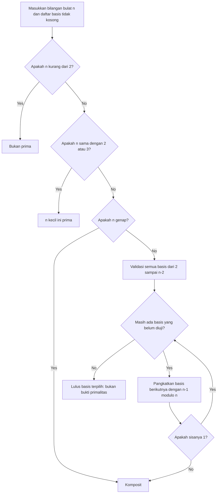
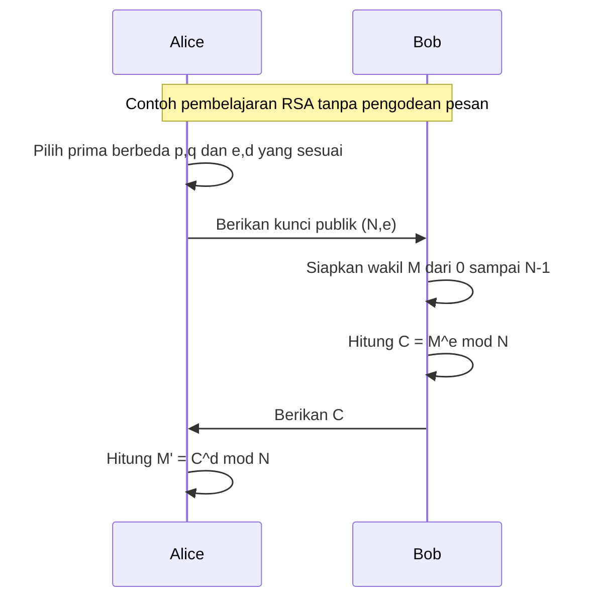

## 1. Apa yang dijamin teorema

Teorema kecil Fermat menjelaskan sifat perpangkatan modulo bilangan prima. Teorema ini membantu memahami syarat perlu bagi primalitas dan mengapa dekripsi RSA benar. Dekripsi yang benar dan skema enkripsi yang aman adalah dua sifat berbeda: teorema saja tidak menjamin kerahasiaan komunikasi.

Artikel ini membahas kongruensi, teorema Fermat dan Euler, keterbatasan uji Fermat, serta matematika RSA. Kode merupakan bahan pembelajaran dengan pemeriksaan batas, bukan implementasi pembangkit kunci atau enkripsi untuk produksi. Lihat juga [perbedaan matematika RSA dan skema enkripsi](https://kenji.blog/id/p/rsa-encryption-math-explained-for-beginners/).

## 2. Kongruensi dan invers

Untuk bilangan bulat positif $n$, notasi berikut menyatakan bahwa selisih bilangan bulat $a,b$ merupakan kelipatan $n$.

$$ a \equiv b \pmod n. $$

Misalnya, $17\equiv12\equiv2\pmod5$. Kongruensi sesuai dengan penjumlahan, pengurangan, perkalian, dan pangkat bulat tak negatif. Namun, mencoret faktor memerlukan syarat.

$$ ac\equiv bc\pmod n,\quad \gcd(c,n)=1
\quad\Longrightarrow\quad a\equiv b\pmod n. $$

Tanpa syarat saling prima, $2\cdot1\equiv2\cdot4\pmod6$ berlaku, tetapi $1\not\equiv4\pmod6$. Untuk $n>1$, invers $c^{-1}$ ada jika dan hanya jika $\gcd(c,n)=1$. Algoritma Euclid diperluas mencari $cx+ny=1$; mereduksi $x$ modulo $n$ menghasilkan inversnya.

## 3. Teorema kecil Fermat dan pembuktian

Jika $p$ prima dan $p\nmid a$, maka:

$$ a^{p-1}\equiv1\pmod p. $$

Untuk $p=5$, nilai $2^4=16$, $3^4=81$, dan $4^4=256$ semuanya bersisa 1 saat dibagi 5. Bentuk yang berlaku bagi setiap bilangan bulat $a$ adalah:

$$ a^p\equiv a\pmod p. $$

Jika $p\nmid a$, kalikan bentuk pertama dengan $a$. Jika $p\mid a$, kedua ruas bentuk kedua kongruen dengan nol.

Untuk membuktikan bentuk pertama, kalikan residu tak nol $1,2,\ldots,p-1$ dengan $a$. Tidak ada residu hasilnya yang nol. Jika $ia\equiv ja\pmod p$, coret faktor $a$ untuk memperoleh $i=j$; jadi hasil kali tersebut mempermutasikan residu tak nol semula. Dengan mengambil hasil kali:

$$ a^{p-1}(p-1)!\equiv(p-1)!\pmod p. $$

Karena $(p-1)!$ dan $p$ saling prima, faktor ini dapat dicoret, sehingga teorema terbukti.

## 4. Teorema Euler

Fungsi totien $\varphi(n)$ menghitung banyaknya bilangan bulat dari 1 sampai $n$ yang saling prima dengan $n$. Untuk prima $p$, berlaku $\varphi(p)=p-1$; untuk prima berbeda $p,q$:

$$ \varphi(pq)=(p-1)(q-1). $$

Untuk $n>1$ dan $\gcd(a,n)=1$, [teorema Euler](https://dlmf.nist.gov/27.2#E8) menyatakan:

$$ a^{\varphi(n)}\equiv1\pmod n. $$

Pembuktiannya memakai permutasi residu yang saling prima dengan modulus dan pencoretan hasil kali, seperti pada bagian sebelumnya. Teorema kecil Fermat adalah kasus modulus prima. Teorema Euler tidak dapat diterapkan tanpa syarat pada masukan yang tidak saling prima dengan modulus.

## 5. Apa yang dapat diketahui dari uji Fermat

Untuk bilangan bulat ganjil $n>3$, pilih basis $a$ dengan $2\le a\le n-2$. Jika ketidakkongruenan berikut terjadi, $n$ pasti komposit.

$$ a^{n-1}\not\equiv1\pmod n. $$

Kebalikannya tidak berlaku. Lulus berarti hanya bahwa basis yang dipilih tidak melanggar syarat perlu tersebut. Mengulang dengan beberapa basis acak tidak memberi batas galat kecil yang berlaku seragam untuk semua masukan komposit.



Kode memunculkan pengecualian untuk daftar kosong atau basis di luar rentang. Versi Python juga menolak tipe bukan bilangan bulat. Rentang basis diperiksa hanya untuk bilangan ganjil $n\ge5$, setelah menangani bilangan bulat kecil dan bilangan genap.

Bilangan Carmichael adalah komposit yang memenuhi kongruensi Fermat untuk **setiap basis yang saling prima dengan $n$**. Contoh terkecil, $561=3\cdot11\cdot17$, lulus basis 2 tetapi gagal pada basis 3. Bilangan komposit $1105=5\cdot13\cdot17$ lulus basis 2 dan 3. Dalam pembangkitan prima, hasil seperti ini tidak boleh dijadikan bukti.

Bagian Fermat dan Miller–Rabin pada [Handbook of Applied Cryptography, Bab 4](https://cacr.uwaterloo.ca/hac/about/chap4.pdf) menjelaskan perbedaannya. Untuk satu komposit ganjil tetap, $k$ uji Miller–Rabin dengan basis acak seragam dan independen membatasi peluang positif palsu sebesar $4^{-k}$. Ini bukan besaran yang sama dengan peluang bahwa bilangan tersebut komposit setelah lulus uji, dan tidak otomatis berlaku untuk basis tetap sembarang. [Dokumentasi OpenSSL](https://docs.openssl.org/master/man3/BN_generate_prime/) juga menjelaskan kandidat prima dan pengujian berulang. Lihat [artikel uji primalitas](https://kenji.blog/id/p/cpp-fast-prime-testing-miller-rabin/).

## 6. Memeriksa syarat perlu dengan C++ dan Python

Contoh pembelajaran ini memeriksa basis yang ditentukan, tanpa pengacakan. Nama `passes` berarti lulus uji, bukan sertifikasi primalitas. Implementasi lama melewati pemeriksaan untuk nol atau jumlah iterasi negatif; versi ini menolak daftar basis kosong.

### C++17

Contoh memerlukan implementasi yang menyediakan `std::uint64_t` dan tidak menangani masukan negatif. Perkalian modular dibangun dari penjumlahan yang menjaga residu dalam rentang modulus, tanpa ekstensi `__int128`. Fungsi pembantu internal `add_mod` mensyaratkan kedua suku penjumlahan lebih kecil dari modulus. Jika `a >= m-b`, pengurangan menggantikan penjumlahan; jika tidak, jumlahnya lebih kecil dari modulus dan muat dalam 64 bit. Fungsi perkalian dan perpangkatan menolak modulus nol serta mengembalikan residu nol untuk modulus satu.

```cpp
#include <cstdint>
#include <iostream>
#include <stdexcept>
#include <vector>

using u64 = std::uint64_t;

// Internal helper: m > 0 and a, b < m.
u64 add_mod(u64 a, u64 b, u64 m) {
    return a >= m - b ? a - (m - b) : a + b;
}

u64 mul_mod(u64 a, u64 b, u64 m) {
    if (m == 0) throw std::invalid_argument("Modulus must be positive");
    a %= m;
    u64 result = 0;
    while (b != 0) {
        if (b & 1) result = add_mod(result, a, m);
        b >>= 1;
        if (b != 0) a = add_mod(a, a, m);
    }
    return result;
}

u64 power_mod(u64 a, u64 exponent, u64 m) {
    if (m == 0) throw std::invalid_argument("Modulus must be positive");
    u64 result = 1 % m;
    a %= m;
    while (exponent != 0) {
        if (exponent & 1) result = mul_mod(result, a, m);
        exponent >>= 1;
        if (exponent != 0) a = mul_mod(a, a, m);
    }
    return result;
}

bool fermat_passes(u64 n, const std::vector<u64>& bases) {
    if (bases.empty()) throw std::invalid_argument("Choose at least one base");
    if (n < 2) return false;
    if (n <= 3) return true;
    if (n % 2 == 0) return false;
    for (u64 a : bases) {
        if (a < 2 || a > n - 2) throw std::invalid_argument("Base outside range");
    }
    for (u64 a : bases) {
        if (power_mod(a, n - 1, n) != 1) return false;
    }
    return true;
}

int main() {
    std::cout << "1000000007 passes bases 2,3: " << fermat_passes(1000000007, {2, 3}) << '\n';
    std::cout << "1105 passes bases 2,3: " << fermat_passes(1105, {2, 3}) << '\n';
    std::cout << "1105 passes base 5: " << fermat_passes(1105, {5}) << '\n';
}
```

Misalnya, kompilasi dengan `g++ -std=c++17 fermat.cpp -o fermat`. Kode telah diverifikasi dengan GCC 13.3 di WSL. Keluaran boolean berurutan adalah `1, 1, 0`. Lulusnya komposit 1105 pada dua basis menunjukkan keterbatasan uji ini.

### Python

Versi ini memakai bilangan bulat Python 3 dan `pow` tiga argumen. Tipe yang diterima hanya `int` bawaan, sedangkan `bool` ditolak. Daftar basis tidak boleh kosong. Kandidat dan basis sama dengan contoh C++.

```python
def fermat_passes(n, bases):
    if type(n) is not int:
        raise TypeError("n must be an integer")
    bases = tuple(bases)
    if not bases:
        raise ValueError("Choose at least one base")
    if any(type(a) is not int for a in bases):
        raise TypeError("Bases must be integers")
    if n < 2:
        return False
    if n <= 3:
        return True
    if n % 2 == 0:
        return False
    if any(a < 2 or a > n - 2 for a in bases):
        raise ValueError("Base outside range")
    return all(pow(a, n - 1, n) == 1 for a in bases)


if __name__ == "__main__":
    print("1000000007 passes bases 2,3:", fermat_passes(1000000007, [2, 3]))
    print("1105 passes bases 2,3:", fermat_passes(1105, [2, 3]))
    print("1105 passes base 5:", fermat_passes(1105, [5]))
```

Kode diverifikasi dengan Python 3.12. Hasilnya berurutan `True, True, False`. Contoh lama 104729 tetap lulus sebagai prima. Bilangan bulat Python berpresisi arbitrer menghindari luapan lebar tetap; ini bukan tipe pecahan berpresisi ganda. Waktu dan memori tetap terbatas.

Metode penguadratan berulang melakukan $O(\log b)$ perkalian modular untuk eksponen $b>0$, sebanding dengan panjang bitnya. Ini bukan kompleksitas bit atau waktu terukur. Setiap perkalian modular pada contoh C++ memakai sejumlah penjumlahan modular yang sebanding dengan panjang bit pengalinya. Algoritma internal tepat `pow` tidak diasumsikan identik pada semua versi Python.

## 7. Mengapa dekripsi RSA benar

Pilih prima berbeda $p,q$ dan tetapkan $N=pq$. Untuk konstruksi pembelajaran ini, pilih eksponen publik yang memenuhi $1<e<\varphi(N)$ dan $\gcd(e,\varphi(N))=1$; eksponen privat $d$ adalah inversnya.

$$ ed\equiv1\pmod{\varphi(N)},\qquad
\varphi(N)=(p-1)(q-1). $$

Kunci publik adalah $(N,e)$, dan bentuk sederhana kunci privat adalah $(N,d)$. Kunci privat nyata juga dapat memuat faktor untuk perhitungan CRT, yang harus dirahasiakan juga. Memfaktorkan modulus memungkinkan perhitungan eksponen privat, tetapi kesetaraan umum antara inversi RSA dan faktorisasi belum terbukti.

Untuk wakil pesan berupa bilangan bulat $0\le M<N$:

$$ C=M^e\bmod N,\qquad M'=C^d\bmod N. $$

Diagram hanya menunjukkan **operasi RSA tanpa pengodean pesan** pada wakil bilangan bulat. Ini diagram matematika yang tidak menyertakan pengodean pesan dan autentikasi pada aplikasi nyata.



Pertama, jika $\gcd(M,N)=1$, tulis $ed=1+t\varphi(N)$ untuk bilangan bulat tak negatif $t$. Teorema Euler memberikan:

$$ M^{ed}=M(M^{\varphi(N)})^t\equiv M\pmod N. $$

Wakil yang tidak saling prima juga tidak dikecualikan. Modulo $p$, jika $p\mid M$, maka $M^{ed}$ dan $M$ sama-sama nol. Jika tidak, teorema kecil Fermat dan $p-1\mid ed-1$ memberikan kongruensi. Argumen yang sama berlaku modulo $q$. Karena $p,q$ saling prima, teorema sisa Tiongkok memberikan:

$$ M^{ed}\equiv M\pmod p,\quad
M^{ed}\equiv M\pmod q
\quad\Longrightarrow\quad M^{ed}\equiv M\pmod N. $$

Dengan demikian, semua wakil dipulihkan, termasuk nol dan kelipatan $p,q$. Ini bukti kebenaran, bukan bukti kerahasiaan.

## 8. Demonstrasi primitif RSA yang dapat direproduksi

Gunakan prima tetap yang diketahui, 61 dan 53, serta eksponen 17. Invers diperoleh melalui algoritma Euclid diperluas. Contoh ini tidak membangkitkan prima acak atau mengubah string karakter demi karakter. «Pembangkit prima» lama yang hanya memeriksa basis 2 dan 3 menerima 1105 dan dapat menghasilkan kunci yang menggagalkan dekripsi. Eksponen satu serta wakil di luar rentang juga tidak boleh diabaikan dalam persyaratan enkripsi nyata.

Fungsi `rsa_primitive` hanya memeriksa rentang aritmetika masukan eksponen, modulus, dan wakil. Fungsi ini tidak memfaktorkan modulus sembarang atau memvalidasi sembarang kunci RSA. Kunci pembelajaran tetap memenuhi syarat kunci secara terpisah. [RFC 8017, bagian 5 dan 7](https://www.rfc-editor.org/rfc/rfc8017.html) juga membedakan primitif dan skema enkripsi.

```python
def extended_gcd(a, b):
    old_r, r = a, b
    old_s, s = 1, 0
    old_t, t = 0, 1
    while r:
        q = old_r // r
        old_r, r = r, old_r - q * r
        old_s, s = s, old_s - q * s
        old_t, t = t, old_t - q * t
    return old_r, old_s, old_t


def mod_inverse(a, modulus):
    if type(a) is not int or type(modulus) is not int:
        raise TypeError("Arguments must be integers")
    if modulus <= 1:
        raise ValueError("Modulus must exceed one")
    g, x, _ = extended_gcd(a % modulus, modulus)
    if g != 1:
        raise ValueError("Inverse does not exist")
    return x % modulus


def rsa_primitive(value, exponent, modulus):
    if any(type(x) is not int for x in (value, exponent, modulus)):
        raise TypeError("Arguments must be integers")
    if exponent <= 0 or modulus <= 1 or not 0 <= value < modulus:
        raise ValueError("Invalid exponent, modulus or representative")
    return pow(value, exponent, modulus)


def rsa_primitive_demo():
    p, q, e = 61, 53, 17  # Fixed public teaching constants, not secret keys.
    n = p * q
    phi = (p - 1) * (q - 1)
    d = mod_inverse(e, phi)
    print("Public key (n, e):", (n, e))
    print("Private key (n, d):", (n, d))
    m = 65
    c = rsa_primitive(m, e, n)
    recovered = rsa_primitive(c, d, n)
    print(f"{m} -> {c} -> {recovered}")
    for representative in range(n):
        cipher = rsa_primitive(representative, e, n)
        if rsa_primitive(cipher, d, n) != representative:
            raise ArithmeticError("Round-trip failed")
    print("All 3233 representatives round-trip.")


if __name__ == "__main__":
    rsa_primitive_demo()
```

Eksekusi menampilkan $(N,e)=(3233,17)$, $(N,d)=(3233,2753)$, dan `65 -> 2790 -> 65`, lalu memeriksa perjalanan pulang-pergi semua 3233 wakil. Kunci privat yang ditampilkan adalah konstanta pembelajaran yang tetap dan terbuka. Pengujian ini tidak menjamin keamanan kunci RSA secara umum.

## 9. Batas penggunaan dan rujukan

RSA tanpa pengodean pesan bersifat deterministik dan tidak cukup untuk enkripsi yang aman. Misalnya, kunci publik memungkinkan pencocokan kamus terhadap teks sandi per karakter. Dalam produksi diperlukan pustaka yang diaudit, skema yang sesuai seperti RSAES-OAEP, parameter yang tepat, dan keacakan yang aman. Generator acak semu pada [random Python](https://docs.python.org/3/library/random.html) tidak boleh dipakai untuk membangkitkan kunci kriptografi. RSASSA-PSS adalah skema tanda tangan, berbeda dari enkripsi.

Bedakan tahapannya: teorema menetapkan kongruensi; uji primalitas memeriksa syarat; operasi RSA dengan kunci valid memulihkan wakil; dan skema nyata menambahkan pengodean serta persyaratan keamanan lain. Tidak dapat dinyatakan bahwa layanan komunikasi tertentu atau seluruh kriptografi modern bergantung hanya pada teorema kecil Fermat.

Sumber primer yang dirujuk adalah [DLMF tentang teorema Euler](https://dlmf.nist.gov/27.2#E8), [HAC Bab 4](https://cacr.uwaterloo.ca/hac/about/chap4.pdf), [spesifikasi RSA RFC 8017](https://www.rfc-editor.org/rfc/rfc8017.html), dan [penjelasan bilangan bulat 128 bit GCC](https://gcc.gnu.org/onlinedocs/gcc/_005f_005fint128.html). Sumber terakhir menjelaskan keterbatasan tipe ekstensi pada implementasi semula.
