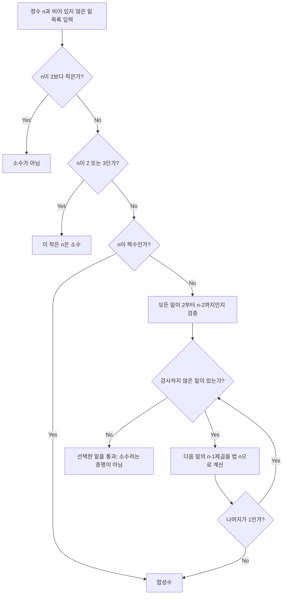
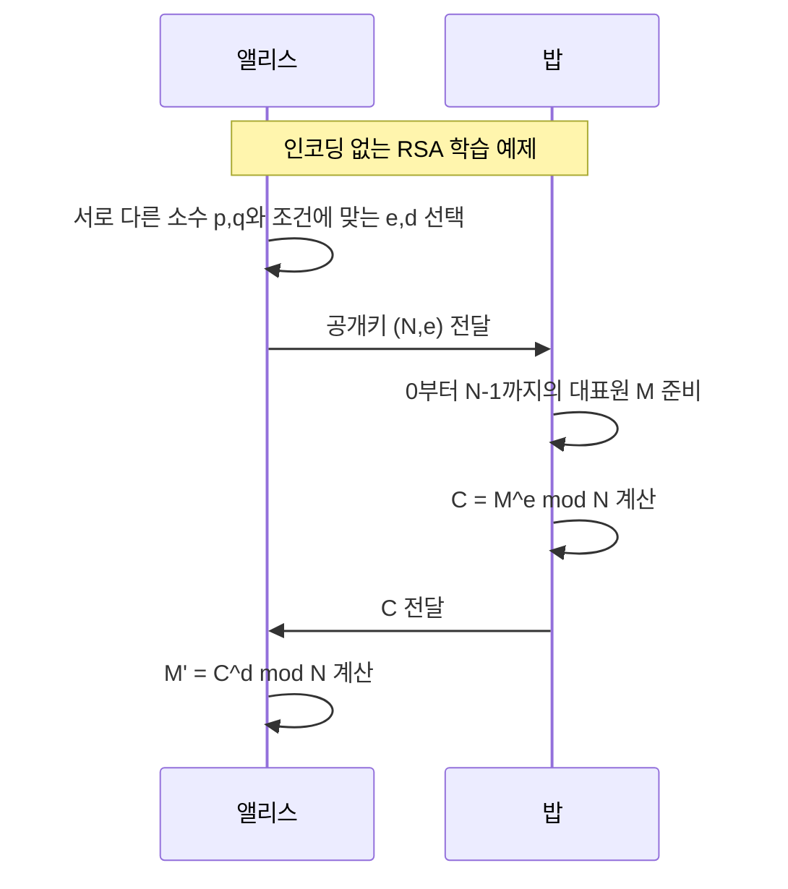

## 1. 정리가 보장하는 것

페르마의 소정리는 소수를 법으로 하는 거듭제곱의 성질을 설명합니다. 소수의 필요조건과 RSA 복호화의 정확성을 이해하는 데 도움이 됩니다. 그러나 정확하게 복호화되는 것과 안전한 암호화 방식을 갖추는 것은 다른 성질입니다. 정리만으로 통신의 기밀성이 보장되지는 않습니다.

이 글에서는 합동식, 페르마와 오일러의 정리, 페르마 테스트의 한계, RSA의 수학을 설명합니다. 코드는 경계를 확인하는 학습용 예제이며, 실제 서비스의 키 생성기나 암호화 방식이 아닙니다. [RSA의 수학과 암호화 방식의 차이](https://kenji.blog/ko/p/rsa-encryption-math-explained-for-beginners/)도 참고하세요.

## 2. 합동식과 역원

양의 정수 $n$에 대해, 정수 $a,b$의 차이가 $n$의 배수라는 것을 다음과 같이 나타냅니다.

$$ a \equiv b \pmod n. $$

예를 들어 $17\equiv12\equiv2\pmod5$입니다. 합동 관계는 덧셈, 뺄셈, 곱셈, 음이 아닌 정수 지수의 거듭제곱과 양립합니다. 다만 인수를 약분하려면 조건이 필요합니다.

$$ ac\equiv bc\pmod n,\quad \gcd(c,n)=1
\quad\Longrightarrow\quad a\equiv b\pmod n. $$

서로소 조건이 없으면 $2\cdot1\equiv2\cdot4\pmod6$이어도 $1\not\equiv4\pmod6$입니다. $n>1$일 때 역원 $c^{-1}$이 존재할 필요충분조건은 $\gcd(c,n)=1$입니다. 확장 유클리드 알고리즘으로 $cx+ny=1$을 구하면, $x$를 법 $n$에 대해 정규화한 값이 역원입니다.

## 3. 페르마의 소정리와 증명

$p$가 소수이고 $p\nmid a$이면 다음이 성립합니다.

$$ a^{p-1}\equiv1\pmod p. $$

$p=5$이면 $2^4=16$, $3^4=81$, $4^4=256$을 5로 나눈 나머지는 모두 1입니다. 모든 정수 $a$에 대해 성립하는 형태는 다음과 같습니다.

$$ a^p\equiv a\pmod p. $$

$p\nmid a$이면 첫 번째 식의 양변에 $a$를 곱합니다. $p\mid a$이면 두 번째 식의 양변은 모두 0과 합동입니다.

첫 번째 형태를 증명하기 위해 0이 아닌 나머지 $1,2,\ldots,p-1$에 $a$를 곱합니다. 결과의 나머지는 0이 되지 않습니다. $ia\equiv ja\pmod p$이면 $a$를 약분하여 $i=j$를 얻으므로, 이 곱들의 나머지는 원래 나머지들의 순열입니다. 곱을 취하면 다음과 같습니다.

$$ a^{p-1}(p-1)!\equiv(p-1)!\pmod p. $$

$(p-1)!$은 $p$와 서로소이므로 약분할 수 있으며, 정리가 증명됩니다.

## 4. 오일러의 정리

오일러 피 함수 $\varphi(n)$은 1부터 $n$까지의 정수 중 $n$과 서로소인 수의 개수입니다. 소수 $p$에 대해 $\varphi(p)=p-1$이고, 서로 다른 소수 $p,q$에 대해서는 다음과 같습니다.

$$ \varphi(pq)=(p-1)(q-1). $$

$n>1$이고 $\gcd(a,n)=1$이면 [오일러의 정리](https://dlmf.nist.gov/27.2#E8)는 다음을 말합니다.

$$ a^{\varphi(n)}\equiv1\pmod n. $$

서로소인 나머지들의 집합에 앞 절과 같은 순열 및 곱의 약분 논증을 적용하여 증명할 수 있습니다. 법이 소수인 경우가 페르마의 소정리입니다. 서로소가 아닌 입력에 오일러의 정리를 무조건 적용할 수는 없습니다.

## 5. 페르마 테스트로 알 수 있는 것

홀수인 정수 $n>3$에 대해 밑 $a$를 $2\le a\le n-2$에서 선택합니다. 다음과 같은 불일치가 있으면 $n$은 합성수로 확정됩니다.

$$ a^{n-1}\not\equiv1\pmod n. $$

역은 성립하지 않습니다. 통과했다는 것은 선택한 밑에서 이 필요조건을 위반하지 않았다는 뜻뿐입니다. 몇 개의 밑을 무작위로 선택하여 반복하더라도, 모든 합성수에 대해 검사를 잘못 통과할 확률이 일률적으로 작다고 보장할 수는 없습니다.



코드는 빈 목록과 잘못된 밑 범위에 예외를 발생시킵니다. Python 버전은 정수가 아닌 타입도 거부합니다. 작은 정수와 짝수를 처리한 뒤, 홀수 $n\ge5$에 대해서만 밑 범위를 검증합니다.

카마이클 수는 **$n$과 서로소인 모든 밑**에서 페르마 합동식을 만족하는 합성수입니다. 가장 작은 예인 $561=3\cdot11\cdot17$은 밑 2를 통과하지만 밑 3은 통과하지 않습니다. 합성수 $1105=5\cdot13\cdot17$도 밑 2와 3을 통과합니다. 소수를 생성할 때 이러한 결과를 증명으로 채택해서는 안 됩니다.

[Handbook of Applied Cryptography 4장](https://cacr.uwaterloo.ca/hac/about/chap4.pdf)의 Fermat 및 Miller–Rabin 절은 이 차이를 설명합니다. 고정된 홀수 합성수에 대해 독립적이고 균등하게 무작위로 선택한 밑으로 Miller–Rabin 검사를 $k$회 수행하면, 잘못 통과할 확률의 상한은 $4^{-k}$입니다. 이는 통과한 뒤 그 수가 합성수일 확률과는 다른 양이며, 임의의 고정된 밑에 그대로 적용되는 값도 아닙니다. [OpenSSL 문서](https://docs.openssl.org/master/man3/BN_generate_prime/)도 소수 후보와 반복 검사를 설명합니다. 자세한 내용은 [소수 판별 글](https://kenji.blog/ko/p/cpp-fast-prime-testing-miller-rabin/)을 참고하세요.

## 6. C++와 Python으로 필요조건 검사하기

다음 학습용 예제는 난수를 사용하지 않고 지정한 밑을 검사합니다. 함수 이름의 `passes`는 통과를 뜻하며, 소수임을 보증한다는 뜻은 아닙니다. 원래 반복 횟수를 받던 구현에서는 0회나 음수 횟수로 검사가 생략되었지만, 여기서는 빈 밑 목록을 거부합니다.

### C++17

`std::uint64_t`를 제공하는 구현이 대상이며, 음수 입력은 다루지 않습니다. `__int128` 확장에 의존하지 않고, 나머지를 법의 범위 안에 유지하는 덧셈으로 곱셈을 만듭니다. 내부 보조 함수 `add_mod`는 두 덧셈 피연산자가 모두 법보다 작다는 전제를 가집니다. `a >= m-b`이면 덧셈 대신 뺄셈을 사용하고, 그렇지 않으면 합이 법보다 작으므로 64비트 범위를 넘지 않습니다. 곱셈과 거듭제곱 함수는 법 0을 거부하고, 법 1에서는 나머지 0을 반환합니다.

```cpp
#include <cstdint>
#include <iostream>
#include <stdexcept>
#include <vector>

using u64 = std::uint64_t;

// Internal helper: m > 0 and a, b < m.
u64 add_mod(u64 a, u64 b, u64 m) {
    return a >= m - b ? a - (m - b) : a + b;
}

u64 mul_mod(u64 a, u64 b, u64 m) {
    if (m == 0) throw std::invalid_argument("Modulus must be positive");
    a %= m;
    u64 result = 0;
    while (b != 0) {
        if (b & 1) result = add_mod(result, a, m);
        b >>= 1;
        if (b != 0) a = add_mod(a, a, m);
    }
    return result;
}

u64 power_mod(u64 a, u64 exponent, u64 m) {
    if (m == 0) throw std::invalid_argument("Modulus must be positive");
    u64 result = 1 % m;
    a %= m;
    while (exponent != 0) {
        if (exponent & 1) result = mul_mod(result, a, m);
        exponent >>= 1;
        if (exponent != 0) a = mul_mod(a, a, m);
    }
    return result;
}

bool fermat_passes(u64 n, const std::vector<u64>& bases) {
    if (bases.empty()) throw std::invalid_argument("Choose at least one base");
    if (n < 2) return false;
    if (n <= 3) return true;
    if (n % 2 == 0) return false;
    for (u64 a : bases) {
        if (a < 2 || a > n - 2) throw std::invalid_argument("Base outside range");
    }
    for (u64 a : bases) {
        if (power_mod(a, n - 1, n) != 1) return false;
    }
    return true;
}

int main() {
    std::cout << "1000000007 passes bases 2,3: " << fermat_passes(1000000007, {2, 3}) << '\n';
    std::cout << "1105 passes bases 2,3: " << fermat_passes(1105, {2, 3}) << '\n';
    std::cout << "1105 passes base 5: " << fermat_passes(1105, {5}) << '\n';
}
```

예를 들어 `g++ -std=c++17 fermat.cpp -o fermat`로 컴파일합니다. WSL의 GCC 13.3에서 검증했습니다. 불리언 출력은 순서대로 `1, 1, 0`입니다. 합성수 1105가 두 밑을 통과하는 것 자체가 한계를 보여 줍니다.

### Python

Python 3 정수와 인수 세 개를 받는 `pow`를 사용합니다. 내장 `int` 타입만 허용하며 `bool` 등은 거부합니다. 밑 목록은 비어 있을 수 없습니다. 후보와 밑은 C++ 예제와 같습니다.

```python
def fermat_passes(n, bases):
    if type(n) is not int:
        raise TypeError("n must be an integer")
    bases = tuple(bases)
    if not bases:
        raise ValueError("Choose at least one base")
    if any(type(a) is not int for a in bases):
        raise TypeError("Bases must be integers")
    if n < 2:
        return False
    if n <= 3:
        return True
    if n % 2 == 0:
        return False
    if any(a < 2 or a > n - 2 for a in bases):
        raise ValueError("Base outside range")
    return all(pow(a, n - 1, n) == 1 for a in bases)


if __name__ == "__main__":
    print("1000000007 passes bases 2,3:", fermat_passes(1000000007, [2, 3]))
    print("1105 passes bases 2,3:", fermat_passes(1105, [2, 3]))
    print("1105 passes base 5:", fermat_passes(1105, [5]))
```

Python 3.12에서 검증했으며, 결과는 순서대로 `True, True, False`입니다. 원래 예제의 104729도 소수로서 통과하는 성질은 그대로입니다. Python 정수는 고정 폭 오버플로를 피하지만 시간과 메모리가 무제한인 것은 아닙니다.

반복 제곱법은 지수 $b>0$의 비트 수에 비례하는 $O(\log b)$회의 모듈러 곱셈을 수행합니다. 이는 비트 복잡도나 측정된 실행 시간이 아닙니다. C++ 예제의 모듈러 곱셈 한 번은 승수의 비트 수에 비례하는 모듈러 덧셈으로 구현됩니다. Python `pow`의 구체적인 내부 알고리즘이 모든 버전에서 같다고 단정하지는 않습니다.

## 7. RSA 복호화가 가능한 이유

서로 다른 소수 $p,q$에서 $N=pq$를 만듭니다. 이 학습용 구성에서는 $1<e<\varphi(N)$과 $\gcd(e,\varphi(N))=1$을 만족하는 공개 지수를 선택하고, 그 역원을 비밀 지수 $d$로 정합니다.

$$ ed\equiv1\pmod{\varphi(N)},\qquad
\varphi(N)=(p-1)(q-1). $$

공개키는 $(N,e)$이고, 비밀키의 간략한 표현은 $(N,d)$입니다. 실제 비밀키에는 CRT 계산을 위한 소인수 등이 포함될 수 있으며, 이들 역시 비밀입니다. 법을 소인수분해하면 비밀 지수를 계산할 수 있지만, RSA 역산과 소인수분해가 일반적으로 동치라고 증명되었다는 뜻은 아닙니다.

대표원 $0\le M<N$에 대해 다음과 같습니다.

$$ C=M^e\bmod N,\qquad M'=C^d\bmod N. $$

아래 그림은 정수 대표원에 대한 **인코딩 없는 RSA 연산**만 나타냅니다. 실제 메시지 인코딩과 인증을 생략한 수학용 그림입니다.



먼저 $\gcd(M,N)=1$이면, 어떤 음이 아닌 정수 $t$에 대해 $ed=1+t\varphi(N)$으로 쓸 수 있습니다. 오일러의 정리에 따라 다음을 얻습니다.

$$ M^{ed}=M(M^{\varphi(N)})^t\equiv M\pmod N. $$

서로소가 아닌 대표원도 제외하지 않습니다. 법 $p$에서 $p\mid M$이면 $M^{ed}$와 $M$은 모두 0입니다. 그렇지 않으면 페르마의 소정리와 $p-1\mid ed-1$에 따라 둘은 합동입니다. 법 $q$에서도 마찬가지이며, $p,q$가 서로소이므로 중국인의 나머지 정리로 다음을 얻습니다.

$$ M^{ed}\equiv M\pmod p,\quad
M^{ed}\equiv M\pmod q
\quad\Longrightarrow\quad M^{ed}\equiv M\pmod N. $$

따라서 0이나 $p,q$의 배수를 포함하는 모든 대표원이 복원됩니다. 이것은 정확성의 증명이지 기밀성의 증명이 아닙니다.

## 8. 재현 가능한 RSA 프리미티브 학습 예제

고정된 알려진 소수 61과 53, 지수 17을 사용하며 확장 유클리드 알고리즘으로 역원을 구합니다. 무작위 소수 생성이나 문자별 문자열 변환은 하지 않습니다. 원래 밑 2와 3만 확인하던 '소수 생성기'는 1105를 받아들여 복호화를 깨뜨리는 키를 만들 수 있습니다. 실제 암호화 요구 사항을 다룰 때 지수 1이나 범위를 벗어난 대표원도 간과해서는 안 됩니다.

다음 `rsa_primitive`는 지수, 법, 대표원의 산술적 입력 범위만 검사합니다. 임의로 전달된 법을 소인수분해하거나 임의의 RSA 키가 유효한지까지 검사하는 함수는 아닙니다. 고정된 학습용 키는 키 조건을 별도로 만족합니다. [RFC 8017의 5절과 7절](https://www.rfc-editor.org/rfc/rfc8017.html)도 프리미티브와 암호화 방식을 구분합니다.

```python
def extended_gcd(a, b):
    old_r, r = a, b
    old_s, s = 1, 0
    old_t, t = 0, 1
    while r:
        q = old_r // r
        old_r, r = r, old_r - q * r
        old_s, s = s, old_s - q * s
        old_t, t = t, old_t - q * t
    return old_r, old_s, old_t


def mod_inverse(a, modulus):
    if type(a) is not int or type(modulus) is not int:
        raise TypeError("Arguments must be integers")
    if modulus <= 1:
        raise ValueError("Modulus must exceed one")
    g, x, _ = extended_gcd(a % modulus, modulus)
    if g != 1:
        raise ValueError("Inverse does not exist")
    return x % modulus


def rsa_primitive(value, exponent, modulus):
    if any(type(x) is not int for x in (value, exponent, modulus)):
        raise TypeError("Arguments must be integers")
    if exponent <= 0 or modulus <= 1 or not 0 <= value < modulus:
        raise ValueError("Invalid exponent, modulus or representative")
    return pow(value, exponent, modulus)


def rsa_primitive_demo():
    p, q, e = 61, 53, 17  # Fixed public teaching constants, not secret keys.
    n = p * q
    phi = (p - 1) * (q - 1)
    d = mod_inverse(e, phi)
    print("Public key (n, e):", (n, e))
    print("Private key (n, d):", (n, d))
    m = 65
    c = rsa_primitive(m, e, n)
    recovered = rsa_primitive(c, d, n)
    print(f"{m} -> {c} -> {recovered}")
    for representative in range(n):
        cipher = rsa_primitive(representative, e, n)
        if rsa_primitive(cipher, d, n) != representative:
            raise ArithmeticError("Round-trip failed")
    print("All 3233 representatives round-trip.")


if __name__ == "__main__":
    rsa_primitive_demo()
```

실행하면 $(N,e)=(3233,17)$, $(N,d)=(3233,2753)$과 `65 -> 2790 -> 65`를 출력하고, 3233개 대표원 전체의 왕복을 검사합니다. 출력하는 비밀키도 고정되어 공개된 학습용 값입니다. 이 검사는 일반적인 RSA 키의 안전성을 보장하지 않습니다.

## 9. 실제 암호화와의 경계 및 참고 자료

인코딩 없는 RSA는 결정적이므로 안전한 암호화 방식에 필요한 성질이 부족합니다. 예를 들어 문자별 암호문을 공개키로 사전 대조할 수 있습니다. 실제로는 검토된 라이브러리, RSAES-OAEP 같은 목적에 맞는 방식, 적절한 매개변수와 안전한 난수를 사용해야 합니다. [Python random](https://docs.python.org/3/library/random.html)의 의사 난수를 암호 키 생성용으로 취급해서는 안 됩니다. RSASSA-PSS는 서명 방식이며 암호화와는 별개입니다.

각 단계를 구분해야 합니다. 정리는 합동식을 보장하고, 소수 판별은 조건을 검사하며, 올바른 키를 사용하는 RSA 연산은 대표원을 복원합니다. 실제 방식은 여기에 인코딩과 다른 보안 요구 사항을 더합니다. 특정 통신 서비스나 모든 현대 암호가 페르마의 소정리 하나에만 의존한다고 말할 수는 없습니다.

참고한 일차 자료는 [DLMF의 오일러 정리](https://dlmf.nist.gov/27.2#E8), [HAC 4장](https://cacr.uwaterloo.ca/hac/about/chap4.pdf), [RSA 명세 RFC 8017](https://www.rfc-editor.org/rfc/rfc8017.html), [GCC의 128비트 정수 설명](https://gcc.gnu.org/onlinedocs/gcc/_005f_005fint128.html)입니다. 마지막 자료는 원래 구현의 확장 정수형 제약을 확인하기 위한 것입니다.
