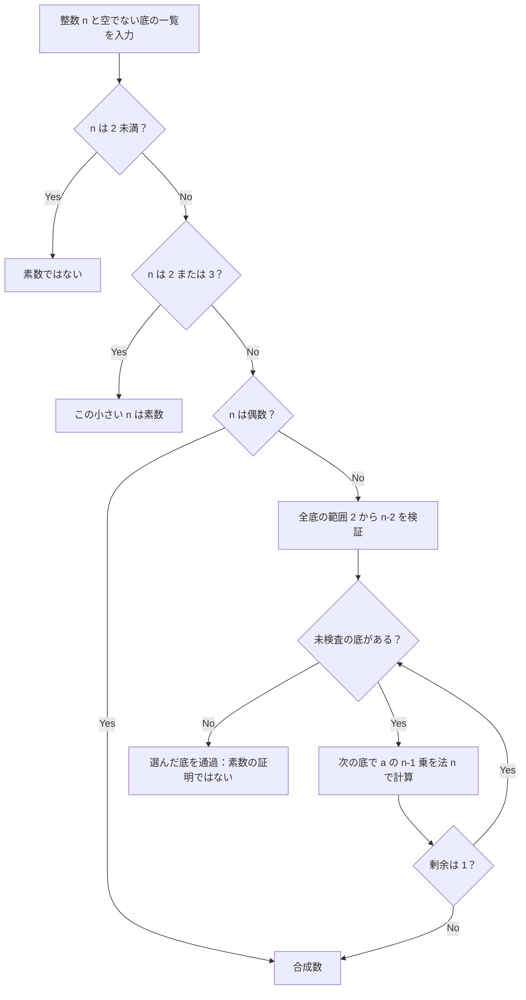
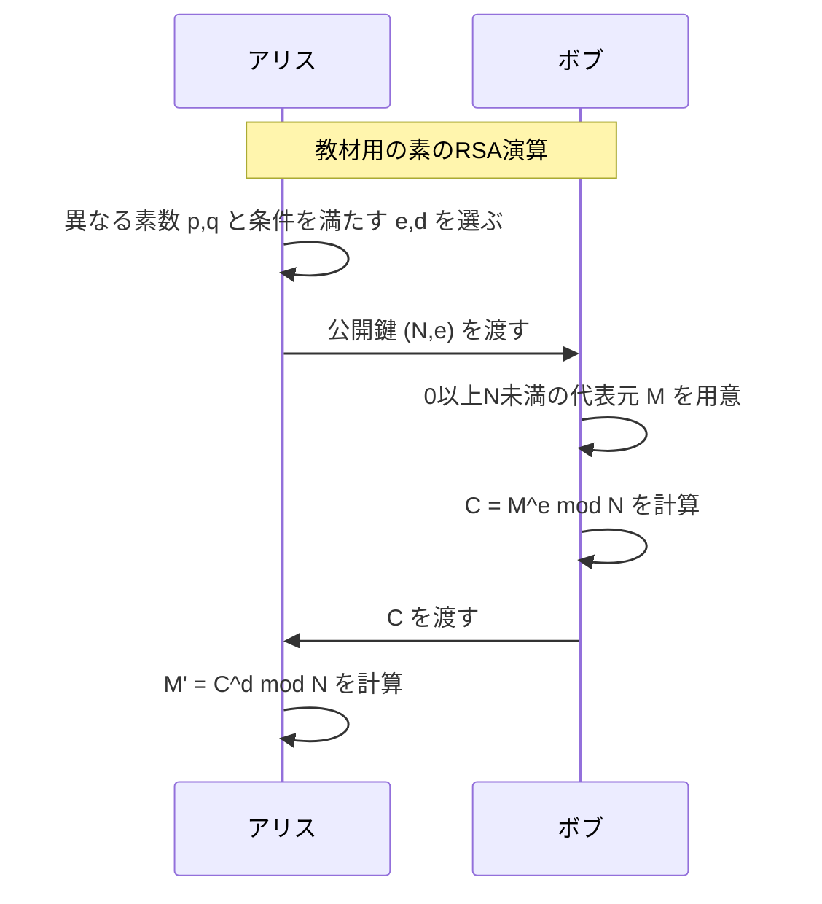

## 1. 定理が保証すること

フェルマーの小定理は、素数を法とするべき乗の性質を述べる定理です。素数判定の必要条件やRSAの復号の正当性を理解する手がかりになります。ただし、正しく復号できることと、安全な暗号方式であることは別です。定理だけで通信の機密性が保証されるわけではありません。

この記事では合同式、フェルマーとオイラーの定理、フェルマーテストの限界、RSAの数学を説明します。コードは境界を確認できる教材です。実用の鍵生成器や暗号方式として使用する実装ではありません。[RSAの仕組みと方式の違い](https://kenji.blog/p/rsa-encryption-math-explained-for-beginners/)も参照してください。

## 2. 合同式と逆元

正の整数 $n$ に対して、整数 $a,b$ の差が $n$ の倍数であることを次のように書きます。

$$ a \equiv b \pmod n. $$

例えば $17\equiv12\equiv2\pmod5$ です。合同式は加法・減法・乗法、非負整数回のべき乗と両立します。ただし約分には条件が必要です。

$$ ac\equiv bc\pmod n,\quad \gcd(c,n)=1
\quad\Longrightarrow\quad a\equiv b\pmod n. $$

互いに素の条件がないと、例えば $2\cdot1\equiv2\cdot4\pmod6$ でも $1\not\equiv4\pmod6$ です。$n>1$ のとき、逆元 $c^{-1}$ が存在する条件は $\gcd(c,n)=1$ です。拡張ユークリッドの互除法で $cx+ny=1$ を求めれば、$x$ を法 $n$ で正規化したものが逆元になります。

## 3. フェルマーの小定理と証明

$p$ が素数で $p\nmid a$ のとき、

$$ a^{p-1}\equiv1\pmod p. $$

例えば $p=5$ では $2^4=16$、$3^4=81$、$4^4=256$ はどれも5で割った余りが1です。すべての整数 $a$ に対して成立する形は、

$$ a^p\equiv a\pmod p. $$

後者は $p\nmid a$ の場合に前者へ $a$ を掛け、$p\mid a$ の場合には両辺が0に合同であることから得られます。

前者の証明では、$1,2,\ldots,p-1$ に $a$ を掛けた剰余を考えます。剰余0は現れず、$ia\equiv ja\pmod p$ なら $a$ を約分できて $i=j$ となるため、元の非零剰余の並べ替えです。積を取ると、

$$ a^{p-1}(p-1)!\equiv(p-1)!\pmod p. $$

$(p-1)!$ は $p$ と互いに素なので約分でき、定理が従います。

## 4. オイラーの定理

トーティエント $\varphi(n)$ は、1以上 $n$ 以下の整数のうち $n$ と互いに素なものの個数です。素数 $p$ では $\varphi(p)=p-1$、異なる素数 $p,q$ では、

$$ \varphi(pq)=(p-1)(q-1). $$

$n>1$ と $\gcd(a,n)=1$ に対し、[オイラーの定理](https://dlmf.nist.gov/27.2#E8)は次を述べます。

$$ a^{\varphi(n)}\equiv1\pmod n. $$

互いに素な剰余の集合に対して、前節と同様の並べ替えと積の約分で示せます。法が素数の場合がフェルマーの小定理です。互いに素でない入力へ無条件に適用することはできません。

## 5. フェルマーテストで分かること

整数 $n>3$ が奇数のとき、底 $a$ を $2\le a\le n-2$ から選びます。次の不一致があれば、$n$ は合成数と確定します。

$$ a^{n-1}\not\equiv1\pmod n. $$

逆向きは成り立ちません。通過したという結果は、選んだ底でこの必要条件に違反しなかったことだけを意味します。底を何回かランダムに選んでも、すべての合成数に一律の小さな誤通過率を保証する説明にはできません。



空の一覧と底の範囲の誤りはコードで例外にします。Python版では整数以外の型も拒否します。小さい整数と偶数を処理した後、奇数 $n\ge5$ のときだけ底の範囲を検証します。

カーマイケル数は、**$n$ と互いに素なすべての底**でフェルマーの合同式を満たす合成数です。最小の例 $561=3\cdot11\cdot17$ は底2を通過しますが、底3では通過しません。$1105=5\cdot13\cdot17$ も合成数であり、底2と3を通過します。これを素数生成の証明として採用してはいけません。

[Handbook of Applied Cryptography第4章](https://cacr.uwaterloo.ca/hac/about/chap4.pdf)のFermatとMiller–Rabinの節は、この違いを説明しています。Miller–Rabinでは、固定した奇合成数に対し、独立・一様なランダム底を使う $k$ 回の検査の誤通過率を $4^{-k}$ 以下に抑えられます。これは「通過後にその数が合成数である確率」と同じ量ではなく、任意の固定底へそのまま適用する値でもありません。[OpenSSLの説明](https://docs.openssl.org/master/man3/BN_generate_prime/)もprobable primeと反復検査を区別しています。より詳しくは[素数判定の記事](https://kenji.blog/p/cpp-fast-prime-testing-miller-rabin/)を参照してください。

## 6. C++とPythonで必要条件を試す

以下は乱数を使わず、指定した底を調べる教材です。関数名の `passes` は通過を意味し、素数との断定ではありません。元の反復数による実装では0回・負の回数で検査が省略されましたが、ここでは空の底一覧を拒否します。

### C++17

`std::uint64_t` がある処理系を対象とし、負の入力は扱いません。`__int128` 拡張には依存せず、剰余を保った加算で乗算を作ります。`add_mod` は内部用で、両加数が法未満という前提を持ちます。`a >= m-b` の場合は引き算へ置き換え、それ以外では和が法未満なので64bitの上限を超えません。乗算・べき乗関数は法0を拒否し、法1では剰余0を返します。

```cpp
#include <cstdint>
#include <iostream>
#include <stdexcept>
#include <vector>

using u64 = std::uint64_t;

// Internal helper: m > 0 and a, b < m.
u64 add_mod(u64 a, u64 b, u64 m) {
    return a >= m - b ? a - (m - b) : a + b;
}

u64 mul_mod(u64 a, u64 b, u64 m) {
    if (m == 0) throw std::invalid_argument("Modulus must be positive");
    a %= m;
    u64 result = 0;
    while (b != 0) {
        if (b & 1) result = add_mod(result, a, m);
        b >>= 1;
        if (b != 0) a = add_mod(a, a, m);
    }
    return result;
}

u64 power_mod(u64 a, u64 exponent, u64 m) {
    if (m == 0) throw std::invalid_argument("Modulus must be positive");
    u64 result = 1 % m;
    a %= m;
    while (exponent != 0) {
        if (exponent & 1) result = mul_mod(result, a, m);
        exponent >>= 1;
        if (exponent != 0) a = mul_mod(a, a, m);
    }
    return result;
}

bool fermat_passes(u64 n, const std::vector<u64>& bases) {
    if (bases.empty()) throw std::invalid_argument("Choose at least one base");
    if (n < 2) return false;
    if (n <= 3) return true;
    if (n % 2 == 0) return false;
    for (u64 a : bases) {
        if (a < 2 || a > n - 2) throw std::invalid_argument("Base outside range");
    }
    for (u64 a : bases) {
        if (power_mod(a, n - 1, n) != 1) return false;
    }
    return true;
}

int main() {
    std::cout << "1000000007 passes bases 2,3: " << fermat_passes(1000000007, {2, 3}) << '\n';
    std::cout << "1105 passes bases 2,3: " << fermat_passes(1105, {2, 3}) << '\n';
    std::cout << "1105 passes base 5: " << fermat_passes(1105, {5}) << '\n';
}
```

例えば `g++ -std=c++17 fermat.cpp -o fermat` でコンパイルします。WSLのGCC13.3で検証しました。出力の真偽値は順に `1, 1, 0` です。1105が二つの底を通過すること自体が、限界を示す例です。

### Python

Python3の `int` と3引数の `pow` を使います。組み込みの `int` 型だけを受け付け、`bool` などは拒否します。底の一覧を空にはできません。C++と同じ候補と底を試します。

```python
def fermat_passes(n, bases):
    if type(n) is not int:
        raise TypeError("n must be an integer")
    bases = tuple(bases)
    if not bases:
        raise ValueError("Choose at least one base")
    if any(type(a) is not int for a in bases):
        raise TypeError("Bases must be integers")
    if n < 2:
        return False
    if n <= 3:
        return True
    if n % 2 == 0:
        return False
    if any(a < 2 or a > n - 2 for a in bases):
        raise ValueError("Base outside range")
    return all(pow(a, n - 1, n) == 1 for a in bases)


if __name__ == "__main__":
    print("1000000007 passes bases 2,3:", fermat_passes(1000000007, [2, 3]))
    print("1105 passes bases 2,3:", fermat_passes(1105, [2, 3]))
    print("1105 passes base 5:", fermat_passes(1105, [5]))
```

Python3.12で検証しました。結果は順に `True, True, False` です。元の104729の例も素数として通過する性質は変わりません。Python整数は固定幅の桁あふれを避けられますが、時間・メモリが無制限になるわけではありません。

繰り返し二乗法は、指数 $b>0$ のビット数に比例する $O(\log b)$ 回の剰余乗算を行います。これはビット計算量や実測時間ではありません。C++例の各剰余乗算は、乗数のビット数に比例する剰余加算で実装しています。Pythonの `pow` の具体的な内部アルゴリズムを全版で同一とは断定しません。

## 7. RSAが復号できる理由

異なる素数 $p,q$ から $N=pq$ を作ります。ここでは教材として $1<e<\varphi(N)$、$\gcd(e,\varphi(N))=1$ を満たす公開指数を選び、その逆元を秘密指数 $d$ とします。

$$ ed\equiv1\pmod{\varphi(N)},\qquad
\varphi(N)=(p-1)(q-1). $$

公開鍵は $(N,e)$、秘密鍵の簡略表現は $(N,d)$ です。実用の秘密鍵はCRT用の因数などを含むこともあり、それらも秘密です。素因数分解ができれば秘密指数を計算できますが、RSAの反転と素因数分解が一般に同値だと証明されたという意味ではありません。

代表元 $0\le M<N$ について、

$$ C=M^e\bmod N,\qquad M'=C^d\bmod N. $$

以下の図は整数代表元への**素のRSA演算**だけを表します。実用暗号のメッセージ符号化や認証を省いた、数学用の図です。



まず $\gcd(M,N)=1$ なら、ある非負整数 $t$ に対して $ed=1+t\varphi(N)$ と書けるため、オイラーの定理から、

$$ M^{ed}=M(M^{\varphi(N)})^t\equiv M\pmod N. $$

互いに素でない代表元も除外しません。法 $p$ で、$p\mid M$ なら $M^{ed}$ と $M$ はともに0です。そうでなければフェルマーの小定理と $p-1\mid ed-1$ により両者は合同です。法 $q$ でも同様で、$p,q$ が互いに素なので中国剰余定理から、

$$ M^{ed}\equiv M\pmod p,\quad
M^{ed}\equiv M\pmod q
\quad\Longrightarrow\quad M^{ed}\equiv M\pmod N. $$

したがって0や $p,q$ の倍数を含むすべての代表元が戻ります。これは正当性の証明であり、機密性の証明ではありません。

## 8. 再現可能なRSAプリミティブの教材

固定した既知の素数61と53、指数17を使い、逆元を拡張ユークリッドの互除法で求めます。ランダムな素数生成・文字列ごとの変換は行いません。元の底2・3だけの「素数生成器」は1105を受理するため、復号を壊す鍵を作る場合があります。指数1や代表元の範囲外入力も、実用暗号の条件として見過ごせません。

次の `rsa_primitive` は指数・法・代表元の算術上の入力範囲だけを検証します。任意に渡された法の因数やRSA鍵の妥当性まで検査する関数ではありません。固定した教材鍵の条件は別に満たしています。[RFC8017のSection5と7](https://www.rfc-editor.org/rfc/rfc8017.html)も、プリミティブと暗号方式を分けています。

```python
def extended_gcd(a, b):
    old_r, r = a, b
    old_s, s = 1, 0
    old_t, t = 0, 1
    while r:
        q = old_r // r
        old_r, r = r, old_r - q * r
        old_s, s = s, old_s - q * s
        old_t, t = t, old_t - q * t
    return old_r, old_s, old_t


def mod_inverse(a, modulus):
    if type(a) is not int or type(modulus) is not int:
        raise TypeError("Arguments must be integers")
    if modulus <= 1:
        raise ValueError("Modulus must exceed one")
    g, x, _ = extended_gcd(a % modulus, modulus)
    if g != 1:
        raise ValueError("Inverse does not exist")
    return x % modulus


def rsa_primitive(value, exponent, modulus):
    if any(type(x) is not int for x in (value, exponent, modulus)):
        raise TypeError("Arguments must be integers")
    if exponent <= 0 or modulus <= 1 or not 0 <= value < modulus:
        raise ValueError("Invalid exponent, modulus or representative")
    return pow(value, exponent, modulus)


def rsa_primitive_demo():
    p, q, e = 61, 53, 17  # Fixed public teaching constants, not secret keys.
    n = p * q
    phi = (p - 1) * (q - 1)
    d = mod_inverse(e, phi)
    print("Public key (n, e):", (n, e))
    print("Private key (n, d):", (n, d))
    m = 65
    c = rsa_primitive(m, e, n)
    recovered = rsa_primitive(c, d, n)
    print(f"{m} -> {c} -> {recovered}")
    for representative in range(n):
        cipher = rsa_primitive(representative, e, n)
        if rsa_primitive(cipher, d, n) != representative:
            raise ArithmeticError("Round-trip failed")
    print("All 3233 representatives round-trip.")


if __name__ == "__main__":
    rsa_primitive_demo()
```

実行すると $(N,e)=(3233,17)$、$(N,d)=(3233,2753)$ と `65 -> 2790 -> 65` を表示し、3233個すべての代表元の往復を検査します。秘密鍵表示も固定した公開教材値だけのものです。この検査は一般のRSA鍵の安全性を保証しません。

## 9. 実用暗号との境界と参考資料

素のRSAは決定的で、文字ごとの暗号文を公開鍵で辞書照合できるなど、安全な暗号化方式には足りません。実用では監査されたライブラリと、RSAES-OAEPなど目的に合う方式・適切なパラメータ・安全な乱数を使います。[Pythonのrandom](https://docs.python.org/3/library/random.html)の擬似乱数を暗号鍵の生成用として扱ってはいけません。署名のRSASSA-PSSは暗号化とは別の方式です。

理解すべき対応は、定理が合同式を保証し、素数判定が条件を検査し、正しい鍵のRSA演算が代表元を復元し、実用方式が追加の符号化や安全性要件を満たす、という段階です。特定の通信サービスや現代暗号のすべてがフェルマーの小定理だけに依存するとは言えません。

参照した一次資料は、[DLMFのオイラーの定理](https://dlmf.nist.gov/27.2#E8)、[HAC第4章](https://cacr.uwaterloo.ca/hac/about/chap4.pdf)、[RSA仕様RFC8017](https://www.rfc-editor.org/rfc/rfc8017.html)、[GCCの128bit整数の説明](https://gcc.gnu.org/onlinedocs/gcc/_005f_005fint128.html)です。最後の資料は、元の実装にあった拡張型の制約を確認するためのものです。
