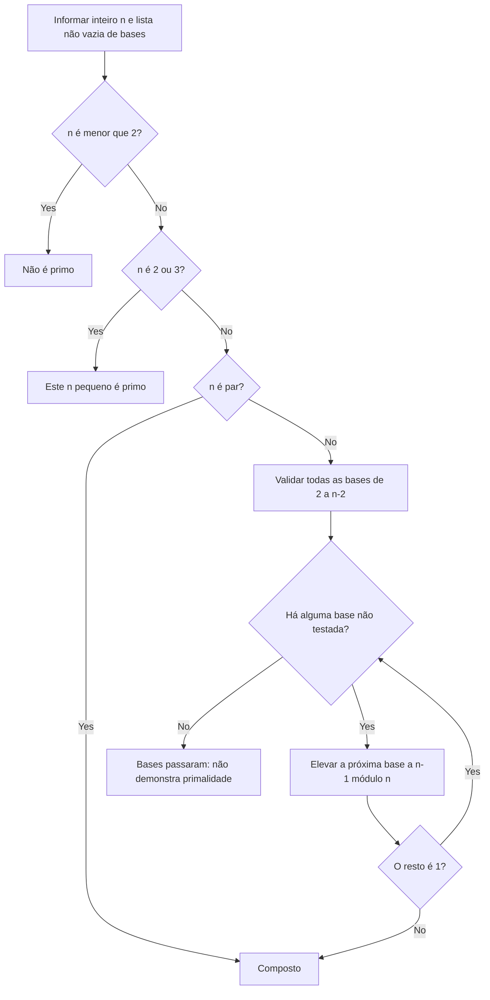
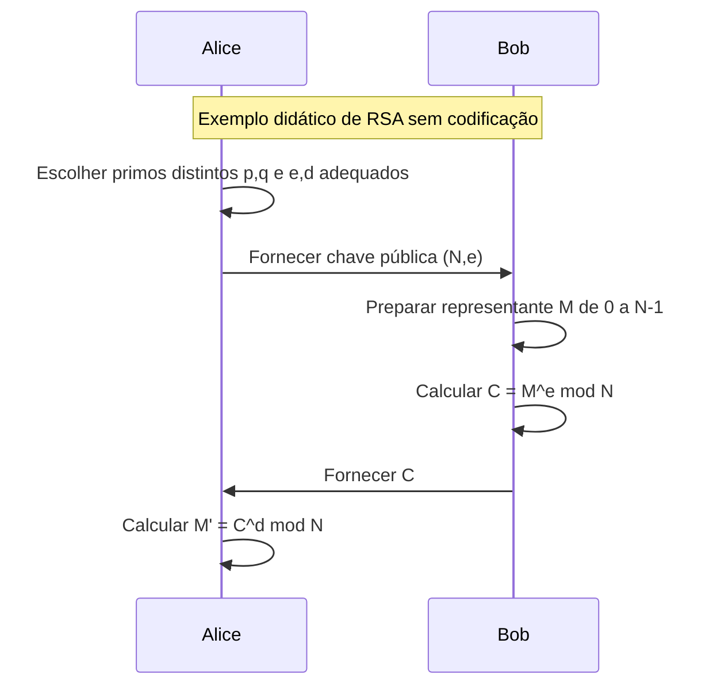

## 1. O que o teorema garante

O pequeno teorema de Fermat descreve potências módulo um primo. Ele ajuda a entender uma condição necessária de primalidade e por que a decifração RSA funciona. Decifrar corretamente e ter um esquema de cifração seguro são propriedades diferentes: o teorema sozinho não garante a confidencialidade da comunicação.

Este artigo apresenta congruências, os teoremas de Fermat e Euler, as limitações do teste de Fermat e a matemática do RSA. O código é material didático com verificações dos limites, e não uma implementação para geração de chaves ou cifração em produção. Veja também a [diferença entre a matemática do RSA e os esquemas de cifração](https://kenji.blog/pt/p/rsa-encryption-math-explained-for-beginners/).

## 2. Congruências e inversos

Para um inteiro positivo $n$, a expressão abaixo indica que a diferença entre os inteiros $a,b$ é múltipla de $n$.

$$ a \equiv b \pmod n. $$

Por exemplo, $17\equiv12\equiv2\pmod5$. Congruências são compatíveis com adição, subtração, multiplicação e potências inteiras não negativas. Contudo, cancelar um fator exige uma condição.

$$ ac\equiv bc\pmod n,\quad \gcd(c,n)=1
\quad\Longrightarrow\quad a\equiv b\pmod n. $$

Sem coprimalidade, vale $2\cdot1\equiv2\cdot4\pmod6$, mas $1\not\equiv4\pmod6$. Para $n>1$, o inverso $c^{-1}$ existe se e somente se $\gcd(c,n)=1$. O algoritmo de Euclides estendido encontra $cx+ny=1$; reduzir $x$ módulo $n$ fornece o inverso.

## 3. Pequeno teorema de Fermat e demonstração

Se $p$ é primo e $p\nmid a$, então:

$$ a^{p-1}\equiv1\pmod p. $$

Para $p=5$, os valores $2^4=16$, $3^4=81$ e $4^4=256$ deixam resto 1 na divisão por 5. Uma forma válida para todo inteiro $a$ é:

$$ a^p\equiv a\pmod p. $$

Quando $p\nmid a$, multiplicamos a primeira forma por $a$. Quando $p\mid a$, os dois lados da segunda são congruentes a zero.

Para demonstrar a primeira forma, multiplicamos os resíduos não nulos $1,2,\ldots,p-1$ por $a$. Nenhum se torna zero. Se $ia\equiv ja\pmod p$, cancelamos $a$ e obtemos $i=j$; portanto, esses produtos permutam os resíduos não nulos originais. Tomando produtos:

$$ a^{p-1}(p-1)!\equiv(p-1)!\pmod p. $$

Como $(p-1)!$ é coprimo com $p$, podemos cancelá-lo e o teorema está demonstrado.

## 4. Teorema de Euler

A função totiente $\varphi(n)$ conta os inteiros de 1 até $n$ que são coprimos com $n$. Para um primo $p$, $\varphi(p)=p-1$; para primos distintos $p,q$:

$$ \varphi(pq)=(p-1)(q-1). $$

Para $n>1$ e $\gcd(a,n)=1$, o [teorema de Euler](https://dlmf.nist.gov/27.2#E8) afirma:

$$ a^{\varphi(n)}\equiv1\pmod n. $$

A demonstração usa uma permutação e o cancelamento do produto dos resíduos coprimos, como na seção anterior. O pequeno teorema de Fermat é o caso de módulo primo. Não se pode aplicar o teorema de Euler sem condições a uma entrada que não seja coprima com o módulo.

## 5. O que o teste de Fermat informa

Para um inteiro ímpar $n>3$, escolhemos uma base $a$ com $2\le a\le n-2$. Se ocorrer a discrepância abaixo, $n$ é certamente composto.

$$ a^{n-1}\not\equiv1\pmod n. $$

A recíproca não vale. Passar no teste significa apenas que as bases escolhidas não violaram essa condição necessária. Repetir com várias bases aleatórias não fornece uma cota pequena de erro que valha uniformemente para todo número composto.



O código lança exceções para uma lista vazia ou uma base fora do intervalo. A versão Python também rejeita tipos não inteiros. O intervalo das bases é validado apenas para ímpares $n\ge5$, depois de tratar inteiros pequenos e números pares.

Um número de Carmichael é um composto que satisfaz a congruência de Fermat para **toda base coprima com $n$**. O menor exemplo, $561=3\cdot11\cdot17$, passa na base 2, mas não na base 3. O composto $1105=5\cdot13\cdot17$ passa nas bases 2 e 3. Ao gerar primos, esses resultados não devem ser usados como demonstração.

As seções de Fermat e Miller–Rabin do [Handbook of Applied Cryptography, capítulo 4](https://cacr.uwaterloo.ca/hac/about/chap4.pdf) explicam a diferença. Para um composto ímpar fixo, $k$ testes de Miller–Rabin com bases uniformemente aleatórias e independentes limitam a probabilidade de falso positivo a $4^{-k}$. Isso não é a mesma quantidade que a probabilidade de o número ser composto após passar nos testes, nem se aplica automaticamente a bases fixas arbitrárias. A [documentação do OpenSSL](https://docs.openssl.org/master/man3/BN_generate_prime/) também explica primos prováveis e testes repetidos. Veja o [artigo sobre testes de primalidade](https://kenji.blog/pt/p/cpp-fast-prime-testing-miller-rabin/).

## 6. Verificar a condição necessária em C++ e Python

Os exemplos didáticos verificam bases especificadas, sem aleatoriedade. O nome `passes` significa passar em um teste, e não certificar a primalidade. A implementação original pulava os testes com zero ou um número negativo de iterações; estas versões rejeitam uma lista de bases vazia.

### C++17

O exemplo requer uma implementação que forneça `std::uint64_t` e não aceita entradas negativas. A multiplicação modular usa adições que mantêm o resíduo dentro do intervalo do módulo, sem a extensão `__int128`. A função interna `add_mod` exige que as duas parcelas sejam menores que o módulo. Quando `a >= m-b`, uma subtração substitui a adição; caso contrário, a soma é menor que o módulo e cabe em 64 bits. As funções de multiplicação e exponenciação rejeitam módulo zero e retornam resíduo zero para módulo um.

```cpp
#include <cstdint>
#include <iostream>
#include <stdexcept>
#include <vector>

using u64 = std::uint64_t;

// Internal helper: m > 0 and a, b < m.
u64 add_mod(u64 a, u64 b, u64 m) {
    return a >= m - b ? a - (m - b) : a + b;
}

u64 mul_mod(u64 a, u64 b, u64 m) {
    if (m == 0) throw std::invalid_argument("Modulus must be positive");
    a %= m;
    u64 result = 0;
    while (b != 0) {
        if (b & 1) result = add_mod(result, a, m);
        b >>= 1;
        if (b != 0) a = add_mod(a, a, m);
    }
    return result;
}

u64 power_mod(u64 a, u64 exponent, u64 m) {
    if (m == 0) throw std::invalid_argument("Modulus must be positive");
    u64 result = 1 % m;
    a %= m;
    while (exponent != 0) {
        if (exponent & 1) result = mul_mod(result, a, m);
        exponent >>= 1;
        if (exponent != 0) a = mul_mod(a, a, m);
    }
    return result;
}

bool fermat_passes(u64 n, const std::vector<u64>& bases) {
    if (bases.empty()) throw std::invalid_argument("Choose at least one base");
    if (n < 2) return false;
    if (n <= 3) return true;
    if (n % 2 == 0) return false;
    for (u64 a : bases) {
        if (a < 2 || a > n - 2) throw std::invalid_argument("Base outside range");
    }
    for (u64 a : bases) {
        if (power_mod(a, n - 1, n) != 1) return false;
    }
    return true;
}

int main() {
    std::cout << "1000000007 passes bases 2,3: " << fermat_passes(1000000007, {2, 3}) << '\n';
    std::cout << "1105 passes bases 2,3: " << fermat_passes(1105, {2, 3}) << '\n';
    std::cout << "1105 passes base 5: " << fermat_passes(1105, {5}) << '\n';
}
```

Por exemplo, compile com `g++ -std=c++17 fermat.cpp -o fermat`. O código foi verificado com GCC 13.3 no WSL. As saídas booleanas são `1, 1, 0`, nessa ordem. O fato de o composto 1105 passar em duas bases já demonstra a limitação.

### Python

Esta versão usa inteiros do Python 3 e `pow` com três argumentos. Exige o tipo embutido `int` e rejeita `bool`. A lista de bases não pode estar vazia. Os candidatos e as bases são os mesmos do exemplo C++.

```python
def fermat_passes(n, bases):
    if type(n) is not int:
        raise TypeError("n must be an integer")
    bases = tuple(bases)
    if not bases:
        raise ValueError("Choose at least one base")
    if any(type(a) is not int for a in bases):
        raise TypeError("Bases must be integers")
    if n < 2:
        return False
    if n <= 3:
        return True
    if n % 2 == 0:
        return False
    if any(a < 2 or a > n - 2 for a in bases):
        raise ValueError("Base outside range")
    return all(pow(a, n - 1, n) == 1 for a in bases)


if __name__ == "__main__":
    print("1000000007 passes bases 2,3:", fermat_passes(1000000007, [2, 3]))
    print("1105 passes bases 2,3:", fermat_passes(1105, [2, 3]))
    print("1105 passes base 5:", fermat_passes(1105, [5]))
```

O código foi verificado com Python 3.12. Os resultados são `True, True, False`. O exemplo original 104729 continua passando como primo. Inteiros do Python evitam o estouro de largura fixa, mas tempo e memória não são ilimitados.

A exponenciação por quadrados sucessivos realiza $O(\log b)$ multiplicações modulares para um expoente $b>0$, uma quantidade proporcional ao seu comprimento em bits. Isso não é complexidade em bits nem tempo medido. Cada multiplicação modular do exemplo C++ usa uma quantidade de adições modulares proporcional ao comprimento do multiplicador em bits. Não se pressupõe que o algoritmo interno exato de `pow` seja idêntico em todas as versões do Python.

## 7. Por que a decifração RSA funciona

Escolhemos primos distintos $p,q$ e definimos $N=pq$. Nesta construção didática, escolhemos um expoente público com $1<e<\varphi(N)$ e $\gcd(e,\varphi(N))=1$; o expoente privado $d$ é seu inverso.

$$ ed\equiv1\pmod{\varphi(N)},\qquad
\varphi(N)=(p-1)(q-1). $$

A chave pública é $(N,e)$, e uma representação simplificada da chave privada é $(N,d)$. Chaves privadas reais também podem conter fatores para cálculos por CRT, que igualmente são secretos. Fatorar o módulo permite calcular o expoente privado, mas a equivalência geral entre inverter a função RSA e fatorar não foi demonstrada.

Para um representante $0\le M<N$:

$$ C=M^e\bmod N,\qquad M'=C^d\bmod N. $$

O diagrama mostra apenas **operações RSA sem codificação** em representantes inteiros. É um diagrama matemático que omite a codificação de mensagens e a autenticação de uma aplicação real.



Primeiro, se $\gcd(M,N)=1$, escrevemos $ed=1+t\varphi(N)$ para um inteiro não negativo $t$. O teorema de Euler fornece:

$$ M^{ed}=M(M^{\varphi(N)})^t\equiv M\pmod N. $$

Não excluímos representantes que não sejam coprimos. Módulo $p$, se $p\mid M$, tanto $M^{ed}$ quanto $M$ são zero. Caso contrário, o pequeno teorema de Fermat e $p-1\mid ed-1$ fornecem a congruência. O mesmo argumento vale módulo $q$. Como $p,q$ são coprimos, o teorema chinês do resto fornece:

$$ M^{ed}\equiv M\pmod p,\quad
M^{ed}\equiv M\pmod q
\quad\Longrightarrow\quad M^{ed}\equiv M\pmod N. $$

Assim, todos os representantes são recuperados, incluindo zero e os múltiplos de $p,q$. É uma demonstração de correção, não de confidencialidade.

## 8. Demonstração reproduzível da primitiva RSA

Usamos os primos conhecidos e fixos 61 e 53 e o expoente 17, obtendo o inverso pelo algoritmo de Euclides estendido. Não geramos primos aleatórios nem convertemos cadeias de caracteres caractere por caractere. O «gerador de primos» original, baseado apenas nas bases 2 e 3, aceita 1105 e pode produzir chaves que impedem recuperar a mensagem. O expoente um e representantes fora do intervalo também não podem ser ignorados ao discutir requisitos de cifração real.

A função `rsa_primitive` verifica somente os intervalos aritméticos do expoente, módulo e representante. Não fatora um módulo arbitrário nem valida qualquer chave RSA. A chave didática fixa satisfaz separadamente as condições da chave. O [RFC 8017, seções 5 e 7](https://www.rfc-editor.org/rfc/rfc8017.html) também distingue primitivas e esquemas de cifração.

```python
def extended_gcd(a, b):
    old_r, r = a, b
    old_s, s = 1, 0
    old_t, t = 0, 1
    while r:
        q = old_r // r
        old_r, r = r, old_r - q * r
        old_s, s = s, old_s - q * s
        old_t, t = t, old_t - q * t
    return old_r, old_s, old_t


def mod_inverse(a, modulus):
    if type(a) is not int or type(modulus) is not int:
        raise TypeError("Arguments must be integers")
    if modulus <= 1:
        raise ValueError("Modulus must exceed one")
    g, x, _ = extended_gcd(a % modulus, modulus)
    if g != 1:
        raise ValueError("Inverse does not exist")
    return x % modulus


def rsa_primitive(value, exponent, modulus):
    if any(type(x) is not int for x in (value, exponent, modulus)):
        raise TypeError("Arguments must be integers")
    if exponent <= 0 or modulus <= 1 or not 0 <= value < modulus:
        raise ValueError("Invalid exponent, modulus or representative")
    return pow(value, exponent, modulus)


def rsa_primitive_demo():
    p, q, e = 61, 53, 17  # Fixed public teaching constants, not secret keys.
    n = p * q
    phi = (p - 1) * (q - 1)
    d = mod_inverse(e, phi)
    print("Public key (n, e):", (n, e))
    print("Private key (n, d):", (n, d))
    m = 65
    c = rsa_primitive(m, e, n)
    recovered = rsa_primitive(c, d, n)
    print(f"{m} -> {c} -> {recovered}")
    for representative in range(n):
        cipher = rsa_primitive(representative, e, n)
        if rsa_primitive(cipher, d, n) != representative:
            raise ArithmeticError("Round-trip failed")
    print("All 3233 representatives round-trip.")


if __name__ == "__main__":
    rsa_primitive_demo()
```

A execução mostra $(N,e)=(3233,17)$, $(N,d)=(3233,2753)$ e `65 -> 2790 -> 65`, e verifica a ida e volta dos 3233 representantes. A chave privada exibida é uma constante didática fixa e pública. O teste não demonstra a segurança das chaves RSA em geral.

## 9. Limites de uso e referências

RSA sem um esquema de codificação é determinístico e não basta para uma cifração segura. Por exemplo, a chave pública permite comparar um dicionário com textos cifrados caractere a caractere. Em produção, são necessárias bibliotecas auditadas, um esquema adequado como RSAES-OAEP, parâmetros apropriados e aleatoriedade segura. O gerador pseudoaleatório do [random do Python](https://docs.python.org/3/library/random.html) não deve ser usado para gerar chaves criptográficas. RSASSA-PSS é um esquema de assinatura, distinto da cifração.

É preciso distinguir as etapas: o teorema estabelece congruências; testes de primalidade verificam condições; operações RSA com chaves válidas recuperam representantes; e esquemas reais acrescentam codificação e outros requisitos de segurança. Não se pode afirmar que serviços específicos de comunicação, ou toda a criptografia moderna, dependam exclusivamente do pequeno teorema de Fermat.

As fontes primárias são [DLMF sobre o teorema de Euler](https://dlmf.nist.gov/27.2#E8), [HAC, capítulo 4](https://cacr.uwaterloo.ca/hac/about/chap4.pdf), [a especificação RSA, RFC 8017](https://www.rfc-editor.org/rfc/rfc8017.html) e [a descrição dos inteiros de 128 bits do GCC](https://gcc.gnu.org/onlinedocs/gcc/_005f_005fint128.html). A última explica as limitações do tipo de extensão usado na implementação original.
