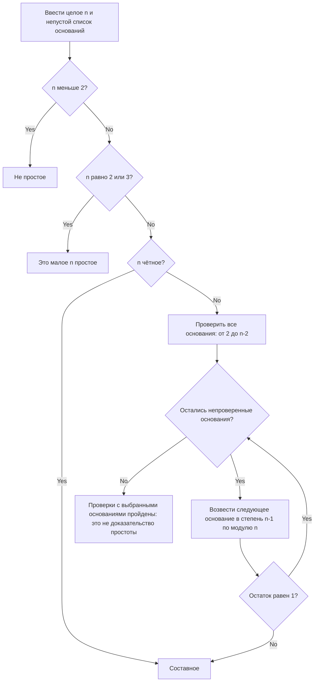
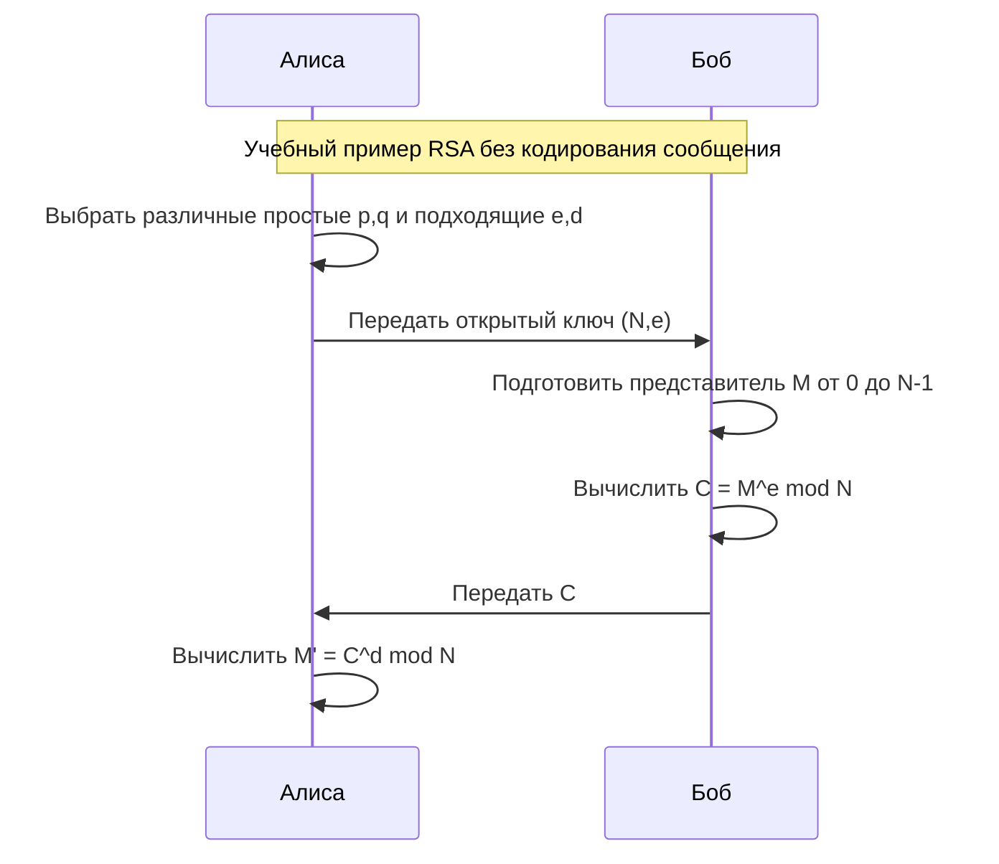

## 1. Что гарантирует теорема

Малая теорема Ферма описывает свойства возведения в степень по простому модулю. Она помогает понять необходимое условие простоты и корректность расшифрования RSA. Корректное расшифрование и безопасность схемы шифрования — разные свойства. Одна теорема не гарантирует конфиденциальность связи.

В статье рассматриваются сравнения по модулю, теоремы Ферма и Эйлера, ограничения теста Ферма и математика RSA. Код служит учебным примером с проверкой граничных условий, а не готовой реализацией генерации ключей или шифрования. См. также [различие между математикой RSA и схемой шифрования](https://kenji.blog/ru/p/rsa-encryption-math-explained-for-beginners/).

## 2. Сравнения и обратные элементы

Для положительного целого $n$ следующая запись означает, что разность целых чисел $a,b$ кратна $n$:

$$ a \equiv b \pmod n. $$

Например, $17\equiv12\equiv2\pmod5$. Сравнения сохраняются при сложении, вычитании, умножении и возведении в неотрицательную целую степень. Но для сокращения общего множителя требуется условие:

$$ ac\equiv bc\pmod n,\quad \gcd(c,n)=1
\quad\Longrightarrow\quad a\equiv b\pmod n. $$

Без взаимной простоты, например, $2\cdot1\equiv2\cdot4\pmod6$, хотя $1\not\equiv4\pmod6$. При $n>1$ обратный элемент $c^{-1}$ существует тогда и только тогда, когда $\gcd(c,n)=1$. Расширенный алгоритм Евклида находит решение $cx+ny=1$; остаток от деления $x$ на $n$ и есть обратный элемент.

## 3. Малая теорема Ферма и доказательство

Если $p$ простое и $p\nmid a$, то:

$$ a^{p-1}\equiv1\pmod p. $$

При $p=5$ числа $2^4=16$, $3^4=81$ и $4^4=256$ дают остаток 1 при делении на 5. Форма, справедливая для любого целого $a$:

$$ a^p\equiv a\pmod p. $$

Если $p\nmid a$, умножаем первое сравнение на $a$. Если $p\mid a$, обе части второго сравнения сравнимы с нулём.

Для доказательства первого сравнения умножим ненулевые остатки $1,2,\ldots,p-1$ на $a$. Нулевых остатков не получится. Если $ia\equiv ja\pmod p$, можно сократить множитель $a$ и получить $i=j$. Следовательно, полученные остатки — перестановка исходных ненулевых остатков. Перемножая их, получаем:

$$ a^{p-1}(p-1)!\equiv(p-1)!\pmod p. $$

Числа $(p-1)!$ и $p$ взаимно просты, поэтому общий множитель можно сократить. Теорема доказана.

## 4. Теорема Эйлера

Функция Эйлера $\varphi(n)$ считает целые числа от 1 до $n$, взаимно простые с $n$. Для простого $p$ имеем $\varphi(p)=p-1$, а для различных простых $p,q$:

$$ \varphi(pq)=(p-1)(q-1). $$

При $n>1$ и $\gcd(a,n)=1$ [теорема Эйлера](https://dlmf.nist.gov/27.2#E8) утверждает:

$$ a^{\varphi(n)}\equiv1\pmod n. $$

Доказательство использует перестановку остатков, взаимно простых с модулем, и сокращение произведения, как в предыдущем разделе. Случай простого модуля — малая теорема Ферма. Без условия взаимной простоты входного числа и модуля теорему Эйлера применять нельзя.

## 5. Что позволяет установить тест Ферма

Для нечётного целого $n>3$ выбираем основание $a$ из $2\le a\le n-2$. Если остаток отличается от единицы, как в записи ниже, то $n$ заведомо составное:

$$ a^{n-1}\not\equiv1\pmod n. $$

Обратное утверждение неверно. Успех означает лишь, что выбранные основания не выявили нарушения этого необходимого условия. Несколько случайных оснований не дают единой малой границы вероятности ошибки для всех составных входных чисел.



Для пустого списка и оснований вне диапазона код возбуждает исключение. Версия на Python также отвергает нецелочисленные типы. Диапазон оснований проверяется только для нечётных $n\ge5$, после обработки малых целых чисел и чётных чисел.

Число Кармайкла — составное число, удовлетворяющее сравнению Ферма для **всех оснований, взаимно простых с $n$**. Наименьший пример $561=3\cdot11\cdot17$ проходит проверку с основанием 2, но не с основанием 3. Составное число $1105=5\cdot13\cdot17$ проходит проверки с основаниями 2 и 3. При генерации простых чисел это нельзя считать доказательством простоты.

Разделы о тестах Ферма и Миллера—Рабина в [главе 4 Handbook of Applied Cryptography](https://cacr.uwaterloo.ca/hac/about/chap4.pdf) объясняют различие. Для фиксированного нечётного составного числа вероятность ошибочного прохождения $k$ проверок Миллера—Рабина с независимыми равномерно случайными основаниями не превышает $4^{-k}$. Это не то же самое, что вероятность составности числа после успешного теста; граница также не переносится автоматически на произвольные фиксированные основания. [Документация OpenSSL](https://docs.openssl.org/master/man3/BN_generate_prime/) описывает вероятно простые числа и повторные проверки. Подробнее см. [статью о проверке простоты](https://kenji.blog/ru/p/cpp-fast-prime-testing-miller-rabin/).

## 6. Проверка необходимого условия на C++ и Python

Это учебные примеры с заданными основаниями, без случайного выбора. `passes` в имени функции означает прохождение теста, а не подтверждение простоты. В старом варианте нулевое или отрицательное число итераций приводило к пропуску проверки; теперь пустой список оснований отвергается.

### C++17

Нужна реализация с `std::uint64_t`; отрицательные входные значения не рассматриваются. Модульное умножение строится на сложениях, сохраняющих остатки в диапазоне модуля, без расширения `__int128`. Внутренняя функция `add_mod` предполагает, что оба слагаемых меньше модуля. При `a >= m-b` сложение заменяется вычитанием; иначе сумма меньше модуля и помещается в 64 бита. Функции умножения и возведения в степень отвергают нулевой модуль, а для модуля один возвращают нулевой остаток.

```cpp
#include <cstdint>
#include <iostream>
#include <stdexcept>
#include <vector>

using u64 = std::uint64_t;

// Internal helper: m > 0 and a, b < m.
u64 add_mod(u64 a, u64 b, u64 m) {
    return a >= m - b ? a - (m - b) : a + b;
}

u64 mul_mod(u64 a, u64 b, u64 m) {
    if (m == 0) throw std::invalid_argument("Modulus must be positive");
    a %= m;
    u64 result = 0;
    while (b != 0) {
        if (b & 1) result = add_mod(result, a, m);
        b >>= 1;
        if (b != 0) a = add_mod(a, a, m);
    }
    return result;
}

u64 power_mod(u64 a, u64 exponent, u64 m) {
    if (m == 0) throw std::invalid_argument("Modulus must be positive");
    u64 result = 1 % m;
    a %= m;
    while (exponent != 0) {
        if (exponent & 1) result = mul_mod(result, a, m);
        exponent >>= 1;
        if (exponent != 0) a = mul_mod(a, a, m);
    }
    return result;
}

bool fermat_passes(u64 n, const std::vector<u64>& bases) {
    if (bases.empty()) throw std::invalid_argument("Choose at least one base");
    if (n < 2) return false;
    if (n <= 3) return true;
    if (n % 2 == 0) return false;
    for (u64 a : bases) {
        if (a < 2 || a > n - 2) throw std::invalid_argument("Base outside range");
    }
    for (u64 a : bases) {
        if (power_mod(a, n - 1, n) != 1) return false;
    }
    return true;
}

int main() {
    std::cout << "1000000007 passes bases 2,3: " << fermat_passes(1000000007, {2, 3}) << '\n';
    std::cout << "1105 passes bases 2,3: " << fermat_passes(1105, {2, 3}) << '\n';
    std::cout << "1105 passes base 5: " << fermat_passes(1105, {5}) << '\n';
}
```

Например, скомпилируйте командой `g++ -std=c++17 fermat.cpp -o fermat`. Код проверен с GCC 13.3 в WSL. Логические результаты по порядку: `1, 1, 0`. Успешные проверки составного числа 1105 с двумя основаниями сами демонстрируют ограничение теста.

### Python

Используются целые числа Python 3 и трёхаргументный `pow`. Допускается только встроенный тип `int`; `bool` и другие типы отвергаются. Список оснований должен быть непустым. Проверяются те же кандидаты и основания, что в примере C++.

```python
def fermat_passes(n, bases):
    if type(n) is not int:
        raise TypeError("n must be an integer")
    bases = tuple(bases)
    if not bases:
        raise ValueError("Choose at least one base")
    if any(type(a) is not int for a in bases):
        raise TypeError("Bases must be integers")
    if n < 2:
        return False
    if n <= 3:
        return True
    if n % 2 == 0:
        return False
    if any(a < 2 or a > n - 2 for a in bases):
        raise ValueError("Base outside range")
    return all(pow(a, n - 1, n) == 1 for a in bases)


if __name__ == "__main__":
    print("1000000007 passes bases 2,3:", fermat_passes(1000000007, [2, 3]))
    print("1105 passes bases 2,3:", fermat_passes(1105, [2, 3]))
    print("1105 passes base 5:", fermat_passes(1105, [5]))
```

Код проверен с Python 3.12. Результаты по порядку: `True, True, False`. Число 104729 из прежнего примера также проходит тест как простое. Целые числа Python произвольной точности позволяют избежать переполнения фиксированной разрядности, но время и память не безграничны.

Метод последовательного возведения в квадрат выполняет $O(\log b)$ модульных умножений для показателя $b>0$, то есть пропорционально его битовой длине. Это не битовая сложность и не измеренное время. Каждое модульное умножение в примере C++ использует число модульных сложений, пропорциональное битовой длине множителя. Не предполагается, что точный внутренний алгоритм `pow` одинаков во всех версиях Python.

## 7. Почему расшифрование RSA корректно

Выбираем различные простые $p,q$ и вычисляем $N=pq$. В учебном построении открытый показатель удовлетворяет $1<e<\varphi(N)$ и $\gcd(e,\varphi(N))=1$. Его обратный элемент — закрытый показатель $d$:

$$ ed\equiv1\pmod{\varphi(N)},\qquad
\varphi(N)=(p-1)(q-1). $$

Открытый ключ — $(N,e)$, а упрощённое представление закрытого ключа — $(N,d)$. Реальный закрытый ключ может включать множители для вычислений по китайской теореме об остатках; они тоже секретны. Разложение модуля на множители позволяет вычислить закрытый показатель, но общая эквивалентность обращения RSA и факторизации не доказана.

Для целочисленного представителя сообщения $0\le M<N$:

$$ C=M^e\bmod N,\qquad M'=C^d\bmod N. $$

Диаграмма показывает только **операции RSA без кодирования сообщения** над целочисленными представителями. Это математическая схема, в которой отсутствуют кодирование сообщения и аутентификация реального приложения.



Сначала пусть $\gcd(M,N)=1$. Для некоторого неотрицательного целого $t$ можно записать $ed=1+t\varphi(N)$. По теореме Эйлера:

$$ M^{ed}=M(M^{\varphi(N)})^t\equiv M\pmod N. $$

Представители, не взаимно простые с модулем, тоже не исключаются. По модулю $p$, если $p\mid M$, то $M^{ed}$ и $M$ оба равны нулю по этому модулю. Иначе сравнение следует из малой теоремы Ферма и $p-1\mid ed-1$. Аналогично для модуля $q$. Поскольку $p,q$ взаимно просты, китайская теорема об остатках даёт:

$$ M^{ed}\equiv M\pmod p,\quad
M^{ed}\equiv M\pmod q
\quad\Longrightarrow\quad M^{ed}\equiv M\pmod N. $$

Итак, восстанавливаются все представители, включая ноль и кратные $p,q$. Это доказательство корректности, а не конфиденциальности.

## 8. Воспроизводимый пример примитива RSA

Используем фиксированные известные простые числа 61 и 53 и показатель 17. Обратный элемент находим расширенным алгоритмом Евклида. Пример не генерирует случайные простые числа и не преобразует строку посимвольно. Прежний «генератор простых чисел», проверявший только основания 2 и 3, принимал 1105 и мог создавать ключи, при которых расшифрование нарушается. Показатель один и представители вне диапазона также нельзя игнорировать при определении требований к реальному шифрованию.

Функция `rsa_primitive` проверяет только арифметические диапазоны показателя, модуля и представителя. Она не раскладывает произвольный модуль на множители и не проверяет корректность произвольного ключа RSA. Для фиксированного учебного ключа необходимые условия выполнены отдельно. [Разделы 5 и 7 RFC 8017](https://www.rfc-editor.org/rfc/rfc8017.html) также различают примитивы и схемы шифрования.

```python
def extended_gcd(a, b):
    old_r, r = a, b
    old_s, s = 1, 0
    old_t, t = 0, 1
    while r:
        q = old_r // r
        old_r, r = r, old_r - q * r
        old_s, s = s, old_s - q * s
        old_t, t = t, old_t - q * t
    return old_r, old_s, old_t


def mod_inverse(a, modulus):
    if type(a) is not int or type(modulus) is not int:
        raise TypeError("Arguments must be integers")
    if modulus <= 1:
        raise ValueError("Modulus must exceed one")
    g, x, _ = extended_gcd(a % modulus, modulus)
    if g != 1:
        raise ValueError("Inverse does not exist")
    return x % modulus


def rsa_primitive(value, exponent, modulus):
    if any(type(x) is not int for x in (value, exponent, modulus)):
        raise TypeError("Arguments must be integers")
    if exponent <= 0 or modulus <= 1 or not 0 <= value < modulus:
        raise ValueError("Invalid exponent, modulus or representative")
    return pow(value, exponent, modulus)


def rsa_primitive_demo():
    p, q, e = 61, 53, 17  # Fixed public teaching constants, not secret keys.
    n = p * q
    phi = (p - 1) * (q - 1)
    d = mod_inverse(e, phi)
    print("Public key (n, e):", (n, e))
    print("Private key (n, d):", (n, d))
    m = 65
    c = rsa_primitive(m, e, n)
    recovered = rsa_primitive(c, d, n)
    print(f"{m} -> {c} -> {recovered}")
    for representative in range(n):
        cipher = rsa_primitive(representative, e, n)
        if rsa_primitive(cipher, d, n) != representative:
            raise ArithmeticError("Round-trip failed")
    print("All 3233 representatives round-trip.")


if __name__ == "__main__":
    rsa_primitive_demo()
```

Программа выводит $(N,e)=(3233,17)$, $(N,d)=(3233,2753)$ и `65 -> 2790 -> 65`, затем проверяет восстановление всех 3233 представителей после шифрования и расшифрования. Выведенный закрытый ключ — фиксированная публичная учебная константа. Эта проверка не гарантирует безопасность произвольных ключей RSA.

## 9. Границы применения и источники

RSA без кодирования сообщения детерминирован и недостаточен для безопасного шифрования. Например, открытый ключ позволяет заранее вычислить шифротексты отдельных символов и сопоставить их по словарю. В реальной системе нужны проверенная аудитом библиотека, подходящая схема, например RSAES-OAEP, правильные параметры и криптографически безопасная случайность. Псевдослучайный генератор [random в Python](https://docs.python.org/3/library/random.html) нельзя использовать для генерации криптографических ключей. RSASSA-PSS — отдельная схема подписи, а не шифрования.

Различайте этапы: теорема устанавливает сравнение; тест простоты проверяет условия; операции RSA с корректным ключом восстанавливают представитель; реальная схема добавляет кодирование и другие требования безопасности. Нельзя утверждать, что конкретные сервисы связи или вся современная криптография зависят только от малой теоремы Ферма.

Первичные источники: [теорема Эйлера в DLMF](https://dlmf.nist.gov/27.2#E8), [глава 4 HAC](https://cacr.uwaterloo.ca/hac/about/chap4.pdf), [спецификация RSA RFC 8017](https://www.rfc-editor.org/rfc/rfc8017.html) и [описание 128-битных целых чисел GCC](https://gcc.gnu.org/onlinedocs/gcc/_005f_005fint128.html). Последний источник поясняет ограничения расширенного типа, использованного в прежней реализации.
