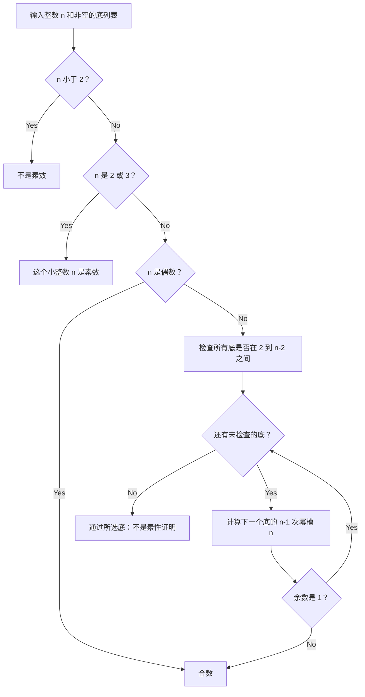
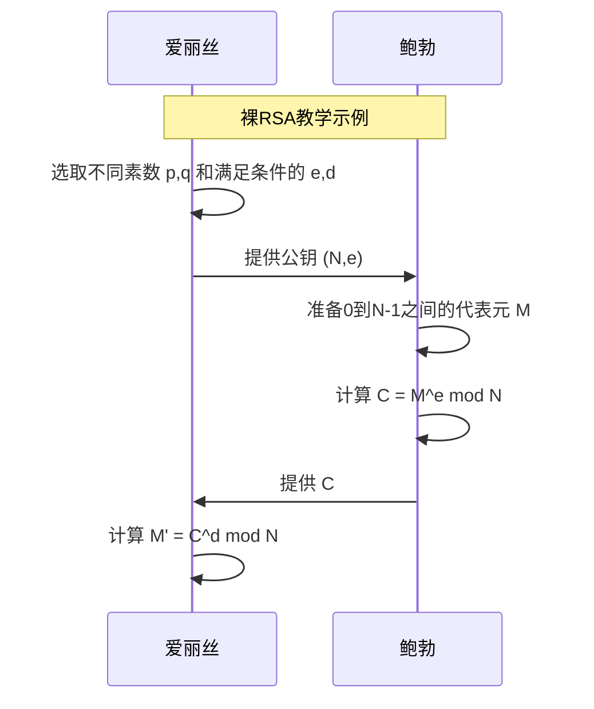

## 1. 定理保证什么

费马小定理描述以素数为模的幂的性质，有助于理解素性的必要条件以及RSA解密的正确性。但正确解密与安全的加密方案是两回事，定理本身并不能保证通信的机密性。

本文介绍同余式、费马与欧拉定理、费马测试的局限以及RSA的数学原理。代码是带有边界检查的教学示例，不是生产环境的密钥生成器或加密方案。另见[RSA数学原理与加密方案的区别](https://kenji.blog/zh-cn/p/rsa-encryption-math-explained-for-beginners/)。

## 2. 同余式与逆元

对于正整数 $n$，整数 $a,b$ 之差是 $n$ 的倍数，记作：

$$ a \equiv b \pmod n. $$

例如 $17\equiv12\equiv2\pmod5$。同余关系与加法、减法、乘法以及非负整数次幂相容。但约去因子需要条件：

$$ ac\equiv bc\pmod n,\quad \gcd(c,n)=1
\quad\Longrightarrow\quad a\equiv b\pmod n. $$

如果不互质，虽然 $2\cdot1\equiv2\cdot4\pmod6$，却有 $1\not\equiv4\pmod6$。当 $n>1$ 时，逆元 $c^{-1}$ 存在的充要条件是 $\gcd(c,n)=1$。扩展欧几里得算法求出 $cx+ny=1$，将 $x$ 对 $n$ 取模就得到逆元。

## 3. 费马小定理及其证明

若 $p$ 为素数且 $p\nmid a$，则：

$$ a^{p-1}\equiv1\pmod p. $$

例如 $p=5$ 时，$2^4=16$、$3^4=81$ 和 $4^4=256$ 除以5的余数均为1。对任意整数 $a$ 都成立的形式是：

$$ a^p\equiv a\pmod p. $$

当 $p\nmid a$ 时，在前式两边乘以 $a$；当 $p\mid a$ 时，后式两边都与0同余。

证明前式时，将非零剩余 $1,2,\ldots,p-1$ 分别乘以 $a$。结果不可能为零。如果 $ia\equiv ja\pmod p$，约去 $a$ 得到 $i=j$，因此这些乘积的剩余只是原来非零剩余的一个排列。两边取乘积：

$$ a^{p-1}(p-1)!\equiv(p-1)!\pmod p. $$

由于 $(p-1)!$ 与 $p$ 互质，可以约去，定理得证。

## 4. 欧拉定理

欧拉函数 $\varphi(n)$ 统计1到 $n$ 之间与 $n$ 互质的整数个数。对于素数 $p$，有 $\varphi(p)=p-1$；对于不同的素数 $p,q$，有：

$$ \varphi(pq)=(p-1)(q-1). $$

当 $n>1$ 且 $\gcd(a,n)=1$ 时，[欧拉定理](https://dlmf.nist.gov/27.2#E8)给出：

$$ a^{\varphi(n)}\equiv1\pmod n. $$

对互质剩余的集合使用上一节的排列与乘积约去论证，即可证明。费马小定理是模数为素数的特例。不能将欧拉定理无条件应用于不互质的输入。

## 5. 费马测试能说明什么

对奇整数 $n>3$，从 $2\le a\le n-2$ 中选择底 $a$。若出现以下不一致，就能确定 $n$ 是合数：

$$ a^{n-1}\not\equiv1\pmod n. $$

逆命题不成立。通过测试只说明所选底未违反这个必要条件。即便随机选取若干个底反复检查，也不能据此对所有合数保证统一且很小的误通过概率。



代码对空列表和底的范围错误抛出异常，Python版本还拒绝非整数类型。先处理小整数和偶数，仅对奇数 $n\ge5$ 检查底的范围。

卡迈克尔数是对**所有与 $n$ 互质的底**都满足费马同余式的合数。最小的例子 $561=3\cdot11\cdot17$ 通过底2，却不通过底3。合数 $1105=5\cdot13\cdot17$ 通过底2和3。生成素数时，不能把这样的通过结果当作证明。

[Handbook of Applied Cryptography第4章](https://cacr.uwaterloo.ca/hac/about/chap4.pdf)的Fermat与Miller–Rabin小节解释了这种区别。对于一个固定的奇合数，使用独立、均匀随机选取的底进行 $k$ 次Miller–Rabin检验，误通过概率可界定为不超过 $4^{-k}$。这与“通过后该数是合数的概率”并非同一个量，也不能直接用于任意固定底。[OpenSSL文档](https://docs.openssl.org/master/man3/BN_generate_prime/)同样说明通过检验的数只是可能素数，并介绍反复检验。更多内容见[素性测试文章](https://kenji.blog/zh-cn/p/cpp-fast-prime-testing-miller-rabin/)。

## 6. 用C++和Python检查必要条件

以下教学示例不使用随机数，而是检查指定的底。函数名中的 `passes` 表示通过，不代表证明了素性。原来的次数参数实现遇到零次或负次数会跳过检查，现在拒绝空的底列表。

### C++17

示例要求编译环境提供 `std::uint64_t`，不处理负数输入。不依赖 `__int128` 扩展，而用将余数保持在模数范围内的加法实现乘法。内部辅助函数 `add_mod` 要求两个加数均小于模数。当 `a >= m-b` 时以减法替代加法，否则和小于模数，不会超出64位上限。乘法与幂运算函数拒绝模数0，模数1的余数为0。

```cpp
#include <cstdint>
#include <iostream>
#include <stdexcept>
#include <vector>

using u64 = std::uint64_t;

// Internal helper: m > 0 and a, b < m.
u64 add_mod(u64 a, u64 b, u64 m) {
    return a >= m - b ? a - (m - b) : a + b;
}

u64 mul_mod(u64 a, u64 b, u64 m) {
    if (m == 0) throw std::invalid_argument("Modulus must be positive");
    a %= m;
    u64 result = 0;
    while (b != 0) {
        if (b & 1) result = add_mod(result, a, m);
        b >>= 1;
        if (b != 0) a = add_mod(a, a, m);
    }
    return result;
}

u64 power_mod(u64 a, u64 exponent, u64 m) {
    if (m == 0) throw std::invalid_argument("Modulus must be positive");
    u64 result = 1 % m;
    a %= m;
    while (exponent != 0) {
        if (exponent & 1) result = mul_mod(result, a, m);
        exponent >>= 1;
        if (exponent != 0) a = mul_mod(a, a, m);
    }
    return result;
}

bool fermat_passes(u64 n, const std::vector<u64>& bases) {
    if (bases.empty()) throw std::invalid_argument("Choose at least one base");
    if (n < 2) return false;
    if (n <= 3) return true;
    if (n % 2 == 0) return false;
    for (u64 a : bases) {
        if (a < 2 || a > n - 2) throw std::invalid_argument("Base outside range");
    }
    for (u64 a : bases) {
        if (power_mod(a, n - 1, n) != 1) return false;
    }
    return true;
}

int main() {
    std::cout << "1000000007 passes bases 2,3: " << fermat_passes(1000000007, {2, 3}) << '\n';
    std::cout << "1105 passes bases 2,3: " << fermat_passes(1105, {2, 3}) << '\n';
    std::cout << "1105 passes base 5: " << fermat_passes(1105, {5}) << '\n';
}
```

例如用 `g++ -std=c++17 fermat.cpp -o fermat` 编译。已在WSL的GCC13.3上验证。布尔输出依次为 `1, 1, 0`。合数1105通过两个底本身就展示了局限。

### Python

使用Python3整数与三参数 `pow`。只接受内置 `int` 类型，拒绝 `bool` 等类型，底列表不能为空。候选数和底与C++示例相同。

```python
def fermat_passes(n, bases):
    if type(n) is not int:
        raise TypeError("n must be an integer")
    bases = tuple(bases)
    if not bases:
        raise ValueError("Choose at least one base")
    if any(type(a) is not int for a in bases):
        raise TypeError("Bases must be integers")
    if n < 2:
        return False
    if n <= 3:
        return True
    if n % 2 == 0:
        return False
    if any(a < 2 or a > n - 2 for a in bases):
        raise ValueError("Base outside range")
    return all(pow(a, n - 1, n) == 1 for a in bases)


if __name__ == "__main__":
    print("1000000007 passes bases 2,3:", fermat_passes(1000000007, [2, 3]))
    print("1105 passes bases 2,3:", fermat_passes(1105, [2, 3]))
    print("1105 passes base 5:", fermat_passes(1105, [5]))
```

已用Python3.12验证，结果依次为 `True, True, False`。原来的示例104729仍作为素数通过。Python整数可以避免固定宽度溢出，但时间和内存并非无限。

对于指数 $b>0$，平方求幂法进行 $O(\log b)$ 次模乘，次数与指数的位数成比例。这不是位复杂度或实测运行时间。C++示例中的每次模乘，通过次数与乘数位数成比例的模加实现。不能断言所有Python版本的 `pow` 内部算法完全相同。

## 7. RSA为什么能正确解密

选取不同的素数 $p,q$，令 $N=pq$。在这个教学构造中，选择满足 $1<e<\varphi(N)$ 和 $\gcd(e,\varphi(N))=1$ 的公开指数，并令秘密指数 $d$ 为其逆元。

$$ ed\equiv1\pmod{\varphi(N)},\qquad
\varphi(N)=(p-1)(q-1). $$

公钥是 $(N,e)$，私钥的简化表示是 $(N,d)$。实际私钥还可能包含CRT所用的素因数等信息，它们同样必须保密。分解模数就能计算秘密指数，但这并不意味着RSA求逆问题与整数分解问题已被证明在一般情形下等价。

对于代表元 $0\le M<N$：

$$ C=M^e\bmod N,\qquad M'=C^d\bmod N. $$

下图只表示对整数代表元进行的**裸RSA运算**。这是省略了实际消息编码与认证环节的数学示意图。



首先，若 $\gcd(M,N)=1$，则可对某个非负整数 $t$ 写成 $ed=1+t\varphi(N)$。欧拉定理给出：

$$ M^{ed}=M(M^{\varphi(N)})^t\equiv M\pmod N. $$

也不能排除不互质的代表元。在模 $p$ 下，若 $p\mid M$，则 $M^{ed}$ 与 $M$ 都为0；否则，由费马小定理及 $p-1\mid ed-1$ 可得同余。在模 $q$ 下同理。由于 $p,q$ 互质，中国剩余定理给出：

$$ M^{ed}\equiv M\pmod p,\quad
M^{ed}\equiv M\pmod q
\quad\Longrightarrow\quad M^{ed}\equiv M\pmod N. $$

因此包括0以及 $p,q$ 的倍数在内的全部代表元都能恢复。这是正确性证明，不是机密性证明。

## 8. 可复现的RSA原语教学示例

使用已知的固定素数61和53以及指数17，通过扩展欧几里得算法求逆元。不随机生成素数，也不逐字符转换字符串。原来只检查底2和3的“素数生成器”会接受1105，因而可能生成无法正确解密的密钥。讨论实际加密要求时，也不能忽略指数1与代表元超范围的问题。

下面的 `rsa_primitive` 只检查指数、模数和代表元在算术上的输入范围，不会分解任意传入的模数，也不会验证任意RSA密钥的有效性。固定教学密钥另行满足密钥条件。[RFC8017第5、7节](https://www.rfc-editor.org/rfc/rfc8017.html)也区分了原语和加密方案。

```python
def extended_gcd(a, b):
    old_r, r = a, b
    old_s, s = 1, 0
    old_t, t = 0, 1
    while r:
        q = old_r // r
        old_r, r = r, old_r - q * r
        old_s, s = s, old_s - q * s
        old_t, t = t, old_t - q * t
    return old_r, old_s, old_t


def mod_inverse(a, modulus):
    if type(a) is not int or type(modulus) is not int:
        raise TypeError("Arguments must be integers")
    if modulus <= 1:
        raise ValueError("Modulus must exceed one")
    g, x, _ = extended_gcd(a % modulus, modulus)
    if g != 1:
        raise ValueError("Inverse does not exist")
    return x % modulus


def rsa_primitive(value, exponent, modulus):
    if any(type(x) is not int for x in (value, exponent, modulus)):
        raise TypeError("Arguments must be integers")
    if exponent <= 0 or modulus <= 1 or not 0 <= value < modulus:
        raise ValueError("Invalid exponent, modulus or representative")
    return pow(value, exponent, modulus)


def rsa_primitive_demo():
    p, q, e = 61, 53, 17  # Fixed public teaching constants, not secret keys.
    n = p * q
    phi = (p - 1) * (q - 1)
    d = mod_inverse(e, phi)
    print("Public key (n, e):", (n, e))
    print("Private key (n, d):", (n, d))
    m = 65
    c = rsa_primitive(m, e, n)
    recovered = rsa_primitive(c, d, n)
    print(f"{m} -> {c} -> {recovered}")
    for representative in range(n):
        cipher = rsa_primitive(representative, e, n)
        if rsa_primitive(cipher, d, n) != representative:
            raise ArithmeticError("Round-trip failed")
    print("All 3233 representatives round-trip.")


if __name__ == "__main__":
    rsa_primitive_demo()
```

运行后显示 $(N,e)=(3233,17)$、$(N,d)=(3233,2753)$ 及 `65 -> 2790 -> 65`，并检查全部3233个代表元的往返。所显示的私钥也只是固定、公开的教学数值。这个检验不保证一般RSA密钥的安全性。

## 9. 与实际密码系统的边界及参考资料

裸RSA是确定性的，不足以构成安全的加密方案。例如，逐字符的密文可以用公钥进行字典匹配。实际应用应使用经过审查的库、RSAES-OAEP等适合用途的方案、恰当的参数和安全随机数。[Python random](https://docs.python.org/3/library/random.html)的伪随机数不能用于密码密钥生成。RSASSA-PSS是签名方案，与加密是不同的用途。

应区分这些阶段：定理保证同余式，素性测试检查条件，有效密钥下的RSA运算恢复代表元，实际方案则增加编码等安全要求。不能说特定通信服务或所有现代密码技术都只依赖费马小定理。

参考的一手资料包括[DLMF的欧拉定理](https://dlmf.nist.gov/27.2#E8)、[HAC第4章](https://cacr.uwaterloo.ca/hac/about/chap4.pdf)、[RSA规范RFC8017](https://www.rfc-editor.org/rfc/rfc8017.html)和[GCC的128位整数说明](https://gcc.gnu.org/onlinedocs/gcc/_005f_005fint128.html)。最后一份资料用于核对原实现中扩展整数类型的限制。
