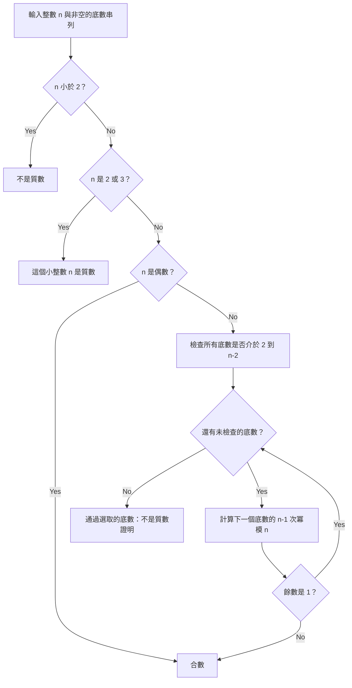
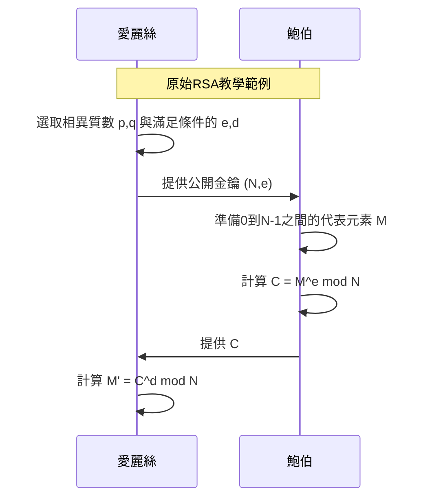

## 1. 定理保證什麼

費馬小定理描述以質數為模數的冪次性質，有助於理解質數的必要條件，以及RSA解密的正確性。但能正確解密與安全的加密方案是兩回事，定理本身並不保證通訊的機密性。

本文介紹同餘式、費馬與尤拉定理、費馬測試的限制，以及RSA的數學原理。程式碼是帶有邊界檢查的教材，不是實務環境的金鑰產生器或加密方案。另見[RSA數學原理與加密方案的差別](https://kenji.blog/zh-tw/p/rsa-encryption-math-explained-for-beginners/)。

## 2. 同餘式與反元素

對正整數 $n$，整數 $a,b$ 的差是 $n$ 的倍數，可記為：

$$ a \equiv b \pmod n. $$

例如 $17\equiv12\equiv2\pmod5$。同餘關係與加法、減法、乘法，以及非負整數次冪相容。但約去因子需要條件：

$$ ac\equiv bc\pmod n,\quad \gcd(c,n)=1
\quad\Longrightarrow\quad a\equiv b\pmod n. $$

若沒有互質條件，雖然 $2\cdot1\equiv2\cdot4\pmod6$，卻有 $1\not\equiv4\pmod6$。當 $n>1$ 時，模反元素 $c^{-1}$ 存在的充要條件是 $\gcd(c,n)=1$。擴展歐幾里得演算法求出 $cx+ny=1$，將 $x$ 對 $n$ 取模就得到反元素。

## 3. 費馬小定理及其證明

若 $p$ 為質數且 $p\nmid a$，則：

$$ a^{p-1}\equiv1\pmod p. $$

例如 $p=5$ 時，$2^4=16$、$3^4=81$ 與 $4^4=256$ 除以5的餘數都是1。對任意整數 $a$ 都成立的形式是：

$$ a^p\equiv a\pmod p. $$

當 $p\nmid a$ 時，在前式兩邊乘以 $a$；當 $p\mid a$ 時，後式兩邊都與0同餘。

證明前式時，將非零剩餘 $1,2,\ldots,p-1$ 分別乘以 $a$。結果不會是零。若 $ia\equiv ja\pmod p$，約去 $a$ 得到 $i=j$，因此這些乘積的剩餘只是原來非零剩餘的重新排列。兩邊取乘積：

$$ a^{p-1}(p-1)!\equiv(p-1)!\pmod p. $$

由於 $(p-1)!$ 與 $p$ 互質，可以約去，定理得證。

## 4. 尤拉定理

尤拉函數 $\varphi(n)$ 計算1到 $n$ 之間與 $n$ 互質的整數個數。對質數 $p$，有 $\varphi(p)=p-1$；對相異質數 $p,q$，有：

$$ \varphi(pq)=(p-1)(q-1). $$

當 $n>1$ 且 $\gcd(a,n)=1$ 時，[尤拉定理](https://dlmf.nist.gov/27.2#E8)指出：

$$ a^{\varphi(n)}\equiv1\pmod n. $$

對互質剩餘的集合使用上一節的排列與乘積約去論證，即可證明。費馬小定理是模數為質數的特例，不能將尤拉定理無條件套用於不互質的輸入。

## 5. 費馬測試能告訴我們什麼

對奇整數 $n>3$，從 $2\le a\le n-2$ 選取底數 $a$。若出現以下不一致，就能確定 $n$ 是合數：

$$ a^{n-1}\not\equiv1\pmod n. $$

反向推論不成立。通過測試只表示選取的底數沒有違反這項必要條件。即使隨機選取數個底數反覆檢查，也不能據此對所有合數保證一致且很小的誤通過機率。



程式對空串列與底數範圍錯誤拋出例外，Python版本也拒絕非整數型別。先處理小整數與偶數，僅對奇數 $n\ge5$ 檢查底數範圍。

卡邁克爾數是對**所有與 $n$ 互質的底數**都滿足費馬同餘式的合數。最小的例子 $561=3\cdot11\cdot17$ 通過底數2，但不通過底數3。合數 $1105=5\cdot13\cdot17$ 通過底數2與3。產生質數時，不能將這種通過結果當成證明。

[Handbook of Applied Cryptography第4章](https://cacr.uwaterloo.ca/hac/about/chap4.pdf)的Fermat與Miller–Rabin小節說明了這個差別。對一個固定的奇合數，使用獨立、均勻隨機選取的底數進行 $k$ 次Miller–Rabin檢驗，誤通過機率的上界為 $4^{-k}$。這與「通過後該數是合數的機率」是不同的量，也不能直接套用到任意固定底數。[OpenSSL文件](https://docs.openssl.org/master/man3/BN_generate_prime/)同樣說明通過檢驗的數仍只是可能為質數的候選數，並介紹重複檢驗。詳情見[質數判定文章](https://kenji.blog/zh-tw/p/cpp-fast-prime-testing-miller-rabin/)。

## 6. 用C++與Python檢查必要條件

以下教材不使用亂數，而是檢查指定的底數。函式名稱中的 `passes` 表示通過，不表示已證明為質數。原來以次數為參數的實作在零次或負次數時會略過檢查，現在拒絕空的底數串列。

### C++17

範例要求編譯環境提供 `std::uint64_t`，不處理負數輸入。不依賴 `__int128` 擴充，而是用讓餘數維持在模數範圍內的加法實作乘法。內部輔助函式 `add_mod` 要求兩個加數都小於模數。當 `a >= m-b` 時以減法取代加法；否則和小於模數，不會超出64位元的上限。乘法與冪次運算函式拒絕模數0，模數1的餘數為0。

```cpp
#include <cstdint>
#include <iostream>
#include <stdexcept>
#include <vector>

using u64 = std::uint64_t;

// Internal helper: m > 0 and a, b < m.
u64 add_mod(u64 a, u64 b, u64 m) {
    return a >= m - b ? a - (m - b) : a + b;
}

u64 mul_mod(u64 a, u64 b, u64 m) {
    if (m == 0) throw std::invalid_argument("Modulus must be positive");
    a %= m;
    u64 result = 0;
    while (b != 0) {
        if (b & 1) result = add_mod(result, a, m);
        b >>= 1;
        if (b != 0) a = add_mod(a, a, m);
    }
    return result;
}

u64 power_mod(u64 a, u64 exponent, u64 m) {
    if (m == 0) throw std::invalid_argument("Modulus must be positive");
    u64 result = 1 % m;
    a %= m;
    while (exponent != 0) {
        if (exponent & 1) result = mul_mod(result, a, m);
        exponent >>= 1;
        if (exponent != 0) a = mul_mod(a, a, m);
    }
    return result;
}

bool fermat_passes(u64 n, const std::vector<u64>& bases) {
    if (bases.empty()) throw std::invalid_argument("Choose at least one base");
    if (n < 2) return false;
    if (n <= 3) return true;
    if (n % 2 == 0) return false;
    for (u64 a : bases) {
        if (a < 2 || a > n - 2) throw std::invalid_argument("Base outside range");
    }
    for (u64 a : bases) {
        if (power_mod(a, n - 1, n) != 1) return false;
    }
    return true;
}

int main() {
    std::cout << "1000000007 passes bases 2,3: " << fermat_passes(1000000007, {2, 3}) << '\n';
    std::cout << "1105 passes bases 2,3: " << fermat_passes(1105, {2, 3}) << '\n';
    std::cout << "1105 passes base 5: " << fermat_passes(1105, {5}) << '\n';
}
```

例如以 `g++ -std=c++17 fermat.cpp -o fermat` 編譯。已在WSL的GCC13.3驗證。布林輸出依序為 `1, 1, 0`。合數1105通過兩個底數，本身就展示了限制。

### Python

使用Python3整數與三參數 `pow`。只接受內建 `int` 型別，拒絕 `bool` 等型別；底數串列不能為空。候選數與底數和C++範例相同。

```python
def fermat_passes(n, bases):
    if type(n) is not int:
        raise TypeError("n must be an integer")
    bases = tuple(bases)
    if not bases:
        raise ValueError("Choose at least one base")
    if any(type(a) is not int for a in bases):
        raise TypeError("Bases must be integers")
    if n < 2:
        return False
    if n <= 3:
        return True
    if n % 2 == 0:
        return False
    if any(a < 2 or a > n - 2 for a in bases):
        raise ValueError("Base outside range")
    return all(pow(a, n - 1, n) == 1 for a in bases)


if __name__ == "__main__":
    print("1000000007 passes bases 2,3:", fermat_passes(1000000007, [2, 3]))
    print("1105 passes bases 2,3:", fermat_passes(1105, [2, 3]))
    print("1105 passes base 5:", fermat_passes(1105, [5]))
```

已使用Python3.12驗證，結果依序為 `True, True, False`。原範例104729仍會以質數通過。Python整數可避免固定寬度的溢位，但時間與記憶體並非無限。

對指數 $b>0$，反覆平方法執行 $O(\log b)$ 次模乘，次數與指數的位元數成正比。這不是位元複雜度或實測執行時間。C++範例中的每次模乘，透過次數與乘數位元數成正比的模加實作。不能斷言所有Python版本的 `pow` 內部演算法完全相同。

## 7. RSA為什麼能正確解密

選取相異質數 $p,q$，令 $N=pq$。在這個教學構造中，選擇滿足 $1<e<\varphi(N)$ 與 $\gcd(e,\varphi(N))=1$ 的公開指數，並令私密指數 $d$ 為其反元素。

$$ ed\equiv1\pmod{\varphi(N)},\qquad
\varphi(N)=(p-1)(q-1). $$

公開金鑰是 $(N,e)$，私鑰的簡化表示是 $(N,d)$。實際私鑰也可能包含CRT使用的質因數等資訊，這些同樣必須保密。分解模數就能計算私密指數，但這不代表RSA反演問題與整數分解問題已被證明在一般情況下等價。

對代表元素 $0\le M<N$：

$$ C=M^e\bmod N,\qquad M'=C^d\bmod N. $$

下圖僅表示對整數代表元素進行的**原始RSA運算**，是省略實務訊息編碼與身分驗證環節的數學示意圖。



首先，若 $\gcd(M,N)=1$，可對某個非負整數 $t$ 寫成 $ed=1+t\varphi(N)$。尤拉定理給出：

$$ M^{ed}=M(M^{\varphi(N)})^t\equiv M\pmod N. $$

也不能排除不互質的代表元素。在模 $p$ 下，若 $p\mid M$，則 $M^{ed}$ 與 $M$ 都為0；否則，由費馬小定理與 $p-1\mid ed-1$ 可得同餘。在模 $q$ 下亦同。由於 $p,q$ 互質，中國剩餘定理給出：

$$ M^{ed}\equiv M\pmod p,\quad
M^{ed}\equiv M\pmod q
\quad\Longrightarrow\quad M^{ed}\equiv M\pmod N. $$

因此，包含0以及 $p,q$ 倍數的全部代表元素都能還原。這是正確性證明，不是機密性證明。

## 8. 可重現的RSA原語教材

使用已知的固定質數61與53，以及指數17，透過擴展歐幾里得演算法求反元素。不隨機產生質數，也不逐字元轉換字串。原來只檢查底數2與3的「質數產生器」會接受1105，因此可能產生無法正確解密的金鑰。討論實務加密的要求時，也不能忽略指數1與代表元素超出範圍的問題。

以下的 `rsa_primitive` 只檢查指數、模數與代表元素在算術上的輸入範圍，不會分解任意傳入的模數，也不會驗證任意RSA金鑰的有效性。固定教學金鑰另行滿足金鑰條件。[RFC8017第5、7節](https://www.rfc-editor.org/rfc/rfc8017.html)也區分了原語與加密方案。

```python
def extended_gcd(a, b):
    old_r, r = a, b
    old_s, s = 1, 0
    old_t, t = 0, 1
    while r:
        q = old_r // r
        old_r, r = r, old_r - q * r
        old_s, s = s, old_s - q * s
        old_t, t = t, old_t - q * t
    return old_r, old_s, old_t


def mod_inverse(a, modulus):
    if type(a) is not int or type(modulus) is not int:
        raise TypeError("Arguments must be integers")
    if modulus <= 1:
        raise ValueError("Modulus must exceed one")
    g, x, _ = extended_gcd(a % modulus, modulus)
    if g != 1:
        raise ValueError("Inverse does not exist")
    return x % modulus


def rsa_primitive(value, exponent, modulus):
    if any(type(x) is not int for x in (value, exponent, modulus)):
        raise TypeError("Arguments must be integers")
    if exponent <= 0 or modulus <= 1 or not 0 <= value < modulus:
        raise ValueError("Invalid exponent, modulus or representative")
    return pow(value, exponent, modulus)


def rsa_primitive_demo():
    p, q, e = 61, 53, 17  # Fixed public teaching constants, not secret keys.
    n = p * q
    phi = (p - 1) * (q - 1)
    d = mod_inverse(e, phi)
    print("Public key (n, e):", (n, e))
    print("Private key (n, d):", (n, d))
    m = 65
    c = rsa_primitive(m, e, n)
    recovered = rsa_primitive(c, d, n)
    print(f"{m} -> {c} -> {recovered}")
    for representative in range(n):
        cipher = rsa_primitive(representative, e, n)
        if rsa_primitive(cipher, d, n) != representative:
            raise ArithmeticError("Round-trip failed")
    print("All 3233 representatives round-trip.")


if __name__ == "__main__":
    rsa_primitive_demo()
```

執行後顯示 $(N,e)=(3233,17)$、$(N,d)=(3233,2753)$ 與 `65 -> 2790 -> 65`，並檢查全部3233個代表元素的往返。顯示的私鑰也只是固定、公開的教學數值。這個檢驗不保證一般RSA金鑰的安全性。

## 9. 與實務密碼系統的界線及參考資料

原始RSA是確定性的，不足以構成安全的加密方案。例如，逐字元的密文可用公開金鑰進行字典比對。實務應使用經審查的函式庫、RSAES-OAEP等符合用途的方案、適當的參數與安全亂數。[Python random](https://docs.python.org/3/library/random.html)的偽亂數不能用於密碼金鑰產生。RSASSA-PSS是簽章方案，與加密是不同用途。

應區分這些階段：定理保證同餘式，質數測試檢查條件，有效金鑰下的RSA運算還原代表元素，實務方案則加入編碼等安全要求。不能說特定通訊服務或所有現代密碼技術都只依賴費馬小定理。

參考的第一手資料包括[DLMF的尤拉定理](https://dlmf.nist.gov/27.2#E8)、[HAC第4章](https://cacr.uwaterloo.ca/hac/about/chap4.pdf)、[RSA規格RFC8017](https://www.rfc-editor.org/rfc/rfc8017.html)，以及[GCC的128位元整數說明](https://gcc.gnu.org/onlinedocs/gcc/_005f_005fint128.html)。最後一份資料用來核對原實作中擴充整數型別的限制。
