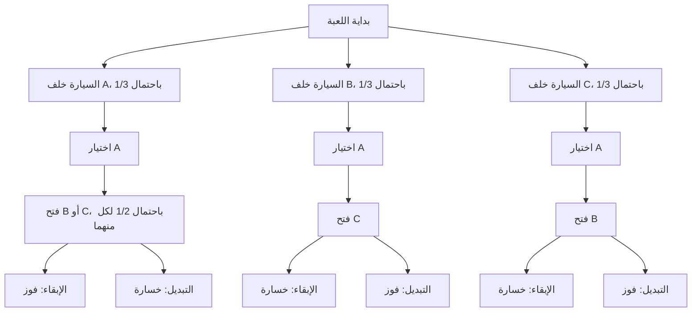
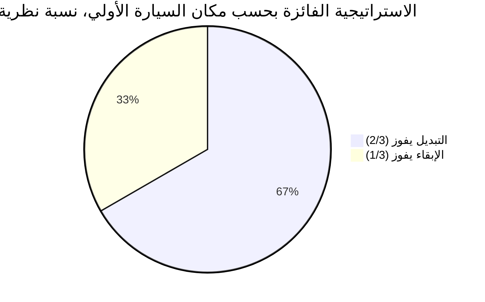

## 1. ثلاثة أبواب وقواعد يجب تحديدها أولاً

سيارة واحدة وماعزان خلف ثلاثة أبواب مغلقة A وB وC. تختار A، ثم يفتح المقدم بابًا آخر ويُظهر ماعزًا. هل تنتقل إلى الباب الآخر الذي بقي مغلقًا؟

أثارت مسألة مونتي هول نقاشًا بعد ظهورها في عمود «Ask Marilyn» في مجلة *Parade* عام 1990. تتناول [ورقة غيل](https://pub.math.leidenuniv.nl/~gillrd/montyhall3.pdf) تاريخ المسألة وصياغاتها المختلفة، وتبحث [ورقة روزنتال](https://probability.ca/jeff/writing/montyfall.pdf) في بدائل لقواعد المقدم. سنستخدم هنا النموذج المحدد الآتي.

1. احتمال وجود السيارة خلف كل باب متساوٍ. تختار A دون استخدام معلومات عن مكانها.
2. يعرف المقدم محتويات الأبواب، ولا يفتح A ولا الباب الذي توجد خلفه السيارة.
3. في كل لعبة، يفتح بابًا غير مختار توجد خلفه ماعز، ويعرض دائمًا الانتقال إلى الباب الوحيد الآخر الذي بقي مغلقًا.
4. إذا كانت السيارة خلف A، يستطيع فتح أي من بابَي الماعز. عندئذ يختار B أو C باحتمال 1/2 لكل منهما.

تساوي الاحتمالات افتراض عن توزيع مكان السيارة، وليس نتيجة تلقائية لجهلنا بمكانها. نرمز بالأحداث C_A وC_B وC_C إلى وجود السيارة خلف A وB وC، على الترتيب.

$$
\Pr(C_A)=\Pr(C_B)=\Pr(C_C)=\frac13
$$

وفق هذه القواعد، تفوز استراتيجية «التبديل دائمًا» باحتمال 2/3، وتفوز استراتيجية «الإبقاء على الاختيار الأول دائمًا» باحتمال 1/3. وبعد ملاحظة فتح B، يكون الاحتمال الشرطي لوجود السيارة خلف C أيضًا 2/3. **احتمال فوز الاستراتيجية إجمالاً والاحتمال المشروط بفتح باب محدد حسابان مختلفان.**

## 2. التبديل يفوز في حالتين من ثلاث حالات لمكان السيارة

قبل الاشتراط على اسم الباب الذي فُتح، نقسم الحالات بحسب مكان السيارة في البداية.

| مكان السيارة، باحتمال 1/3 لكل حالة | الباب الذي يفتحه المقدم | الإبقاء على الاختيار | التبديل |
| --- | --- | --- | --- |
| A | B أو C | فوز | خسارة |
| B | C | خسارة | فوز |
| C | B | خسارة | فوز |

يفوز التبديل إذا وفقط إذا كان خلف الباب الذي اخترته أولاً ماعز. والسبب أن المقدم يفتح دائمًا بابًا فيه ماعز ويعرض التبديل.

$$
\Pr(\mathrm{stay\ wins})=\frac13,\qquad\Pr(\mathrm{switch\ wins})=\frac23
$$

القيمة 2/3 احتمال داخل هذا النموذج، ولا تضمن فوزين بالضبط في كل ثلاث ألعاب. ترتبط العلاقة بين الاحتمال ومعدل الفوز في التكرارات المستقلة بـ[قانون الأعداد الكبيرة](https://kenji.blog/ar/p/law-of-large-numbers/).

## 3. مبرهنة بايز بعد فتح المقدم للباب B

لتكن C_A وC_B وC_C أحداث وجود السيارة خلف A وB وC على الترتيب، وليكن M_B حدث فتح المقدم للباب B. تعطينا القواعد احتمالات فتح B المشروطة بمكان السيارة:

$$
\Pr(M_B\mid C_A)=\frac12,\qquad\Pr(M_B\mid C_B)=0,\qquad\Pr(M_B\mid C_C)=1
$$

نريد حساب الاحتمالات بعد معرفة أن B قد فُتح. تجمع [مبرهنة بايز](https://kenji.blog/ar/p/bayes-theorem/) هذه الاحتمالات الشرطية مع الاحتمالات القبلية.

$$
\Pr(C_i\mid M_B)=\frac{\Pr(M_B\mid C_i)\Pr(C_i)}{\sum_{j\in\{A,B,C\}}\Pr(M_B\mid C_j)\Pr(C_j)}
$$

من قانون الاحتمال الكلي، احتمال فتح B هو:

$$
\Pr(M_B)=\frac12\cdot\frac13+0\cdot\frac13+1\cdot\frac13=\frac12
$$

إذن الاحتمال البعدي لوجود السيارة خلف الباب الأصلي A هو:

$$
\Pr(C_A\mid M_B)=\frac{(1/2)(1/3)}{1/2}=\frac13
$$

واحتمال وجودها خلف باب التبديل C هو:

$$
\Pr(C_C\mid M_B)=\frac{1\cdot(1/3)}{1/2}=\frac23
$$

بقاء A وC مغلقين وحده لا يثبت تساوي احتماليهما. استخدمنا اعتماد احتمال فتح B على مكان السيارة.

## 4. فحص الحدس: معرفة المقدم وقاعدة اختيار الباب

القول «بقي بابان، إذن الاحتمال نصف لكل منهما» يتجاهل الآلية التي أدت إلى بقائهما. وفي المقابل، معرفة المقدم بمكان السيارة لا تجعل كل قراراته محددة سلفًا؛ ففي القسم الأول يختار عشوائيًا بين B وC عندما تكون السيارة خلف A. كذلك لا يعني إبقاء C مغلقًا أنه لم يكن يستطيع فتحه؛ فعندما تكون السيارة خلف A كان فتح C ممكنًا أيضًا.

### 4.1. تفضيل أحد بابَي الماعز

نُبقي القواعد الأخرى، ونغيّر احتمال فتح B عندما تكون السيارة خلف A إلى q.

$$
q=\Pr(M_B\mid C_A),\qquad0\le q\le1
$$

عندئذ:

$$
\Pr(M_B)=\frac{1+q}{3}
$$

وتكون الاحتمالات بعد فتح B:

$$
\Pr(C_A\mid M_B)=\frac{q}{1+q},\qquad\Pr(C_C\mid M_B)=\frac1{1+q}
$$

وبالمثل، إذا كان M_C حدث فتح المقدم للباب C:

$$
\Pr(M_C)=\frac{2-q}{3}
$$

$$
\Pr(C_A\mid M_C)=\frac{1-q}{2-q},\qquad\Pr(C_B\mid M_C)=\frac1{2-q}
$$

مثلاً، عند q يساوي 1، تؤدي ملاحظة فتح B إلى تساوي احتمالَي وجود السيارة خلف A وC. أما ملاحظة فتح C فتجعل وجود السيارة خلف B مؤكدًا. ومع ذلك، عند أخذ المتوسط على الباب الذي فُتح، يبقى احتمال فوز استراتيجية التبديل دائمًا:

$$
\Pr(M_B)\Pr(C_C\mid M_B)+\Pr(M_C)\Pr(C_B\mid M_C)=\frac23
$$

لحساب الاحتمال بعد ملاحظة محددة، يجب تضمين تفضيل المقدم بين أسماء الأبواب في النموذج.

### 4.2. فتح باب دون معرفة محتواه

لننظر في لعبة مختلفة: لا يعرف المقدم مكان السيارة، ويختار B أو C باحتمال 1/2 لكل منهما، بصورة مستقلة عن مكان السيارة. قد تؤدي هذه القاعدة إلى كشف السيارة. لنفترض الآن أننا لاحظنا أنه فتح B وظهرت ماعز.

ليكن U_B حدث فتح هذا المقدم للباب B، وG حدث ظهور ماعز خلف الباب المفتوح. عندئذ:

$$
\Pr(U_B\cap G\mid C_A)=\frac12,\qquad\Pr(U_B\cap G\mid C_B)=0,\qquad\Pr(U_B\cap G\mid C_C)=\frac12
$$

مع الاحتمالات القبلية المتساوية، تعطينا مبرهنة بايز:

$$
\Pr(C_A\mid U_B\cap G)=\Pr(C_C\mid U_B\cap G)=\frac12
$$

«إظهار ماعز دائمًا» و«إظهار ماعز بالمصادفة» آليتان مختلفتان لإنتاج الملاحظة. تفسير علم النفس البشري وحساب الاحتمالات وفق قواعد محددة مسألتان منفصلتان.

## 5. حتى مع مليون باب يجب تحديد شرط الملاحظة

نرقّم n بابًا من 1 إلى n، وليكن مكان السيارة C موزعًا بالتساوي، والاختيار الأول ثابتًا عند الباب 1. في كل لعبة يفتح المقدم العارف بالمحتويات n−2 بابًا غير مختار توجد خلفها ماعز، ويعرض الانتقال إلى الباب الوحيد غير المختار الذي بقي مغلقًا، ورقمه R. هنا n عدد صحيح لا يقل عن 3.

$$
\Pr(C=1)=\frac1n,\qquad\Pr(C=R)=\frac{n-1}{n}
$$

مع مليون باب، يكون احتمال الفوز غير المشروط لاستراتيجية التبديل دائمًا 999999/1000000. السبب نفسه: يفوز التبديل كلما كان خلف الباب المختار أولاً ماعز.

لنحسب الآن الاحتمال المشروط بملاحظة الرقم المتبقي R وحده. نفترض أنه كلما كانت السيارة خلف الباب الأول، اختار المقدم R بالتساوي من بين الأبواب الأخرى وعددها n−1. عندئذ، لرقم معين r يختلف عن 1:

$$
\Pr(C=r\mid R=r)=\frac{1/n}{(1/n)+(1/n)(1/(n-1))}=\frac{n-1}{n}
$$

وفق هذه القاعدة المتناظرة، إذا لاحظنا بقاء الباب 777777 مغلقًا من بين مليون باب، يظل احتمال وجود السيارة خلف باب التبديل 999999/1000000.

لكن إذا كان المقدم يُبقي دائمًا الباب ذا الرقم نفسه r عندما تكون السيارة خلف الباب الأول، فإن احتمال وجود السيارة خلف r بعد ملاحظة بقائه يصبح:

$$
\Pr(C=r\mid R=r)=\frac{1/n}{(1/n)+(1/n)}=\frac12
$$

قد يظل احتمال فوز استراتيجية التبديل إجمالاً مرتفعًا، بينما يتغير الاحتمال المشروط بملاحظة رقم بعينه. يعتمد هذا الحساب على R وحده، ولا يتضمن معلومات إضافية مثل ترتيب فتح الأبواب.

يقسم الرسم التالي حالات مكان السيارة في نموذج الأبواب الثلاثة من القسم الأول بحسب الاستراتيجية الفائزة. العددان 2 و1 يمثلان نسبة احتمالات نظرية، وليسا عددَي انتصارات مقاسين في تجربة.

## 6. فحص الافتراضات والمعلومات قبل تغيير الاختيار

لا تعني المسألة أن تغيير الاختيار يضاعف النجاح في كل موقف. تعتمد احتمالات الفوز على توزيع مكان السيارة ومعرفة المقدم وقاعدة الفتح وقاعدة عرض التبديل.

في الأعمال والحياة اليومية، قد تساعد المعلومات الجديدة على مراجعة الافتراضات وتحديث القرارات. لكن التكاليف الفعلية والتفضيلات وطرق جمع المعلومات تحتاج إلى نماذج خاصة بها؛ فلا يصح مساواتها تلقائيًا بلعبة الأبواب الثلاثة.
