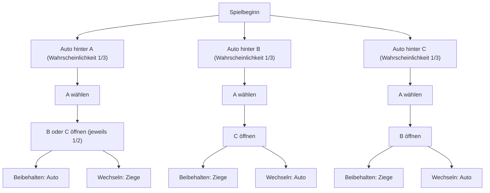
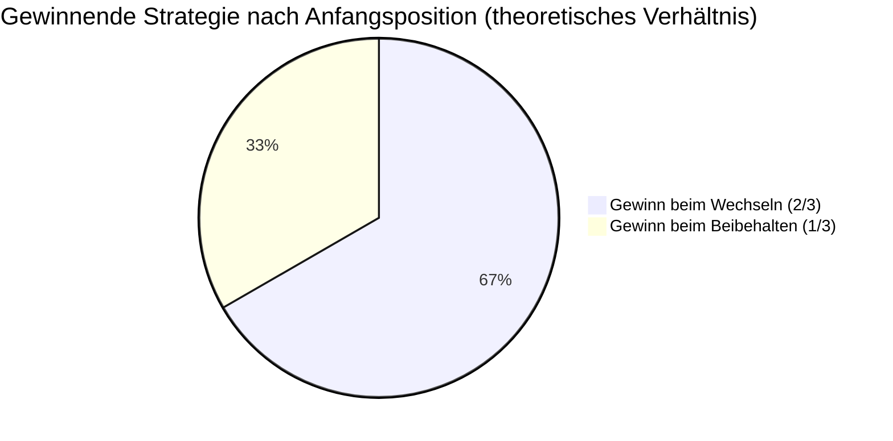

## 1. Drei Türen und die Regeln, die zuerst feststehen müssen

Ein Auto und zwei Ziegen. Sie wählen A unter drei geschlossenen Türen A, B und C. Danach öffnet der Moderator eine andere Tür und zeigt eine Ziege. Sollten Sie zur verbleibenden Tür wechseln?

Das Monty-Hall-Problem löste nach seiner Darstellung in der Kolumne „Ask Marilyn“ der Zeitschrift *Parade* im Jahr 1990 eine Debatte aus. [Gills Aufsatz](https://pub.math.leidenuniv.nl/~gillrd/montyhall3.pdf) behandelt die Geschichte und verschiedene mathematische Formulierungen; [Rosenthals Aufsatz](https://probability.ca/jeff/writing/montyfall.pdf) untersucht Varianten der Regeln des Moderators. Hier verwenden wir folgendes ausdrücklich festgelegte Modell.

1. Das Auto steht mit gleicher Wahrscheinlichkeit hinter jeder Tür. Sie wählen A ohne Informationen über seinen Standort.
2. Der Moderator kennt die Inhalte und öffnet weder A noch die Tür mit dem Auto.
3. In jeder Runde öffnet er eine nicht gewählte Tür mit einer Ziege und bietet immer den Wechsel zur anderen, noch geschlossenen und nicht gewählten Tür an.
4. Steht das Auto hinter A, sind beide anderen Türen mit Ziegen besetzt. Dann öffnet er B oder C mit einer Wahrscheinlichkeit von jeweils 1/2.

Gleiche Wahrscheinlichkeiten sind eine Annahme über die Platzierung des Autos. Sie folgen nicht allein daraus, dass man seinen Standort nicht kennt. C_A, C_B und C_C bezeichnen die Ereignisse, dass das Auto hinter A, B beziehungsweise C steht.

$$
\Pr(C_A)=\Pr(C_B)=\Pr(C_C)=\frac13
$$

Unter diesen Regeln gewinnt die von Anfang an festgelegte Strategie „immer wechseln“ mit Wahrscheinlichkeit 2/3, die Strategie „immer bei der ersten Wahl bleiben“ mit Wahrscheinlichkeit 1/3. Nach der Beobachtung, dass B geöffnet wurde, beträgt die bedingte Wahrscheinlichkeit für das Auto hinter C ebenfalls 2/3. **Die Gewinnwahrscheinlichkeit einer Strategie insgesamt und eine bedingte Wahrscheinlichkeit nach dem Öffnen einer bestimmten Tür sind verschiedene Berechnungen.**

## 2. Wechseln gewinnt bei zwei der drei Anfangspositionen

Zunächst unterscheiden wir nur nach der ursprünglichen Position des Autos, ohne auf eine bestimmte geöffnete Tür zu bedingen.

| Position des Autos (jeweils Wahrscheinlichkeit 1/3) | Vom Moderator geöffnete Tür | Beibehalten | Wechseln |
| --- | --- | --- | --- |
| A | B oder C | Auto | Ziege |
| B | C | Ziege | Auto |
| C | B | Ziege | Auto |

Wechseln gewinnt genau dann, wenn zuerst eine Tür mit einer Ziege gewählt wurde. Denn der Moderator scheidet immer eine Tür mit einer Ziege aus und bietet den Wechsel an.

$$
\Pr(\mathrm{stay\ wins})=\frac13,\qquad\Pr(\mathrm{switch\ wins})=\frac23
$$

2/3 ist eine Wahrscheinlichkeit im Modell, keine Garantie für genau zwei Gewinne in jeder Gruppe von drei Spielen. Der Zusammenhang zwischen Wahrscheinlichkeiten und relativen Gewinnhäufigkeiten bei unabhängigen Wiederholungen führt auch zum [Gesetz der großen Zahlen](https://kenji.blog/de/p/law-of-large-numbers/).

## 3. Der Satz von Bayes nach dem Öffnen von B

C_A, C_B und C_C sind die Ereignisse, dass das Auto hinter A, B beziehungsweise C steht; M_B ist das Ereignis, dass der Moderator B öffnet. Die Regeln liefern folgende Likelihood-Werte:

$$
\Pr(M_B\mid C_A)=\frac12,\qquad\Pr(M_B\mid C_B)=0,\qquad\Pr(M_B\mid C_C)=1
$$

Gesucht sind die Wahrscheinlichkeiten unter der Bedingung, dass B geöffnet wurde. Der [Satz von Bayes](https://kenji.blog/de/p/bayes-theorem/) verbindet diese Likelihood-Werte mit den A-priori-Wahrscheinlichkeiten.

$$
\Pr(C_i\mid M_B)=\frac{\Pr(M_B\mid C_i)\Pr(C_i)}{\sum_{j\in\{A,B,C\}}\Pr(M_B\mid C_j)\Pr(C_j)}
$$

Nach dem Satz der totalen Wahrscheinlichkeit beträgt die Wahrscheinlichkeit für das Öffnen von B

$$
\Pr(M_B)=\frac12\cdot\frac13+0\cdot\frac13+1\cdot\frac13=\frac12
$$

Damit ist die Wahrscheinlichkeit für das Auto hinter der ursprünglich gewählten Tür A

$$
\Pr(C_A\mid M_B)=\frac{(1/2)(1/3)}{1/2}=\frac13
$$

und die für das Auto hinter C, dem Ziel des Wechsels,

$$
\Pr(C_C\mid M_B)=\frac{1\cdot(1/3)}{1/2}=\frac23
$$

Dass A und C noch geschlossen sind, reicht nicht aus, um gleiche Wahrscheinlichkeiten anzunehmen. Die Berechnung nutzt, dass die Wahrscheinlichkeit für das Öffnen von B vom Standort des Autos abhängt.

## 4. Intuition prüfen: Wissen und Regeln des Moderators

Die Intuition „zwei bleiben übrig, also hat jede die Hälfte der Wahrscheinlichkeit“ berücksichtigt nicht, wie diese beiden Türen übrig geblieben sind. Umgekehrt macht das Wissen über den Standort des Autos nicht jede Entscheidung des Moderators deterministisch. Im Modell aus Abschnitt 1 wählt er weiterhin zufällig zwischen B und C, wenn das Auto hinter A steht. Dass C geschlossen bleibt, bedeutet auch nicht, dass er C nicht hätte öffnen dürfen: Steht das Auto hinter A, wäre das Öffnen von C ebenfalls erlaubt.

### 4.1. Bevorzugung einer der beiden Türen mit einer Ziege

Wir behalten die übrigen Regeln bei und ändern nur die Wahrscheinlichkeit, B zu öffnen, wenn das Auto hinter A steht, auf q.

$$
q=\Pr(M_B\mid C_A),\qquad0\le q\le1
$$

Dann gilt

$$
\Pr(M_B)=\frac{1+q}{3}
$$

und nach dem Öffnen von B ergeben sich

$$
\Pr(C_A\mid M_B)=\frac{q}{1+q},\qquad\Pr(C_C\mid M_B)=\frac1{1+q}
$$

Bezeichnet M_C entsprechend das Öffnen von C, so gilt

$$
\Pr(M_C)=\frac{2-q}{3}
$$

$$
\Pr(C_A\mid M_C)=\frac{1-q}{2-q},\qquad\Pr(C_B\mid M_C)=\frac1{2-q}
$$

Bei q gleich 1 etwa haben A und C nach der Beobachtung, dass B geöffnet wurde, jeweils Wahrscheinlichkeit 1/2. Wird hingegen C geöffnet, steht das Auto sicher hinter B. Dennoch bleibt die mit den Öffnungswahrscheinlichkeiten gewichtete Gewinnwahrscheinlichkeit der Strategie „immer wechseln“

$$
\Pr(M_B)\Pr(C_C\mid M_B)+\Pr(M_C)\Pr(C_B\mid M_C)=\frac23
$$

Für Wahrscheinlichkeiten nach einer bestimmten Beobachtung muss die Bevorzugung einer Tür durch den Moderator im Modell enthalten sein.

### 4.2. Eine Tür ohne Kenntnis des Inhalts öffnen

Betrachten wir ein anderes Spiel: Der Moderator kennt den Standort des Autos nicht und öffnet B oder C mit einer Wahrscheinlichkeit von jeweils 1/2, unabhängig vom Standort des Autos. Dabei kann auch das Auto sichtbar werden. Nun beobachten wir, dass er B geöffnet und eine Ziege gezeigt hat.

U_B sei das Ereignis, dass dieser Moderator B öffnet, und G das Ereignis, dass die geöffnete Tür eine Ziege zeigt. Dann gilt

$$
\Pr(U_B\cap G\mid C_A)=\frac12,\qquad\Pr(U_B\cap G\mid C_B)=0,\qquad\Pr(U_B\cap G\mid C_C)=\frac12
$$

Aus gleichen A-priori-Wahrscheinlichkeiten und dem Satz von Bayes folgt

$$
\Pr(C_A\mid U_B\cap G)=\Pr(C_C\mid U_B\cap G)=\frac12
$$

„Immer eine Ziege zeigen“ und „zufällig eine Ziege zeigen“ beschreiben verschiedene Beobachtungsmechanismen. Eine Erklärung menschlicher Psychologie und eine Wahrscheinlichkeitsberechnung unter festgelegten Regeln sind unterschiedliche Fragen.

## 5. Auch bei einer Million Türen muss die Bedingung klar sein

Wir nummerieren n Türen von 1 bis n. Die Position C des Autos ist gleichverteilt auf diese Türnummern; die erste Wahl ist fest auf 1 gesetzt. In jeder Runde öffnet der informierte Moderator n−2 nicht gewählte Türen mit Ziegen und bietet den Wechsel zur einzigen noch geschlossenen, nicht gewählten Tür R an. Dabei ist n ganzzahlig und mindestens 3.

$$
\Pr(C=1)=\frac1n,\qquad\Pr(C=R)=\frac{n-1}{n}
$$

Bei einer Million Türen beträgt die unbedingte Gewinnwahrscheinlichkeit der Strategie „immer wechseln“ 999999/1000000. Der Grund bleibt derselbe: Wechseln gewinnt, wenn zuerst eine Tür mit einer Ziege gewählt wurde.

Nun berechnen wir bedingte Wahrscheinlichkeiten, wobei wir nur die beobachtete Nummer R der verbleibenden Tür verwenden. Zusätzlich nehmen wir an: Steht das Auto hinter der zuerst gewählten Tür, wählt der Moderator R gleichverteilt unter den anderen n−1 Türen. Für eine bestimmte Nummer r ungleich 1 ergibt sich

$$
\Pr(C=r\mid R=r)=\frac{1/n}{(1/n)+(1/n)(1/(n-1))}=\frac{n-1}{n}
$$

Unter dieser symmetrischen Regel beträgt die Gewinnwahrscheinlichkeit beim Wechsel zu Tür 777777 auch dann 999999/1000000, wenn gerade diese Tür unter einer Million geschlossen geblieben ist.

Lässt der Moderator jedoch immer dieselbe Nummer r übrig, wenn das Auto hinter der ursprünglichen Tür steht, dann gilt nach der Beobachtung, dass diese Nummer übrig bleibt,

$$
\Pr(C=r\mid R=r)=\frac{1/n}{(1/n)+(1/n)}=\frac12
$$

Die gesamte Gewinnwahrscheinlichkeit der Strategie „immer wechseln“ kann also hoch bleiben, während die Wahrscheinlichkeit nach Beobachtung einer bestimmten Nummer anders ausfällt. Bei dieser Berechnung berücksichtigen wir nur R, keine zusätzlichen Informationen wie die Reihenfolge des Öffnens.

Das folgende Diagramm teilt die Anfangspositionen des Drei-Türen-Modells aus Abschnitt 1 danach auf, welche Strategie gewinnt. Die Werte 2 und 1 sind ein theoretisches Wahrscheinlichkeitsverhältnis, keine Anzahlen tatsächlich gespielter Runden.

## 6. Vor einem Wechsel Annahmen und Informationen prüfen

Die Lehre lautet nicht, dass ein Wechsel in jeder Situation die Erfolgswahrscheinlichkeit verdoppelt. Gewinnwahrscheinlichkeiten hängen von der Platzierung des Autos, dem Wissen des Moderators, der Öffnungsregel und der Regel für das Wechselangebot ab.

Auch im Geschäftsleben und im Alltag kann neue Information helfen, Annahmen zu überprüfen und Entscheidungen anzupassen. Tatsächliche Kosten, Präferenzen und die Art der Informationsgewinnung brauchen jedoch eigene Modelle; sie lassen sich nicht einfach mit drei Türen gleichsetzen.
