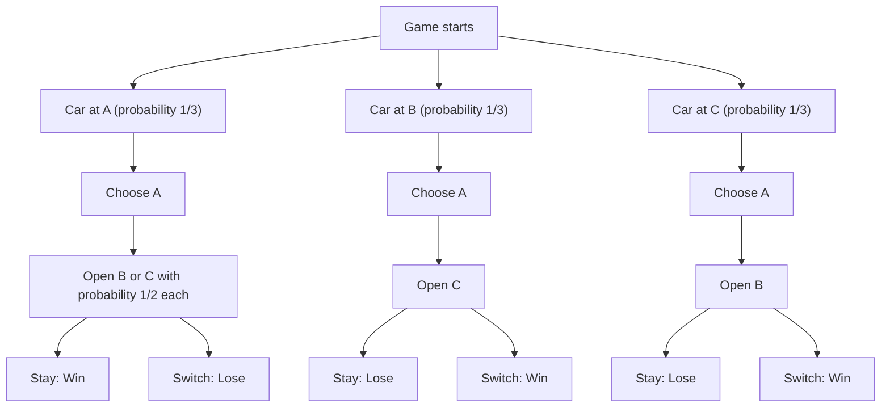
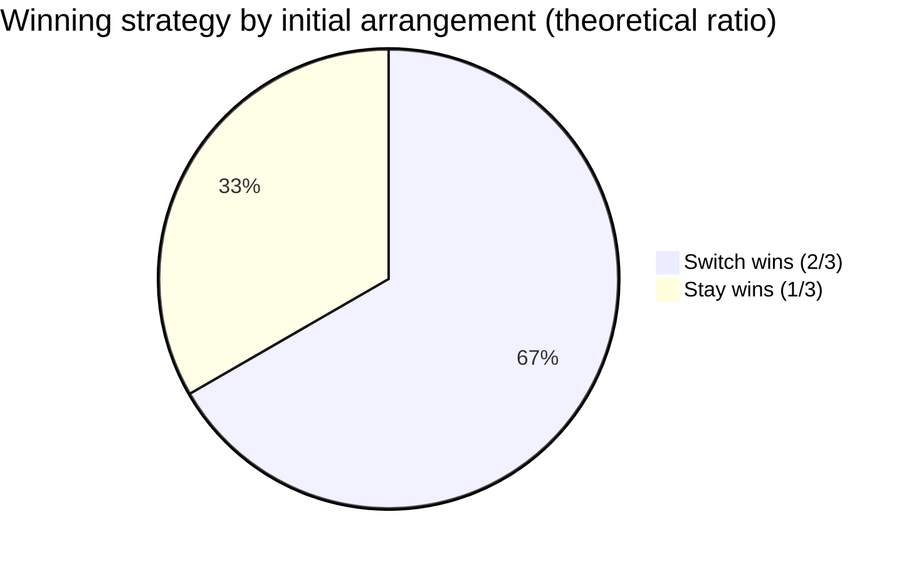

## 1. Three doors and the rules to specify first

One car, two goats. After you choose A from three closed doors A, B and C, the host opens another door and shows a goat. Should you switch to the remaining door?

The Monty Hall problem prompted debate after appearing in the “Ask Marilyn” column in *Parade* in 1990. [Gill's paper](https://pub.math.leidenuniv.nl/~gillrd/montyhall3.pdf) discusses its history and different formulations; [Rosenthal's paper](https://probability.ca/jeff/writing/montyfall.pdf) examines variants of the host's rules. Here we use the following explicit model.

1. The car is equally likely to be behind each door. You choose A without using information about its location.
2. The host knows what is behind the doors and opens neither A nor the car's door.
3. Every time, the host opens one unchosen goat door and offers a switch to the remaining unchosen door.
4. If A has the car, leaving two goat doors available, the host chooses B or C with probability 1/2 each.

Equal probabilities are an assumption about the car's placement, rather than a conclusion from not knowing where it is. Write C_A, C_B and C_C for the events that the car is at A, B and C respectively.

$$
\Pr(C_A)=\Pr(C_B)=\Pr(C_C)=\frac13
$$

Under these rules, a strategy of always switching wins with probability 2/3; always staying wins with probability 1/3. After observing that the host opened B, the conditional probability that C has the car is also 2/3. **An overall strategy's winning probability and a probability conditional on a particular door being opened are distinct calculations.**

## 2. Switching wins in two of the three initial arrangements

Before conditioning on the label of the opened door, separate the possibilities by the car's initial location.

| Car location (each with probability 1/3) | Door the host opens | Stay | Switch |
| --- | --- | --- | --- |
| A | B or C | Win | Lose |
| B | C | Lose | Win |
| C | B | Lose | Win |

Switching wins exactly when the initial choice was a goat. This follows because the host always removes a goat and offers a switch.

$$
\Pr(\mathrm{stay\ wins})=\frac13,\qquad\Pr(\mathrm{switch\ wins})=\frac23
$$

The value 2/3 is a probability in this model, not a guarantee of exactly two wins in every three games. The relationship between probabilities and empirical win rates in independent repetitions connects to the [law of large numbers](https://kenji.blog/en/p/law-of-large-numbers/).

## 3. Bayes' theorem after the host opens B

Let C_A, C_B and C_C be the events that the car is at A, B and C respectively, and let M_B be the event that the host opens B. The rules give these likelihoods:

$$
\Pr(M_B\mid C_A)=\frac12,\qquad\Pr(M_B\mid C_B)=0,\qquad\Pr(M_B\mid C_C)=1
$$

We want probabilities conditional on the information that B was opened. [Bayes' theorem](https://kenji.blog/en/p/bayes-theorem/) combines these likelihoods with the prior probabilities.

$$
\Pr(C_i\mid M_B)=\frac{\Pr(M_B\mid C_i)\Pr(C_i)}{\sum_{j\in\{A,B,C\}}\Pr(M_B\mid C_j)\Pr(C_j)}
$$

By the law of total probability, the probability of opening B is

$$
\Pr(M_B)=\frac12\cdot\frac13+0\cdot\frac13+1\cdot\frac13=\frac12
$$

The probability that the original door A has the car is therefore

$$
\Pr(C_A\mid M_B)=\frac{(1/2)(1/3)}{1/2}=\frac13
$$

and the probability that the switching destination C has the car is

$$
\Pr(C_C\mid M_B)=\frac{1\cdot(1/3)}{1/2}=\frac23
$$

Merely seeing A and C still closed does not establish equal probabilities. We used the fact that the chance of opening B depends on the car's location.

## 4. Testing intuition: the host's information and door-selection rule

The intuition “two remain, so each has half the probability” ignores how they remained. Conversely, knowing the car's location does not make every host decision deterministic. The host in Section 1 still chooses randomly between B and C when A has the car. Nor does leaving C closed establish that the host could not have opened it: if A has the car, opening C was also possible.

### 4.1. A preference between the two goat doors

Keep the other rules, but change the probability of opening B when A has the car to q.

$$
q=\Pr(M_B\mid C_A),\qquad0\le q\le1
$$

Then

$$
\Pr(M_B)=\frac{1+q}{3}
$$

so the probabilities after B is opened are

$$
\Pr(C_A\mid M_B)=\frac{q}{1+q},\qquad\Pr(C_C\mid M_B)=\frac1{1+q}
$$

Similarly, if M_C is the event that the host opens C,

$$
\Pr(M_C)=\frac{2-q}{3}
$$

$$
\Pr(C_A\mid M_C)=\frac{1-q}{2-q},\qquad\Pr(C_B\mid M_C)=\frac1{2-q}
$$

For example, with q equal to 1, observing B opened leaves A and C equally likely. Observing C opened instead makes B certain to have the car. Nevertheless, averaging over which door was opened, the always-switch strategy's winning probability remains

$$
\Pr(M_B)\Pr(C_C\mid M_B)+\Pr(M_C)\Pr(C_B\mid M_C)=\frac23
$$

To calculate probabilities after a particular observation, include the host's preference between door labels in the model.

### 4.2. Opening a door without knowing its contents

Consider a different game: the host does not know where the car is and chooses B or C with probability 1/2 each, independently of the car's location. This rule can reveal the car. Now suppose we observe that the host opened B and revealed a goat.

Let U_B be the event that this host opens B, and G the event that the opened door reveals a goat. Then

$$
\Pr(U_B\cap G\mid C_A)=\frac12,\qquad\Pr(U_B\cap G\mid C_B)=0,\qquad\Pr(U_B\cap G\mid C_C)=\frac12
$$

Equal priors and Bayes' theorem give

$$
\Pr(C_A\mid U_B\cap G)=\Pr(C_C\mid U_B\cap G)=\frac12
$$

“Always revealing a goat” and “happening to reveal a goat” describe different observation mechanisms. An explanation of human psychology and a probability calculation under specified rules are separate questions.

## 5. A million doors still requires a clear conditioning event

Number n doors from 1 to n, with the car's location C uniform and the initial choice fixed at 1. Every time, the informed host opens n−2 unchosen goat doors and offers a switch to the single remaining unchosen door R. Here n is an integer at least 3.

$$
\Pr(C=1)=\frac1n,\qquad\Pr(C=R)=\frac{n-1}{n}
$$

With a million doors, the unconditional probability of winning by always switching is 999999/1000000. The same reasoning applies: switching wins whenever the initial choice was a goat.

Now condition only on the remaining label R. If, whenever the initial choice has the car, the host chooses R uniformly among the other n−1 doors, then for a particular r different from 1,

$$
\Pr(C=r\mid R=r)=\frac{1/n}{(1/n)+(1/n)(1/(n-1))}=\frac{n-1}{n}
$$

Under this symmetric rule, observing that door 777777 was left closed out of a million still gives the switching destination a probability of 999999/1000000.

However, if the host always leaves that same label r whenever the initial choice has the car, then after observing that label remaining,

$$
\Pr(C=r\mid R=r)=\frac{1/n}{(1/n)+(1/n)}=\frac12
$$

The overall always-switch winning probability can remain high while the probability after observing a particular label changes. Information such as the order in which doors were opened is not included in this conditioning on R alone.

The next diagram partitions initial arrangements in the three-door model of Section 1 by which strategy wins. The values 2 and 1 represent a theoretical probability ratio, not measured trial counts.

## 6. Check assumptions and information before changing a choice

The lesson is not that changing choices doubles success in every situation. Winning probabilities depend on the car's placement, the host's knowledge, the opening rule and the rule for offering a switch.

In business and everyday life, new information can help us revisit assumptions and update decisions. Real costs, preferences and ways of collecting information still need their own models; they cannot simply be equated with three doors.
