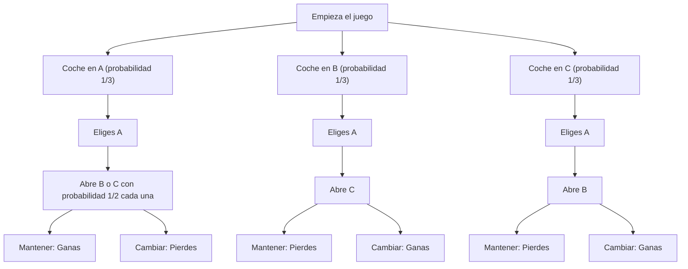
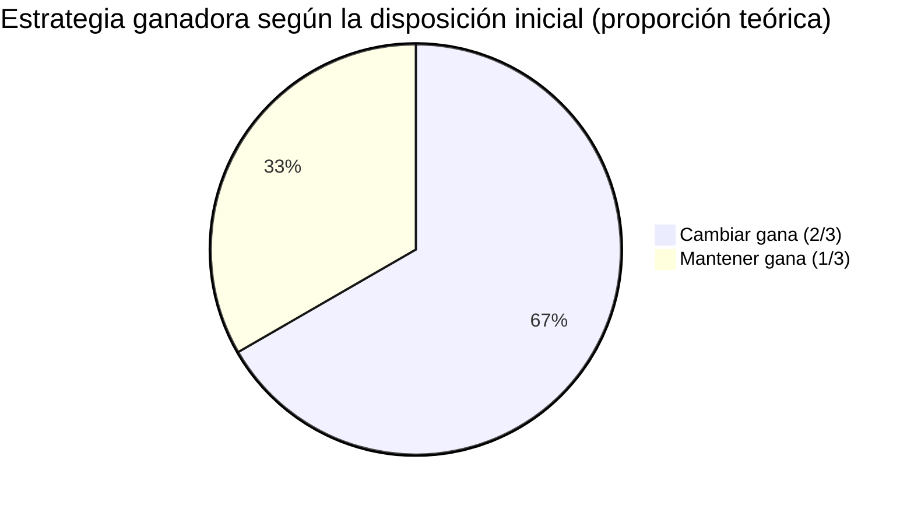

## 1. Tres puertas y las reglas que hay que fijar primero

Un coche y dos cabras. Eliges A entre tres puertas cerradas, A, B y C. Después, el presentador abre otra puerta y muestra una cabra. ¿Conviene cambiar a la puerta que queda?

El problema de Monty Hall suscitó debate tras aparecer en la columna «Ask Marilyn» de *Parade* en 1990. [El artículo de Gill](https://pub.math.leidenuniv.nl/~gillrd/montyhall3.pdf) trata su historia y distintas formulaciones; [el de Rosenthal](https://probability.ca/jeff/writing/montyfall.pdf) analiza variantes de las reglas del presentador. Aquí utilizamos el siguiente modelo explícito.

1. El coche tiene la misma probabilidad de estar detrás de cada puerta. Eliges A sin utilizar información sobre su ubicación.
2. El presentador conoce el contenido de las puertas y no abre ni A ni la puerta del coche.
3. En cada partida abre una puerta no elegida que contiene una cabra y siempre ofrece cambiar a la otra puerta no elegida que sigue cerrada.
4. Si el coche está en A, quedan dos puertas con cabra: el presentador elige abrir B o C con probabilidad 1/2 cada una.

La equiprobabilidad es un supuesto sobre la colocación del coche, no una conclusión de ignorar dónde está. Denotamos por C_A, C_B y C_C los sucesos de que el coche esté en A, B y C, respectivamente.

$$
\Pr(C_A)=\Pr(C_B)=\Pr(C_C)=\frac13
$$

Bajo estas reglas, la estrategia de cambiar siempre gana con probabilidad 2/3 y la de mantener siempre la elección inicial, con probabilidad 1/3. Tras observar que el presentador ha abierto B, la probabilidad condicional de que C contenga el coche también es 2/3. **La probabilidad global de ganar con una estrategia y la probabilidad condicionada a que se abra una puerta concreta son cálculos distintos.**

## 2. Cambiar gana en dos de las tres disposiciones iniciales

Sin condicionar todavía a qué puerta se ha abierto, separamos los casos según la ubicación inicial del coche.

| Ubicación del coche (cada caso con probabilidad 1/3) | Puerta que abre el presentador | Mantener | Cambiar |
| --- | --- | --- | --- |
| A | B o C | Ganas | Pierdes |
| B | C | Pierdes | Ganas |
| C | B | Pierdes | Ganas |

Cambiar gana si y solo si al principio elegiste una puerta con cabra. Esto ocurre porque el presentador siempre descarta una cabra y ofrece el cambio.

$$
\Pr(\mathrm{stay\ wins})=\frac13,\qquad\Pr(\mathrm{switch\ wins})=\frac23
$$

El valor 2/3 es una probabilidad del modelo, no una garantía de ganar exactamente dos de cada tres partidas. La relación entre las probabilidades y las frecuencias relativas de victoria en repeticiones independientes conecta con la [ley de los grandes números](https://kenji.blog/es/p/law-of-large-numbers/).

## 3. El teorema de Bayes después de abrir B

C_A, C_B y C_C son los sucesos de que el coche esté en A, B y C; M_B es el suceso de que el presentador abra B. Las reglas dan estas verosimilitudes:

$$
\Pr(M_B\mid C_A)=\frac12,\qquad\Pr(M_B\mid C_B)=0,\qquad\Pr(M_B\mid C_C)=1
$$

Buscamos probabilidades condicionadas a la información de que B se ha abierto. El [teorema de Bayes](https://kenji.blog/es/p/bayes-theorem/) combina estas verosimilitudes con las probabilidades a priori.

$$
\Pr(C_i\mid M_B)=\frac{\Pr(M_B\mid C_i)\Pr(C_i)}{\sum_{j\in\{A,B,C\}}\Pr(M_B\mid C_j)\Pr(C_j)}
$$

Por la ley de la probabilidad total, la probabilidad de abrir B es

$$
\Pr(M_B)=\frac12\cdot\frac13+0\cdot\frac13+1\cdot\frac13=\frac12
$$

Por tanto, la probabilidad de que el coche esté en la puerta original A es

$$
\Pr(C_A\mid M_B)=\frac{(1/2)(1/3)}{1/2}=\frac13
$$

y la de que esté en C, la puerta a la que cambiarías, es

$$
\Pr(C_C\mid M_B)=\frac{1\cdot(1/3)}{1/2}=\frac23
$$

Ver que A y C siguen cerradas no basta para establecer que sean equiprobables. El cálculo utiliza que la probabilidad de abrir B depende de dónde está el coche.

## 4. Poner a prueba la intuición: información y reglas del presentador

La intuición «quedan dos, así que cada una tiene la mitad de probabilidad» pasa por alto cómo han quedado. A la inversa, conocer la ubicación del coche no convierte todas las decisiones del presentador en deterministas. En la sección 1 sigue eligiendo al azar entre B y C cuando el coche está en A. Dejar C cerrada tampoco demuestra que fuera imposible abrirla: si el coche está en A, abrir C también estaba permitido.

### 4.1. Preferencia entre las dos puertas con cabra

Mantenemos las demás reglas y solo cambiamos a q la probabilidad de abrir B cuando el coche está en A.

$$
q=\Pr(M_B\mid C_A),\qquad0\le q\le1
$$

Entonces

$$
\Pr(M_B)=\frac{1+q}{3}
$$

de modo que las probabilidades después de abrir B son

$$
\Pr(C_A\mid M_B)=\frac{q}{1+q},\qquad\Pr(C_C\mid M_B)=\frac1{1+q}
$$

Análogamente, si M_C es el suceso de que el presentador abra C,

$$
\Pr(M_C)=\frac{2-q}{3}
$$

$$
\Pr(C_A\mid M_C)=\frac{1-q}{2-q},\qquad\Pr(C_B\mid M_C)=\frac1{2-q}
$$

Por ejemplo, con q igual a 1, observar que B se ha abierto deja A y C con probabilidad 1/2 cada una. En cambio, observar que se ha abierto C permite concluir que el coche está en B con certeza. Aun así, al promediar según qué puerta se ha abierto, la probabilidad de ganar cambiando siempre sigue siendo

$$
\Pr(M_B)\Pr(C_C\mid M_B)+\Pr(M_C)\Pr(C_B\mid M_C)=\frac23
$$

Para calcular probabilidades después de una observación concreta, hay que incluir en el modelo la preferencia del presentador por una u otra puerta.

### 4.2. Abrir sin conocer el contenido

Consideremos otro juego: el presentador no sabe dónde está el coche y elige abrir B o C con probabilidad 1/2 cada una, independientemente de la ubicación del coche. Esta regla puede revelar el coche. Ahora observamos que ha abierto B y ha mostrado una cabra.

Sea U_B el suceso de que este presentador abra B, y G el de que la puerta abierta revele una cabra. Entonces

$$
\Pr(U_B\cap G\mid C_A)=\frac12,\qquad\Pr(U_B\cap G\mid C_B)=0,\qquad\Pr(U_B\cap G\mid C_C)=\frac12
$$

Con probabilidades a priori iguales y el teorema de Bayes obtenemos

$$
\Pr(C_A\mid U_B\cap G)=\Pr(C_C\mid U_B\cap G)=\frac12
$$

«Revelar siempre una cabra» y «revelar una cabra por casualidad» describen mecanismos de observación distintos. Explicar la psicología humana y calcular probabilidades bajo unas reglas dadas son cuestiones diferentes.

## 5. Un millón de puertas también exige precisar la condición

Numeramos n puertas del 1 al n. La ubicación C del coche se distribuye uniformemente entre ellas y la elección inicial se fija en 1. En cada partida, el presentador informado abre n−2 puertas no elegidas que contienen cabras y ofrece cambiar a la única puerta no elegida que queda cerrada, R. Aquí n es un entero mayor o igual que 3.

$$
\Pr(C=1)=\frac1n,\qquad\Pr(C=R)=\frac{n-1}{n}
$$

Con un millón de puertas, la probabilidad incondicional de ganar cambiando siempre es 999999/1000000. Se aplica el mismo razonamiento: cambiar gana cuando la elección inicial era una puerta con cabra.

Calculemos ahora probabilidades condicionadas únicamente al número R de la puerta que queda cerrada. Supongamos además que, cuando la puerta elegida inicialmente contiene el coche, el presentador elige R uniformemente entre las otras n−1 puertas. Para un número concreto r distinto de 1, esto da

$$
\Pr(C=r\mid R=r)=\frac{1/n}{(1/n)+(1/n)(1/(n-1))}=\frac{n-1}{n}
$$

Con esta regla simétrica, observar que ha quedado cerrada la puerta 777777 de un millón sigue dando una probabilidad de 999999/1000000 de ganar al cambiar a ella.

Sin embargo, si el presentador deja siempre ese mismo número r cuando la puerta elegida inicialmente contiene el coche, entonces, después de observar que queda esa puerta,

$$
\Pr(C=r\mid R=r)=\frac{1/n}{(1/n)+(1/n)}=\frac12
$$

La probabilidad global de ganar cambiando siempre puede seguir siendo alta, mientras que la probabilidad tras observar un número concreto cambia. No se incluye información adicional, como el orden de apertura, en este condicionamiento basado solo en R.

El siguiente diagrama divide las disposiciones iniciales del modelo de tres puertas de la sección 1 según qué estrategia gana. Los valores 2 y 1 representan una proporción teórica de probabilidades, no cantidades de ensayos observados.

## 6. Revisar los supuestos y la información antes de cambiar

La lección no es que cambiar de elección duplique el éxito en cualquier situación. Las probabilidades de ganar dependen de cómo se coloca el coche, del conocimiento del presentador, de la regla de apertura y de la regla para ofrecer el cambio.

En los negocios y la vida cotidiana, la nueva información puede ayudar a revisar supuestos y actualizar decisiones. Los costes, las preferencias y las formas de recopilar información necesitan sus propios modelos; no pueden equipararse sin más a tres puertas.
