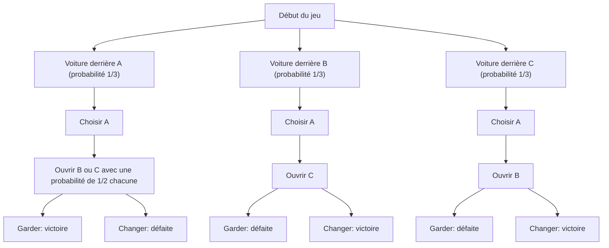
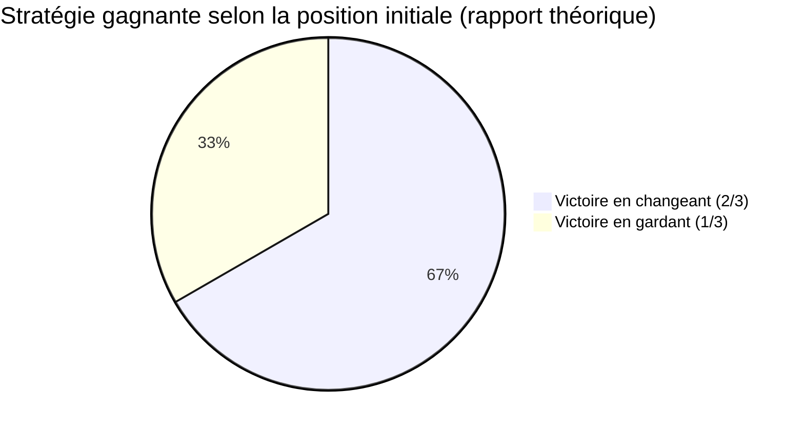

## 1. Trois portes et les règles à préciser d'abord

Une voiture, deux chèvres. Vous choisissez A parmi trois portes fermées, A, B et C. Le présentateur ouvre ensuite une autre porte et montre une chèvre. Vaut-il mieux choisir la porte restante ?

Le problème de Monty Hall a suscité un débat après sa présentation dans la chronique « Ask Marilyn » de *Parade* en 1990. [L'article de Gill](https://pub.math.leidenuniv.nl/~gillrd/montyhall3.pdf) aborde son histoire et différentes formulations mathématiques ; [celui de Rosenthal](https://probability.ca/jeff/writing/montyfall.pdf) étudie des variantes des règles du présentateur. Nous adoptons ici le modèle explicite suivant.

1. La voiture a la même probabilité de se trouver derrière chaque porte. Vous choisissez A sans utiliser d'information sur sa position.
2. Le présentateur connaît le contenu des portes et n'ouvre ni A ni la porte de la voiture.
3. À chaque partie, il ouvre une porte non choisie qui cache une chèvre et propose toujours de passer à l'autre porte non choisie encore fermée.
4. Si la voiture est derrière A, les deux autres portes cachent des chèvres : il choisit d'ouvrir B ou C avec une probabilité de 1/2 pour chacune.

L'équiprobabilité est une hypothèse sur le placement de la voiture ; elle ne découle pas du seul fait d'ignorer sa position. Notons C_A, C_B et C_C les événements où la voiture se trouve respectivement derrière A, B et C.

$$
\Pr(C_A)=\Pr(C_B)=\Pr(C_C)=\frac13
$$

Sous ces règles, la stratégie consistant à toujours changer gagne avec une probabilité de 2/3, contre 1/3 pour celle qui garde toujours le choix initial. Après avoir observé l'ouverture de B, la probabilité conditionnelle que C cache la voiture est également de 2/3. **La probabilité globale de gain d'une stratégie et une probabilité conditionnelle à l'ouverture d'une porte précise sont deux calculs distincts.**

## 2. Changer permet de gagner dans deux des trois cas initiaux

Avant de conditionner sur l'identité de la porte ouverte, séparons les cas selon la position initiale de la voiture.

| Position de la voiture (chaque cas a une probabilité de 1/3) | Porte ouverte par le présentateur | Garder | Changer |
| --- | --- | --- | --- |
| A | B ou C | Victoire | Défaite |
| B | C | Défaite | Victoire |
| C | B | Défaite | Victoire |

Changer de porte permet de gagner si et seulement si la porte choisie au départ cache une chèvre. En effet, le présentateur écarte toujours une porte cachant une chèvre et propose le changement.

$$
\Pr(\mathrm{stay\ wins})=\frac13,\qquad\Pr(\mathrm{switch\ wins})=\frac23
$$

La valeur 2/3 est une probabilité du modèle, pas la garantie de gagner exactement deux parties sur chaque groupe de trois. Le lien entre probabilités et fréquences de victoire dans des répétitions indépendantes renvoie aussi à la [loi des grands nombres](https://kenji.blog/fr/p/law-of-large-numbers/).

## 3. Le théorème de Bayes après l'ouverture de B

C_A, C_B et C_C désignent les événements où la voiture est derrière A, B et C ; M_B est l'événement où le présentateur ouvre B. Les règles donnent les vraisemblances suivantes :

$$
\Pr(M_B\mid C_A)=\frac12,\qquad\Pr(M_B\mid C_B)=0,\qquad\Pr(M_B\mid C_C)=1
$$

Nous cherchons les probabilités sachant que B a été ouverte. Le [théorème de Bayes](https://kenji.blog/fr/p/bayes-theorem/) combine ces vraisemblances avec les probabilités a priori.

$$
\Pr(C_i\mid M_B)=\frac{\Pr(M_B\mid C_i)\Pr(C_i)}{\sum_{j\in\{A,B,C\}}\Pr(M_B\mid C_j)\Pr(C_j)}
$$

La formule des probabilités totales donne pour l'ouverture de B :

$$
\Pr(M_B)=\frac12\cdot\frac13+0\cdot\frac13+1\cdot\frac13=\frac12
$$

La probabilité que la voiture soit derrière la porte initiale A est donc

$$
\Pr(C_A\mid M_B)=\frac{(1/2)(1/3)}{1/2}=\frac13
$$

et celle qu'elle soit derrière C, la porte proposée pour le changement, vaut

$$
\Pr(C_C\mid M_B)=\frac{1\cdot(1/3)}{1/2}=\frac23
$$

Voir A et C encore fermées ne suffit pas à les déclarer équiprobables. Le calcul utilise le fait que la probabilité d'ouvrir B dépend de la position de la voiture.

## 4. Éprouver l'intuition : information et règles du présentateur

L'intuition « il en reste deux, donc chacune a la moitié de la probabilité » néglige la manière dont elles sont restées fermées. À l'inverse, connaître la position de la voiture ne rend pas toutes les décisions du présentateur déterministes. Dans la section 1, il choisit encore au hasard entre B et C lorsque la voiture est derrière A. Laisser C fermée ne prouve pas non plus qu'il était impossible de l'ouvrir : si la voiture est derrière A, ouvrir C est aussi autorisé.

### 4.1. Préférence entre les deux portes cachant une chèvre

Conservons les autres règles, mais remplaçons par q la probabilité d'ouvrir B lorsque la voiture est derrière A.

$$
q=\Pr(M_B\mid C_A),\qquad0\le q\le1
$$

Alors

$$
\Pr(M_B)=\frac{1+q}{3}
$$

d'où les probabilités après l'ouverture de B :

$$
\Pr(C_A\mid M_B)=\frac{q}{1+q},\qquad\Pr(C_C\mid M_B)=\frac1{1+q}
$$

De même, si M_C désigne l'événement où le présentateur ouvre C,

$$
\Pr(M_C)=\frac{2-q}{3}
$$

$$
\Pr(C_A\mid M_C)=\frac{1-q}{2-q},\qquad\Pr(C_B\mid M_C)=\frac1{2-q}
$$

Par exemple, avec q égal à 1, observer B ouverte laisse A et C avec une probabilité de 1/2 chacune. En revanche, observer C ouverte rend certaine la présence de la voiture derrière B. Pourtant, en faisant la moyenne pondérée selon les probabilités d'ouverture des portes, la probabilité de gain de la stratégie qui change toujours reste

$$
\Pr(M_B)\Pr(C_C\mid M_B)+\Pr(M_C)\Pr(C_B\mid M_C)=\frac23
$$

Pour calculer une probabilité après une observation précise, il faut inclure dans le modèle la préférence du présentateur pour l'une ou l'autre porte.

### 4.2. Ouvrir sans connaître le contenu

Considérons un autre jeu : le présentateur ignore la position de la voiture et choisit d'ouvrir B ou C avec une probabilité de 1/2 chacune, indépendamment de la position de la voiture. Cette règle peut dévoiler la voiture. Supposons maintenant que nous observions l'ouverture de B et la présence d'une chèvre.

Notons U_B l'événement où ce présentateur ouvre B, et G l'événement où la porte ouverte révèle une chèvre. Alors

$$
\Pr(U_B\cap G\mid C_A)=\frac12,\qquad\Pr(U_B\cap G\mid C_B)=0,\qquad\Pr(U_B\cap G\mid C_C)=\frac12
$$

Avec des probabilités a priori égales et le théorème de Bayes, on obtient

$$
\Pr(C_A\mid U_B\cap G)=\Pr(C_C\mid U_B\cap G)=\frac12
$$

« Montrer toujours une chèvre » et « montrer une chèvre par hasard » correspondent à des mécanismes d'observation différents. Expliquer la psychologie humaine et calculer des probabilités sous des règles données sont deux questions distinctes.

## 5. Un million de portes exige aussi de préciser la condition

Numérotons n portes de 1 à n. La position C de la voiture suit une loi uniforme sur ces numéros, et le choix initial est fixé à 1. À chaque partie, le présentateur informé ouvre n−2 portes non choisies cachant des chèvres et propose de passer à l'unique porte non choisie encore fermée, R. Ici n est un entier supérieur ou égal à 3.

$$
\Pr(C=1)=\frac1n,\qquad\Pr(C=R)=\frac{n-1}{n}
$$

Avec un million de portes, la probabilité inconditionnelle de gagner en changeant toujours est 999999/1000000. Le raisonnement reste le même : on gagne en changeant lorsque la porte initiale cache une chèvre.

Calculons maintenant des probabilités conditionnelles au seul numéro R de la porte restante. Supposons en plus que, lorsque la porte initialement choisie cache la voiture, le présentateur choisit R uniformément parmi les n−1 autres portes. Pour un numéro précis r différent de 1, cela donne

$$
\Pr(C=r\mid R=r)=\frac{1/n}{(1/n)+(1/n)(1/(n-1))}=\frac{n-1}{n}
$$

Sous cette règle symétrique, observer que la porte 777777 est restée fermée parmi un million donne encore une probabilité de 999999/1000000 de gagner en la choisissant.

En revanche, si le présentateur laisse toujours ce même numéro r lorsque la porte initiale cache la voiture, alors, après avoir observé que cette porte reste fermée,

$$
\Pr(C=r\mid R=r)=\frac{1/n}{(1/n)+(1/n)}=\frac12
$$

La probabilité globale de gain de la stratégie qui change toujours peut rester élevée, alors que la probabilité après l'observation d'un numéro précis varie. Nous n'incluons pas d'information supplémentaire, comme l'ordre d'ouverture, dans ce conditionnement portant seulement sur R.

Le diagramme suivant sépare les positions initiales du modèle à trois portes de la section 1 selon la stratégie gagnante. Les valeurs 2 et 1 représentent un rapport théorique de probabilités, pas des nombres de parties effectivement jouées.

## 6. Vérifier les hypothèses et les informations avant de changer

La leçon n'est pas que changer de choix double la probabilité de réussite dans n'importe quelle situation. Les probabilités de gain dépendent du placement de la voiture, des connaissances du présentateur, de la règle d'ouverture et de la règle qui détermine l'offre de changement.

Dans les affaires et la vie quotidienne, de nouvelles informations peuvent aider à réexaminer les hypothèses et à mettre à jour les décisions. Les coûts, les préférences et les modes de collecte d'information nécessitent leurs propres modèles ; on ne peut pas les assimiler simplement à trois portes.
