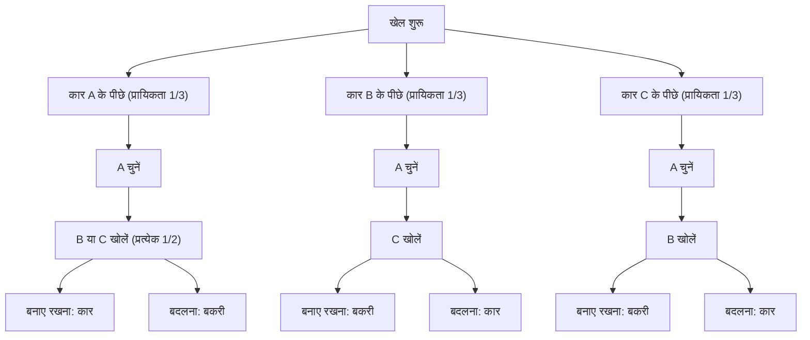
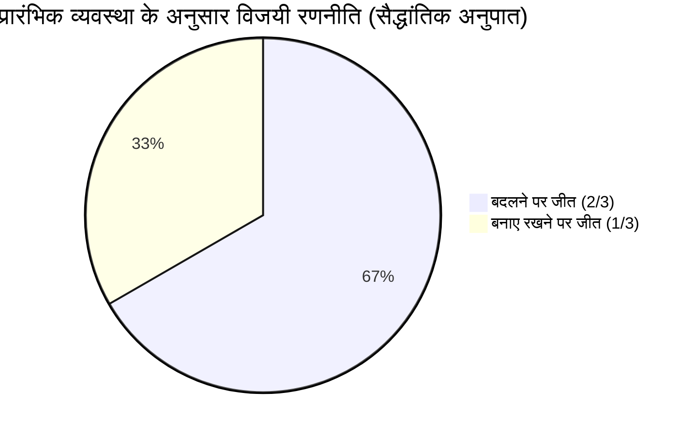

## 1. तीन दरवाजे और पहले स्पष्ट किए जाने वाले नियम

एक कार और दो बकरियाँ हैं। आप तीन बंद दरवाजों A, B और C में से A चुनते हैं। फिर संचालक दूसरा दरवाजा खोलकर बकरी दिखाता है। क्या बचे हुए दरवाजे को चुनना बेहतर है?

मोंटी हॉल समस्या 1990 में *Parade* के “Ask Marilyn” स्तंभ में आने के बाद चर्चा का विषय बनी। इतिहास और अलग गणितीय रूपों के लिए [Gill का लेख](https://pub.math.leidenuniv.nl/~gillrd/montyhall3.pdf), तथा संचालक के नियम बदलने वाले उदाहरणों के लिए [Rosenthal का लेख](https://probability.ca/jeff/writing/montyfall.pdf) देख सकते हैं। यहाँ हम निम्न स्पष्ट नियमों वाला मॉडल लेते हैं।

1. कार को तीनों में से किसी एक दरवाजे के पीछे समान प्रायिकता से रखा जाता है। आप उसके स्थान की जानकारी का उपयोग किए बिना A चुनते हैं।
2. संचालक जानता है कि किस दरवाजे के पीछे क्या है। वह न A खोलता है, न कार वाला दरवाजा।
3. हर खेल में वह न चुने गए दरवाजों में से बकरी वाला एक दरवाजा खोलता है और हमेशा दूसरे, अब भी बंद और न चुने गए दरवाजे को चुनने का अवसर देता है।
4. यदि कार A के पीछे है, तो बाकी दोनों दरवाजों के पीछे बकरियाँ हैं। तब वह B या C को प्रत्येक के लिए 1/2 की प्रायिकता से चुनकर खोलता है।

समान प्रायिकता कार रखने के तरीके की धारणा है। केवल स्थान न जानने से यह निष्कर्ष नहीं निकलता। कार के A, B और C के पीछे होने की घटनाएँ क्रमशः C_A, C_B और C_C हों, तो

$$
\Pr(C_A)=\Pr(C_B)=\Pr(C_C)=\frac13
$$

इन नियमों के अंतर्गत, पहले से “हमेशा बदलना” तय करने वाली रणनीति की जीतने की प्रायिकता 2/3 है और हमेशा पहला चयन बनाए रखने की 1/3। B खुलने का प्रेक्षण मिलने के बाद भी, बदलकर चुने जाने वाले C के पीछे कार की सशर्त प्रायिकता 2/3 है। **रणनीति की समग्र जीतने की प्रायिकता और किसी खास दरवाजे के खुलने पर सशर्त प्रायिकता अलग गणनाएँ हैं।**

## 2. तीन प्रारंभिक व्यवस्थाओं में से दो में बदलना जीतता है

अभी किसी खास खुले दरवाजे पर शर्त नहीं लगाते। केवल कार के प्रारंभिक स्थान के अनुसार मामले अलग करते हैं।

| कार का स्थान (प्रत्येक की प्रायिकता 1/3) | संचालक कौन सा दरवाजा खोलता है | बनाए रखना | बदलना |
| --- | --- | --- | --- |
| A | B या C | कार | बकरी |
| B | C | बकरी | कार |
| C | B | बकरी | कार |

बदलने पर जीत ठीक उन्हीं मामलों में होती है जिनमें पहले बकरी वाला दरवाजा चुना गया था। कारण यह है कि संचालक हमेशा एक बकरी वाला दरवाजा विकल्पों से हटाकर बदलने का अवसर देता है।

$$
\Pr(\mathrm{stay\ wins})=\frac13,\qquad\Pr(\mathrm{switch\ wins})=\frac23
$$

2/3 इस मॉडल की प्रायिकता है, हर तीन खेलों में ठीक दो जीत की गारंटी नहीं। स्वतंत्र पुनरावृत्तियों में जीत के नमूना अनुपात और प्रायिकता का संबंध [बड़ी संख्याओं के नियम](https://kenji.blog/hi/p/law-of-large-numbers/) से भी जुड़ा है।

## 3. B खुलने के बाद बेज़ के प्रमेय से गणना

C_A, C_B और C_C कार के क्रमशः A, B और C के पीछे होने की घटनाएँ हैं। M_B संचालक के B खोलने की घटना है। नियमों से निम्न लाइकलीहुड मान मिलते हैं:

$$
\Pr(M_B\mid C_A)=\frac12,\qquad\Pr(M_B\mid C_B)=0,\qquad\Pr(M_B\mid C_C)=1
$$

हमें B खुलने की जानकारी पर सशर्त प्रायिकताएँ चाहिए। [बेज़ का प्रमेय](https://kenji.blog/hi/p/bayes-theorem/) इन लाइकलीहुड मानों को पूर्व प्रायिकताओं से जोड़ता है।

$$
\Pr(C_i\mid M_B)=\frac{\Pr(M_B\mid C_i)\Pr(C_i)}{\sum_{j\in\{A,B,C\}}\Pr(M_B\mid C_j)\Pr(C_j)}
$$

कुल प्रायिकता के नियम से, B खोलने की प्रायिकता है

$$
\Pr(M_B)=\frac12\cdot\frac13+0\cdot\frac13+1\cdot\frac13=\frac12
$$

इसलिए पहले चुने गए A के पीछे कार होने की प्रायिकता है

$$
\Pr(C_A\mid M_B)=\frac{(1/2)(1/3)}{1/2}=\frac13
$$

और बदलकर चुने जाने वाले C के पीछे कार होने की प्रायिकता है

$$
\Pr(C_C\mid M_B)=\frac{1\cdot(1/3)}{1/2}=\frac23
$$

केवल A और C को बंद देखकर उन्हें समान प्रायिकता देना उचित नहीं। गणना में यह इस्तेमाल हुआ है कि कार का स्थान बदलने पर B खोलने की संभावना बदलती है।

## 4. अंतर्ज्ञान की जाँच: संचालक की जानकारी और खोलने के नियम

“दो बचे हैं, इसलिए दोनों की आधी प्रायिकता है” वाला अंतर्ज्ञान इस बात को नहीं देखता कि वे बचे कैसे। दूसरी ओर, कार का स्थान जानने से हर स्थिति में खोलने के लिए एक ही दरवाजा तय नहीं हो जाता। पहले खंड में भी, कार A के पीछे होने पर संचालक B और C में यादृच्छिक चयन करता है। C को बंद छोड़ने का अर्थ यह नहीं कि वह C खोल ही नहीं सकता था: कार A के पीछे होती तो C खोलना भी अनुमत था।

### 4.1. बकरी वाले दो दरवाजों में चयन का झुकाव

बाकी नियम वही रखते हैं और केवल कार A के पीछे होने पर B खोलने की प्रायिकता को q करते हैं।

$$
q=\Pr(M_B\mid C_A),\qquad0\le q\le1
$$

तब

$$
\Pr(M_B)=\frac{1+q}{3}
$$

इसलिए B खुलने के बाद प्रायिकताएँ हैं

$$
\Pr(C_A\mid M_B)=\frac{q}{1+q},\qquad\Pr(C_C\mid M_B)=\frac1{1+q}
$$

इसी तरह, M_C को संचालक के C खोलने की घटना कहें, तो

$$
\Pr(M_C)=\frac{2-q}{3}
$$

$$
\Pr(C_A\mid M_C)=\frac{1-q}{2-q},\qquad\Pr(C_B\mid M_C)=\frac1{2-q}
$$

उदाहरण के लिए, q बराबर 1 हो तो B खुलने के बाद A और C, दोनों की प्रायिकता 1/2 है। लेकिन C खुलने का प्रेक्षण मिलने पर कार निश्चित रूप से B के पीछे है। फिर भी, कौन सा दरवाजा खुला इसकी प्रायिकताओं से भारित औसत लेने पर हमेशा बदलने की रणनीति की जीतने की प्रायिकता बनी रहती है:

$$
\Pr(M_B)\Pr(C_C\mid M_B)+\Pr(M_C)\Pr(C_B\mid M_C)=\frac23
$$

किसी खास प्रेक्षण के बाद की प्रायिकता निकालने के लिए, संचालक का दरवाजे के क्रमांक के प्रति चयन-झुकाव भी मॉडल में शामिल करना होगा।

### 4.2. अंदर क्या है यह जाने बिना खोलना

एक अलग खेल लें। संचालक कार का स्थान नहीं जानता और B या C को प्रत्येक के लिए 1/2 की प्रायिकता से चुनकर खोलता है। यह चयन कार के स्थान से स्वतंत्र है। इस नियम में कार भी दिखाई दे सकती है। अब मानें कि हमने देखा: B खुला और उसके पीछे बकरी थी।

U_B इस संचालक के B खोलने की घटना हो और G खुले दरवाजे के पीछे बकरी होने की घटना, तो

$$
\Pr(U_B\cap G\mid C_A)=\frac12,\qquad\Pr(U_B\cap G\mid C_B)=0,\qquad\Pr(U_B\cap G\mid C_C)=\frac12
$$

समान पूर्व प्रायिकताओं और बेज़ के प्रमेय से

$$
\Pr(C_A\mid U_B\cap G)=\Pr(C_C\mid U_B\cap G)=\frac12
$$

मिलता है। “हमेशा बकरी दिखाना” और “संयोग से बकरी दिखना” अलग प्रेक्षण प्रक्रियाएँ हैं। मानव मनोविज्ञान का स्पष्टीकरण और तय नियमों के अंतर्गत प्रायिकता की गणना अलग प्रश्न हैं।

## 5. दस लाख दरवाजों में भी शर्त स्पष्ट करें

n दरवाजों को 1 से n तक क्रमांक दें। कार का स्थान C इन क्रमांकों पर एकसमान वितरित है और पहला चयन 1 तय है। जानकारी रखने वाला संचालक हर बार न चुने गए n−2 बकरी वाले दरवाजे खोलता है और बचे हुए एकमात्र बंद, न चुने गए दरवाजे R को चुनने का अवसर देता है। n एक पूर्णांक है और कम से कम 3 है।

$$
\Pr(C=1)=\frac1n,\qquad\Pr(C=R)=\frac{n-1}{n}
$$

दस लाख दरवाजों में हमेशा बदलने की रणनीति की समग्र, अशर्त जीतने की प्रायिकता 999999/1000000 है। वही तर्क लागू होता है: पहले बकरी वाला दरवाजा चुना हो तो बदलने पर जीत होती है।

अब केवल बचे हुए दरवाजे के क्रमांक R पर शर्त लगाएँ। अतिरिक्त धारणा लें कि पहले चुने गए दरवाजे के पीछे कार होने पर संचालक बाकी n−1 दरवाजों में से R को एकसमान प्रायिकता से चुनता है। तब 1 से अलग किसी विशेष क्रमांक r के लिए

$$
\Pr(C=r\mid R=r)=\frac{1/n}{(1/n)+(1/n)(1/(n-1))}=\frac{n-1}{n}
$$

इस सममित नियम के अंतर्गत, दस लाख में 777777वाँ दरवाजा बचा देखने पर भी उस दरवाजे पर जाने से जीत की प्रायिकता 999999/1000000 है।

लेकिन यदि पहले चुने दरवाजे के पीछे कार होने पर संचालक हमेशा वही क्रमांक r छोड़ता है, तो उस दरवाजे को बचा देखने के बाद

$$
\Pr(C=r\mid R=r)=\frac{1/n}{(1/n)+(1/n)}=\frac12
$$

हमेशा बदलने की रणनीति की समग्र जीतने की प्रायिकता ऊँची रह सकती है, जबकि किसी खास क्रमांक को देखने के बाद की प्रायिकता अलग हो सकती है। केवल R पर इस शर्त में दरवाजे खोलने के क्रम जैसी अतिरिक्त जानकारी शामिल नहीं है।

अगला चित्र पहले खंड के तीन-दरवाजे वाले मॉडल की प्रारंभिक व्यवस्थाओं को जीतने वाली रणनीति के अनुसार बाँटता है। 2 और 1 प्रायिकताओं का सैद्धांतिक अनुपात हैं, खेले गए खेलों की मापी हुई गिनती नहीं।

## 6. बदलने से पहले धारणाएँ और जानकारी जाँचें

इस समस्या का अर्थ यह नहीं कि हर स्थिति में चयन बदलने से सफलता की प्रायिकता दोगुनी हो जाती है। जीत की प्रायिकता कार रखने के तरीके, संचालक की जानकारी, खोलने के नियम और बदलने का अवसर देने के नियम पर निर्भर है।

व्यापार और रोजमर्रा के जीवन में भी नई जानकारी मिलने पर धारणाएँ जाँचना और जरूरत हो तो निर्णय अद्यतन करना उपयोगी है। लेकिन वास्तविक लागत, पसंद और जानकारी जुटाने के तरीकों के लिए अपने मॉडल चाहिए; उन्हें तीन दरवाजों के खेल के समान नहीं मान सकते।
