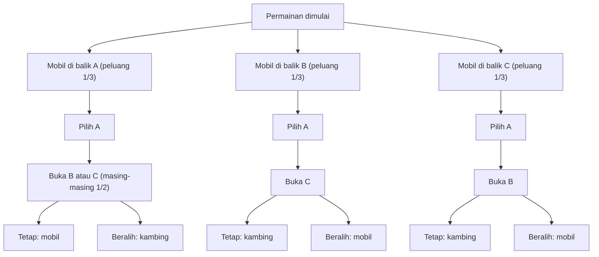
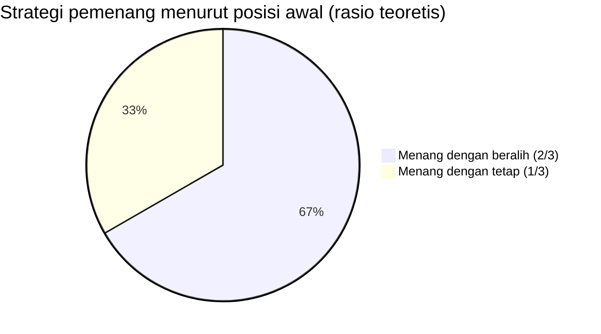

## 1. Tiga pintu dan aturan yang harus jelas lebih dahulu

Satu mobil dan dua kambing. Anda memilih A di antara tiga pintu tertutup, A, B, dan C. Kemudian pembawa acara membuka pintu lain dan memperlihatkan kambing. Apakah lebih baik mengganti pilihan ke pintu yang tersisa?

Masalah Monty Hall memicu perdebatan setelah muncul dalam kolom “Ask Marilyn” di *Parade* pada 1990. [Tulisan Gill](https://pub.math.leidenuniv.nl/~gillrd/montyhall3.pdf) membahas sejarah dan berbagai perumusan matematisnya; [tulisan Rosenthal](https://probability.ca/jeff/writing/montyfall.pdf) membahas variasi aturan pembawa acara. Di sini kita memakai model dengan aturan berikut.

1. Mobil memiliki peluang yang sama untuk berada di balik setiap pintu. Anda memilih A tanpa memakai informasi tentang letaknya.
2. Pembawa acara mengetahui isi pintu dan tidak membuka A maupun pintu dengan mobil.
3. Dalam setiap permainan, ia membuka satu pintu yang belum dipilih dan berisi kambing, lalu selalu menawarkan kesempatan beralih ke pintu lain yang belum dipilih dan masih tertutup.
4. Jika mobil berada di balik A, dua pintu lainnya berisi kambing. Ia memilih membuka B atau C dengan peluang masing-masing 1/2.

Peluang yang sama merupakan asumsi tentang penempatan mobil. Tidak mengetahui letak mobil saja belum cukup untuk menyimpulkan bahwa peluangnya sama. Nyatakan kejadian mobil berada di balik A, B, dan C berturut-turut sebagai C_A, C_B, dan C_C.

$$
\Pr(C_A)=\Pr(C_B)=\Pr(C_C)=\frac13
$$

Dengan aturan ini, strategi yang sejak awal selalu mengganti pilihan menang dengan peluang 2/3; strategi yang selalu mempertahankan pilihan awal menang dengan peluang 1/3. Setelah mengamati B dibuka, peluang bersyarat bahwa C berisi mobil juga 2/3. **Peluang menang keseluruhan suatu strategi dan peluang bersyarat setelah pintu tertentu dibuka adalah perhitungan yang berbeda.**

## 2. Mengganti pilihan menghasilkan kemenangan pada dua dari tiga posisi awal

Untuk perhitungan ini, kita belum menggunakan informasi tentang pintu tertentu yang dibuka. Kasus dibagi hanya berdasarkan posisi awal mobil.

| Posisi mobil (masing-masing berpeluang 1/3) | Pintu yang dibuka pembawa acara | Tetap | Beralih |
| --- | --- | --- | --- |
| A | B atau C | Mobil | Kambing |
| B | C | Kambing | Mobil |
| C | B | Kambing | Mobil |

Anda menang dengan mengganti pilihan jika dan hanya jika pilihan awal adalah pintu dengan kambing. Sebab, pembawa acara selalu menyingkirkan satu pintu dengan kambing dari pilihan dan menawarkan pergantian.

$$
\Pr(\mathrm{stay\ wins})=\frac13,\qquad\Pr(\mathrm{switch\ wins})=\frac23
$$

Nilai 2/3 adalah peluang dalam model, bukan jaminan tepat dua kemenangan dalam setiap tiga permainan. Hubungan peluang dengan proporsi kemenangan sampel pada pengulangan independen juga berkaitan dengan [hukum bilangan besar](https://kenji.blog/id/p/law-of-large-numbers/).

## 3. Teorema Bayes setelah B dibuka

C_A, C_B, dan C_C adalah kejadian mobil berada di balik A, B, dan C; M_B adalah kejadian pembawa acara membuka B. Aturan menghasilkan nilai likelihood berikut:

$$
\Pr(M_B\mid C_A)=\frac12,\qquad\Pr(M_B\mid C_B)=0,\qquad\Pr(M_B\mid C_C)=1
$$

Yang dicari adalah peluang dengan syarat bahwa B telah dibuka. [Teorema Bayes](https://kenji.blog/id/p/bayes-theorem/) menggabungkan likelihood tersebut dengan probabilitas prior.

$$
\Pr(C_i\mid M_B)=\frac{\Pr(M_B\mid C_i)\Pr(C_i)}{\sum_{j\in\{A,B,C\}}\Pr(M_B\mid C_j)\Pr(C_j)}
$$

Dengan hukum probabilitas total, peluang membuka B adalah

$$
\Pr(M_B)=\frac12\cdot\frac13+0\cdot\frac13+1\cdot\frac13=\frac12
$$

Jadi, peluang mobil berada di balik pintu A yang dipilih semula adalah

$$
\Pr(C_A\mid M_B)=\frac{(1/2)(1/3)}{1/2}=\frac13
$$

sedangkan peluang mobil berada di balik C, tujuan pergantian pilihan, adalah

$$
\Pr(C_C\mid M_B)=\frac{1\cdot(1/3)}{1/2}=\frac23
$$

Melihat A dan C masih tertutup saja tidak cukup untuk menetapkan peluang yang sama. Perhitungan menggunakan fakta bahwa peluang membuka B bergantung pada letak mobil.

## 4. Menguji intuisi: informasi dan aturan pembawa acara

Intuisi “tersisa dua, jadi masing-masing setengah” mengabaikan proses yang membuat kedua pintu itu tersisa. Sebaliknya, mengetahui letak mobil tidak membuat semua keputusan pembawa acara deterministik. Pada bagian 1, ia tetap memilih B atau C secara acak jika mobil ada di balik A. Membiarkan C tertutup juga tidak membuktikan bahwa ia tidak bisa membukanya: jika mobil berada di balik A, membuka C juga diperbolehkan.

### 4.1. Kecenderungan memilih salah satu pintu dengan kambing

Pertahankan aturan lainnya, tetapi ubah peluang membuka B ketika mobil ada di balik A menjadi q.

$$
q=\Pr(M_B\mid C_A),\qquad0\le q\le1
$$

Maka

$$
\Pr(M_B)=\frac{1+q}{3}
$$

sehingga peluang setelah B dibuka adalah

$$
\Pr(C_A\mid M_B)=\frac{q}{1+q},\qquad\Pr(C_C\mid M_B)=\frac1{1+q}
$$

Demikian pula, jika M_C menyatakan kejadian pembawa acara membuka C,

$$
\Pr(M_C)=\frac{2-q}{3}
$$

$$
\Pr(C_A\mid M_C)=\frac{1-q}{2-q},\qquad\Pr(C_B\mid M_C)=\frac1{2-q}
$$

Misalnya, jika q sama dengan 1, setelah B terlihat dibuka, A dan C masing-masing berpeluang 1/2. Namun, jika C terlihat dibuka, mobil pasti ada di balik B. Meski demikian, rata-rata berbobot menurut peluang pintu yang dibuka tetap memberikan peluang menang bagi strategi selalu mengganti pilihan sebesar

$$
\Pr(M_B)\Pr(C_C\mid M_B)+\Pr(M_C)\Pr(C_B\mid M_C)=\frac23
$$

Untuk menghitung peluang setelah pengamatan tertentu, kecenderungan pembawa acara memilih suatu pintu juga harus masuk dalam model.

### 4.2. Membuka tanpa mengetahui isinya

Pertimbangkan permainan lain: pembawa acara tidak mengetahui letak mobil dan memilih membuka B atau C dengan peluang masing-masing 1/2, secara independen dari letak mobil. Aturan ini bisa memperlihatkan mobil. Sekarang kita mengamati bahwa ia membuka B dan memperlihatkan kambing.

Nyatakan kejadian pembawa acara ini membuka B sebagai U_B, dan kejadian pintu yang dibuka memperlihatkan kambing sebagai G. Maka

$$
\Pr(U_B\cap G\mid C_A)=\frac12,\qquad\Pr(U_B\cap G\mid C_B)=0,\qquad\Pr(U_B\cap G\mid C_C)=\frac12
$$

Dengan probabilitas prior yang sama dan Teorema Bayes, diperoleh

$$
\Pr(C_A\mid U_B\cap G)=\Pr(C_C\mid U_B\cap G)=\frac12
$$

“Selalu memperlihatkan kambing” dan “kebetulan memperlihatkan kambing” adalah mekanisme pengamatan yang berbeda. Penjelasan psikologi manusia dan perhitungan peluang di bawah aturan tertentu merupakan dua persoalan berbeda.

## 5. Satu juta pintu tetap memerlukan syarat yang jelas

Berikan nomor 1 hingga n pada n pintu. Posisi mobil C berdistribusi seragam pada nomor tersebut, dan pilihan awal ditetapkan sebagai 1. Pada setiap permainan, pembawa acara yang mengetahui isinya membuka n−2 pintu yang belum dipilih dan berisi kambing. Ia menawarkan pergantian ke satu-satunya pintu yang belum dipilih dan masih tertutup, R. Di sini n adalah bilangan bulat minimal 3.

$$
\Pr(C=1)=\frac1n,\qquad\Pr(C=R)=\frac{n-1}{n}
$$

Dengan satu juta pintu, peluang menang tak bersyarat bagi strategi selalu mengganti pilihan adalah 999999/1000000. Alasannya sama: Anda menang dengan mengganti pilihan ketika pintu awal berisi kambing.

Sekarang hitung peluang bersyarat dengan hanya menggunakan nomor R dari pintu yang teramati tersisa. Asumsikan pula bahwa, jika pintu awal berisi mobil, pembawa acara memilih R secara seragam dari n−1 pintu lainnya. Untuk nomor tertentu r yang berbeda dari 1, kita memperoleh

$$
\Pr(C=r\mid R=r)=\frac{1/n}{(1/n)+(1/n)(1/(n-1))}=\frac{n-1}{n}
$$

Dengan aturan simetris ini, mengamati bahwa pintu 777777 tersisa dari satu juta pintu tetap memberikan peluang 999999/1000000 untuk menang saat beralih ke sana.

Tetapi, jika pembawa acara selalu menyisakan nomor r yang sama ketika pintu awal berisi mobil, maka setelah mengamati pintu itu tersisa,

$$
\Pr(C=r\mid R=r)=\frac{1/n}{(1/n)+(1/n)}=\frac12
$$

Peluang menang keseluruhan strategi selalu mengganti pilihan dapat tetap tinggi, sementara peluang setelah mengamati nomor tertentu bisa berbeda. Dalam perhitungan ini kita hanya memakai hasil pengamatan R, tanpa informasi tambahan seperti urutan pembukaan pintu.

Diagram berikut membagi posisi awal model tiga pintu pada bagian 1 menurut strategi yang menang. Angka 2 dan 1 menyatakan rasio peluang teoretis, bukan jumlah permainan yang benar-benar dijalankan.

## 6. Periksa asumsi dan informasi sebelum mengganti pilihan

Pelajarannya bukan bahwa mengganti pilihan melipatgandakan peluang sukses dalam setiap situasi. Peluang menang bergantung pada penempatan mobil, pengetahuan pembawa acara, aturan membuka pintu, dan aturan menawarkan pergantian.

Dalam bisnis dan kehidupan sehari-hari, informasi baru dapat membantu kita memeriksa asumsi dan memperbarui keputusan. Biaya, preferensi, serta cara mengumpulkan informasi memerlukan model masing-masing; semuanya tidak dapat langsung disamakan dengan tiga pintu.
