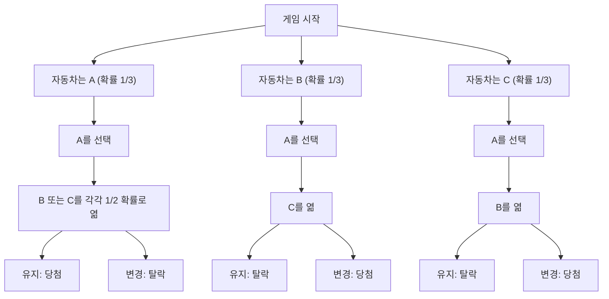
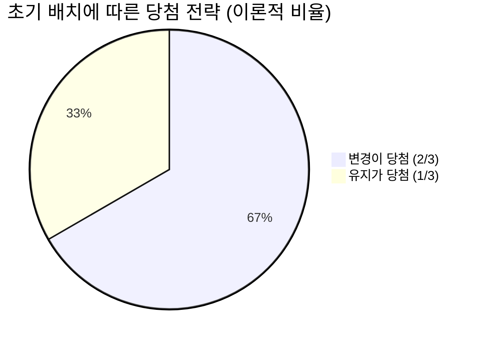

## 1. 세 개의 문과 먼저 정해야 할 규칙

자동차 한 대와 염소 두 마리가 있습니다. 닫힌 문 A, B, C 중 A를 고른 뒤 진행자가 다른 문을 열어 염소를 보여 줍니다. 남은 문으로 바꾸는 편이 나을까요?

몬티 홀 문제는 1990년 *Parade*의 「Ask Marilyn」 칼럼에 소개된 뒤 논쟁을 불러일으켰습니다. 역사와 서로 다른 수학적 정식화는 [Gill의 논문](https://pub.math.leidenuniv.nl/~gillrd/montyhall3.pdf), 진행자의 규칙을 바꾼 변형은 [Rosenthal의 논문](https://probability.ca/jeff/writing/montyfall.pdf)을 참고할 수 있습니다. 여기서는 다음 규칙을 둔 모형을 생각합니다.

1. 자동차는 세 문 뒤에 같은 확률로 놓입니다. 참가자는 자동차 위치에 관한 정보를 이용하지 않고 A를 고릅니다.
2. 진행자는 내용물을 알고 있으며, 참가자가 고른 A와 자동차가 있는 문은 열지 않습니다.
3. 매번 선택하지 않은 문 중 염소가 있는 문 하나를 열고, 반드시 선택하지 않은 나머지 문으로 바꿀 기회를 줍니다.
4. A에 자동차가 있어 다른 두 문에 모두 염소가 있다면, B와 C를 각각 1/2의 확률로 골라 엽니다.

같은 확률이라는 것은 자동차 배치에 관한 가정입니다. 위치를 모른다는 사실만으로 도출한 결론이 아닙니다. 자동차가 A, B, C에 있는 사건을 각각 C_A, C_B, C_C라고 하면

$$
\Pr(C_A)=\Pr(C_B)=\Pr(C_C)=\frac13
$$

입니다. 이 규칙 아래에서 처음부터 항상 바꾸기로 정한 전략의 당첨 확률은 2/3이고, 항상 처음 선택을 유지하는 전략은 1/3입니다. B가 열렸다고 관측한 뒤에도 변경 대상 C에 자동차가 있을 조건부 확률은 2/3입니다. **전략 전체의 당첨 확률과 특정 문이 열렸다는 조건 아래의 확률은 구분해서 계산해야 합니다.**

## 2. 세 가지 초기 배치 중 두 경우에는 바꾸면 당첨

아직 열린 문의 번호를 조건으로 삼지 않고, 자동차의 초기 위치에 따라 경우를 나눕니다.

| 자동차 위치(각각 1/3) | 진행자가 여는 문 | 유지 | 변경 |
| --- | --- | --- | --- |
| A | B 또는 C | 당첨 | 탈락 |
| B | C | 탈락 | 당첨 |
| C | B | 탈락 | 당첨 |

바꿔서 당첨되는 경우는 처음에 염소가 있는 문을 고른 경우와 정확히 일치합니다. 진행자가 반드시 염소가 있는 문을 제외하고 변경 기회를 주기 때문입니다.

$$
\Pr(\mathrm{stay\ wins})=\frac13,\qquad\Pr(\mathrm{switch\ wins})=\frac23
$$

2/3은 이 모형의 확률이며, 세 번 할 때마다 반드시 두 번 당첨된다는 보장은 아닙니다. 독립적으로 반복했을 때 표본 당첨 비율과 확률의 관계는 [대수의 법칙](https://kenji.blog/ko/p/law-of-large-numbers/)과도 연결됩니다.

## 3. B가 열린 뒤의 확률을 베이즈 정리로 계산하기

C_A, C_B, C_C는 자동차가 각각 A, B, C에 있는 사건이고, M_B는 진행자가 B를 여는 사건입니다. 규칙에서 다음 우도를 얻습니다.

$$
\Pr(M_B\mid C_A)=\frac12,\qquad\Pr(M_B\mid C_B)=0,\qquad\Pr(M_B\mid C_C)=1
$$

구하려는 것은 B가 열렸다는 정보를 조건으로 한 확률입니다. [베이즈 정리](https://kenji.blog/ko/p/bayes-theorem/)는 이 우도와 사전 확률을 결합합니다.

$$
\Pr(C_i\mid M_B)=\frac{\Pr(M_B\mid C_i)\Pr(C_i)}{\sum_{j\in\{A,B,C\}}\Pr(M_B\mid C_j)\Pr(C_j)}
$$

전확률의 법칙에 따라 B를 열 확률은

$$
\Pr(M_B)=\frac12\cdot\frac13+0\cdot\frac13+1\cdot\frac13=\frac12
$$

입니다. 따라서 처음 고른 A에 자동차가 있을 확률은

$$
\Pr(C_A\mid M_B)=\frac{(1/2)(1/3)}{1/2}=\frac13
$$

이고, 바꿔 고를 C에 자동차가 있을 확률은

$$
\Pr(C_C\mid M_B)=\frac{1\cdot(1/3)}{1/2}=\frac23
$$

입니다. A와 C가 여전히 닫혀 있다는 모습만으로 같은 확률이라고 판단할 수는 없습니다. 자동차 위치에 따라 B를 열 가능성이 달라진다는 점을 계산에 사용했습니다.

## 4. 직관 점검: 진행자의 정보와 문을 여는 규칙

둘이 남았으니 각각 절반이라는 직관은, 그 둘이 어떻게 남았는지를 고려하지 않습니다. 반대로 자동차 위치를 안다고 해서 열 문이 항상 하나로 정해지는 것은 아닙니다. 제1절의 진행자도 자동차가 A에 있으면 B와 C 중 하나를 무작위로 고릅니다. C가 남았다는 사실이 C를 열 수 없었다는 뜻도 아닙니다. 자동차가 A에 있었다면 C를 여는 것도 허용되기 때문입니다.

### 4.1. 염소가 있는 두 문 사이의 선택 경향

나머지 규칙은 유지하고, 자동차가 A에 있을 때 B를 열 확률만 q로 바꿉니다.

$$
q=\Pr(M_B\mid C_A),\qquad0\le q\le1
$$

이때

$$
\Pr(M_B)=\frac{1+q}{3}
$$

이므로, B가 열린 뒤의 확률은

$$
\Pr(C_A\mid M_B)=\frac{q}{1+q},\qquad\Pr(C_C\mid M_B)=\frac1{1+q}
$$

입니다. 마찬가지로 M_C를 진행자가 C를 여는 사건이라고 하면

$$
\Pr(M_C)=\frac{2-q}{3}
$$

$$
\Pr(C_A\mid M_C)=\frac{1-q}{2-q},\qquad\Pr(C_B\mid M_C)=\frac1{2-q}
$$

입니다. 예를 들어 q가 1이면 B가 열린 뒤 A와 C의 확률은 각각 1/2입니다. 반면 C가 열린 것을 관측하면 자동차는 확실히 B에 있습니다. 그래도 어떤 문이 열렸는지에 따라 가중 평균한, 항상 바꾸는 전략의 당첨 확률은

$$
\Pr(M_B)\Pr(C_C\mid M_B)+\Pr(M_C)\Pr(C_B\mid M_C)=\frac23
$$

로 유지됩니다. 특정 관측 이후의 확률을 계산하려면, 진행자가 어느 문 번호를 더 자주 고르는지도 모형에 포함해야 합니다.

### 4.2. 내용을 모르고 문을 여는 경우

다른 게임을 생각해 봅시다. 진행자는 자동차 위치를 모르고, A 이외의 B와 C를 각각 1/2의 확률로 고르며, 이 선택은 자동차 위치와 독립입니다. 이 규칙에서는 자동차가 드러날 수도 있습니다. 이제 B를 열었는데 염소가 있었다고 관측한 경우를 생각합니다.

이 진행자가 B를 여는 사건을 U_B, 열린 문에 염소가 있는 사건을 G라고 하면

$$
\Pr(U_B\cap G\mid C_A)=\frac12,\qquad\Pr(U_B\cap G\mid C_B)=0,\qquad\Pr(U_B\cap G\mid C_C)=\frac12
$$

입니다. 같은 사전 확률과 베이즈 정리를 사용하면

$$
\Pr(C_A\mid U_B\cap G)=\Pr(C_C\mid U_B\cap G)=\frac12
$$

을 얻습니다. 반드시 염소를 보여 주는 것과 우연히 염소를 보여 준 것은 관측이 생기는 방식이 다릅니다. 인간 심리에 대한 설명과 주어진 규칙 아래에서의 확률 계산은 구분해서 생각합니다.

## 5. 문이 백만 개여도 조건을 분명히 하기

문의 수를 n개로 늘려 1부터 n까지 번호를 붙입니다. 자동차 위치 C는 균등분포를 따르고, 첫 선택은 1로 고정합니다. 내용을 아는 진행자는 매번 선택하지 않은 문 중 염소가 있는 문 n−2개를 엽니다. 처음 고른 1 이외에 닫혀 있는 유일한 문을 R이라 하고, 진행자는 매번 R로 바꿀 기회를 줍니다. n은 3 이상의 정수입니다.

$$
\Pr(C=1)=\frac1n,\qquad\Pr(C=R)=\frac{n-1}{n}
$$

백만 개라면 항상 바꾸는 전략의 무조건부 당첨 확률은 999999/1000000입니다. 처음 고른 문에 염소가 있으면 바꾸는 쪽이 당첨된다는 구조가 같습니다.

이제 남은 문의 번호 R만을 조건으로 삼습니다. 처음 선택한 문에 자동차가 있을 때 진행자가 나머지 n−1개 문 중 R을 균등하게 고른다고 추가로 가정합시다. 그러면 처음 고른 1과 다른 특정 번호 r에 대해

$$
\Pr(C=r\mid R=r)=\frac{1/n}{(1/n)+(1/n)(1/(n-1))}=\frac{n-1}{n}
$$

입니다. 이 대칭적인 규칙이라면, 백만 개 중 777777번이 남았다고 관측해도 변경 대상의 당첨 확률은 999999/1000000입니다.

하지만 처음 선택한 문에 자동차가 있을 때 항상 같은 번호 r을 남기는 규칙이라면, 그 번호가 남았다고 관측한 뒤의 확률은

$$
\Pr(C=r\mid R=r)=\frac{1/n}{(1/n)+(1/n)}=\frac12
$$

입니다. 항상 바꾸는 전략의 전체 당첨 확률은 여전히 높더라도, 특정 번호를 관측한 뒤의 확률은 달라질 수 있습니다. 여기서 R만을 조건으로 삼을 때는 문을 여는 순서 등의 추가 정보는 포함하지 않습니다.

다음 그림은 제1절의 세 문 모형에서, 초기 배치에 따라 어느 전략이 당첨되는지를 나눈 이론적인 비율입니다. 수치 2와 1은 확률의 비이며 실제로 측정한 시행 횟수가 아닙니다.

## 6. 선택을 바꾸기 전에 가정과 정보 점검하기

이 문제는 어떤 상황에서든 선택을 바꾸면 성공 확률이 두 배가 된다는 뜻이 아닙니다. 확률을 계산하려면 자동차 배치, 진행자의 지식, 문을 여는 규칙, 변경 기회를 주는 규칙을 함께 정해야 합니다.

비즈니스와 일상에서도 새로운 정보를 얻었을 때 전제를 점검하고 필요하면 판단을 갱신하는 태도는 도움이 됩니다. 다만 실제 비용, 선호, 정보 수집 방식에는 각각의 모형이 필요하며, 이를 세 개의 문과 그대로 동일시해서는 안 됩니다.
