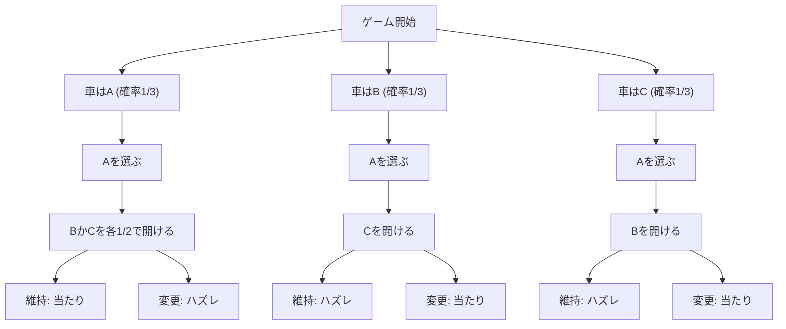
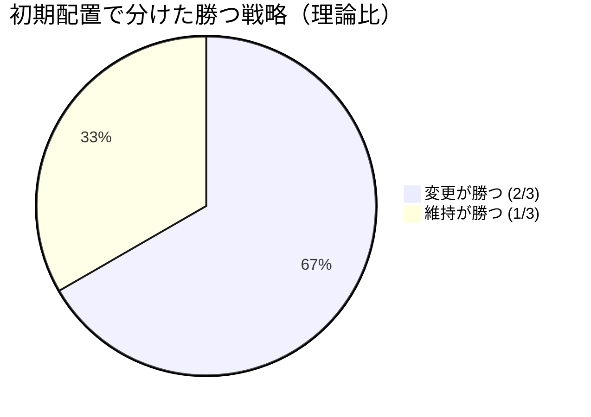

## 1. 3つのドアと、最初に決めるルール

車が1台、ヤギが2頭。閉じた3つのドアA・B・CからAを選んだ後、司会者が別のドアを開けてヤギを見せます。残るドアに変更した方がよいでしょうか。

モンティ・ホール問題は、1990年の『Parade』誌の「Ask Marilyn」で取り上げられ、議論を呼びました。歴史や異なる定式化については[Gillの論文](https://pub.math.leidenuniv.nl/~gillrd/montyhall3.pdf)、司会者の規則を変えた例については[Rosenthalの論文](https://probability.ca/jeff/writing/montyfall.pdf)を参照できます。ここでは、次のルールを置いたモデルを考えます。

1. 車の場所は3つのドアで等確率とし、参加者はその場所の情報を使わずにAを選ぶ。
2. 司会者は中身を知っており、参加者が選んだAも車のドアも開けない。
3. 毎回、未選択のヤギのドアを1枚開け、必ず残る未選択ドアへの変更を提案する。
4. Aが当たりでヤギのドアが2枚あるときは、BとCを各1/2で選んで開ける。

「分からないから等確率」なのではなく、車の配置について等確率を仮定しています。車がA・B・Cにある事象をC_A・C_B・C_Cと書くと、

$$
\Pr(C_A)=\Pr(C_B)=\Pr(C_C)=\frac13
$$

このルールの下では、最初から「必ず変更する」と決めた戦略の勝率は2/3、維持する戦略の勝率は1/3です。また、Bを開けたと観測した場合にも、変更先Cの条件付き当選確率は2/3になります。**戦略全体の勝率と、特定のドアを開けた条件付き確率は、区別して計算します。**

## 2. 初期配置を分けると、変更が勝つのは2ケース

まだ開けたドアの番号で条件付けず、車の初期位置で全体を分けます。

| 車の位置（各1/3） | 司会者が開けるドア | 維持 | 変更 |
| --- | --- | --- | --- |
| A | BまたはC | 当たり | ハズレ |
| B | C | ハズレ | 当たり |
| C | B | ハズレ | 当たり |

変更は、最初にハズレを選んだ場合にちょうど勝ちます。司会者が必ずヤギを除いて変更を提案するためです。

$$
\Pr(\mathrm{stay\ wins})=\frac13,\qquad\Pr(\mathrm{switch\ wins})=\frac23
$$

2/3はモデル上の確率で、「3回ごとに必ず2回勝つ」という保証ではありません。独立な反復での標本勝率と確率の関係は、[大数の法則](https://kenji.blog/p/law-of-large-numbers/)ともつながります。

## 3. Bを開けた後の確率をベイズの定理で求める

C_A・C_B・C_Cをそれぞれ車がA・B・Cにある事象、M_Bを司会者がBを開ける事象とします。ルールから、次の尤度が得られます。

$$
\Pr(M_B\mid C_A)=\frac12,\qquad\Pr(M_B\mid C_B)=0,\qquad\Pr(M_B\mid C_C)=1
$$

求めるのは、Bを開けたという情報で条件付けた確率です。[ベイズの定理](https://kenji.blog/p/bayes-theorem/)は、この尤度と事前確率を組み合わせます。

$$
\Pr(C_i\mid M_B)=\frac{\Pr(M_B\mid C_i)\Pr(C_i)}{\sum_{j\in\{A,B,C\}}\Pr(M_B\mid C_j)\Pr(C_j)}
$$

全確率の公式から、Bを開ける確率は

$$
\Pr(M_B)=\frac12\cdot\frac13+0\cdot\frac13+1\cdot\frac13=\frac12
$$

となります。したがって、維持先Aの当選確率は

$$
\Pr(C_A\mid M_B)=\frac{(1/2)(1/3)}{1/2}=\frac13
$$

変更先Cの当選確率は

$$
\Pr(C_C\mid M_B)=\frac{1\cdot(1/3)}{1/2}=\frac23
$$

です。AもCも閉まっているという見た目だけでは、等確率とはいえません。車の位置ごとに、Bを開ける可能性が異なることを使っています。

## 4. 直感を検査する：司会者の情報と扉選択の規則

「二つ残ったから半々」という直感では、残り方を考慮できません。一方で、司会者が車の場所を知っていることは、どのドアを開けるかが常に決定的であることを意味しません。第1節の司会者も、Aが当たりならB/Cを無作為に選びます。また、Cが残ったからといって、司会者がCを開けられなかったとは限りません。Aが当たりなら、Cも開けられたからです。

### 4.1. ヤギが2枚あるときの偏り

他のルールを保ち、Aが当たりの場合にBを開ける確率だけをqに変えます。

$$
q=\Pr(M_B\mid C_A),\qquad0\le q\le1
$$

そのとき

$$
\Pr(M_B)=\frac{1+q}{3}
$$

なので、Bを開けた後の確率は

$$
\Pr(C_A\mid M_B)=\frac{q}{1+q},\qquad\Pr(C_C\mid M_B)=\frac1{1+q}
$$

です。同様に、M_CをCを開ける事象とすると

$$
\Pr(M_C)=\frac{2-q}{3}
$$

$$
\Pr(C_A\mid M_C)=\frac{1-q}{2-q},\qquad\Pr(C_B\mid M_C)=\frac1{2-q}
$$

となります。たとえばqが1なら、Bを開けた後はAとCが各1/2です。一方、Cを開けた後はBが確実に当たりです。それでも、どちらを開けたかで平均した「必ず変更する」戦略の勝率は

$$
\Pr(M_B)\Pr(C_C\mid M_B)+\Pr(M_C)\Pr(C_B\mid M_C)=\frac23
$$

のままです。特定の観測後の確率を求めるときは、扉選択の偏りもモデルに含めます。

### 4.2. 中身を知らずに開けた場合

別のゲームとして、司会者が車の場所を知らず、A以外のB/Cを車の場所と独立に各1/2で開けるとします。車を見せる場合もある規則です。ここで「Bを開け、しかもヤギだった」と観測した場合を考えます。

U_Bをこの司会者がBを開ける事象、Gを開けた先がヤギである事象とすると

$$
\Pr(U_B\cap G\mid C_A)=\frac12,\qquad\Pr(U_B\cap G\mid C_B)=0,\qquad\Pr(U_B\cap G\mid C_C)=\frac12
$$

です。等しい事前確率とベイズの定理から

$$
\Pr(C_A\mid U_B\cap G)=\Pr(C_C\mid U_B\cap G)=\frac12
$$

となります。「必ずヤギを開ける」と「たまたまヤギだった」は違う観測の仕組みです。人の心理の説明と、与えたルールの下での確率計算は分けて考えます。

## 5. 100万枚でも、何に条件付けるかを確かめる

ドアをn枚に増やして1からnまで番号を付け、車の位置Cは一様、初期選択は1とします。司会者は毎回、中身を知って未選択のヤギをn−2枚開け、残る1枚Rへの変更を提案します。nは3以上の整数です。

$$
\Pr(C=1)=\frac1n,\qquad\Pr(C=R)=\frac{n-1}{n}
$$

100万枚なら、必ず変更する戦略の無条件勝率は999999/1000000です。これも「最初の選択がハズレなら変更が勝つ」という構造から分かります。

さらに、残った番号Rだけで条件付けるとします。初期選択が当たりのときに、司会者が残るn−1枚からRを一様に選ぶなら、初期選択1とは異なる特定の番号rに対して

$$
\Pr(C=r\mid R=r)=\frac{1/n}{(1/n)+(1/n)(1/(n-1))}=\frac{n-1}{n}
$$

です。この対称な規則なら、たとえば100万枚のうち777777番が残ったと観測しても、変更先の確率は999999/1000000です。

しかし、初期選択が当たりなら必ず同じ番号rを残す規則では、その番号が残った後の確率は

$$
\Pr(C=r\mid R=r)=\frac{1/n}{(1/n)+(1/n)}=\frac12
$$

になります。無条件の戦略勝率は依然として高くても、特定ラベルを見た後の確率は変わり得ます。開ける順序などの追加情報は、このRだけによる条件付けには含めていません。

次の図は、第1節の3枚モデルで、初期配置によってどちらの戦略が勝つかを分けた理論上の比です。数値2と1は確率の比で、実測した試行回数ではありません。

## 6. 選択を変える前に、仮定と情報を確かめる

この問題の学びは、選択を変えればどんな状況でも成功率が倍になるということではありません。車の配置、司会者の知識、開ける規則、変更を提案する規則をそろえると、初めて確率を計算できます。

ビジネスや生活でも、新しい情報を得たときに前提を点検し、必要なら判断を更新する姿勢は役立ちます。ただし、実際の費用・選好・情報の集め方を、3枚のドアのモデルと同一視しないことが大切です。
