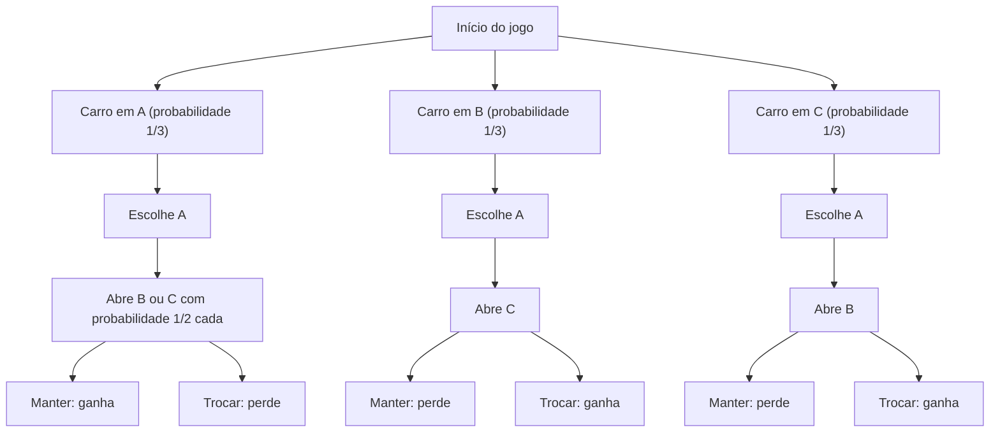
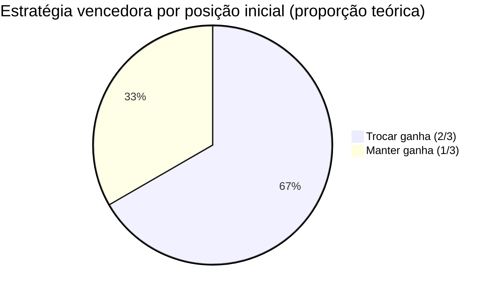

## 1. Três portas e as regras que precisamos definir

Um carro e duas cabras. Você escolhe A entre três portas fechadas, A, B e C. Depois, o apresentador abre outra porta e mostra uma cabra. É melhor trocar para a porta restante?

O problema de Monty Hall gerou debate após aparecer na coluna “Ask Marilyn” da revista *Parade* em 1990. [O artigo de Gill](https://pub.math.leidenuniv.nl/~gillrd/montyhall3.pdf) discute a história e diferentes formulações matemáticas; [o de Rosenthal](https://probability.ca/jeff/writing/montyfall.pdf) analisa variantes das regras do apresentador. Aqui usamos o seguinte modelo explícito.

1. O carro tem a mesma probabilidade de estar atrás de cada porta. Você escolhe A sem usar informação sobre sua localização.
2. O apresentador conhece o conteúdo das portas e não abre nem A nem a porta do carro.
3. Em toda partida, ele abre uma porta não escolhida que contém uma cabra e sempre oferece a troca para a outra porta não escolhida que continua fechada.
4. Se o carro estiver em A, as outras duas portas contêm cabras: ele escolhe abrir B ou C com probabilidade 1/2 para cada uma.

Probabilidades iguais são uma hipótese sobre a colocação do carro. Não saber onde ele está não basta para concluir que essas probabilidades são iguais. Denotamos por C_A, C_B e C_C os eventos de o carro estar em A, B e C, respectivamente.

$$
\Pr(C_A)=\Pr(C_B)=\Pr(C_C)=\frac13
$$

Sob essas regras, a estratégia de sempre trocar ganha com probabilidade 2/3; a de sempre manter a escolha inicial, com probabilidade 1/3. Depois de observar que o apresentador abriu B, a probabilidade condicional de o carro estar em C também é 2/3. **A probabilidade global de vitória de uma estratégia e a probabilidade condicionada à abertura de uma porta específica são cálculos diferentes.**

## 2. Trocar ganha em duas das três posições iniciais

Antes de usar como condição qual porta foi aberta, separamos os casos pela posição inicial do carro.

| Posição do carro (cada caso com probabilidade 1/3) | Porta que o apresentador abre | Manter | Trocar |
| --- | --- | --- | --- |
| A | B ou C | Ganha | Perde |
| B | C | Perde | Ganha |
| C | B | Perde | Ganha |

Trocar ganha se, e somente se, você escolheu uma porta com cabra no início. Isso acontece porque o apresentador sempre descarta uma porta com cabra e oferece a troca.

$$
\Pr(\mathrm{stay\ wins})=\frac13,\qquad\Pr(\mathrm{switch\ wins})=\frac23
$$

O valor 2/3 é uma probabilidade do modelo, não uma garantia de ganhar exatamente duas de cada três partidas. A relação entre probabilidades e frequências relativas de vitória em repetições independentes também se conecta à [lei dos grandes números](https://kenji.blog/pt/p/law-of-large-numbers/).

## 3. O teorema de Bayes depois de abrir B

C_A, C_B e C_C são os eventos de o carro estar em A, B e C; M_B é o evento de o apresentador abrir B. As regras fornecem estas verossimilhanças:

$$
\Pr(M_B\mid C_A)=\frac12,\qquad\Pr(M_B\mid C_B)=0,\qquad\Pr(M_B\mid C_C)=1
$$

Queremos probabilidades condicionadas à informação de que B foi aberta. O [teorema de Bayes](https://kenji.blog/pt/p/bayes-theorem/) combina essas verossimilhanças com as probabilidades a priori.

$$
\Pr(C_i\mid M_B)=\frac{\Pr(M_B\mid C_i)\Pr(C_i)}{\sum_{j\in\{A,B,C\}}\Pr(M_B\mid C_j)\Pr(C_j)}
$$

Pela lei da probabilidade total, a probabilidade de abrir B é

$$
\Pr(M_B)=\frac12\cdot\frac13+0\cdot\frac13+1\cdot\frac13=\frac12
$$

Logo, a probabilidade de o carro estar na porta inicial A é

$$
\Pr(C_A\mid M_B)=\frac{(1/2)(1/3)}{1/2}=\frac13
$$

e a de estar em C, o destino da troca, é

$$
\Pr(C_C\mid M_B)=\frac{1\cdot(1/3)}{1/2}=\frac23
$$

Ver A e C ainda fechadas não basta para concluir que são equiprováveis. O cálculo usa o fato de que a probabilidade de abrir B depende da posição do carro.

## 4. Testando a intuição: informação e regras do apresentador

A intuição “restam duas, então cada uma tem metade da probabilidade” ignora o processo que deixou essas duas portas fechadas. Por outro lado, saber onde está o carro não torna toda decisão do apresentador determinística. Na seção 1, ele ainda escolhe aleatoriamente entre B e C quando o carro está em A. Deixar C fechada também não demonstra que ele não podia abri-la: se o carro estiver em A, abrir C também é permitido.

### 4.1. Preferência entre as duas portas com cabra

Mantemos as outras regras e mudamos apenas para q a probabilidade de abrir B quando o carro está em A.

$$
q=\Pr(M_B\mid C_A),\qquad0\le q\le1
$$

Nesse caso,

$$
\Pr(M_B)=\frac{1+q}{3}
$$

de modo que as probabilidades depois de abrir B são

$$
\Pr(C_A\mid M_B)=\frac{q}{1+q},\qquad\Pr(C_C\mid M_B)=\frac1{1+q}
$$

Da mesma forma, se M_C é o evento de o apresentador abrir C,

$$
\Pr(M_C)=\frac{2-q}{3}
$$

$$
\Pr(C_A\mid M_C)=\frac{1-q}{2-q},\qquad\Pr(C_B\mid M_C)=\frac1{2-q}
$$

Por exemplo, com q igual a 1, observar B aberta deixa A e C com probabilidade 1/2 cada uma. Já observar C aberta implica que o carro certamente está em B. Mesmo assim, ao calcular a média ponderada pelas probabilidades das portas abertas, a probabilidade de vitória da estratégia de sempre trocar continua sendo

$$
\Pr(M_B)\Pr(C_C\mid M_B)+\Pr(M_C)\Pr(C_B\mid M_C)=\frac23
$$

Para calcular probabilidades após uma observação específica, é preciso incluir no modelo a preferência do apresentador por uma ou outra porta.

### 4.2. Abrir sem conhecer o conteúdo

Considere outro jogo: o apresentador não sabe onde está o carro e escolhe abrir B ou C com probabilidade 1/2 cada uma, independentemente da posição do carro. Essa regra pode revelar o carro. Agora observamos que ele abriu B e mostrou uma cabra.

Sejam U_B o evento de esse apresentador abrir B e G o evento de a porta aberta revelar uma cabra. Então

$$
\Pr(U_B\cap G\mid C_A)=\frac12,\qquad\Pr(U_B\cap G\mid C_B)=0,\qquad\Pr(U_B\cap G\mid C_C)=\frac12
$$

Com probabilidades a priori iguais e o teorema de Bayes, obtemos

$$
\Pr(C_A\mid U_B\cap G)=\Pr(C_C\mid U_B\cap G)=\frac12
$$

“Revelar sempre uma cabra” e “revelar uma cabra por acaso” descrevem mecanismos de observação diferentes. Explicar a psicologia humana e calcular probabilidades sob regras definidas são questões distintas.

## 5. Um milhão de portas também exige uma condição clara

Numeramos n portas de 1 a n. A posição C do carro tem distribuição uniforme entre elas, e a escolha inicial é fixada em 1. Em toda partida, o apresentador informado abre n−2 portas não escolhidas que contêm cabras e oferece a troca para a única porta não escolhida que continua fechada, R. Aqui n é um inteiro maior ou igual a 3.

$$
\Pr(C=1)=\frac1n,\qquad\Pr(C=R)=\frac{n-1}{n}
$$

Com um milhão de portas, a probabilidade incondicional de vitória da estratégia de sempre trocar é 999999/1000000. Vale o mesmo raciocínio: trocar ganha quando a porta inicial contém uma cabra.

Agora calculamos probabilidades condicionadas somente ao número R da porta restante. Suponha também que, quando a porta escolhida inicialmente contém o carro, o apresentador escolhe R uniformemente entre as outras n−1 portas. Para um número específico r diferente de 1, isso dá

$$
\Pr(C=r\mid R=r)=\frac{1/n}{(1/n)+(1/n)(1/(n-1))}=\frac{n-1}{n}
$$

Sob essa regra simétrica, observar que a porta 777777 ficou fechada entre um milhão ainda dá uma probabilidade de 999999/1000000 de ganhar ao trocar para ela.

Mas, se o apresentador sempre deixa esse mesmo número r quando a porta inicial contém o carro, então, após observar essa porta restante,

$$
\Pr(C=r\mid R=r)=\frac{1/n}{(1/n)+(1/n)}=\frac12
$$

A probabilidade global de vitória da estratégia de sempre trocar pode continuar alta, enquanto a probabilidade após observar um número específico muda. Não incluímos informações adicionais, como a ordem de abertura, nesse condicionamento baseado apenas em R.

O próximo diagrama separa as posições iniciais do modelo de três portas da seção 1 conforme a estratégia vencedora. Os valores 2 e 1 representam uma proporção teórica de probabilidades, não contagens de partidas realizadas.

## 6. Conferir hipóteses e informações antes de trocar

A lição não é que mudar uma escolha dobre o sucesso em qualquer situação. As probabilidades de vitória dependem da colocação do carro, do conhecimento do apresentador, da regra de abertura e da regra para oferecer a troca.

Nos negócios e no cotidiano, novas informações podem ajudar a rever hipóteses e atualizar decisões. Os custos, as preferências e as formas de coletar informações precisam de modelos próprios; não podem ser simplesmente equiparados a três portas.
