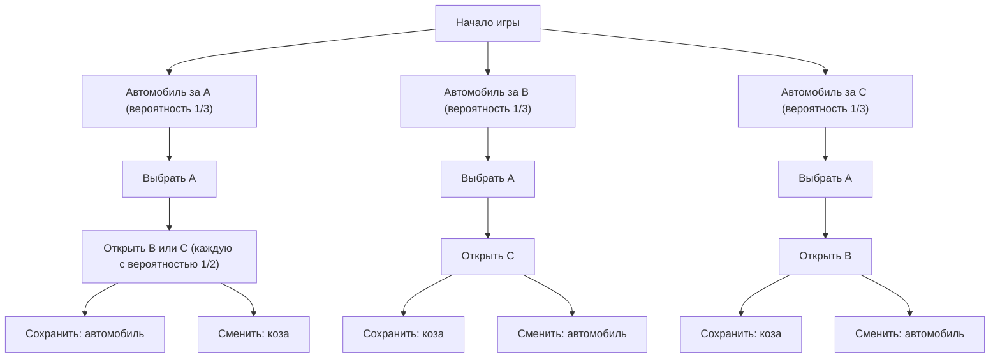
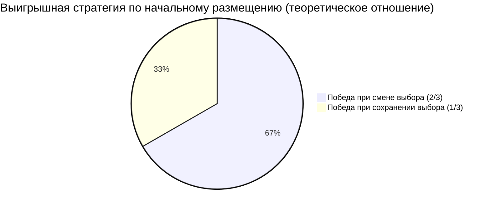

## 1. Три двери и правила, которые нужно задать заранее

Один автомобиль и две козы. Вы выбираете A из трёх закрытых дверей A, B и C. Затем ведущий открывает другую дверь и показывает козу. Стоит ли выбрать оставшуюся дверь?

Задача Монти Холла вызвала споры после появления в колонке «Ask Marilyn» журнала *Parade* в 1990 году. [Статья Гилла](https://pub.math.leidenuniv.nl/~gillrd/montyhall3.pdf) рассматривает историю и разные математические постановки, а [статья Розенталя](https://probability.ca/jeff/writing/montyfall.pdf) — варианты правил ведущего. Здесь мы используем следующую явно заданную модель.

1. Автомобиль с одинаковой вероятностью находится за каждой дверью. Вы выбираете A, не используя информацию о его расположении.
2. Ведущий знает содержимое дверей и не открывает ни A, ни дверь с автомобилем.
3. В каждой игре он открывает одну невыбранную дверь с козой и всегда предлагает перейти к другой невыбранной двери, которая остаётся закрытой.
4. Если автомобиль за A, за обеими другими дверями козы. Тогда он открывает B или C, выбирая каждую из этих дверей с вероятностью 1/2.

Равные вероятности — предположение о размещении автомобиля, а не следствие одного лишь незнания его положения. Обозначим через C_A, C_B и C_C события, что автомобиль находится за A, B и C соответственно.

$$
\Pr(C_A)=\Pr(C_B)=\Pr(C_C)=\frac13
$$

При этих правилах заранее выбранная стратегия «всегда менять выбор» выигрывает с вероятностью 2/3, а стратегия «всегда сохранять первый выбор» — с вероятностью 1/3. После наблюдения, что ведущий открыл B, условная вероятность того, что автомобиль находится за C, также равна 2/3. **Вероятность выигрыша стратегии в целом и условная вероятность после открытия определённой двери — разные расчёты.**

## 2. Смена выбора даёт выигрыш в двух из трёх начальных размещений

Пока не учитываем, какая именно дверь была открыта, а разделяем случаи только по исходному положению автомобиля.

| Положение автомобиля (каждый случай имеет вероятность 1/3) | Какую дверь открывает ведущий | Сохранить выбор | Сменить выбор |
| --- | --- | --- | --- |
| A | B или C | Автомобиль | Коза |
| B | C | Коза | Автомобиль |
| C | B | Коза | Автомобиль |

Смена выбора приводит к выигрышу тогда и только тогда, когда сначала была выбрана дверь с козой. Ведь ведущий всегда исключает из выбора одну дверь с козой и предлагает сменить выбор.

$$
\Pr(\mathrm{stay\ wins})=\frac13,\qquad\Pr(\mathrm{switch\ wins})=\frac23
$$

Значение 2/3 — вероятность в модели, а не гарантия ровно двух побед в каждой тройке игр. Связь вероятностей с выборочными долями побед при независимых повторениях также относится к [закону больших чисел](https://kenji.blog/ru/p/law-of-large-numbers/).

## 3. Теорема Байеса после открытия B

C_A, C_B и C_C — события, что автомобиль находится за A, B и C; M_B — событие, что ведущий открывает B. Правила дают следующие значения правдоподобия:

$$
\Pr(M_B\mid C_A)=\frac12,\qquad\Pr(M_B\mid C_B)=0,\qquad\Pr(M_B\mid C_C)=1
$$

Нужны вероятности при условии, что B открыта. [Теорема Байеса](https://kenji.blog/ru/p/bayes-theorem/) объединяет эти значения правдоподобия с априорными вероятностями.

$$
\Pr(C_i\mid M_B)=\frac{\Pr(M_B\mid C_i)\Pr(C_i)}{\sum_{j\in\{A,B,C\}}\Pr(M_B\mid C_j)\Pr(C_j)}
$$

По формуле полной вероятности вероятность открытия B равна

$$
\Pr(M_B)=\frac12\cdot\frac13+0\cdot\frac13+1\cdot\frac13=\frac12
$$

Следовательно, вероятность того, что автомобиль находится за первоначально выбранной дверью A, равна

$$
\Pr(C_A\mid M_B)=\frac{(1/2)(1/3)}{1/2}=\frac13
$$

Для двери C, которую можно выбрать вместо A, получаем

$$
\Pr(C_C\mid M_B)=\frac{1\cdot(1/3)}{1/2}=\frac23
$$

Одного вида двух закрытых дверей A и C недостаточно, чтобы объявить их равновероятными. Расчёт учитывает, что вероятность открыть B зависит от расположения автомобиля.

## 4. Проверяем интуицию: информация и правила ведущего

Интуиция «осталось два варианта, значит, каждому достаётся половина вероятности» не учитывает, как они остались. И наоборот, знание положения автомобиля не делает все решения ведущего детерминированными. В разделе 1 он по-прежнему выбирает B или C случайно, если автомобиль за A. То, что C осталась закрытой, также не доказывает невозможность её открыть: если автомобиль за A, открыть C тоже разрешено.

### 4.1. Предпочтение одной из двух дверей с козами

Сохраним остальные правила, но изменим на q вероятность открыть B, когда автомобиль за A.

$$
q=\Pr(M_B\mid C_A),\qquad0\le q\le1
$$

Тогда

$$
\Pr(M_B)=\frac{1+q}{3}
$$

поэтому после открытия B получаем

$$
\Pr(C_A\mid M_B)=\frac{q}{1+q},\qquad\Pr(C_C\mid M_B)=\frac1{1+q}
$$

Аналогично, если M_C — событие открытия C ведущим,

$$
\Pr(M_C)=\frac{2-q}{3}
$$

$$
\Pr(C_A\mid M_C)=\frac{1-q}{2-q},\qquad\Pr(C_B\mid M_C)=\frac1{2-q}
$$

Например, при q равном 1 после наблюдения открытой B вероятности для A и C равны 1/2 каждая. Если же наблюдается открытая C, автомобиль наверняка за B. Тем не менее после усреднения с весами, равными вероятностям открытия дверей, вероятность выигрыша стратегии «всегда менять выбор» остаётся

$$
\Pr(M_B)\Pr(C_C\mid M_B)+\Pr(M_C)\Pr(C_B\mid M_C)=\frac23
$$

При расчёте вероятности после определённого наблюдения нужно включить в модель то, с какой вероятностью ведущий выбирает каждую из дверей.

### 4.2. Открытие без знания содержимого

Рассмотрим другую игру: ведущий не знает, где автомобиль, и открывает B или C, выбирая каждую из них с вероятностью 1/2 независимо от положения автомобиля. При таком правиле можно открыть дверь с автомобилем. Теперь мы наблюдаем, что он открыл B и показал козу.

Обозначим через U_B событие, что этот ведущий открывает B, а через G — событие, что за открытой дверью коза. Тогда

$$
\Pr(U_B\cap G\mid C_A)=\frac12,\qquad\Pr(U_B\cap G\mid C_B)=0,\qquad\Pr(U_B\cap G\mid C_C)=\frac12
$$

При равных априорных вероятностях теорема Байеса даёт

$$
\Pr(C_A\mid U_B\cap G)=\Pr(C_C\mid U_B\cap G)=\frac12
$$

«Всегда показывать козу» и «случайно показать козу» — разные механизмы наблюдения. Объяснение человеческой психологии и расчёт вероятностей при заданных правилах — разные вопросы.

## 5. Миллион дверей тоже требует ясного условия

Пронумеруем n дверей от 1 до n. Положение автомобиля C равномерно распределено по этим номерам, а первый выбор фиксирован как 1. В каждой игре знающий содержимое ведущий открывает n−2 невыбранные двери с козами и предлагает перейти к единственной оставшейся закрытой невыбранной двери R. Здесь n — целое число не меньше 3.

$$
\Pr(C=1)=\frac1n,\qquad\Pr(C=R)=\frac{n-1}{n}
$$

Для миллиона дверей безусловная вероятность выигрыша стратегии «всегда менять выбор» равна 999999/1000000. Рассуждение то же: смена выбора даёт выигрыш, если сначала выбрана дверь с козой.

Теперь вычислим условные вероятности, используя только наблюдаемый номер R оставшейся двери. Дополнительно предположим: если за первоначально выбранной дверью автомобиль, ведущий выбирает R равномерно из остальных n−1 дверей. Для определённого номера r, отличного от 1, получаем

$$
\Pr(C=r\mid R=r)=\frac{1/n}{(1/n)+(1/n)(1/(n-1))}=\frac{n-1}{n}
$$

При таком симметричном правиле даже наблюдение, что из миллиона дверей осталась закрытой дверь 777777, даёт вероятность 999999/1000000 выиграть при переходе к ней.

Но если ведущий всегда оставляет тот же номер r, когда автомобиль за первоначальной дверью, то после наблюдения этой оставшейся двери

$$
\Pr(C=r\mid R=r)=\frac{1/n}{(1/n)+(1/n)}=\frac12
$$

Общая вероятность выигрыша стратегии «всегда менять выбор» может остаться высокой, хотя вероятность после наблюдения конкретного номера изменится. В этом расчёте учитывается только R, без дополнительной информации, например о порядке открытия дверей.

Следующая диаграмма разделяет начальные размещения модели с тремя дверями из раздела 1 по тому, какая стратегия выигрывает. Числа 2 и 1 — теоретическое отношение вероятностей, а не количества реально сыгранных игр.

## 6. Проверить предположения и информацию перед сменой выбора

Задача не означает, что смена выбора удваивает вероятность успеха в любой ситуации. Вероятности выигрыша зависят от размещения автомобиля, знаний ведущего, правила открытия и правила предложения сменить выбор.

В бизнесе и повседневной жизни новая информация может помочь пересмотреть предположения и скорректировать решения. Реальные затраты, предпочтения и способы получения информации требуют собственных моделей; их нельзя просто приравнять к трём дверям.
