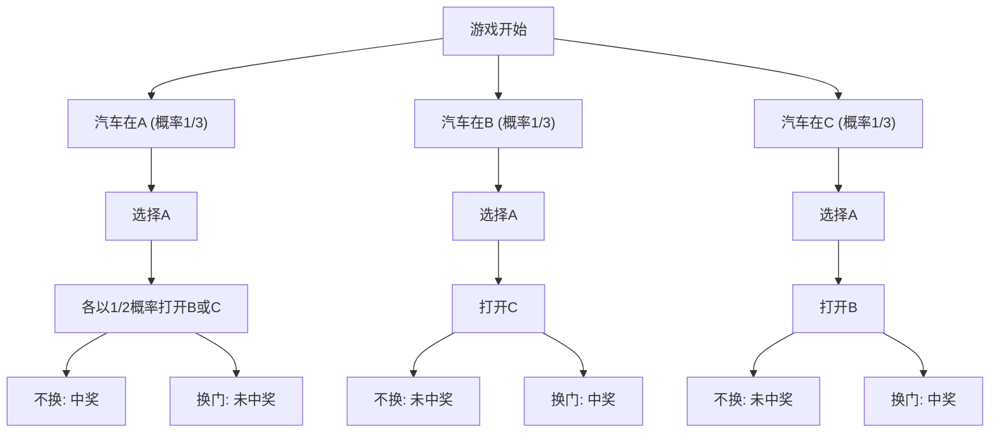
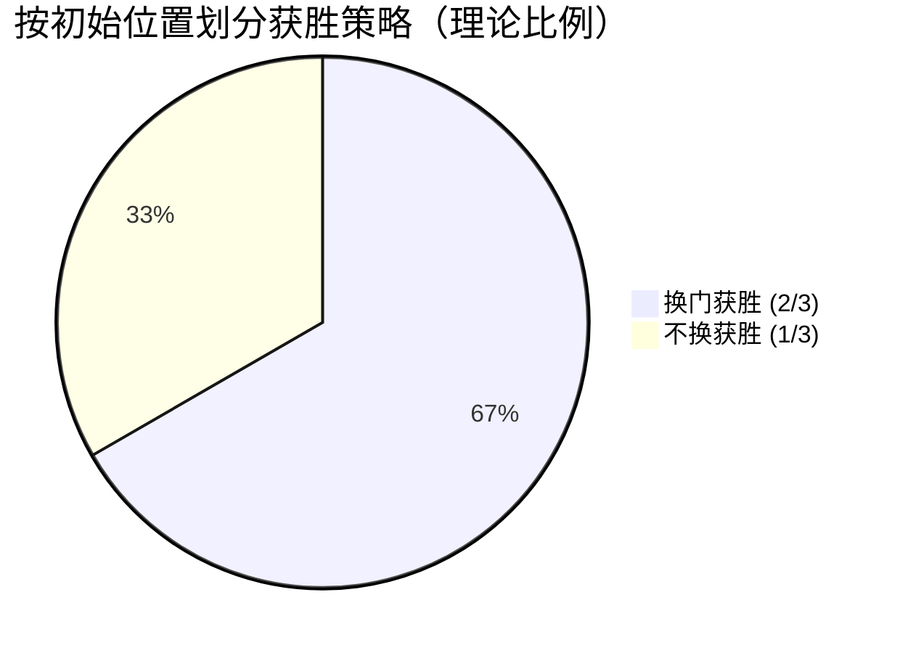

## 1. 三扇门与首先要明确的规则

一辆汽车，两只山羊。你从关闭的A、B、C三扇门中选了A，随后主持人打开另一扇门，让你看到山羊。换到剩下的门会更好吗？

蒙提·霍尔问题在1990年《Parade》杂志的“Ask Marilyn”专栏中出现后引发了讨论。[Gill的论文](https://pub.math.leidenuniv.nl/~gillrd/montyhall3.pdf)讨论了历史和不同的数学表述；[Rosenthal的论文](https://probability.ca/jeff/writing/montyfall.pdf)分析了主持人规则改变后的变体。本文采用以下明确的模型。

1. 汽车等概率地位于三扇门后。你在不利用汽车位置信息的情况下选择A。
2. 主持人知道门后的内容，既不打开你选的A，也不打开汽车所在的门。
3. 每次都打开一扇未被选择的山羊门，并且总会提议你换到剩下的未选门。
4. 如果汽车在A后，另两扇门都是山羊，主持人就以各1/2的概率选择打开B或C。

等概率是对汽车放置方式的假设，而不是从“不知道在哪儿”推导出的结论。用C_A、C_B、C_C分别表示汽车在A、B、C后的事件，则

$$
\Pr(C_A)=\Pr(C_B)=\Pr(C_C)=\frac13
$$

按这些规则，预先决定“始终换门”的策略胜率为2/3，始终不换的策略胜率为1/3。观察到主持人打开B之后，换门目标C中有车的条件概率也为2/3。**整个策略的胜率与观察到某扇特定门被打开后的条件概率，是需要分别计算的量。**

## 2. 三种初始位置中，有两种换门会赢

先不以打开的门号为条件，只按汽车的初始位置分类。

| 汽车位置（各1/3） | 主持人打开的门 | 不换 | 换门 |
| --- | --- | --- | --- |
| A | B或C | 中奖 | 未中奖 |
| B | C | 未中奖 | 中奖 |
| C | B | 未中奖 | 中奖 |

换门获胜，当且仅当最初选中的是山羊。这是因为主持人总会排除一扇山羊门，并提供换门机会。

$$
\Pr(\mathrm{stay\ wins})=\frac13,\qquad\Pr(\mathrm{switch\ wins})=\frac23
$$

2/3是模型中的概率，不保证“每玩三次就恰好赢两次”。独立重复游戏时，样本胜率与概率的关系也与[大数定律](https://kenji.blog/zh-cn/p/law-of-large-numbers/)有关。

## 3. 用贝叶斯定理计算打开B后的概率

C_A、C_B、C_C分别是汽车在A、B、C后的事件，M_B是主持人打开B的事件。规则给出以下似然：

$$
\Pr(M_B\mid C_A)=\frac12,\qquad\Pr(M_B\mid C_B)=0,\qquad\Pr(M_B\mid C_C)=1
$$

我们要计算的是以“B被打开”为条件的概率。[贝叶斯定理](https://kenji.blog/zh-cn/p/bayes-theorem/)把这些似然与先验概率结合起来。

$$
\Pr(C_i\mid M_B)=\frac{\Pr(M_B\mid C_i)\Pr(C_i)}{\sum_{j\in\{A,B,C\}}\Pr(M_B\mid C_j)\Pr(C_j)}
$$

根据全概率公式，打开B的概率为

$$
\Pr(M_B)=\frac12\cdot\frac13+0\cdot\frac13+1\cdot\frac13=\frac12
$$

所以，原先选择的A后面有车的概率为

$$
\Pr(C_A\mid M_B)=\frac{(1/2)(1/3)}{1/2}=\frac13
$$

而换门目标C后面有车的概率为

$$
\Pr(C_C\mid M_B)=\frac{1\cdot(1/3)}{1/2}=\frac23
$$

仅仅看到A和C仍然关闭，并不能说明它们等概率。计算用到的是：汽车位置不同，主持人打开B的可能性也不同。

## 4. 检验直觉：主持人的信息与开门规则

“剩下两个，所以各占一半”的直觉忽略了它们是怎样被留下的。反过来，知道汽车位置也不意味着主持人每次的选择都是确定的。第1节的主持人在汽车位于A后时，仍然会随机选择B或C。而且，留下C不代表主持人不能打开C：如果汽车在A后，打开C原本也是允许的。

### 4.1. 主持人更偏向打开哪扇山羊门

保持其他规则不变，只把汽车在A后时打开B的概率改为q。

$$
q=\Pr(M_B\mid C_A),\qquad0\le q\le1
$$

此时

$$
\Pr(M_B)=\frac{1+q}{3}
$$

因此，打开B后的概率为

$$
\Pr(C_A\mid M_B)=\frac{q}{1+q},\qquad\Pr(C_C\mid M_B)=\frac1{1+q}
$$

同样，用M_C表示主持人打开C的事件，则

$$
\Pr(M_C)=\frac{2-q}{3}
$$

$$
\Pr(C_A\mid M_C)=\frac{1-q}{2-q},\qquad\Pr(C_B\mid M_C)=\frac1{2-q}
$$

例如，q等于1时，看到B被打开后，A和C各有1/2的概率；但看到C被打开后，汽车就一定在B后。即便如此，按打开哪扇门的概率加权平均，“始终换门”策略的胜率仍为

$$
\Pr(M_B)\Pr(C_C\mid M_B)+\Pr(M_C)\Pr(C_B\mid M_C)=\frac23
$$

计算某个特定观察结果后的概率时，需要把主持人对门号的选择偏向也纳入模型。

### 4.2. 不知道门后内容而开门

考虑另一个游戏：主持人不知道汽车的位置，以各1/2的概率打开A以外的B或C，而且该选择与汽车位置独立。这样的规则也可能把汽车展示出来。现在假设我们观察到“主持人打开B，而且后面是山羊”。

令U_B表示这位主持人打开B的事件，G表示打开的门后是山羊的事件，则

$$
\Pr(U_B\cap G\mid C_A)=\frac12,\qquad\Pr(U_B\cap G\mid C_B)=0,\qquad\Pr(U_B\cap G\mid C_C)=\frac12
$$

由相等的先验概率和贝叶斯定理可得

$$
\Pr(C_A\mid U_B\cap G)=\Pr(C_C\mid U_B\cap G)=\frac12
$$

“总是打开山羊门”与“碰巧打开了山羊门”是不同的观察机制。解释人的心理与在给定规则下计算概率，是不同的问题。

## 5. 一百万扇门也要明确条件

把门增至n扇，编号为1到n，汽车位置C服从均匀分布，最初选择固定为1。知道内容的主持人每次都打开n−2扇未选的山羊门，并提议换到唯一剩下的未选门R。这里n是至少为3的整数。

$$
\Pr(C=1)=\frac1n,\qquad\Pr(C=R)=\frac{n-1}{n}
$$

如果有一百万扇门，始终换门的无条件胜率就是999999/1000000。道理相同：只要初始选择是山羊，换门就会赢。

接着，只以剩下的门号R为条件。进一步假设，当最初选中的门后有车时，主持人从其余n−1扇门中等概率地选择一扇R留下。这样，对不同于初始选择1的某个特定门号r，

$$
\Pr(C=r\mid R=r)=\frac{1/n}{(1/n)+(1/n)(1/(n-1))}=\frac{n-1}{n}
$$

在这种对称规则下，即使看到一百万扇门中的777777号被留下，换门目标有车的概率也为999999/1000000。

但如果主持人在最初选中的门后有车时，总是留下同一个门号r，那么看到该门号被留下之后，概率为

$$
\Pr(C=r\mid R=r)=\frac{1/n}{(1/n)+(1/n)}=\frac12
$$

即使始终换门策略的整体胜率仍然很高，观察到特定门号后的概率也可能改变。这里仅以R为条件，没有加入开门顺序等额外信息。

下图按第1节三门模型的初始位置，划分哪种策略会赢，展示的是理论比例。数值2和1表示概率之比，不是实测的试验次数。

## 6. 改变选择前，先检查假设与信息

这个问题并不意味着在任何情境中改变选择都能让成功率翻倍。计算获胜概率，需要明确汽车的放置方式、主持人的知识、开门规则和提供换门机会的规则。

在商业和日常生活中，获得新信息后检查前提、必要时更新判断，是有益的做法。但实际的成本、偏好和信息收集方式都需要各自的模型，不能直接等同于三扇门的游戏。
