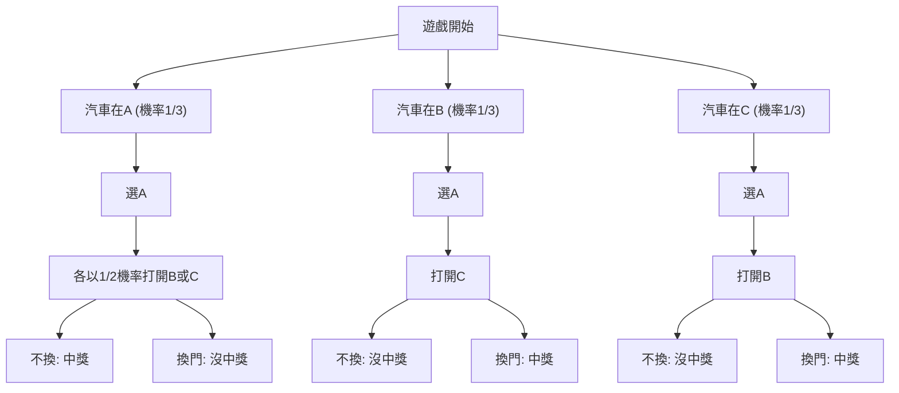
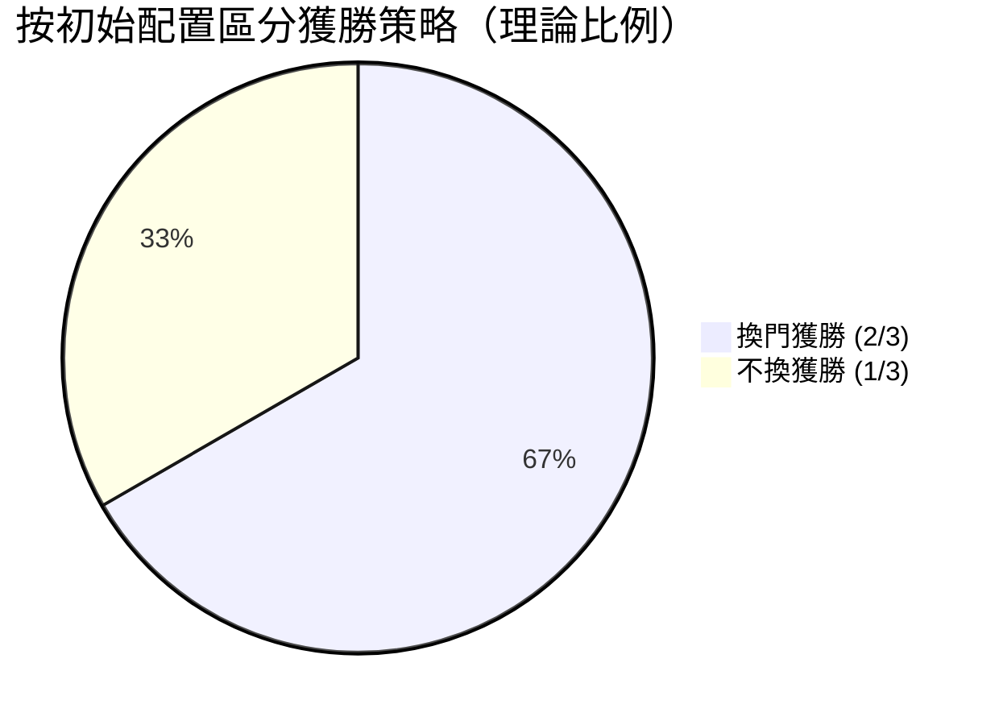

## 1. 三扇門，以及必須先說清楚的規則

一輛汽車、兩隻山羊。你從關著的A、B、C三扇門中選了A，接著主持人打開另一扇門，讓你看到山羊。改選剩下的門會比較好嗎？

蒙提霍爾問題在1990年《Parade》雜誌的「Ask Marilyn」專欄刊出後引發討論。[Gill的論文](https://pub.math.leidenuniv.nl/~gillrd/montyhall3.pdf)討論歷史與不同的數學表述；[Rosenthal的論文](https://probability.ca/jeff/writing/montyfall.pdf)則分析主持人規則改變後的變體。本文採用以下明確的模型。

1. 汽車位於三扇門後的機率相同。你不利用汽車位置的資訊，先選A。
2. 主持人知道門後的內容，既不打開你選的A，也不打開汽車所在的門。
3. 每次都打開一扇未選的山羊門，並且一定提供改選剩下那扇未選門的機會。
4. 如果汽車在A後，另兩扇門都是山羊，主持人便各以1/2的機率選擇打開B或C。

等機率是對汽車放置方式的假設，不能僅由「不知道在哪裡」推得。以C_A、C_B、C_C分別表示汽車在A、B、C後的事件，則

$$
\Pr(C_A)=\Pr(C_B)=\Pr(C_C)=\frac13
$$

在這些規則下，事先決定「始終換門」的策略勝率為2/3，始終維持原選擇的策略勝率為1/3。觀測到主持人打開B之後，改選目標C有車的條件機率也為2/3。**整個策略的勝率，與觀測到某扇特定門被打開後的條件機率，是需要分別計算的量。**

## 2. 三種初始配置中，有兩種換門會贏

先不以被打開的門號為條件，只按汽車的初始位置分類。

| 汽車位置（各1/3） | 主持人打開的門 | 不換 | 換門 |
| --- | --- | --- | --- |
| A | B或C | 中獎 | 沒中獎 |
| B | C | 沒中獎 | 中獎 |
| C | B | 沒中獎 | 中獎 |

換門獲勝，若且唯若一開始選到的是山羊。這是因為主持人每次都排除一扇山羊門，並提供換門機會。

$$
\Pr(\mathrm{stay\ wins})=\frac13,\qquad\Pr(\mathrm{switch\ wins})=\frac23
$$

2/3是模型中的機率，不保證「每玩三次就剛好贏兩次」。獨立重複遊戲時，樣本勝率與機率的關係，也與[大數法則](https://kenji.blog/zh-tw/p/law-of-large-numbers/)有關。

## 3. 用貝氏定理計算打開B後的機率

C_A、C_B、C_C分別是汽車在A、B、C後的事件，M_B是主持人打開B的事件。規則給出下列概似：

$$
\Pr(M_B\mid C_A)=\frac12,\qquad\Pr(M_B\mid C_B)=0,\qquad\Pr(M_B\mid C_C)=1
$$

我們要計算的是以「B被打開」為條件的機率。[貝氏定理](https://kenji.blog/zh-tw/p/bayes-theorem/)將這些概似與先驗機率結合。

$$
\Pr(C_i\mid M_B)=\frac{\Pr(M_B\mid C_i)\Pr(C_i)}{\sum_{j\in\{A,B,C\}}\Pr(M_B\mid C_j)\Pr(C_j)}
$$

根據全機率公式，打開B的機率為

$$
\Pr(M_B)=\frac12\cdot\frac13+0\cdot\frac13+1\cdot\frac13=\frac12
$$

因此，原選擇A後面有車的機率為

$$
\Pr(C_A\mid M_B)=\frac{(1/2)(1/3)}{1/2}=\frac13
$$

改選目標C後面有車的機率則為

$$
\Pr(C_C\mid M_B)=\frac{1\cdot(1/3)}{1/2}=\frac23
$$

光是看到A和C仍然關著，並不能認定兩者等機率。計算用到的是：汽車位置不同，主持人打開B的可能性也不同。

## 4. 檢驗直覺：主持人的資訊與開門規則

「剩下兩個，所以各占一半」的直覺，沒有考慮它們如何被留下。反過來，知道汽車位置，也不代表主持人每一次的選擇都已確定。第1節的主持人在汽車位於A後時，仍會隨機選B或C。而且，C被留下不代表主持人無法打開C：如果汽車在A後，打開C原本也是允許的。

### 4.1. 主持人偏向打開哪扇山羊門

保持其他規則不變，只把汽車在A後時打開B的機率改成q。

$$
q=\Pr(M_B\mid C_A),\qquad0\le q\le1
$$

此時

$$
\Pr(M_B)=\frac{1+q}{3}
$$

所以打開B後的機率為

$$
\Pr(C_A\mid M_B)=\frac{q}{1+q},\qquad\Pr(C_C\mid M_B)=\frac1{1+q}
$$

同樣地，若M_C表示主持人打開C的事件，則

$$
\Pr(M_C)=\frac{2-q}{3}
$$

$$
\Pr(C_A\mid M_C)=\frac{1-q}{2-q},\qquad\Pr(C_B\mid M_C)=\frac1{2-q}
$$

例如，q等於1時，觀測到B被打開後，A和C各有1/2的機率；但觀測到C被打開後，汽車就一定在B後。即使如此，依打開哪扇門的機率加權平均，「始終換門」策略的勝率仍為

$$
\Pr(M_B)\Pr(C_C\mid M_B)+\Pr(M_C)\Pr(C_B\mid M_C)=\frac23
$$

計算某個特定觀測結果之後的機率時，需要把主持人對門號的選擇偏向也納入模型。

### 4.2. 不知道門後內容而開門

考慮另一個遊戲：主持人不知道汽車的位置，各以1/2的機率打開A以外的B或C，且這項選擇與汽車位置獨立。這種規則也可能把汽車展示出來。現在假設觀測到「主持人打開B，而且後面是山羊」。

以U_B表示這位主持人打開B的事件，G表示打開的門後是山羊的事件，則

$$
\Pr(U_B\cap G\mid C_A)=\frac12,\qquad\Pr(U_B\cap G\mid C_B)=0,\qquad\Pr(U_B\cap G\mid C_C)=\frac12
$$

由相同的先驗機率與貝氏定理可得

$$
\Pr(C_A\mid U_B\cap G)=\Pr(C_C\mid U_B\cap G)=\frac12
$$

「每次都打開山羊門」與「剛好打開了山羊門」是不同的觀測機制。解釋人的心理，與計算給定規則下的機率，是不同的問題。

## 5. 一百萬扇門也要說清楚條件

把門增至n扇，編號為1到n，汽車位置C服從均勻分布，初始選擇固定為1。知道內容的主持人每次都打開n−2扇未選的山羊門，並提議改選唯一剩下的未選門R。這裡n是至少為3的整數。

$$
\Pr(C=1)=\frac1n,\qquad\Pr(C=R)=\frac{n-1}{n}
$$

如果有一百萬扇門，始終換門的無條件勝率就是999999/1000000。道理相同：只要初始選擇是山羊，換門就會贏。

接著，只以剩下的門號R為條件。進一步假設，當最初選中的門後有車時，主持人從其餘n−1扇門中等機率地選一扇R留下。於是，對不同於初始選擇1的某個特定門號r，

$$
\Pr(C=r\mid R=r)=\frac{1/n}{(1/n)+(1/n)(1/(n-1))}=\frac{n-1}{n}
$$

在這種對稱規則下，即使看到一百萬扇門中的777777號被留下，改選目標有車的機率也為999999/1000000。

但如果主持人在最初選中的門後有車時，總是留下同一個門號r，那麼看到該門號被留下之後，機率為

$$
\Pr(C=r\mid R=r)=\frac{1/n}{(1/n)+(1/n)}=\frac12
$$

即使始終換門策略的整體勝率仍然很高，觀測到特定門號後的機率也可能改變。這裡只以R為條件，沒有加入開門順序等額外資訊。

下圖按第1節三門模型的初始配置，區分哪種策略會贏，呈現的是理論比例。數值2與1表示機率之比，不是實測的試驗次數。

## 6. 改變選擇前，先檢查假設與資訊

這個問題並不表示在任何情境中改變選擇，都能讓成功率加倍。計算獲勝機率，需要說清楚汽車的放置方式、主持人的知識、開門規則與提供換門機會的規則。

在商業與日常生活中，獲得新資訊後檢查前提、必要時更新判斷，是有幫助的做法。但實際的成本、偏好與資訊蒐集方式都需要各自的模型，不能直接等同於三扇門的遊戲。
