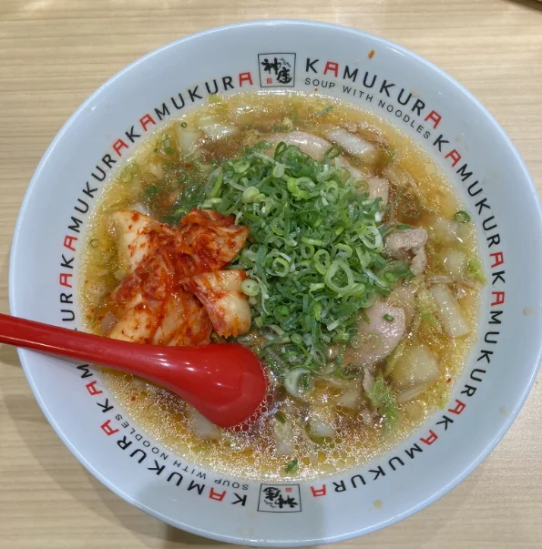

---

title: "Volví a Kamukura y probé el ramen de negi y kimchi"
slug: "何年かぶりのKamukura（かむくら）（Ramen）"
date: 2022-09-09T21:45:19+09:00
lastmod: 2026-11-24T00:00:00+09:00
tags: ["Ramen", "Kamukura"]
draft: false
image: "images/img2.webp"
categories: ["it-technology"]
description: "Nota personal breve sobre mi regreso a Dotonbori Kamukura después de varios años y el ramen de negi y kimchi que comí."
---

Fui a Kamukura (Ramen) por primera vez en varios años.

**Ramen de cebolla verde y kimchi**

Estaba delicioso. Es un sabor que a veces te dan ganas de comer.
